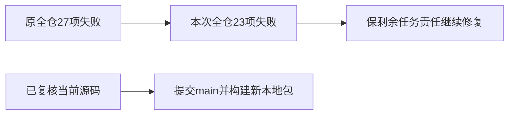

# T1190/T1191 当前全仓对账

实际1371.561389秒、exit1、23 ERROR/1 WARN；原27项中LED014/017/018/020消除，没有新ERROR标识。剩余19项原审核链与LED042/054/058/053均保留旧责任，不能签全绿。T1188雷达三旧呈现失败、T1189七Worker状态失败以及timeout27静态失败另有真实公共日志；本总表不凭同标识倒签相同根因。

T1190仅补完整ctx缺失的三组字段；T1187替身接口由T1191当前源独立复核。各自局部要求已发生的通过证据另存；本全仓失败是这些任务范围外旧欠债。T1191界面、真实回执核对/模型/安装、新包及全部功能验收仍不代签，T1193另登记输入回填/可点击状态。完整原log/receipt保SHA，不改预算、权限、schema或validator。

本轮研究暂停仍为T1135/T1155/T1181，上传2/2用尽原样保留；原真人微信不介入。仅后续新包隔离smoke，不替换/启动真实用户App，不做备份。
