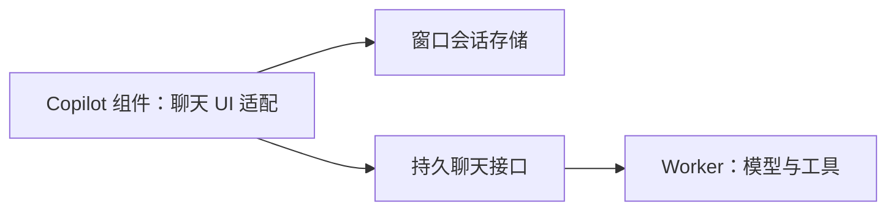

# T-1016 聊天会话的前端依赖边界

## 改动

`live-chat-session.ts` 只保存当前窗口的会话对象、任务控制器和对话 ID，不再直接导入 AI SDK。已经使用 `useChat` 的 `ai-copilot-content.tsx` 创建 `Chat` 并交给会话存储。切页重挂载仍复用同一对象；不同账号或入口使用不同 key。模型及工具继续由独立 Worker 执行。

## 本次实测

- 先新增会话复用与账号隔离测试：旧代码不调用注入的创建函数，红测 1/1 失败；改动后 1/1 通过。
- `pnpm --dir frontend typecheck` 通过。
- `node orchestrator/process/boundary-scan.mjs` 通过：剩余 5 条均在原基线，新增 R2 从 2 条降到 0 条。本改动没有放宽规则或提升基线。
- LED-047 前端回归：8 文件、157/157 通过。
- `pmem sync` 已执行；全局 `reconcile` 退出 1，仍有 34 条范围外错误（16 条旧评审回执、18 条教训回归）和 1 条看板容量警告。T-1015 承接教训核实，评审回执由 T-916 承接；本任务边界门和 LED-047 已通过。

现有 `ai-copilot-content.tsx` 的 UI SDK 使用仍在既有边界基线内；本任务只消除了新引入的会话存储模块依赖，不能据此声称历史 R2 违规已全部解决。
