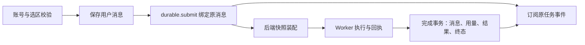

# T-1017 按持久执行链重建聊天路由回归

独立工作树：`codex/t1017-durable-chat-regression`。入口依次核对 `BACKLOG.md`、[T-1015 核实记录](t1015-lesson-verification.md)、`PROJECT.md`、`PROJECT_CONTEXT.md`、`product-to-code-orchestrator` 技能 `3.27.2` 与项目 `.skill-version=3.27.2`、stage router、`SYSTEM_ARCHITECTURE.md`。`context-plan` 路由为 `4-build / compat-full`，Research Gate 无未关闭项。`context-compile T-1017` 初次因旧模块配置缺绑定而拒绝；临时绑定编译出 `/tmp/t1017-context-packet.md` 后已恢复两个控制文件，未提交治理状态变更。

## 实际链路

用户发消息后，路由先校验当前账号、会话作用域、局部改稿选区和附件，再保存原用户消息。`durable.submit` 的回调只用后端消息快照装配模型输入；返回原任务 ID 后订阅持久事件。Worker 的完成服务在一个事务中保存 assistant 消息、用量、任务结果和终态。HTTP 断开只断订阅，停止需显式任务命令。

## 旧断言与真实缺陷

| 旧断言 | 当前事实与本轮回归 |
| --- | --- |
| 路由直接调用 `runChatStream`，`onFinish` 负责落 assistant | 旧接口已退出公共路由。测试现实际调用 `durable.submit` 的装配回调，检查后端消息快照、原消息 ID 和事件订阅；另在同一测试文件用 PGlite 跑路由提交→真实执行账本→完成事务，核对 assistant 正文、用量、任务结果、终态和 `finish` 事件。 |
| 空轮写兜底 assistant，断开请求触发流式 `onFinish` | 持久链路对空输出不能伪装成功，失败事件明确传给用户；请求断开只释放订阅，已确认的文本及工具事件沿原任务可读，取消不补造结束消息。 |
| 用户消息保存失败仍可 `200` 启动模型 | 现必须返回 `500` 并禁止提交任务，避免无来源执行。 |
| 非法 scope 声明不再查库 | 当前回落推导后仍核对已有会话归属；跨 scope 返回 `403`，不续写。 |
| `regenerate-message` 不重插用户行 | **真实缺陷**：路由原条件没有把 regenerate 置为 `skipInsert`，会重复写入。红测来自基线 29/50 失败及夹具接通后的单例失败。按用户本轮授权，仅在 `route.ts` 把既有会话的 regenerate 纳入跳过插入；再从真实历史绑定原消息。历史源缺失时拒绝提交。PGlite 回归确认重发复用原任务 ID，数据库仍只有一条用户消息。 |

授权答复仅在原任务为 `waiting_user` 时续跑，不新增用户消息；其他状态不盲目执行 `resume`。局部改稿继续检验当前段落 ID、版本与正文重绑；失效的必需锚点返回 `409`，可选锚点丢弃后继续普通对话，明确整稿功能先去除旧局部锚点。逐字来源测试保留换行、空格和标点，客户端伪造的历史 UI 消息不能进入后端快照。封面参考测试调用**真实** `prepareChatReply`，确认 `context.publications → cover.generate` 的工具顺序，物理排除 `local.tools`；模型仍须把真实 `coverAssetId` 传给生成工具，这由后端工具测试覆盖。

## 本轮证据

- 原基线：`pnpm --dir frontend exec vitest run src/app/api/chat/route.test.ts --retry=0`，**29/50 失败**。夹具改到持久链后仍有 regenerate 重插红测；最小路由修复并补授权回归后 **54/54 通过**。
- LED-014/017/020 前端命令涉及的 10 个不重复文件合并运行：**175/175 通过**。
- 三条 LED 后端命令涉及的文件合并运行：**296/296 通过**。另加 `chat-turn-completion.service.test.ts` 的扩大运行中，相关完成事务用例通过。
- `pnpm --dir frontend exec tsc --noEmit --pretty false`：通过。`node orchestrator/process/boundary-scan.mjs`：5 条既有基线，无新增。`git diff --check`：通过。
- 独立候选工作树的 `reconcile` 为 **19 error、1 warning**；其中 LED-014/017/020 均显示 `guard holds`。其余为 16 条旧评审回执、LED-018/024/042 与 BACKLOG 体积告警。本次对账生成的 `.lessons-stats.json` 已恢复，未作为候选提交。
- 合入主分支后重跑路由 **54/54**、frontend typecheck 与 boundary-scan，均通过；主分支完整 `reconcile` 为 **17 error、1 warning**，LED-014/017/020/024/042 均通过。剩余 16 条旧评审回执由 T-916 跟踪，LED-018 由 T-1013 跟踪。

扩大后端运行把写集外 `chat-turn-submission.service.test.ts` 也纳入后，结果 **349/350**：该文件“真实租约恢复只读工具，使用冻结产品说明及当前账号数据”一例因未冻结 `creatoros.guide@v1` 失败。它不在 LED-014/017/020 的既定命令中，本轮没有修改该测试或把失败写成通过。

验证层级：路由 mock/真实装配、PGlite 事务与现有工具测试已跑；未在已安装桌面应用和真实模型中做端到端验收。没有改 `BACKLOG.md` 状态、`video-render/template`、T-1008/T-1009 工作台或发布配置。
