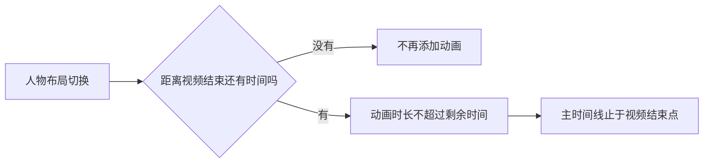

# T-1018 竖屏动效时长修复

## 问题与处理

15 秒预览的最后一张内容卡结束时，人物布局在第 15 秒又启动一次 0.34 秒归位动画，导致 GSAP 主时间线变成 15.34 秒。结束点已经没有可播放画面，因此现在跳过该动画；接近结束点才开始的布局切换按剩余时长收口。

## 验证

- 修复前真实 Playwright 预览复现 `portrait: 15.34 !== 15`，GSAP 超出的唯一 tween 为 `#th` 在 15 秒开始的归位动画。
- 修复后 `verify-t794-motion-card-preview.mjs` 通过：横屏、竖屏主时间线均为 15 秒，五种关系卡片均在画布和字幕安全区内。
- 渲染模板 Vitest 81/81 通过，新增片尾仅余 0.20 秒时的切换回归；竖屏 HTML 快照只移除了 60 秒结束点的两条无效人物归位指令。
- LED-024 其余门：AI 模板 11/11、后端含渲染模板 179/179、前端组装 12/12，通过。
- 使用该确定性竖屏样例实际渲染 MP4；`ffprobe` 记录为 24 fps、360 帧、`15.000000` 秒。14.5 秒抽帧确认仍有画面与字幕。样例人物源是空数据占位，未代表真实用户素材验收。

该修复没有修改动效语义选择、字幕内容或输出尺寸。
