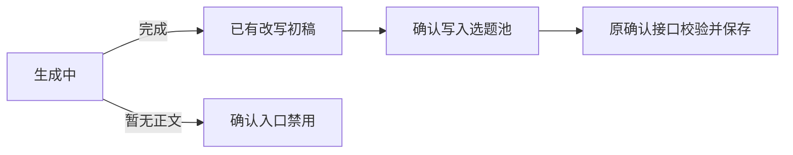

# T-1019 成功候选确认入口回归

## 用户能看到什么

内容雷达生成了改写初稿后，可以点击“确认写入选题池”。生成仍在进行时，不显示确认入口；初稿还没有正文时，入口显示为禁用态。已有候选的归属、来源和幂等校验仍由原确认接口处理。

## 证据

- 修改前新增组件测试复现：成功且有 `adaptedDraft.contentText` 的候选找不到确认按钮。
- 修改后组件和工作区测试共 59/59 通过；其中工作区覆盖已有正文可确认、无正文禁用、进行中不重复提交。
- LED-042 对应的 contract 3/3、backend 4/4、frontend 56/56 全部通过；frontend typecheck 通过，`git diff --check` 通过。

本项没有更改后端写入接口或数据归属。
