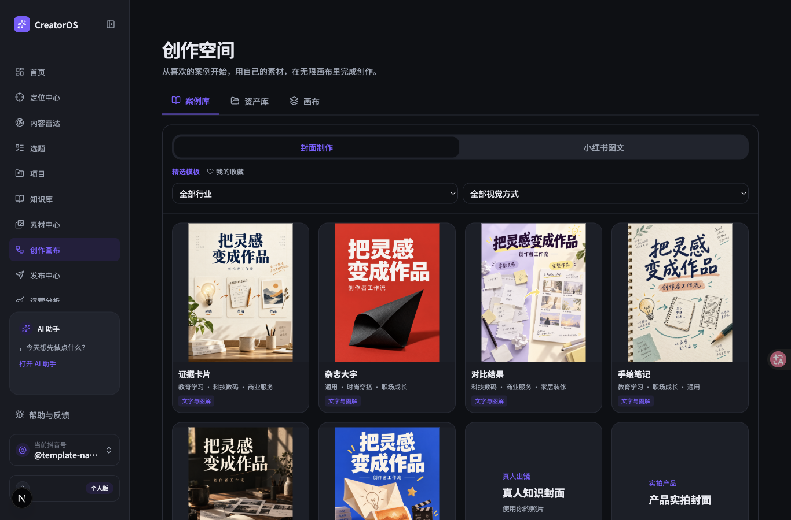
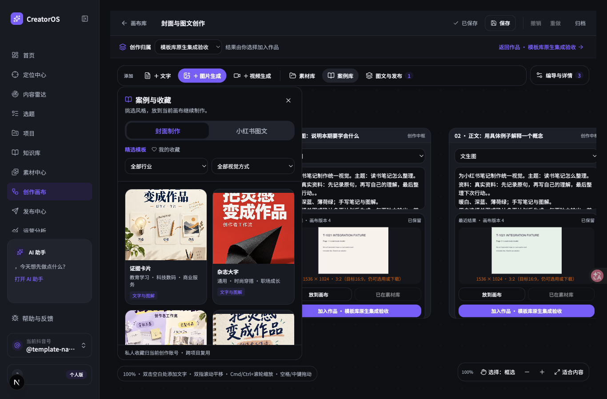
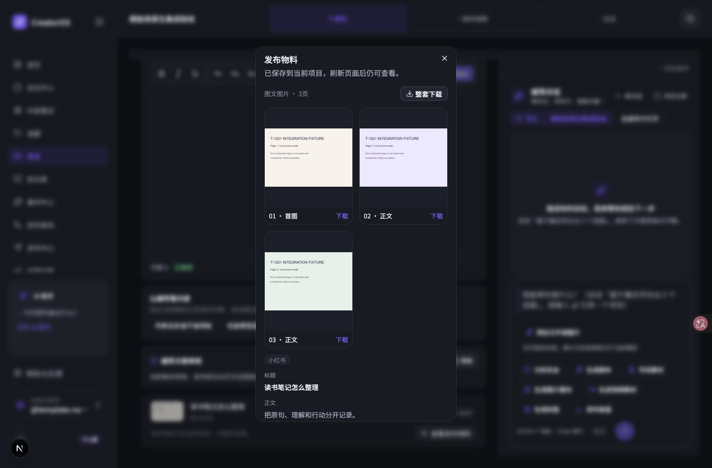

# T-1021 原无限画布双模板库实施与验证

## 本轮首页入口补充（2026-10-04）

用户明确执行后，功能首页已改为「案例库 / 资产库 / 画布」并列，普通入口默认案例库，从项目进入仍显示该项目画布。两库可独立浏览、收藏与上传，选择后通过原 create/get/saveCanvas 新建或追加；原无限画布与 Publishing 继续承接制作和发布物料。新增 IA 独立复核通过，相关前端 18 项、原生画布与新增首页 Chrome E2E 11 项、LED-047 156 项实际通过，前端类型与本批 lint 无错误。独立 UI 走查及实际素材追加已完成，详见 [首页验证](t1021/home/REVIEW.md)。本轮不把真实供应商、安装版和既有全局 Gate 待验改成完成。

## 当前交付

2026-10-04，用户明确“开始执行”。实现位于 `codex/t1021-canvas-templates`，工作区 `/Users/zyongzhu/.codex/worktrees/cover-template-library/Thirdspace-creator`，沿已存在的 `codex/creator-canvas@de031bc3` 宿主实现。后端隔离候选 `cfc2d868` 经候选验证整合为 `b9fd9288`，前端与联调修复由 root 串行完成，业务提交为 `3f7921222c50bd2198e32b1f7b23cbc954f43c00`。frontend进度已用真实提交闭合，verification保留阻塞。主工作区其他任务修改保留。

新增UI按用户指定oil-ui-pro 0.10.0流程，沿原品牌tokens、组件与画布工具层实现。用户在原画布打开案例库，选择封面或小红书图文，再按行业、视觉方式挑选；填入本期标题、内容、配文、自己的图片与比例后，模板放入当前视野。图文每页都是可编辑的普通节点，页序与配文在固定抽屉编辑。收藏提示词或完整风格保存到当前创作账号，可跨项目使用。用户选择候选后，沿原 Publishing 创建不可变发布版本，原项目稿面展示图片、正文与下载；原排期和登记发布保持既有入口。

上图的发布结果明确标注本地模型测试夹具，用于验证系统真实链路，不能作为供应商AI出图证据。

## 实现边界

- 两库包含行业标签、真人照片、产品实拍、图解及AI视觉方式；内置12张本轮原创公共AI风格预览，真人与实拍配方要求用户提供自己的素材，公共目录不分发私人肖像。三页预览板仅展示风格方向，生成按三张独立图片执行。行业标签由模板内容和用户选择决定，代码不猜行业。
- 候选比例为1:1、3:4、16:9、9:16、2:3、3:2、4:3、4:5、5:4、21:9，按真实适配器能力禁用不可用项；原未知能力入口保持可用。节点/任务冻结比例与画布zoom独立，实际像素比例不符仍保留安全下载与明确采纳。
- 收藏为原Assets领域的持久CRUD、CAS、完整版本快照和稳定键回执。模板要求身份时从可信内置目录或当前user/account持久收藏回执解析；节点和组两个绑定均校验，旧收藏更新/软删后仍可核对历史快照。
- 图文页组沿原画布文档schemaVersion1保存、撤销、删页与刷新；生成沿原stable-attempt和execution账本。回执丢失先查既存任务，核owner及冻结输入后补link，既存任务即使节点已编辑仍能恢复且不重复提交。
- 用户可明确选择此前安全候选；采纳保留原task/link/inputDigest/结算/真实文件核验。旧候选不因当前提示词编辑失效，界面明确提示当前编辑尚未应用于这张图。
- 采纳只由原Publishing事务创建/更新不可变版本、真实目标归属与CAS；替换封面保留正文、标签、其余设置和图文正文页。导出按指定版冻结fileId/checksum读取图片；整套缺页明确失败，但同一操作pageIndex可独立下载其余安全页。
- 原发布物料查看器已有结果时不被口播脚本0字门挡住。下载ZIP经真实解包CRC验证，包含三张PNG与UTF-8配文。单页缺失降级有前后端行为回归，未通过删除原生夹具模拟生产缺失。

## 当场验证

| 验证 | 真实结果 | 证据 |
| --- | --- | --- |
| 契约模板合同与类型 | 4测试PASS，typecheck PASS | `t1021/logs/contract-final.txt` |
| 后端6个相关测试文件 | 73测试PASS；公共链包含三页、失败恢复、历史选择、原确认、版本与导出 | `t1021/logs/backend-final-serial.txt` |
| 前端8个相关测试文件 | 38测试PASS | `t1021/logs/front-integrated-final.txt` |
| 前端类型检查 | PASS，无输出 | `t1021/logs/front-typecheck.txt` |
| 代码审计三处修复 | 当场3 failed/16 passed后，修复3文件23 passed | `t1021/logs/review-fixes-red.txt`、`review-fixes-green.txt` |
| 原画布Chrome E2E | 最新源码9测试PASS，1.2分钟；隔离PGlite与媒体根 | `t1021/logs/canvas-baseline-final.txt`、`t1021/baseline-regression/` |
| LED-047性能回归 | 8文件156测试PASS | `t1021/logs/led047.txt` |
| 原生页面独立实测 | 1366、1024宽度，案例库/收藏/比例/组编辑/原发布下载；200%使用等效683×450 DPR2，小高度抽屉与工具栏修复后可操作 | `t1021/review-*.png` |
| 原生生成到原发布下载 | 原worker实际发起3次本地模型夹具请求，pending→原确认激活→不可变发布版→原查看器下载，ZIP内3 PNG+配文CRC有效 | `t1021/review-publication-fixture.zip`及解包目录 |
| 独立bounded审计 | 原生SPEC三轮PASS，第三轮receipt d081e13ac7d4；审计三项major闭合 | `../features/t1021-cover-template-library/native-review-round-3.json` |
| Orphan双向溯源 | 0 errors / 100 warnings，PASS | `t1021/logs/orphan-final.txt` |
| 物理/语义门、完整类型与reconcile | 未全绿，见下文；不以相关单测代替完整Gate | `t1021/logs/*-final.txt` |

后端并行回归曾在公共链动态导入与PGlite加载时触发默认5秒超时（1 failed/72 passed）；串行maxWorkers=1、testTimeout=15000再跑同一输入族，公共链实际3474ms通过，全部73通过，未删断言或重试掩盖失败。记录保留 `backend-parallel-timeout.txt`。

原生UI实测使用测试账号 `@template-native-test`，项目 `project-bc599d85-8`，画布 `cb3027eb-e517-4231-bfea-707e8eda267d`，本地原生服务端口43422。所有夹具创建、生成、采纳经原公开API；用户正式数据库与媒体目录未用作测试。真实应用截图不是静态43321预览。

## 未完成验收与既有欠债

1. 本地模型夹具不代表真实供应商；真实供应商各比例与真人身份保持的实际效果、安装版以及真实浏览器200%缩放仍待验证。安装版CLI连接曾返回CONNECTION_EXPIRED，未强制关闭或覆盖用户运行中的客户端。
2. 后端完整typecheck为14个旧测试错误，均在未改动文件；本任务新导出测试曾有unknown类型访问，已修复，最终14项不包含任务改动文件。物理门7条对基线5条，多出的live-chat-session.ts两项SDK导入在b22e6522已存在，本任务diff为空。语义门video-decisions-runner.ts未调用material.match Skill也为未改动来源。复用已登记T-1018，历史治理漂移由T-916继续跟踪；不删基线、不放宽门。
3. ESLint当前改动文件覆盖检查共2 errors/16 warnings；两处prefer-const均为原persistence-client.ts已有代码，b22e6522可核对，新增UI无错误。不宣称全项目lint PASS。
4. pmem sync已运行，生成的PROJECT.md只更新分支哈希与开放任务清单。由于当前reviewctl将整份自动生成PROJECT.md绑定为constitution，收尾同步导致第三轮receipt的constitution hash过期；原独立审计结论保留为当时证据，当前receipt不得冒称有效生产Gate。没有伪造第四轮、新cycle用户授权或改写历史receipt。该治理冲突连同全局reconcile失败如实留账。

第一次完整reconcile为239 errors；收尾状态更新与manifest按实际结果登记后，最终完整reconcile为238 errors、0 warnings，包含上述本任务当前receipt过期及其他模块历史漂移；两份日志完整保存，LED-047在其中继续PASS。ARTIFACT_MANIFEST的BUILD gate已按真实失败记录，SHIP不推进。本任务代码已实施；因SPEC要求未通过全部范围不得完成，已通过taskctl block记录真实未验收原因，未安装、未发布、未将生产Gate记为PASS。

本轮首页收尾：完整 reconcile 239 errors / 0 warnings，Orphan clean、LED-047 通过；相关原生最终回归11项通过，作品画布返回列表保留 projectId。代码提交 fb566c02 / e7b5c670。pmem 收尾同步后，新增 IA receipt 的 PROJECT constitution hash 同样过期，当前生产 Gate 仍不可写 PASS。首页实现已完成，总 verification 如实保留阻塞；新证据见 `t1021/home/`。

LED-049 单独复核：后端 3 文件 43 测试通过；前端 7 文件 77 测试中 75 通过、2 失败，均在未改动的 `src/components/shell/shell.test.tsx`，原导航断言预期 11 个链接而现有导航实际 12 个。该门在此前完整 reconcile 日志中已失败，本轮保留真实失败记录，没有修改原导航来迁就断言。
