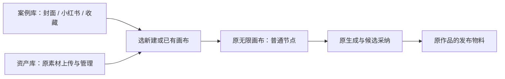

# 首页入口实际验证

2026-10-04，用户明确「执行」后，新增 IA 经独立 home_spec_review 只读复核 PASS，receipt 55bcfd0e2f8b（cycle 2 round 1），保持原 Assets / Publishing / 无限画布合同与归属。

## 用户可以完成的事

首页 `/canvases` 并列案例库、资产库、画布；普通入口默认案例，项目入口保留该项目画布，显式 tab 优先。封面与小红书图文按行业/视觉方式选择，可在没有画布时收藏提示词和风格。资产页沿原素材中心真实上传和预览，管理全部素材回原入口。模板/资产确认后选择新建或已有画布；浏览和取消不创建画布或调用模型。生成、候选采纳及原作品发布物料继续在原画布完成。

## 当场证据

- 新增转入画布 helper 的 7 项测试先因模块不存在红测，实施后通过；后来增加离开首页的迟到读取保护，当前 8 项通过。
- 首次扩展前端回归 1 failed / 14 passed：新增账号防写保护暴露原收藏测试未提供当前账号，补上真实选择前提，并增加切账号拒绝写收藏与完整输入恢复测试。最终相关 4 文件 18 测试通过；失败日志保留，不编造这些后补回归的红测历史。
- 原画布 Chrome E2E 的 9 项与首页新增 2 项全部通过（首轮 11 passed / 1.1m；补充作品画布安全返回后，最终 11 passed / 2.3m）。新增测试实际验证独立浏览/取消不写画布、三页模板新建且重新读取、真实上传与选用、原 saveCanvas 冻结真实 fileId/checksum。
- LED-047：8 文件 156 测试通过。前端 tsc 无错误；本批 ESLint 无错误，保留 effect 与预览图片的 warning。日志在 `logs/`。
- 主 Agent 用 Ego TaskSpace 14 的 p1 真实操作三页模板→原画布 `a0fdfd8c-feb2-4189-9ae8-d5645095e5f7`，原 API 回读 3 个普通生成节点、1:1、真实有序页组、配文，未调用生成。再从资产页实际上传 image-4.png 并追加此画布，回读 4 节点，原 3 页/视口保留，追加图携带服务冻结的 fileId/checksum。联调模型请求仍为原来的 3 次。
- 单页收藏的 UI 实测：标题「单页收藏恢复实测」、single_cover、参考原图 `asset-ae40ed92-277`、16:9 在收藏后全部保留。
- 独立 home_task_walkthrough 仅操作 p2：行业/视觉筛选→填写内容→收藏风格→切资产再返回→切换新建/已有并取消→新建 `6b02ebf7-8deb-437c-930b-19472d92d9e8`→真实编辑生成描述并保存→返回画布列表与案例→小红书筛选及收藏提示词，均实际通过。该执行者未操作上传、已有追加、生成或发布，不能把这些记为其验证。

## 独立复核与修正

home_visual_review 实际看了首稿案例、详情和资产截图，按存量项目规范只做一轮、不打分。提出顶部过高、资产预览占位、比例灰色原因和提示词截字。删去英文眉题、重复案例面板标题/说明与资产内重复标题；首排案例由约 y483 上移到 y386；保留原品牌和组件。主 Agent 核实资产预览当时截图早于真实图片加载，重新等待真实图片取得最终截图，没有伪造新素材。桌面比例变两行并加当前模型禁用说明，提示词框增加高度。

home_code_review 发现离开首页仍可能迟到保存/导航、收藏后单页变多页、空态清筛选未同步 URL，三项均已修复；独立最新源码复核确认无新增阻断。稳定节点/组 ID 回读避免保存回执丢失导致二次追加；create 无幂等键，未知回执禁止自动重发，提示查看原画布库。已知创建 ID 的保存重试绑定同一张画布。当前账号、活动窗口、目标归属和最新 revision 在原写入路径检查。关联作品的画布返回列表继续带 projectId，新增断言真实验证返回本作品筛选。

最终截图均已实际查看：1366×900、1024×768，窄窗 document scrollWidth=1024 无整页横溢出；详情、资产和页组关键状态也查看。683×450 DPR2 只作 200% 等效排版检查，不是原生浏览器实际 200% 缩放证据，后者仍待验证。当前宿主全局侧栏在窄窗保持原行为，不在本任务替换。

## 尚未满足的总验收

本轮只完成获批首页 IA 与相关原系统回归。真实供应商比例/真人效果、安装版及既有全局 Gate 问题沿用总报告待验，未因此冒称 T-1021 全部完成、安装或发布。记录中的本地模型图明确为联调夹具。pmem sync / reconcile 的本轮结果追加到总报告与本目录日志；以前的全局失败证据只代表当时结果。
