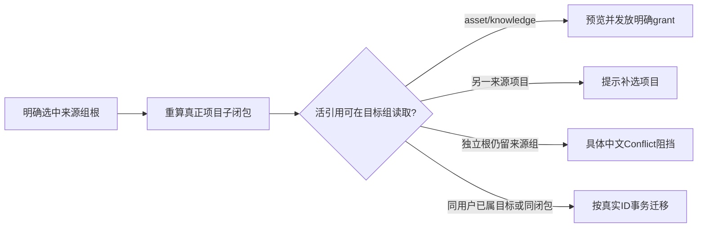

# 本轮交付与真实验收范围

项目视频转写按独立账号组保存请求回执：空组已有视频来源的项目可排入AI任务；真实选定的平台账号仍按实际accountId及membershipVersion冻结。这里只验证任务提交、归属和回执，不声称浏览器抓取、模型转写或发布生产链路已通过。

知识候选在同组AI公共确认链采纳。知识根和回执组内共享，不需要平台账号；关系两端都必须是同用户、当前组自有或有未撤销的明确知识grant。战绩仅聚合当前workspace用料及发布事实。

迁移只移动明确项目、知识、会话及其真实子项；不复制雷达、选题、经验、定位或校准整库。用户不能在目标组上下文任意搬来源组资料。apply在组锁事务中重复所有权限和依赖检查。

显式活引用检查字段：
- project_intelligence_references的topic/item/snapshot/transform；快照继续检查source、item，source检查collection，transform检查item/snapshot/positioning/targetTopic。
- predictions.rubric_version_id继续检查rubric；待采纳calibration_rule_suggestions作为独立工作阻挡，不随learning移动。
- learning_applications.learning_id、learnings.review_id；没有所属project的独立learning不隐式授权。
- content_calendar_entries.candidate_id/content_output_id、topic_promotions.candidate_id、topic_proposal_feedback.positioning_version_id及其profile父根。
- reviews.report_artifact_id/content_output_id、artifacts.content_output_id、production_segments.script_section_id、review_publications.publication_id：其它来源项目明确requiredProject补选。
- projectBriefDetail.contentRadarEvidence的sourceSnapshotId、positioningVersionId、adaptedDraftSeed.positioningVersionId、sourceReferences[].intelligenceItemId；同样检查目标组现有candidate.card中的声明式来源/定位ID。
- project_activities的明确entity_type/entity_id映射（project、content_output、artifact/version、review、learning、candidate/topic、intelligence_item、rubric/version、positioning_statement）。

任意正文字符串、未声明结构的聊天tool parts、历史ingestion_run、旧AI任务/执行的freeze及历史完成校准建议不被猜成新的活依赖，不自动重写冻结组。新协议引用类型需要新增明确映射及真实fixture，不能把当前测试扩为所有未来共享根引用已覆盖。

undo检查原after-image、新增子闭包、其它新工作真实引用和不可抹除的grant消费ledger。已有内容的纯读取、group_id-only迁移不登记新消费；删除后来引用不能消掉既有使用记录。source/target资源权限同时按同user收窄，外部私有根不能作为跨用户迁移依赖。

实际证据：转写组RED3；知识组RED3（硬绑account、单端关系泄露、跨组战绩）；新增迁移活根RED3。迁移最终19/19；知识/转写核心18/18，旧知识仓库+agentic采纳22/22；四文件合并最终40/40（21:28:06，23.87s）。与迁移19个是不同测试，总计59个通过。日志：/tmp/t1022-adoption-transcription-final-suite.log、/tmp/t1022-migration-live-roots-final.log。

持久恢复证据来自隔离PGlite目录关闭再打开及权限SQL验证；不包含实际存储字节读取、损坏库备份恢复、真实五平台采集或生产发布。全局后端tsc仍有其它模块错误，本轮文件不掩盖该失败。
