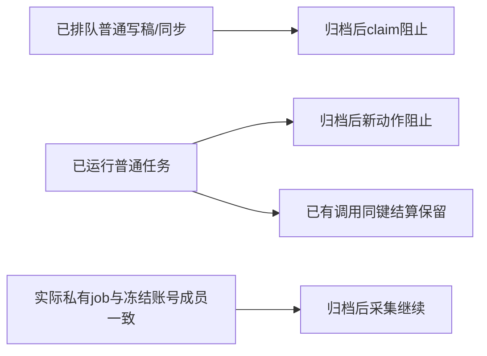

# T-1022 归档执行权限修复增量交付

大白话：账号组归档之后，普通写稿/同步任务不能再领取执行权或启动动作；真实账号四种私有采集仍能继续，归档前已执行的调用仍可结算真实回执。

仅在原隔离 tree 修复。ROOT 未回写、没有浏览器或外部采集。7 个增量文件（相对原 21 文件冻结）为：AI repository/service，persistent-task，execution-lease（新归本子任务所有权），scheduling private admission helper/barrel，startup PG integration test。逐项 ROOT 集成前 SHA 已保存并在冻结时重验未变化；详见 `/tmp/t1022-archive-admission-freeze.json` 和 `/tmp/t1022-archive-admission-owned-files.sha256`。原冻结其余文件继续保留，不用旧 SHA 覆盖这些增量。

## 改动与边界

- 删除 persistent claimNext/claimTask 和 execution lease admission 中 `allowArchived:!!accountId` 的宽权限。
- 归档豁免统一从实际业务事实派生：AI task 必须为 scheduled.self.metrics/self.traffic/comments/self.detail、实际 jobId、实际 active Douyin 同组成员与 frozen membershipVersion；automation 必须为 scheduled_job owner 的 automation_sync + scheduled_collection handler，读取实际 job 校验四种 sourceKind 和冻结属主。
- execution AI 权限从数据库实际 ai_tasks owner/executionTaskId 映射派生，AI 与 execution 的 user/account/group/groupVersion/membershipVersion 必须相同，worker payload 无法授予权限。缺失/错号 job、错 membership、假 AI owner 均不能豁免。
- AI repository claim 与 beginModelCall 在各自更新同 TX 中持实际 account/member/group 锁验证，旧 runClaimedTaskExecution 与公开 claim/model 调用共享这个门。AI service 不再在单独事务里以 accountId 放宽 beginModelCall。
- lease admission 锁前与任务锁后各次验证共用窄 helper，既有 parent/control/fence 检查保留。settlement 分支不增加归档检查，账本只能按已有同键调用和现存执行凭证结算。
- 不新增 wire flags，未改变已验证 cron→driver→controls→AI→intent→flywheel→authority→child 业务链。

## 实际 RED / GREEN

1. 原透明探针重新执行：`/tmp/t1022-archive-admission-red-probe.log`。普通 AI claimed:true/running、lease admitted:true、source_sync claimed:true，完整本地私有交接链 PASS；随机 PostgreSQL 55422 DB 已清理。
2. 初版新增测试 `/tmp/t1022-archive-admission-red-tests.log`：5 FAIL / 2 PASS /16 filtered。其中 3 是实际负向缺口，另 2 为 fixture attemptId 太短及 self.detail 缺 __backfillOnly；普通 AI case 首版还误用了同一自动生成 attempt 而复用了 running task。没有将这些 fixture 失败冒充 meaningful RED。
3. 校正 fixture 后仍在修复前执行 `/tmp/t1022-archive-admission-red-tests-corrected.log`：3 实际 FAIL /4 PASS /16 filtered。四种合法私有 collector 原路径均通过。
4. 修复后 `/tmp/t1022-archive-admission-green-first.log`：3 文件 86/86 PASS，exit 0，含 PG 23 和原 AI/persistent service 回归。
5. 加 job/member/owner 故障族及真实账本后 `/tmp/t1022-archive-admission-green-final.log`：3 文件 56/56 PASS，exit 0，PG 28 + 原 execution lease/call ledger。归档后普通已运行任务 ledger 新 reserve/start 拒绝，但已有模型调用 settle 回执保持 12 tokens，重复同键不重复计费。
6. 透明 GREEN 探针：`/tmp/t1022-archive-admission-green-probe.ts`、`/tmp/t1022-archive-admission-green-probe.log`。只在 /tmp 复制原探针并允许 denied claim 返回 null 后继续观察；普通 AI/source_sync claimed:false，新普通 AI creation 拒绝，原真实完整本地私有交接链保持 PASS。探针中 denied claim 自然没有可用 fence，lease 的独立“先认领再归档”负例由真实 PG 测试直接覆盖。
7. Production types：`/tmp/t1022-archive-admission-production-types.log`，`pnpm exec tsc --noEmit -p /tmp/t1022-startup-backend-tsconfig.json` exit 0 /0 diagnostics；source 完成后运行，后续只增测试。owned diff-check exit 0：`/tmp/t1022-archive-admission-diff-check.log`。

每个 PG fixture 在显式 55422 server 创建随机 isolated DB 后清理；没有访问真实 DB。pg query 并发 deprecation warning仍存在，不导致测试失败。

待 ROOT fresh 独立权限评审、按增量 SHA 集成及最终运行态/Gate。未实际登录外部平台、调用模型或采集真实媒体，不将本地 handoff 当平台成功证据。
