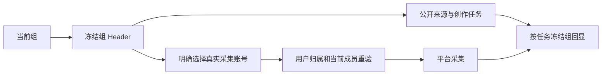

# 共享雷达组上下文交付

工作树：`/Users/zyongzhu/.codex/worktrees/t1022-task-scope/Thirdspace-creator`。精确 18 文件见 `/tmp/t1022-group-radar-files.txt`，SHA-256 见 `/tmp/t1022-group-radar-hashes.json`。未提交，不修改主目录或 journal，未重写既有工作台风格。

## 行为

空组进入真实 intelligence 页面，分类/公开 URL 导入/公开网页预检/已有素材改写候选使用组身份。组与真实平台账号是独立字段；共享 RPC payload 省略账号和 groupId，groupId 只通过已冻结 scope header 传递。私有主页/收藏/热点采集必须显式选择当前组实际有效成员账号；重新登录单次请求带真实 collector ID。所属组不随平台筛选改变。旧账号入口只允许原始 legacy workspace；真实其他组或缺 member 的其他真实账号拒绝预检，提示升级。仅保留无真实账号记录的迁移前测试端口兼容。

列表、偏好、组件寿命按组独立；公开导入/项目升级任务以 task.groupId 冻结判断，两个 null account 组不会混入。组切换卸载旧状态，迟到响应不覆盖新组。轮询限制在途读取，原后台任务和幂等标识保留。账号转出后原来源仍可读，availability=missing 显示需重选并禁同步；私有执行输入再次校验成员。

## 根组合接线

依赖 root 已实现并同步的 `createHttpTransport(baseUrl, scope?)`，这只读文件不在 18 文件里。`createIntelligenceApplicationTransport` 两个必需 ports：`assertWorkspaceReadable: intelligenceService.assertWorkspaceReadable`、`assertCollectorEligible: intelligenceService.assertCollectorEligible`。root 负责 persistence-client 接线及真实浏览器走查。

## 当场证据

- UI/SSR/HTTP mock 边界与 T1017 等既有雷达：8 files，77/77 PASS，`/tmp/t1022-group-radar-ui-delivery.log`，22:07:37，7.10s。
- 实际 createDb 正式迁移隔离库 + 公共 contract client + legacy service 回归：2 files，33/33 PASS，`/tmp/t1022-group-radar-backend-frozen.log`，22:04:08，141.17s。含空组实际持久导入队列、current member、跨用户/跨组、账号转出与 legacy 不扩大四项新真实 DB 测试。
- 既有 contract + 真实 shared item import：2 files，5/5 PASS，`/tmp/t1022-group-radar-contract-import.log`。
- 共享 optional account contract：1/1 PASS，`/tmp/t1022-group-radar-contract-final.log`。
- RED：UI 4 failures `/tmp/t1022-group-radar-red.log`；contract 1 `/tmp/t1022-group-radar-contract-red.log`；实际 DB 初始 2 `/tmp/t1022-group-radar-backend-red2.log`；转出投影 1 `/tmp/t1022-group-radar-transferred-red.log`；实际 legacy 跨组预检 1 `/tmp/t1022-group-radar-legacy-red.log`。第一次 DB fixture import 错误日志不算业务 RED。
- 修改的 8 个基础前端生产文件 eslint 0 问题：`/tmp/t1022-group-radar-lint-final.log`；18 文件 whitespace check 0。
- 全局 backend/frontend tsc 仍 FAIL 既有 collection/dashboard nullable、旧 SDK tests 等；本包检查分别记录 `/tmp/t1022-group-radar-backend-types-frozen.log` 与 `/tmp/t1022-group-radar-frontend-types-delivery.log`，根组合两个新 ports 尚需接入，因此不能声称全局编译 PASS。

公开网页读取/平台预检/模型端口使用受控 stub；真实持久任务排队与隔离授权已验证。没有真实浏览器截图、真实外网采集、真实模型生成、真实登录或五平台生产链路证据，不声称这些通过。未运行 root 的 orchestrator 完成/全局 Gate。
