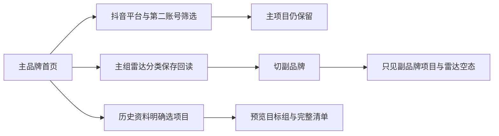

# T1022 正式页面任务走查

执行日期：2026-10-05。运行地址 `http://127.0.0.1:8788`，使用主 Agent 启动的隔离 UItest 数据服务。此记录只描述实际页面任务与卡点，不作视觉评分，不改代码，不声称真实 OS 登录、平台采集、AI 生成或发布通过。

已加载项目 `oil-ui-pro`、`UI_RULES.md`、`PAGE_SPEC.md`、`ego-browser` 与产品流程 stage-router。原 TaskSpace 15 已不存在，实际续用返回 `task space not found: 15`，空间清单仅余无关任务2；经主 Agent 按用户继续验收授权恢复，创建唯一替代 TaskSpace 3、p1。没有借用任务2。结束本阶段后保留3/p1给主 Agent 补图表样本并继续验收。

## 对象与保存回读

- 主品牌 `账号组验收 · 主品牌`，公开组选择 cookie `grp-8d773d5d-39`，项目 `/projects/project-d7b00638-13`（账号组验收 · 多平台内容）。
- 副品牌 `账号组验收 · 副品牌`，cookie `grp-d7b00638-247`，项目 `/projects/project-d7b00638-283`（账号组验收 · 副品牌独立项目）。
- 新建临时无账号空组 `账号组验收 · 无账号空组`，cookie `grp-bd7973e3-146`。0账号、0项目保留，供真正空态复测。
- 初次回读主5账号、副1账号。为同平台筛选实际在主组手动登记 `走查抖音第二号`，勾选本人管理确认、保存后 reload 重新读到主6账号。主组实际名称：走查抖音主号、走查快手号、走查视频号、走查公众号、走查小红书号、走查抖音第二号。均显示“身份未验证 · 未自动采集”，没有把登记写成登录成功。
- 雷达实际新建 `走查主组信源分类`，保存后 reload 可见；切副组后该分类消失、0条真实内容。没有添加外网来源、触发采集或AI任务。

## 当场实际任务

| 任务 | 精确操作与结果 | 证据 |
| --- | --- | --- |
| 绑定管理重新读 | `/accounts`手动登记第二抖音号，保存后 reload；主组显示6账号。扫码登录与手动登记明确分开；能力表只有抖音扫码/采集可用，五平台手动登记可用，其余未装配能力有原因 | `journey-accounts-reread.png` |
| 同平台多账号 | 首页选抖音，账号下拉只显示两个抖音号；选第二号，覆盖从0/2变0/1，选择近7天显示09/28—10/04。继续创作、待办、选题、建议仍在当前组 | `journey-home-account-filter.png` |
| 平台与日期 | 首页小红书重置具体账号到全部，近30天显示09/05—10/04。点击起止日期实际加载双月日历，Esc后转页可继续操作。跨页面各自默认日期重置，不是共享持久日期 | 可见文本与任务操作日志 |
| 创作者总览 | 真实侧栏入口进入 `/overview`，0/6覆盖；视频与文章分开、真实0与未知—分开；空比较没有虚假条形/曲线 | `journey-overview.png` |
| 运营分析空态 | 进入 `/daily-report`，切公众号为0/1，周期无作品，合法同步入口保留。先点近7天再切公众号，最终截图仍为昨天10/04，日期保持需单独复测 | `journey-analytics-empty.png` |
| 项目隔离 | 主组项目列表只显示主项目并能打开脚本工作区；副组列表只显示副项目。主项目顶部复盘为不可点击文本，因为立项、0稿、未发布，没有实际复盘入口证据 | `journey-project.png`、`journey-project-group-isolation.png` |
| 雷达组隔离 | 主组创建分类保存reload，切副组不见主分类且0条内容；没有强迫先绑定平台才显示雷达页面 | `journey-radar-reread.png`、`journey-radar-group-isolation.png` |
| 历史迁移预览 | 主组“整理历史资料”→目标副组→勾选主项目→预览；清单1项目/7阶段/1项目活动，无新增引用授权。没有点击确认归组，主项目仍在主组 | `journey-migration-source.png`、`journey-migration-preview.png` |
| 真正无账号空组 | 新建0账号0项目组，进入首页显示0/0与0/—；“新建项目”直接打开完整弹层，无先绑账号阻挡。只打开未提交，Esc关闭后回首页 | `journey-empty-group.png`、`journey-empty-create-dialog.png` |
| 共享资源错误 | 主组重新读取返回Zod meta.page/pageSize/total缺失，raw JSON错误面向用户。主 Agent 修复后热更新reload仍错误，需服务重启复测 | `journey-shared-resource-recovery.png`，保留实际RED |

## 视口与操作卡点

所有本轮保存的 `journey-*.png` 均用 `view_image` 实际逐张查看；仅保留于当前受控服务版本的证据，不用截图保存成功代替检查。

- 1366×900：主首页五指标、三列六卡保持；当前无采集，没有虚假每日曲线。未采集首页趋势卡无日期/数值轴，仍需要主 Agent 后续检查空态图表规范及真实样本图表。总览空比较只显示单位与空态。问候和AI助手用户称呼为空（“早上好, !”），是临时用户资料状态。
- 1280×800：首页五指标与三列骨架保持，第二排需纵向滚动。截图 `journey-home-1280.png`。
- 390×844：侧栏没有自动折叠，正文被挤至约118px。搜索顶栏覆盖左上侧栏按钮；鼠标点“收起侧栏”被 `<kbd>` 拦截。改用 focus+Enter可折叠，正文可读，平台筛选换行；顶部搜索和新建操作仍有横向裁切。截图 `journey-home-390.png`、`journey-home-390-collapsed.png`。极限检查不等同桌面宿主最小窗已通过。
- 200%：CDP `Emulation.setPageScaleFactor(2)`返回 visualViewport.scale=2，但 Ego screenshot仍返回1倍CSS布局；键盘缩放也未取得可靠放大截图。因此 `journey-home-200-percent.png`不能作为原生200%视觉通过。另以documented CDP设683×450、deviceScaleFactor2，验证1366×900在200%下等效可用CSS面积；截图 `journey-home-200-percent-equivalent.png`，侧栏仍未自动折叠，首屏只能显示筛选，需滚动。原生缩放实图证据缺失，诚实保留待验证。
- 新建项目弹层可Esc关闭，但焦点落body而非原入口。没有代码评审，无法确定是本次新增还是历史Dialog行为，按观察残项记录。

当前结论：登记保存回读、组/账号筛选、组内项目/雷达隔离、迁移预览与空组入口已取得实际操作证据；共享资源恢复、日期保持、复盘有数据链、图表有样本轴、窄窗顶栏及原生200%不能写成全绿。没有把本轮任务走查当作独立视觉评审。

普通页面可见文本检查点存于 `journey-visible-text.json`，只含URL、组选择cookie片段及 `document.body.innerText`；不读取应用内部state或密钥。
