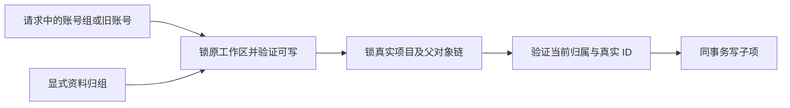

# T-1022 父对象写入独立验收（2026-10-05）

本轮只读生产源码；只新增本验收记录，临时探针与日志写入 `/tmp`，未提交。按项目入口读取 T-1022 SPEC、Task Packet、PROJECT/PROJECT_CONTEXT、物理架构和 product-to-code-orchestrator；技能与项目版本均为 3.27.2，当前 BUILD 验收。本文不替代全任务 Gate，也不宣称真实用户迁移或桌面操作已通过。

大白话：每次改稿、添加分段或保存用料，先在同一个数据库事务里锁住所属工作区与真实项目，再检查当前请求确实能写。项目已经搬走时，旧组不能因为还拿着旧作品 ID 或可读证明继续写。

## 已验证

- `workspace-write.ts` 的 `withWorkspaceParentWrite` 验证 user 与 workspace，先组后父链加锁。`via` 使用真实外键逐层关联，不从调用方传入的 parentMeta 改写 ctx；此路径不消费 read grant。
- Artifacts 的 create、createVersion、restore、createRelation、replaceStructuredContent 均经该 helper。新作品带 outputId 时也核验 output 确实属于输入 project。版本、结构化子项分别沿 project → artifact → version 验证；关联写同时验证两端。
- Production 的 ensureProductionForOutput、updateProduction、confirmEditingPlan、createSegment、createExport、completeExportRow 均经该 helper。update、确认/移除剪辑素材、导出完成的公共 service 最终落到上述 repository；不以可读 output validator 的返回值替代写事务中的真实项目校验。已有 ready 导出幂等返回属于读，不制造新写。
- MaterialLinks 的 create、delete 均经真实 project 父锁；create 带 outputId 时在同事务验证 output/project 关联；delete 沿 project → link 验证。组级实体引用继续经绑定的 Asset/Knowledge service 验证。
- 完整正式 journal 的隔离 `createDb` 探针确认旧 account-only 创建的 artifact/link 返回 `groupId=grp_legacy_ac`，显式原组查询分别可读 1 条。0114 与 0117 的 INSERT 触发器补戳闭合；不应仅看 TypeScript 中的 null 初始值判断数据丢组。

## 当场回归证据

命令：`CREATOROS_TEST_POSTGRES_URL=postgresql://zyongzhu@127.0.0.1:55422/postgres pnpm --filter @creatoros/backend exec vitest run <下列16文件> --maxWorkers=1`。

- 三域 `workspace-parent-write.integration.test.ts`：6 个 PGlite 权限例与 6 个真实 PostgreSQL 并发例。PG 为三个公共代表入口各验证“迁移先持锁，旧 scope 写等待后拒绝”以及“子项先写，迁移等待后拒绝过期 digest”。测试创建随机隔离数据库，使用 fixture 的既有清理，未访问产品数据。
- Production：`production.contract.test.ts`、`production.service.test.ts`、`production.repository.integration.test.ts`、`production.acceptance.test.ts`、`material-export.test.ts`。
- Artifacts：`artifacts.repository.integration.test.ts`、`artifacts.service.test.ts`、`artifacts.service.t730.test.ts`、`artifacts.contract.test.ts`、`artifacts.acceptance.test.ts`、`legacy-script-patch.integration.test.ts`、`artifact-adoption.test.ts`。
- MaterialLinks：`material-links.service.test.ts`。

结果：**16 文件、147 测试通过**，耗时 274.65 秒。原始日志：`/tmp/t1022-parent-writers-audit-test.log`。真实 PG 并发证明覆盖上述三个代表公共写入口；其余叶子入口通过代码同 helper 审查与既有回归，不能表述为每个叶子入口都单独做过 PG 双向并发。

旧账号落戳探针：`/tmp/t1022-parent-writers-legacy-probe.ts`，日志 `/tmp/t1022-parent-writers-legacy-probe.log`。

## 已交主任务处理的缺口

1. **缺工作区的用料列表读旁路（真实 RED）**：`material-links.repository.ts:62` 在 groupId/accountId 都空时只过滤 userId；`material-links.service.ts:126` 的 list 未先 requireWorkspace。完整 journal 真库 fixture 后，公共 service 无 groupId 且 accountId=null 的全量 list 返回 1 条用料边。显式失败探针 `/tmp/t1022-material-no-workspace-red-probe.ts`，日志 `/tmp/t1022-material-no-workspace-red-probe.log`，退出 1：`RED: 无工作区公共materialLinks.list返回 1 条，应拒绝读取`。transport 的 projectId 可选，scope registry 标记 project-derived；不能把缺工作区当作全用户多组读取。正式组合注入的 Projects service 能挡非空列表的父项读取，但公共 service 缺端口及空库路径仍需自身保持相同拒绝语义。
2. **owned 测试类型缺字段**：`legacy-script-patch.integration.test.ts:29` 的 transport.request 输入缺 `query: undefined`，backend tsc 报 TS2345。三 repo、三 service 与 workspace-write 无诊断。原始日志 `/tmp/t1022-parent-writers-typecheck.log`。其余 ai-runtime 旧测试错误属于 T-1018；projects.repository.ts:483 也被全局 tsc 报 undefined，已交主任务确认归属，本审查不改生产文件。

以上是本轮发现时的事实；主任务修复后应另补当场 GREEN，不能改写该 RED 已经发生的历史。

追加组入口回归：`pnpm -C backend exec vitest run src/modules/production/group-project-derived.integration.test.ts --maxWorkers=1`，**1 文件、4 测试通过**，24.15 秒。验证无真实平台账号的共享 output 制作、同组切平台、跨组子项拒绝、结果素材验证、用料隔离、归档可读不可写以及缺真实父项端口拒绝。日志 `/tmp/t1022-parent-writers-derived-regression.log`。连同前述批次，本轮实际运行 **17 文件、151 测试通过**；这不抵消独立无工作区 RED 与全局类型失败。
