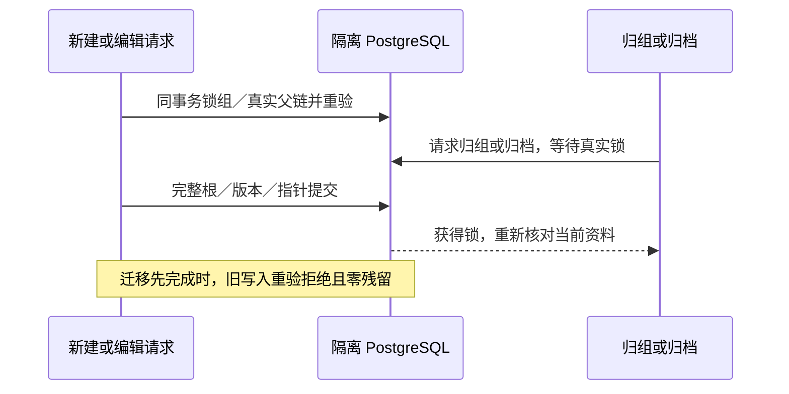

# T-1022 独立权限与事务最终复查

首次复查：2026-10-05 01:09，实际 FAIL；增量集成后最终复验：2026-10-05 01:22（Asia/Shanghai）。复查人：独立子代理 `final_scope_recheck`。最终结论对应 ROOT 实际集成的源码，保留首轮和本轮全部历史 RED。

**最终结论：PASS（本报告覆盖的权限、真实父链、迁移／归档事务一致性）。** 增量集成后独立重跑 115 项真实 PostgreSQL 测试全部通过、0 skip；三项曾实际失败的公开入口也在原透明探针中分别重新通过两个竞争顺序。知识授权与新来源经验闭包再次通过，本地文件真实 grant 与撤销授权的正式 composition 测试通过。已记录的实际阻断项均由本轮 GREEN 关闭；这不代表 T-1022 全任务、外部平台或真机验收完成。本报告不改变 BACKLOG、ARTIFACT_MANIFEST 或任何任务状态。

## 大白话

本次覆盖的公开创建／编辑现在把根资料、版本和指针放在同一事务中：谁先拿到真实锁，谁先完成；后来者拿锁后重新核对当前归属。迁移先完成时，旧组写入被拒绝且不留正文；写入先完成时，迁移拒绝已过期的预览。归档同样会等待完整初始化，不再留下接口报错后的半成品。



## 复查范围与执行方式

- 按项目要求读 AGENTS、BACKLOG 的 T-1022、SPEC、PROJECT、PROJECT_CONTEXT、SYSTEM_ARCHITECTURE，并加载 `product-to-code-orchestrator` 和 stage router。技能和项目版本均为 3.27.2；context-plan 为 BUILD implementation、compat-full。本轮没有生产修改、commit、浏览器操作或控制面修改。
- [第一轮报告](permission-review.md) 保留原实际 FAIL；本报告补充整改后的独立重跑和新增实际发现，不覆盖旧失败。
- 真实 PG 服务器仅 `127.0.0.1:55422`。每个 suite／probe 新建随机数据库，`createRuntimeDb` 应用完整 journal；finally 关闭连接并删除随机库。实际 role 为 `zyongzhu`。最初误用不存在的 `postgres` role 的尝试属于环境失败；纠正后的全部计数均为实际执行、零 skip。
- 竞争探针使用真实公共 service、真实父资料和 Drizzle transaction；代理只暂停实际 SQL await 点，并递归传递真实 transaction。通过 `pg_stat_activity.wait_event_type='Lock'` 观察等待，然后释放暂停；不替换权限结果，不制造“锁已生效”的 fixture。
- 发布／分析外部事实只注入空窄端口；真实项目、发布、知识、经验与任务授权由实际 service 和数据库执行。没有外部平台发布或采集。

## 首次整改后的独立 GREEN（增量后已重新执行）

运行命令（两种环境变量是各 suite 的既有入口）：

```bash
CREATOROS_TEST_POSTGRES_URL=postgresql://zyongzhu@127.0.0.1:55422/postgres \
CREATOROS_ISOLATED_PG_URL=postgresql://zyongzhu@127.0.0.1:55422/postgres \
pnpm -C backend exec vitest run \
  src/integration/group-knowledge-write.postgres.integration.test.ts \
  src/integration/adjacent-parent-migration.postgres.integration.test.ts \
  src/integration/group-migration-concurrency.postgres.integration.test.ts --maxWorkers 1

CREATOROS_TEST_POSTGRES_URL=postgresql://zyongzhu@127.0.0.1:55422/postgres \
CREATOROS_ISOLATED_PG_URL=postgresql://zyongzhu@127.0.0.1:55422/postgres \
pnpm -C backend exec vitest run \
  src/integration/shared-parent-writers.postgres.integration.test.ts --maxWorkers 1
```

| 独立重跑 | 实际结果 | 直接覆盖 |
| --- | --- | --- |
| `/tmp/t1022-independent-final-pg.log` | 3 文件，40/40 PASS，0 skip | 知识版本／归档／改名／关系两端的双方先持锁；排期、output/publication 预测、发布创建／导入／登记的过期读／迁移先锁／写先锁；项目与无 scope 子行、grant消费及undo并发 |
| `/tmp/t1022-independent-final-shared-pg.log` | 1 文件，30/30 PASS，0 skip | 复盘根／洞察／指定稿件、经验根／应用／复盘来源／任务来源、消息／项目会话、AI任务及稿件父链双方先锁；无父经验与会话的归档竞争；两个同组AI任务串行取得组 UPDATE 无升级死锁；运行准备旧读后迁组拒绝 |

附加独立探针均实际运行：`pnpm -C backend exec tsx /tmp/<下列脚本>`。

| 脚本与同名 `.log` | 实际结果 |
| --- | --- |
| `t1022-independent-knowledge-scope.mts` | 6 项断言 PASS：真实 legacy 账号知识创建／版本／读取／归档；跨组写拒绝；grant 读而不能写；原组归档后 grant 仍可读且 owner 写拒绝；无 scope 明确拒绝；拒绝的正文没有残留 |
| `t1022-independent-learning-closure.mts` | PASS：无显式 project 的 `promoteReviewInsight`、无显式 project 的 `sourceTaskId` 采纳均派生真实 projectId；预览 `learnings=2`；apply 后两条经验与项目／复盘同属目标组，来源组读 0、目标组读 2；终态来源任务保留原冻结组；undo 完整恢复两条经验 |
| `t1022-independent-root-archive.mts` 的 knowledge-root 两顺序 | 2 项 PASS：写先锁则真实归档等待；归档先锁则知识新建等待后 OwnershipError，数据库没有根行残留 |

本地文件入口另独立运行：

```bash
pnpm -C frontend exec vitest run src/server/group-local-file-runtime.integration.test.ts
```

结果 `/tmp/t1022-independent-local-file-runtime.log` 为 1/1 PASS。正式 composition 的 `getLocalFileRuntime().assetStorageKey` 对空组 owner 返回原 storageKey，外组按相同 assetId 拒绝。该测试仅把 configured DB 替换为实际内存 PGlite、注入测试 masterKey；资产权限未 mock。这份首次回归未测试 grant 分支；增量后已新增并实际通过 grant／revoke，见下面最终复验。真实文件内容和 OS 显示／打开仍未验。

## 本轮新增历史 RED（最终复验已关闭）

### R-01：公开发布版本编辑在迁移后留下迟到正文

01:09 RED 时入口 `backend/src/modules/publishing/publishing.service.ts` 的 `createRevision`：分别进行 `getPublication`、repository `createRevision` 和 `setCurrentRevision`，没有整体交易锁。

独立脚本 `/tmp/t1022-independent-publishing-revision.mts`，完成的 RED 日志 `/tmp/t1022-independent-publishing-revision-red-final.log`：

| 顺序 | 实际观察 |
| --- | --- |
| writer-first | 写已完成实际父读、暂停在真实 revision INSERT；迁移不等待并成功。writer 最后 OwnershipError，目标组已有第二条 `title=旧组迟到版本` revision，currentRevisionId 保持旧版 |
| migration-first | 迁移持真实闭包锁、尚未提交。旧 writer 先完成 revision INSERT，直到 setCurrentRevision 才进入真实 Lock 等待；迁移提交后 ConflictError。目标组同样保留迟到 revision |

第二顺序早先一次观测超时来自本探针 application_name 超过 PostgreSQL 的 63 字符限制而截断，属于探针错误；已改短 label 后重新执行两个顺序，完成日志 exit 0，观察到真实 Lock。早先超时不计产品 RED/PASS。

修复关闭标准：公开 `createRevision` 在同事务锁并重验 publication 的真实父链，revision＋current pointer 原子提交。写先锁时迁移应等待，提交后旧 digest 应拒绝；迁移先锁时旧 writer 等待后拒绝，且只有原版记录。`setCover` 也调用同一两步写路径，源码复查已反馈；本轮没有对它另作 RED，不能将其推断为已验证通过。

### R-02：公开量表新建被归档打断后留下半初始化根

01:09 RED 时入口 `backend/src/modules/calibration/calibration.service.ts` 的 `createRubric`：root→v1→currentVersion 三步独立提交；repository 仅瞬时 `writable()`。

独立脚本 `/tmp/t1022-independent-root-archive.mts`，日志 `/tmp/t1022-independent-root-archive.log`：

- writer-first：归档不等待；rubric 根插入后，下一步版本创建返回 OwnershipError；rubric 根行仍留在 archived group。
- archive-first：归档事务已持有真实组 UPDATE、尚未提交；量表创建不等待，公开 service 返回成功并留下 archived group 的 rubric 根。

关闭标准：以公开 service 为完整交易边界，初始化 root、v1 和 pointer，不能只让每个 repository 写分别持锁。重验两个顺序、数据库根／版本／pointer 一致且没有失败残留；同时回归 legacy 与原合法量表创建。

### R-03：公开项目新建被归档打断后留下项目根

01:09 RED 时入口 `backend/src/modules/projects/projects.service.ts` 的 `createProject`：root／固定 stages／目标平台／activity 分步提交；`projects.repository.ts.insertProject` 只有瞬时 writable 校验。

独立脚本 `/tmp/t1022-independent-project-root-archive.mts`，日志 `/tmp/t1022-independent-project-root-archive-red.log`：

- writer-first：真实 root INSERT 前已检查组可写，但归档不等待；root 插入后，stages 创建报 OwnershipError，projects 根行保留。
- archive-first：归档已持组 UPDATE，公开创建仍先插入 root；直到后续 stage 父锁才观察到真实等待，归档提交后 OwnershipError，projects 根行保留。

关闭标准：同事务保护完整 project／stages／targets／activity 初始化，并在真实组锁内重验。保留 SPEC 允许的已归档组真实 ingestion 导入例外，不能用一刀切禁采集来取得 GREEN。已有项目子写的 12 项 PG GREEN 不能代替这个 root 创建验证。

## 增量集成后的最终独立 GREEN

在 ROOT 逐项计算 SHA-256，与 `adjacent-increment-freeze.json` 的 8 文件及 `project-root-owned-files.sha256` 的 3 文件全部相符。共用 `workspace-write.ts` 的第四参数 `allowArchived` 已检查：只对调用者明确允许的内部路径保留历史写入，默认组写仍锁后重验 active。

本轮独立命令（两类 PG URL 均显式指向上述隔离服务器）：

```bash
CREATOROS_TEST_POSTGRES_URL=postgresql://zyongzhu@127.0.0.1:55422/postgres \
CREATOROS_ISOLATED_PG_URL=postgresql://zyongzhu@127.0.0.1:55422/postgres \
pnpm -C backend exec vitest run \
  src/integration/calibration-archive-concurrency.postgres.integration.test.ts \
  src/integration/publication-mutations-migration.postgres.integration.test.ts \
  src/integration/project-create-archive.postgres.integration.test.ts --maxWorkers 1
```

| ROOT 集成后独立运行 | 实际结果和关闭证据 |
| --- | --- |
| `/tmp/t1022-independent-increment-pg.log` | 3 文件，45/45 PASS，0 skip：calibration 20、publication 18、project 7 |
| `/tmp/t1022-independent-postincrement-existing-pg.log` | 共用锁／root初始化集成后，原四个 PG suite 70/70 再次 PASS，0 skip；加上新增 45，共 115 项 |
| `/tmp/t1022-independent-root-archive-green.log` | 原 root probe 4/4 场景 `pass:true`；知识／量表两顺序均观察真实 Lock。量表写先锁完整成功，归档先锁拒绝且零 rubric 根 |
| `/tmp/t1022-independent-publishing-revision-green.log` | 原发布版本 probe 两顺序实际 GREEN，明确断言：写先锁迁移等待后 ConflictError，revision 与 currentRevisionId 原子生效；迁移先锁 writer OwnershipError，只有原版、无迟到正文 |
| `/tmp/t1022-independent-project-root-archive-green.log` | 原项目 root probe 两顺序 `pass:true`；写先锁归档真实等待，归档先锁创建拒绝且零项目根 |
| `/tmp/t1022-independent-postincrement-knowledge-scope.log` | 6 项 scope／grant／legacy／归档边界断言在最终集成源码再次 PASS |
| `/tmp/t1022-independent-postincrement-learning-closure.log` | 两种新增来源经验的 apply／目标组读回／终态任务冻结／undo，在最终集成源码再次 PASS |
| `/tmp/t1022-independent-local-file-runtime-grant.log` | 正式 composition 新版测试 1/1 PASS：空组 owner 路径、无 grant 外组拒绝、真实 grant 后读原 storageKey、revoke 后再次拒绝；未 mock 资产权限 |

三个历史阻断项的具体关闭：

- **R-01 已关闭**：公开 `createRevision`／`setCover` 经 `withPublicationWrite` 在真实组→project→output→publication 锁内提交 revision＋pointer。新增 publication 18 项覆盖两序的版本、封面、排期状态、发布状态、可见性、平台审核、导入补版和草稿采纳，以及转出账号／归档冻结事实的后台 metadata、真实孤儿事实修复。探针里的 publisher 是窄端口计数器，migration-first 的外部副作用次数实际为 0；这不是外部真实发布证据。封面用真实测试资产元数据，不提供真图片质量或文件内容证据。
- **R-02 已关闭**：公开量表初始化的 root／v1／current pointer 已纳入同一 service 事务。20 项 PG 验证归档两序的 root、版本递增、预测／草稿预测、预测锁定、结果、规则建议／采纳／驳回；两次并发 bump 得到连续版本；真实首版 INSERT 异常后整个初始化回滚，重试成功。外部 ingestion／learning 窄端口不代替真实采集证据。
- **R-03 已关闭**：项目 root／7 stages／targets／activity 已由 repository 原子创建，公开 service 使用完整图写入。7 项 PG 不只检查 root：竞争两序核对四族计数；stages、targets、activity 三个真实 INSERT 触发异常，各验证全部回滚并可重试；真实 legacy 账号完整创建；默认用户 imported 拒绝、可信内部 ingestion context 在 archived group 仍完整写入。最后一项证明 backend 既有内部例外未被删除，不冒充真实后台采集、worker身份或供应商流水线验证。

这些 GREEN 对应本轮实际执行的 ROOT 源码。保留上文 RED 和首轮报告，不将源码阅读或作者提供的日志作为独立机械通过的替代。

## 第一轮发现的对应结论

| 首轮发现 | 本轮结论 |
| --- | --- |
| F-01 知识写与归组 | 本次覆盖族 PASS，10 项 PG + scope／grant 附加证据；rename 仍只计 repository，不冒充产品端点 |
| F-02 复盘与洞察 | 本次覆盖族 PASS，共享 PG 测试 |
| F-03 经验与应用 | 本次覆盖族 PASS，共享 PG＋新来源两条经验真实迁移／undo闭包 |
| F-04 聊天消息 | 本次覆盖族 PASS，共享 PG＋无父会话归档竞争 |
| F-05 排期 | 本次覆盖族 PASS，相邻 PG |
| F-06 AI任务 | 本次覆盖族 PASS，共享 PG＋真实 runtime准备旧读重验＋双任务锁顺序 |
| F-07 新预测 | output／publication 预测本次覆盖族 PASS；R-02 也由最终量表 root probe＋20 项校准 PG 关闭 |
| F-08 发布 | 创建／导入／登记 PASS；R-01 由最终两序原 probe＋18 项发布 mutation PG 关闭 |
| F-09 空组本地文件 | 修复源码与正式 composition owner／grant／revoke PASS；真实 FS／OS 打开仍不计真机完成 |

## 证据锚与边界

SHA-256：

- 40 PG 日志：`6b9fa6f4a2bce9f15f14658d9b2a188ecc1c7b61bfa0a7b27b0b0e764253e05e`
- 30 共享 PG 日志：`f0e03175fa3e4ad95cc6cb3316b4d32121234ba8f1fd263efdb74fa31d3dfc31`
- 经验闭包日志：`01a9b0e5c4ce9543db49be4fdedcf3fcd60a9d300150d34fc6b87a7591a7f67c`
- 知识 scope 日志：`0778d654cfc9f9fefb40a9a56b38fc00128bf58fa9287bf47ccb432ccd65b450`
- root 量表／知识日志：`4bdb145f4c58bf1f0010a0ef76e51152493688c423e16c20761b14facc047e22`
- 发布版本 RED：`1b81b6c7e31e42e35930ab40fd400fc6fd04f53aac0bac0afa6497466c590242`
- 项目 root RED：`80e150b9b56ecc3cf7ccb0cc5cab10d38c4c1f04e06caf68afce289923fe2b9c`
- local runtime：`c541f14e9a85f2e0670abff6600050cfc3197ea49e8551c8cb0532a01a042e0e`


最终 GREEN SHA-256：

- 新增 45 PG：`97cd5c533ec53262c0e3d63a60d143e148b7e6804b4b50d1afada08eac81e78f`
- 集成后原 70 PG：`e4d438aeec3b51b981eb2fcf083ab1d19d77ee86968e27ed9584e7fdc7fda518`
- root 量表／知识 GREEN：`8b70465e4671d7ddf1d4cf40c3f87c8abc733ecdd25be61d72f144930c523c4d`
- 发布版本 GREEN：`177194509fd6011fabb1a43f37f5a5f73e10a89cb38489157968c42c8c4df34d`
- 项目 root GREEN：`437d436f0d4722f0f9d643e4022638d5aec23c99b6b8013bfbaf3854300faef1`
- local runtime grant／revoke：`d13a1c6f64903b48902e2f61926e46a5caed423c30b95a095fb6ebda9667c9f3`
- 最终知识 scope：`0778d654cfc9f9fefb40a9a56b38fc00128bf58fa9287bf47ccb432ccd65b450`
- 最终经验闭包：`2aaac544dc83886044fbfcbd37102f50ee96624637330233114ae17a8dadc15d`

本轮仅审权限、真实父链、迁移与归档交易一致性。没有运行完整 UI、五平台真实登录／采集／发布、真实模型效果、Mac／Windows安装包或用户库迁移；临时 runtime／测试数据不属于外部平台采集证据。没有补造历史 TDD 红测、前置评审或真机回执；全任务验收和全局 reconcile 仍以主会话实际结果为准。
