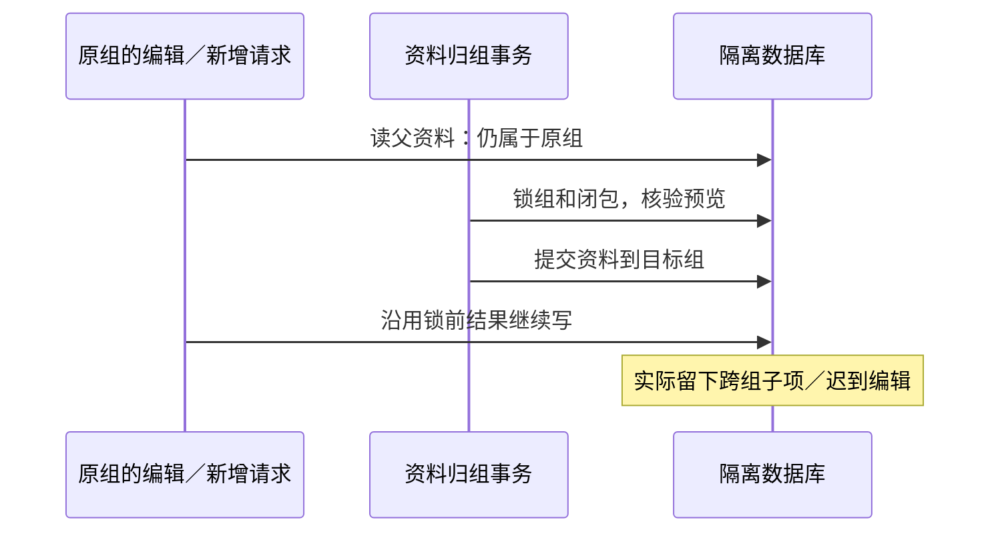

# T-1022 独立权限与事务审查

首轮报告时间：2026-10-05 00:33（Asia/Shanghai）。审查人：独立子代理 `permission_final_review`。本报告记录本次探针加载源码时的实现；主会话正在并行整改，以下 RED 不自动表示整改后的源码仍失败，关闭发现必须补本轮 GREEN。

**当前结论：FAIL，不能把权限和迁移并发 Gate 标为全绿。** 已通过的项目／稿件／制作／用料链锁保护并不覆盖知识、复盘、经验、聊天、排期、AI 任务、预测和发布这些实际父链写入。本轮在随机隔离 PostgreSQL 库通过真实公共 service 复现 31 个错误交错结果；另 1 个发布登记案例正确拒绝。没有对真实用户数据库、媒体或外部平台写入。

## 大白话

问题发生在“先看资料还在原组，再稍后写入”之间：资料可能已经搬到另一个组。接口报错也不一定安全——知识归档／改名会先改目标组里的资料，再在最终读回时报错。修复需要让写入和资料归组遵守同一锁序，并在拿到锁以后重读真实父资料。

## 已核对的合同与路径

已按顺序阅读 AGENTS、BACKLOG 的 T-1022 行、SPEC、PROJECT、PROJECT_CONTEXT、任务 packet、SYSTEM_ARCHITECTURE，以及 product-to-code-orchestrator 的技能与 stage router。安装技能／项目版本均为 3.27.2；context-plan 输出 BUILD implementation，兼容模式 compat-full。本审查只读生产源码，允许写入的独立报告为本文件。

- `backend/src/workspace-scope.ts`：group scope 以真实 groupId 过滤；legacy scope 只允许原 accountId 与 NULL／`grp_legacy_<accountId>`；无 scope 通过 requireAccountId 明确拒绝，不将 NULL 当全组。
- `contract/src/workspace-operation-scope.ts`：逐项声明用户／组／真实账号／父项目范围。声明本身不是执行时授权证据。
- `backend/src/application/queries/group-workspace.ts`：以 backend service 组合真实组、项目、冻结 Publication；历史账号选项来自当前成员与历史事实并集，拒绝不属于并集的筛选账号；组内创作卡片不消费平台筛选。
- `frontend/src/lib/request-context.server.ts`、实际 composition `frontend/src/server/persistence-client.ts`：服务端解析用户组与真实成员；公开查询的历史筛选走 query，不靠历史账号取得当前登录／采集权限。
- `platform-account/membership-lock.service.ts`、`account-group.service.ts`：真实平台账号／有效 membership／group 锁和版本；新平台任务与转组分开核验。历史事实 resolver `publishing.service.ts:947` 限定 ingestion 来源并重新检查当前成员，历史数据仍使用 Publication 冻结组。
- `intelligence/intelligence.service.ts:1003` 与 `application/intelligence/transport.ts`：私采账号按当前 membership 与真实平台端口验证；公开网页／RSS 预览使用真实 workspace，不强制要求空组拥有平台账号。worker task 的 collector 仍是真实账号。
- `workspace-write.ts` 与 projects、artifacts、production、material-links repository：已检查实际公共写入装配及交易回调，看到 group→真实父链的同事务锁；不能将这个局部覆盖推断为全部共享领域覆盖。
- `group-migration.service.ts:192` apply／`:209` undo：组锁、闭包父根锁、拿锁后重建 digest、事务更新、before-image、子项增量检查。显式移动 knowledge、conversation，项目闭包含 reviews／learnings／predictions／calendar 等，因而这些领域的 writer 也属于迁移验收范围。
- `group-resource-access.service.ts`、`0121_group_resource_grant_locks.sql`、assets／knowledge／blob 权限：共享 grant 只用于读；资源写仍需原组 owner；消费触发器锁真实资源与 grant，ledger 不随当前引用删除而丢失；revoke／undo会拒绝已消费授权。blob 按真实资产／grant授权，不从路径中猜默认账号。

## 需要关闭的发现

下面行号为 RED 复现时的位置；主会话整改会改变行号。

### F-01 · P1：知识写入与显式知识归组不在同一事务授权

位置：`backend/src/modules/knowledge/knowledge.repository.ts:530` createRevision、`:593` createRelation、`:634` archive、`:654` renameTitle。

版本、关系、归档和改名先在事务外校验知识根，再新增子项或按 userId／id 更新根。知识归组可在两步之间提交。真实公共 knowledge service 的 createRevision 在目标组写入“旧scope迟到正文”；archive 最后抛 OwnershipError，但目标组知识已 archived；关系分别只搬源端／只搬目标端后，旧请求仍成功留下跨组关系。renameTitle 的两例也改目标组标题再报错，**该例属于 repository API，本轮未发现产品用户 service 调用，不把它冒充公开端点**。

预期：owner 写必须在组→真实知识根锁内重验；关系按稳定顺序锁两端；版本＋currentRevisionId 更新原子提交；最后读回失败不能留下越权写入。

### F-02 · P1：复盘根及洞察新增使用已过期的父项目／复盘范围

位置：`backend/src/modules/reviews/reviews.repository.ts:110` createReview、`:148` createInsight；真实入口 `reviews.service.ts:154`／`:214`。

公共 createReview 的项目端口校验、createInsight 的父复盘校验都发生在持久化前且没有共同父锁。项目归组后，两顺序分别留下原组复盘引用目标组项目，以及原组洞察引用目标组复盘。公共 service 返回成功。应在事务内锁并重新校验真实项目／复盘父链；洞察不能沿用锁前 parent.groupId。

### F-03 · P1：经验根及应用新增形成跨组父引用

位置：`backend/src/modules/learnings/learnings.repository.ts:182` createLearning、`:376` createApplication；`learnings.service.ts:375`／`:482`。

公共 createLearning 带真实 projectId、applyLearning 分别验证经验和目标项目后，迁移仍可提交。两顺序都成功留下原组经验引用目标组项目，或应用的 group 为原组、父经验为目标组、应用项目仍为原组。必须在同事务中验证并锁实际项目以及经验根／应用项目，不能只补一条 group 锁。

### F-04 · P1：流式聊天消息能由旧组范围追加到已移组会话

位置：`backend/src/modules/ai/ai.repository.ts:354` createMessage；公开 service `ai.service.ts:846`；实际流式入口 `frontend/src/app/api/chat/route.ts:506`。

conversationIds 是显式归组对象。createMessage 读取 conversation 后直接新增 ai_messages，并按 userId／id 更新会话。两顺序都成功把“旧scope的迟到消息”写入已在目标组的会话。真实调用是产品流式聊天，不是只测试未暴露 helper。createMessage 与 appendAssistantMessage 共用同一路径；应按组→真实会话锁后重验授权与父归属。

### F-05 · P1：排期的组锁不能替代锁内项目重验

位置：`backend/src/modules/content-calendar/content-calendar.service.ts:634` 项目可排期验证；`content-calendar.repository.ts:201` createEntry。

真实 projects.getScheduleProject 已验证后，项目迁移提交；createEntry 等待组锁返回仍使用旧绑定，成功新增原组排期引用目标组项目。两顺序均复现。需在同事务内按真实 project／contentOutput／candidate 父链重验，本次新增不是仅靠 WHERE 的已有 entry 更新。

### F-06 · P1：AI 任务锁定成员后未重验任务关联项目

位置：`backend/src/modules/ai/ai.service.ts:952` 提取 projectId 和锁前 runtimeData 准备；`ai.repository.ts:514` createTaskIfAbsent（createTask 同类）。

探针的 runtimeData 端口真实调用 projects.getProject，随后项目迁移；任务创建等组锁后仍成功冻结原组并关联已在目标组的项目。两顺序均复现。冻结 group／membership 正确并不能证明 project／contentOutput 当前仍属该组；必须在事务内验证真实目标链并保持与迁移的锁顺序。仅在 worker 执行时失败不能修复已有错误任务归属。

### F-07 · P1：新预测在 subject 迁移后仍按原组创建

位置：`backend/src/modules/calibration/calibration.service.ts:653` createPrediction；`calibration.repository.ts:341` createPrediction。

公共预测创建先通过真实 projects.getOutput 的 subject 校验，再按原组 rubric 版本新增 prediction。两顺序均留下原组 prediction 引用目标组 contentOutput。应在同事务内锁真实 subject 父链与需要的版本根并复验 scope；createDraftPrediction／createResult 的类似瞬时 parent 检查也应纳入修复后的实际公共链测试，本报告未将未运行的额外案例写成 RED／PASS。

### F-08 · P1：新发布／导入事实可在组锁后引用已迁出的内容

位置：`backend/src/modules/publishing/publishing.service.ts:835` createPublication、`:970` createImportedPublication、`:978` registerOwnerPublication；`withTarget` 在 `:340`。

真实目标账号仍为来源组的当前成员，user／platform／membership校验全部成立；问题是 contentOutput 的 owner 读发生在 withTarget 前。createPublication 与 createImportedPublication 各两顺序都成功留下 source Publication 引用 target 项目；registerOwnerPublication 在 migration-validated-first 顺序同样写入错误已发布事实。register 的另一顺序因第二次 owner 读取正确拒绝，数据库没有新增 publication，这个案例记为正常，不充入 RED。

应在成员锁内用实际交易对象重新校验 output→project 内容父链。adoptDraft、register/imported换锚与revision写入也需按照真实公共链覆盖，不能只改 createPublication 一处。本探针只在隔离库登记测试 publication；没有真实发布供应商／浏览器调用。

### F-09 · P2：空组素材的本地路径与显示入口仍要求平台账号

位置：`frontend/src/server/persistence-client.ts:1544` localFileRuntime.assetStorageKey；实际入口 `frontend/src/app/api/v1/local/path/route.ts:54`、`local/reveal/route.ts:57`。

两 route 已接受 group context。assetsService.getAsset 可以确认组 owner／有效 grant 的素材后，后续 listAssetFiles 仍传 requireAccountId(ctx.accountId)。空组上传的合法素材无法复制地址或在文件管理器中显示，属于新增组能力使旧合法入口失败。应沿 workspaceKey 传真实范围与同一素材权限，不通过制造默认账号恢复。此项为源码证据，本轮没有在真实媒体上执行这两 OS 操作。

## 本轮执行证据

4 份直接 TypeScript 探针单进程串行执行，每个 probe 创建随机 `t1022_review_<uuid>` PostgreSQL 数据库，限制服务器为 `127.0.0.1:55422`，writer pool `max:1`，finally 关闭连接并销毁随机库。暂停点置于实际 service 父读／mutation await 边界；事务持锁顺序通过真实 PostgreSQL `pg_stat_activity` 观察 Lock 等待，未用假数据库驱动或纯几何/helper单测替代。

| 探针和日志（/tmp） | 案例 | 观测 |
| --- | ---: | --- |
| `t1022-knowledge-pg-review.ts` / `.log` | 10 | 版本／归档／repository改名／关系源端和目标端，各两顺序全部出现越权写入或跨组边 |
| `t1022-shared-pg-review.mts` / `.log` | 10 | 复盘根、洞察、经验根、应用、会话消息，各两顺序全部出现错误归属 |
| `t1022-adjacent-pg-review.mts` / `.log` | 6 | 排期、AI任务、预测，各两顺序全部在父资料迁移后成功新建原组记录 |
| `t1022-publishing-pg-review.mts` / `.log` | 6 | 发布／导入各两顺序、登记迁移先持锁共5个错误结果；登记读先完成的1例正确拒绝且无写入 |

复现命令：`pnpm -C backend exec tsx /tmp/<上述脚本>`。外部空 analytics／publication 查读、无发布事实／时区等窄端口按案例 stub；实际归属父读全部通过真实 projects／knowledge／account service。不存在真实模型效果、五平台 OS 身份采集或真实发布证据。

截至首轮审查提供的既有日志，本人已实际读取：

- `/tmp/t1022-migration-concurrency-final.log`：真实 PG 项目／无 scope output／stage／task／activity及grant消费者，12／12 通过。
- `/tmp/t1022-parent-writers-audit-test.log`：16文件、147测试通过；这个日志不能用于宣称上述未纳入的共享父链并发已经通过。
- `/tmp/t1022-final-group-backend.log`：18通过、1跳过、1失败文件；83通过、1跳过、4失败测试。失败是 candidate/group-shared-domains 中父链 OwnershipError，主会话正在定位／修复。未写成全绿。

首批日志校验锚：knowledge `2f3b20a50dbd7dee2e77eba5705bfbfced72e418eeb62bdfe43db1998c23ad32`；shared `27b95cfcd2a25c8c21cf9fe46b4ec9d137971562c40d8d572dbc275ba2102a0d`；adjacent `b2b48dbfdf75ad646aebc8555dfde711728324c0fe60cd34c96779c63de605cf`。publishing `feac1162476b981e6d34c875220a2b8e71663fccb35cf309d882121f6add6b0d`。整改后结果应另附日志，不覆盖 RED 证据。

## 关闭标准与证据边界

每项必须在实际公开 service 或产品入口重新测试两个顺序：写先持真实父链锁则迁移等待并拒绝旧 digest；迁移先持锁则旧 scope 的写等待后拒绝，数据库无迟到编辑／跨组边／错误任务。undo也必须使用相同父链协议并验证后续写／新消费不会被撤回覆盖。真实历史事实按冻结组读、当前成员的采集／发布权分别验证；空组与 legacy 原账号合法任务不得因新增门禁失去安全输出路径。

本报告不改变 BACKLOG／Gate 状态，不进行 commit／push，不把临时 PG、PGlite、DOM／浏览器假驱动当作真实五平台账号采集／真实发布／Mac和Windows安装包验收。尚未运行的额外路径与真实宿主矩阵保持待验证。
