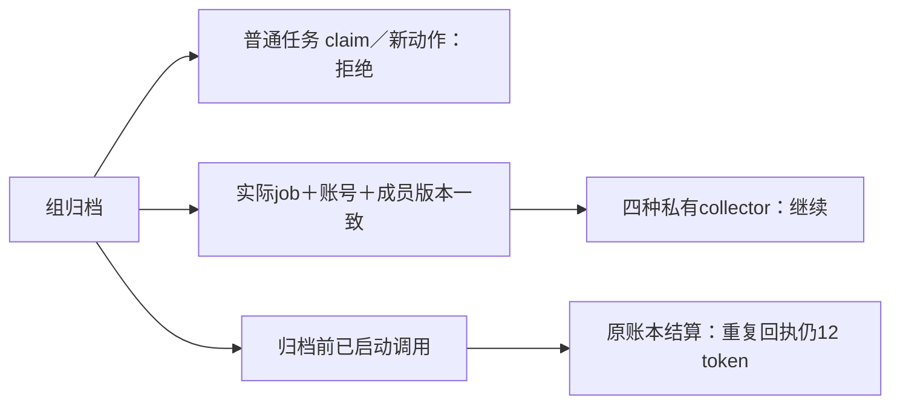

# T-1022 启动调度 B1 修复独立复验

时间：2026-10-05。结论：**PASS（限 B1 归档准入修复），初次阻断 finding 已关闭**。这不是整个 T-1022、真实平台或安装版的放行。初次 FAIL 报告 `startup-permission-review.md` 保留原样。

大白话：归档后，普通写稿和同步任务拿不到新的执行权，也不能继续启动新动作；归档前已经发出的调用仍能正确结算。实际账号的四种私有采集保留合法后台路径。



## 快照与边界

候选树：`/Users/zyongzhu/.codex/worktrees/t1022-task-scope/Thirdspace-creator`。

原冻结：`/tmp/t1022-startup-freeze.json`（21 文件）；修复冻结：`/tmp/t1022-archive-admission-freeze.json`（2026-10-05 02:44，7 文件），替换原清单 6 文件、新增 owned `execution-lease.service.ts`。按 path 依次合并原冻结、B1 冻结及 `/tmp/t1022-test-types-freeze.json`（两文件 test-only 类型整理），仍为 **22 个文件**。最新组合候选树 **22/22 匹配**；B1 增量中 PG 测试以 test-only SHA 为最终版本，其它六个文件保持 B1 原 SHA。主会话接入后，本评审再次当场复核：ROOT 与候选树最新组合均 **22/22 匹配**，B1 非 test-only 生产增量无漂移，最新 test-only 增量 **2/2 匹配**。报告据此冻结。

遵循前次已加载的流程技能 3.27.2／T-1022 SPEC／架构；本轮只修改本报告。生产代码、初次报告、BACKLOG、manifest 与控制面未由评审修改。探针仅在 `/tmp`，PG 仅为 127.0.0.1:55422 随机临时数据库；未打开真实用户库、浏览器或外部平台。

## B1 关闭依据

新增 `assertAiTaskWorkspaceAdmission` 从持久化 AI task 的 scheduled kind／jobId 及实际 job、账号、有效成员派生豁免；`assertExecutionTaskWorkspaceAdmission` 先核对实际 AI→execution 映射（包括 group/account/version），或验证 automation 的实际 scheduled job。账号ID本身不再构成归档授权。真实 job 还必须匹配四种 sourceKind、抖音 active 账号、当前组与 membershipVersion。

独立逐调用点复核：

- `persistent-task.service.ts:614/660` 的 claimNext／claimTask 均改用 execution admission，拒绝后记录 blocked。
- `execution-lease.service.ts:23/36` 在 admission 动作前后都复核；settlement 保留原租约／账本结算语义。
- `ai.repository.ts:592/623` 的旧 AI claim／beginModelCall 都在真实事务内调用 AI admission；`ai.service.beginModelCall` 经该 repository 落实，没有另留宽泛 `allowArchived:!!accountId` 门。
- 没有新 wire flag；内部判定读取持久化业务事实，不采信 worker payload 自称私有 collector。

## 同一透明 PG 探针及独立扩展

按要求先原样执行 `/tmp/t1022-independent-probe.ts`。输出变为：

```json
{"probe":"ordinary-ai-claim-after-archive","claimed":false,"taskType":"script.draft"}
```

日志：`/tmp/t1022-b1-original-transparent-probe.log`。原脚本下一行以 `ordinaryClaim!` 假设漏洞仍返回任务，且 finally 内 `process.exit(0)` 会掩盖空值中断，所以**原样执行只证明第一条认领结果，不能当全探针通过**。保留原脚本不修改；另在 `/tmp/t1022-b1-independent-probe.ts` 延续同一建组、任务和实际 automation 装配，使用 Node assert 对修后结果作断言，并修正 finally 的退出状态和 ESM cron 停止逻辑。

最终执行：

```bash
pnpm --filter @creatoros/backend exec tsx /tmp/t1022-b1-independent-probe.ts
```

最终日志：`/tmp/t1022-b1-independent-probe-final.log`；**退出 0，全部断言通过**。真实临时数据库 `t1022_independent_9da6e4871f6c4773b0704696e65276b4` 已 DROP，探针进程／timer 无残留。探针直接通过生产服务公开入口创建真实组、账号、job、AI／execution 和账本；负向故障仅在这个隔离库中明确篡改持久化字段后复验并恢复，没有修改生产文件。

| 本轮透明探针 | 实际结果 |
|---|---|
| ordinary script.draft 排队，归档后 claimTask | null，不获得执行权 |
| ordinary source_sync 排队，归档后 claimNext | null，不获得执行权 |
| ordinary 归档前已认领，归档后 lease admission | 拒绝 |
| ordinary 旧AI归档前已认领，归档后 beginModelCall；归档后旧AI claim | 均拒绝 |
| 原账本调用在归档前 reserve／start，归档后新增 reserve／start | 拒绝新动作 |
| 原账本已有调用 settle 两次同一12 token回执 | spentTokens=12，没有重复计费 |
| self.metrics／self.traffic／comments／self.detail，归档后旧AI claim＋beginModelCall | 四种均允许 |
| 同四种实际 collector，归档后 persistent claim＋lease admission | 四种均允许 |
| 实际私有已认领任务分别改成缺失job、假owner、错membershipVersion、错job membershipVersion | lease admission 均拒绝 |
| 归档后新增普通AI | 拒绝 |
| 真实 automation.start 全链（self.metrics） | driver→persistent enqueue/claim→实际 handler→trigger/controls→AI admission→run intent→真实 scheduledFlywheel.prepare→execution authority→scheduledChild.attach 成功 |

全链故意传入其它页面组，实际派发仍是原 `grp-1 / acct-3 / membershipVersion=1`；AI、run、execution、父任务 payload 冻结一致，`__scheduledChild.executionTaskId` 已持久写入。official Skill resolver、flywheel.prepare、authority 与 child attach 均为真实代码。模型解析端口设置抛错且没有执行 collector，确保没有外部副作用。四种 collector 的 claim/model/lease 检查完整；完整 cron 父子交接本轮实跑 self.metrics，没有把它写成四种全链都已实跑。

## Fresh 测试结果

在候选树独立执行：

```bash
CREATOROS_TEST_POSTGRES_URL=postgresql://zyongzhu@127.0.0.1:55422/postgres \
CREATOROS_ISOLATED_PG_URL=postgresql://zyongzhu@127.0.0.1:55422/postgres \
pnpm --filter @creatoros/backend exec vitest run \
  src/integration/startup-group-collectors.postgres.integration.test.ts \
  src/modules/execution/execution-lease.service.test.ts \
  src/modules/execution/execution-call-ledger.service.test.ts --reporter=verbose
```

**3 文件，56 PASS，0 FAIL，0 SKIP**；日志 `/tmp/t1022-b1-independent-suite.log`，Duration 31.81s。

- 真实 PG suite：28 PASS，覆盖普通任务／旧 AI 拒绝、四种 collector 保留、缺 job／其它账号 job／错 membership／假 owner 拒绝、锁并发顺序、转组回滚、历史 run 与 shared group job。
- lease suite：4 PASS。
- call-ledger suite：24 PASS。

在作者整理两份测试的资源字段／mock签名、satisfies／回调类型／非空guard后，本评审只读对比确认没有移除断言，并再独立执行：

```bash
CREATOROS_TEST_POSTGRES_URL=postgresql://zyongzhu@127.0.0.1:55422/postgres \
CREATOROS_ISOLATED_PG_URL=postgresql://zyongzhu@127.0.0.1:55422/postgres \
pnpm --filter @creatoros/backend exec vitest run \
  src/application/workspace/startup.test.ts \
  src/integration/startup-group-collectors.postgres.integration.test.ts --reporter=verbose
```

最新 test-only 冻结实跑 **2 文件，34 PASS，0 FAIL，0 SKIP**（startup 6 + PG 28），Duration 17.63s；日志 `/tmp/t1022-b1-test-types-independent-suite.log`。PG 28 与前一轮重复，不能把两轮相加声称90个不同测试；最终已覆盖不同测试为 **4文件62例**，由最新 startup6／PG28 和未变 lease4／ledger24 组成。

后两套使用 createDb 隔离内存数据库，不冒充 PG。上述 56 为本轮真实重新执行的数量；透明探针观察不计入 Vitest 数。作者其它 86 PASS／production typecheck 材料未在本轮独立重跑，也没有作为本轮 PASS 依据。

## 剩余边界

B1 当场反例已全部转为拒绝，合法私有采集、已有账本结算与实际交接路径没有被此修复反杀；本轮没有新增阻断 finding。

本次独立回执只关闭初次归档权限 finding，不追认历史 RED、不修改任务完成状态。真实扫码／Cookie登录有效性、外部平台／模型、安装版 Mac/Windows、T-1022 其它迁移／UI／全局 Gate 仍需原任务的独立验收证据。
