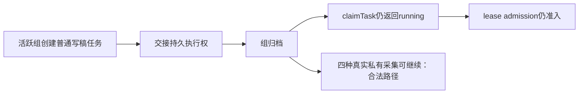

# T-1022 启动与调度追加候选独立评审

评审时间：2026-10-05。结论：**FAIL，不放行当前冻结候选**。存在 1 项阻断权限问题。评审仅写本报告，生产代码、BACKLOG、manifest 与控制面没有被本评审修改。

大白话：组归档之后，只有真实账号的四种私有采集可以继续；现在普通写稿和同步任务也能因为“带了账号ID”拿到执行权，归档边界没有守住。



## 冻结与输入

- 候选树：`/Users/zyongzhu/.codex/worktrees/t1022-task-scope/Thirdspace-creator`。
- 冻结清单：`/tmp/t1022-startup-freeze.json`，冻结时间 `2026-10-05 02:27 Asia/Shanghai`。
- 本轮读取前及源码评审完成后 SHA-256 均匹配 **21/21**，没有漂移；报告只对该快照下结论。ROOT 集成由主会话负责，本报告不将混合工作树 HEAD 当候选回执。
- 已读 BACKLOG T-1022、已评审 SPEC `docs/features/t1022-account-group-workspace.md`、PROJECT、PROJECT_CONTEXT、SYSTEM_ARCHITECTURE、流程技能与 stage-router/context-plan。技能和项目均为 `3.27.2`，入口为 `4-build` 独立实现复核。
- 本轮没有运行会修改索引／控制面的 CodeGraph index、reconcile、taskctl 或 pmem。独立隔离探针只落 `/tmp`；没有打开用户数据库、浏览器或外部平台。

## 阻断 finding：普通任务获得归档豁免

**严重度：高。范围：普通 AI／持久任务认领与动作准入。**

`backend/src/modules/execution/persistent-task.service.ts:614`、`:660` 在 `claimNext`／`claimTask` 中使用 `allowArchived: !!candidate.accountId`／`!!snapshot.accountId`，只要带实际账号就允许归档组；没有验证任务属于四种 collector，也没有读取实际 scheduled job。`backend/src/modules/execution/execution-lease.service.ts:23`、`:36` 的 admission 校验重复同一宽泛授权。`backend/src/modules/ai/ai.service.ts:1137` 的 `beginModelCall` 也存在同类逻辑（此入口本轮仅源码确认）。

当场复现采用 **真实 PostgreSQL 55422、随机临时数据库**、生产服务公开入口，未直接插入伪造权限记录：

1. 活跃组内 `ai.createTask(script.draft)` → `executionAuthority.bindAiTask`；另以 `persistent.enqueue(source_sync)` 建普通任务。
2. `accountGroup.archive` 归档原组。
3. `persistent.claimTask` 返回普通写稿任务 `running`；`persistent.claimNext(kinds:['source_sync'])` 返回普通同步任务 `running`。
4. 使用真实 claim 的 attempt／fenceToken 调 `executionLease.withLease(...,'admission',...)`，普通写稿任务仍准入。
5. 对照：归档后新增普通 `ai.createTask(script.draft)` 被拒绝。因此只收窄新增创建入口不足以封住既有排队任务与动作准入。

当场输出（完整在 `/tmp/t1022-independent-probe-final.log`）：

```json
{"probe":"ordinary-ai-claim-after-archive","claimed":true,"status":"running","taskType":"script.draft","groupId":"grp-1"}
{"probe":"ordinary-ai-lease-admission-after-archive","admitted":true,"groupId":"grp-1"}
{"probe":"ordinary-source-sync-claim-after-archive","claimed":true,"kind":"source_sync"}
{"probe":"new-normal-ai-after-archive","rejected":true}
```

应在认领、模型动作和通用 lease admission 一致落实服务端窄授权：只有四种 collector、真实 job、原账号／组／membershipVersion 一致且账号 active 才能豁免归档；普通任务不可凭 accountId 得到此豁免。必须保留已存在调用的安全 settlement 与合法私有采集路径。修复后重跑同一负向探针和完整私有链。

## 六项链路复核结果

| 检查 | 本轮观察 |
|---|---|
| receipt／实际 profile 准入 | startup 使用成功 account_binding execution receipt；无 receipt 时经实际账号授权 profile 后检查非空 Cookie 文件，不把 externalAccountId／路径解析直接当身份成功。profile helper 的空文件／symlink 拒绝测试通过。成功扫码 stage 的真实 CDP/文件采纳路径只读追踪 ROOT `frontend/src/server/ingestion/account-binding-stage.ts`，本轮未连接真实平台；旧 Cookie 证明不承诺当前仍已登录。 |
| 同平台多账号／组共享 | 私有 job 查找带真实 accountId；同组 A/B 两个抖音各保留独立 job。topic.daily／intelligence.sync 可 accountId=null，按组幂等。隔离 PG 与 startup 测试通过。 |
| 转组事务／历史冻结 | 转组和创建锁实际 account／有效 member；两种锁先后顺序均观察真实 PG wait_event_type=Lock。旧 version 创建拒绝、新 version 可建；future job 更新失败整事务回滚；历史 run 留旧组并可读取，新组不吞旧历史。 |
| 归档私有窄通道 | 新建 job、AI admission、execution binding、persistent enqueue 读取真实 job／成员，拒绝错组、错号、共享 topic 和未接入平台；**既有任务认领和 lease admission 存在上述阻断漏洞**。未发现新增 wire flag。 |
| 绑定后 best-effort | account-binding.execute 先在成功事务内落 accountId checkpoint／succeeded，再调用 onBound；callback 与 onBoundError 均抛错时保持成功，不 rollback profile。独立重跑测试通过。 |
| cron 到 execution 全链 | 额外独立探针运行真实 createSchedulingAutomation.start → listJobsSystem → runAutomationDriverTick → persistent enqueue/claim → 实际 handler → triggerScheduledJob → createSchedulingControls → AI admission → run intent → scheduledFlywheel.prepare → execution authority → scheduledChild.attach，冻结 group/account/version 在 AI、run、execution 与父payload一致。模型与外部采集没有执行。 |

完整私有链是在归档组执行，调用方故意带其它页面组；实际派发仍使用原 `grp-1 / acct-3 / membershipVersion=1`，父任务 `payload.__scheduledChild.executionTaskId` 已写入。该探针使用真实 official Skill resolver 与真实 flywheel preparation；仅预算模型规格端口设置为抛错，保证不发外部模型请求。

## 本轮准确验证结果

fresh 命令（在候选树执行）：

```bash
CREATOROS_TEST_POSTGRES_URL=postgresql://zyongzhu@127.0.0.1:55422/postgres \
CREATOROS_ISOLATED_PG_URL=postgresql://zyongzhu@127.0.0.1:55422/postgres \
pnpm --filter @creatoros/backend exec vitest run \
  src/application/workspace/startup.test.ts \
  src/integration/startup-group-collectors.postgres.integration.test.ts \
  src/modules/platform-account/account-binding.integration.test.ts \
  src/modules/platform-account/account-binding-commit.integration.test.ts \
  src/modules/ai-runtime/collection-bootstrap.test.ts \
  src/modules/ai-runtime/scheduled-collection-scheduler.test.ts \
  src/modules/ai-runtime/automation-driver.test.ts --reporter=verbose
```

结果：**7 文件，131 PASS，0 FAIL，0 SKIP**；日志 `/tmp/t1022-startup-independent-suite.log`；Duration 24.38s。其中启动组 PG suite 真实随机临时数据库；绑定／commit 套件采用 createDb 隔离内存数据库及注入宿主端口，不能冒充真实平台。出现 pg 并发 query 的 DeprecationWarning，无测试失败。

独立探针命令：`pnpm --filter @creatoros/backend exec tsx /tmp/t1022-independent-probe.ts`；最终日志 `/tmp/t1022-independent-probe-final.log`，退出 0。它含 **4 个权限观察**及 **1 条真实本地私有调度交接链**，不是 Vitest 测试数量。最终随机数据库 `t1022_independent_760746f2ca7649bab4ca3af99f0617c2` 已清理。前一版日志也保留于 `/tmp/t1022-independent-probe.log`；该版关闭 DB 后遗留 cron tick 报 pool 已关闭，已停止该探针进程。最终版在完成随机数据库清理后退出进程，不留下 timer。首次探针曾误用未导出的 listRunnableAutomationJobs 导致 TypeError；没有将失败版当完整链通过。完整链最初用未准备的 authority 子任务导致父子校验拒绝；改为真实 flywheel.prepare 后挂接成功，原失败日志保留事实，不作为产品缺陷。

**131 GREEN 不能覆盖上面的确定性反例，当前结论仍为 FAIL。** 本轮未独立重跑作者提到的 backend production types，也未采信作者历史测试或主会话验证为本轮结论。

## 限制与待验

- 未实际扫码、启动浏览器、采集平台数据或调用模型；真实 profile 登录有效性、安装版 Mac/Windows 和外部平台仍待验。
- 真实完整本地交接探针重点覆盖 self.metrics；其它三种 collector 本轮有准入相关套件和静态调用链证据，未逐一执行同一全链探针。
- 本次只审启动调度追加范围，不代替 T-1022 UI、迁移、全局 reconciliation／boundary／orphan 验收，不补拍历史 RED。
- 修复归档漏洞后需要新的冻结 SHA 与负向反例复验；本报告不提前给予修后 PASS。
