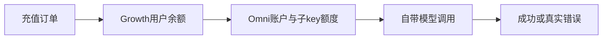
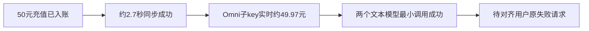
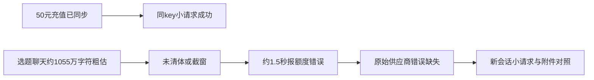

# T-1024：Growth受管模型充值后余额不足排查

用户报告：2026-10-04下午充值50元，后台显示余额，调用自带模型持续报余额不足。用户提供Omni key供定向诊断，原文凭据不进入工件。

范围：只读追踪Growth充值订单、账本、供应商同步、子key限额及CreatorOS错误来源。必要时以极小调用验证用户授权的调用链。禁止重复入账、直接改资金或扩大查询到无关用户。若需发布或改账户资金，先提供具体修复与证据。



验收：受影响账户脱敏映射、订单及供应商证据、最小复现与根因；无真实凭据的环节保留待验，不编造PASS。

## 2026-10-04 实际核验（北京时间）

只读连接实际生产release：`ff6d7dd5d00b48680ee7d8281840c06d77a483dd`，API/worker active。所有数据库查询均在READ ONLY事务中执行。未改充值、账本、key限额或生产配置。

- 受影响凭证：`mmc_b4019adca8824419868dce0f66517984`，`creatoros / official / omnihi`，provider key ID `241`，状态active。仅保存脱敏标识`sk-omnihi-1T...6ss3`。
- 额度账户：`AICA-787929DAA4204662BC9D`。
- 充值：16:58:42.074登记`recharge_code`，provider增额50.00000000 CNY，16:58:44.783应用成功。同步outbox `out_2f90faf96e514d83a752c8feb68a59dc`一次成功，无待重试。
- 首赠5元，ASR已消费1.5元，对应累计供应商预算上限53.5元。Growth最后刷新17:00:15，已用2.08742062元，剩余51.41257938元；该值不是现在的供应商实时余额。
- Omni实时读回：key enabled=true，budget_amount=53.5，budget_used=3.53033012，budget_frozen=0，budget_remaining=49.96966988 CNY。母账户spendable_balance=120.32593444 CNY，无冻结、无超信用、无待偿债。
- 定向查询`api_key_id=241`当日流水：9条记录均status=1（供应商页面标记成功）；充值后17:11、17:21、17:23、19:17及21:10有成功扣费调用，模型为claude-sonnet-4.6与gpt-5.6-sol。此流水不能证明没有被前置拒绝且未入流水的请求。
- 使用该凭证通过`https://api.omnihi.ai/openai/v1/models`读取模型清单HTTP 200。
- 两次极小调用：`POST /openai/v1/chat/completions`，输入“Reply OK only.”，max_tokens=8，非流式。claude-sonnet-4.6与gpt-5.6-sol均HTTP 200，正文OK，分别15与14 total_tokens。这是实际供应商调用，不是fixture，也不是用户桌面原失败任务复验。



## 结论与尚缺证据

已排除本次50元漏入账、当前子key预算未同步、当前key禁用及当前母账户无余额。尚不能认定用户原任务已经恢复，也不能仅凭现状认定客户端误报或供应商路由故障。客户端会将HTTP402或明确余额错误翻译为额度不足，但缺少原请求状态、错误正文、实际凭证身份、模型/协议、时间和安装版本，无法确定其触发来源。

已向用户询问失败操作、所选模型与最近报错时间；必要时继续读取原任务脱敏日志。没有复现原失败，不修改错误分类或重发用户原收费任务，不将T-1024标完成。

## 工程状态

`taskctl start T-1024`已产生审计事件；`pmem sync`已完成。`reconcile`本轮已结束：33 errors、1 warning，exit 1；全局未通过，不能宣称全绿。现有T-1022验收记录另有全局历史失败，由T-1015/T-1018/T-916承接；本次不改基线。未改产品运行时代码，原用户失败请求仍待对齐，因此任务保持进行中。

## 用户提供两份Windows日志后的定向诊断

两份文件均用开发者本地私钥按项目CRLOG-v1协议解密，私钥没有输出。第一份94帧、第二份142帧，全部认证通过，无截断或损坏。仅脱敏临时文件位于本机`/tmp/t1024-log-diagnosis/`（目录0700、文件0600），原加密文件未改。

| 文件 | SHA-256 | 时间覆盖（北京时间） |
| --- | --- | --- |
| sidecar-2026-10-04.log.enc | 6012c6d5e8fe2549d0e662003190df80652542a2e22a4ade5c59ba12200eb23a | 15点至充值前后 |
| sidecar-2026-10-04-1.log(1).enc | 6fc43f2c049adfb6f47fbb5219b17831b4eaae435f33890b53a72ac2eb9f9e86 | 16:59至21:15 |

### 已确认的原失败请求

| 时间（北京时间） | 安全参考号 | 操作 | 发送前后粗估 | 耗时 |
| --- | --- | --- | --- | --- |
| 21:08:10 | chat-4e173b480b | topics / topic.generate | 3518301 → 3518301 | 1580ms |
| 21:11:06 | chat-1ae5526c69 | topics / topic.generate | 3519092 → 3519092 | 1495ms |
| 21:15:09 | chat-6182861c2e | topics / chat | 3532294 → 3532294 | 1459ms |

三次日志均为`ManagedAiCreditExhaustedError`、`AI_CREDIT_EXHAUSTED`，分类`provider_stream_error`；没有进入有效模型输出。这是聊天入口报错，不是这三次点击充值接口失败。每次上下文日志都显示`cleared=0 truncated=0`；切换topic.generate到普通chat后异常仍在。

关键脱敏日志（第二份第84、92、105、113、125、133帧）：

```text
[2026-10-04T13:08:08.625Z] [chat-context] est=3518301→3518301 tokens cleared=0 truncated=0
[2026-10-04T13:08:10.239Z] diagnostic: class=ManagedAiCreditExhaustedError code=AI_CREDIT_EXHAUSTED
[2026-10-04T13:11:05.134Z] [chat-context] est=3519092→3519092 tokens cleared=0 truncated=0
[2026-10-04T13:11:06.655Z] diagnostic: class=ManagedAiCreditExhaustedError code=AI_CREDIT_EXHAUSTED
[2026-10-04T13:15:08.086Z] [chat-context] est=3532294→3532294 tokens cleared=0 truncated=0
[2026-10-04T13:15:09.572Z] diagnostic: class=ManagedAiCreditExhaustedError code=AI_CREDIT_EXHAUSTED
```

### 源码与隔离探针

1. `backend/src/modules/ai-runtime/chat-history-window.ts`的`estimateTokens`按整个JSON字符数除3，包括图片/文件data URL；它是粗估，**不是供应商实际计费token**。因此不能从上述日志直接推导“实际发了352万文本token”或“实际费用超过50元”。
2. `projectChatHistory`第247行只有超预算且轮数大于keepTurns（默认12）时才删旧轮；没有对单轮大文本或系统上下文重新收敛到预算。当前仍保存这份旧逻辑，日志表明受影响安装版调用了这一路投影。
3. `frontend/src/server/chat-attachments.ts`第97行把图片转换为base64 data URL，粗估会放大图片的字符数。
4. 本机隔离纯函数探针（无网络、无业务库、无用户资料）分别使用10530000字符的单轮纯文本及等长合成base64图片：得到3510042及3510057粗估，after不变、cleared=0、truncated=0，原part保持。这验证裁剪缺口及图片计数歧义，**不验证用户附件类型，也不验证Omni的拒绝理由**。
5. 用户安装目录栈为Windows runtime-images `1.1.0-461f89527244`。这是运行目录指纹，未验证对应源码Git commit，不冒称已用同一安装产物复现。

### 当前结论

充值与当前key余额已被真实账本/供应商排除。原失败准确定位到选题聊天三次首响前的额度错误；其共同异常是约1055万字符量级的上下文粗估且未收敛。异常大输入、图片base64计数或附件协议问题是高价值排查方向，但供应商原始HTTP状态/错误正文、实际所选模型以及请求体分项均未记录，因此不能将其写成确定根因。也不能从`ManagedAiCreditExhaustedError`倒推一定HTTP402：该分类器同时识别明确余额文字与1008等代码。

安全恢复验证建议：保留原会话，另开新对话，不带附件，仅一句短问；成功后再对比单张小图/原资料请求。该动作由用户在其桌面执行，本轮没有删用户会话或历史，也没有重发原大请求。

已询问用户报错前是否上传图片或长文档；后续若仍不足，需拿到该参考号对应的请求分项尺寸、实际模型及供应商脱敏错误，避免盲目重复充值。



### 另外发现的独立故障

- 15:18项目重建失败是结构化输出缺`research`字段；17:11选题生成一次`output_invalid`，17:21该模板又成功。
- 15:18、15:19、15:30、17:11、17:21、17:26、19:17等转写错误是`LOCAL_WHISPER_MODEL_LOAD`，模型为`whisper-local`；属于本地Whisper加载问题，不是本次充值未到账。日志没有保留模型加载底层原因，不推断是模型文件缺失、权限或网络问题。

补充真实供应商验证：同key、claude-sonnet-4.6、stream=true、max_tokens=8192的一句短请求HTTP200，5个SSE data事件，正文OK，无error。这进一步排除当前该模型仅因开启流式或8192输出上限而必然报额度不足；不覆盖原用户大请求。

本轮仍只诊断，未改运行代码、未打包或发布、未改账；原用户大请求未完成复验。
