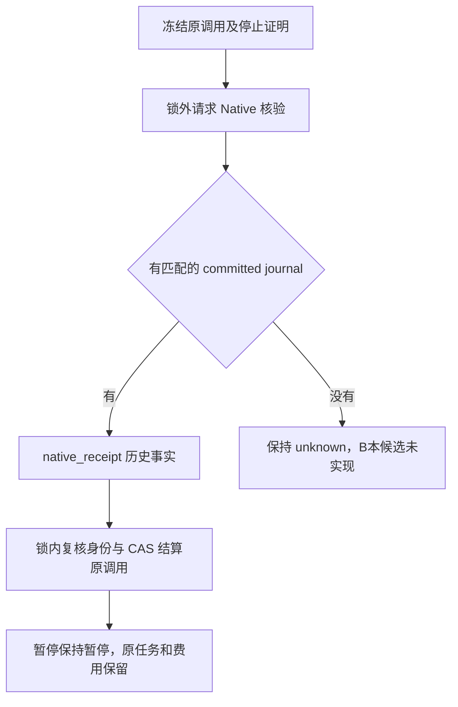

# T-1026 文件写入中断对账协议与验证

状态：A协议及正式公开端口已通过Wegener独审并实施，最终生命周期回归及代码已获Wegener独审通过，允许当前mac候选冻结。B本候选未实施、未通过，原99继续paused/unknown。本文承接T-1026 SPEC第四轮，不替代SPEC/BACKLOG。

## 已确认事实

- 公开证据 `/tmp/t1026-cli-evidence/repair-third-paused-all-combined.json`：原任务 `execution-task-2082997a-99` 已 paused，调用114 `call_7bb3e855-5799-4dd2-9772-187dc33967b5` 为 `files_edit`，冻结参数 `expectedVersion=3`，回执为空且 unknown。此事实不能证明实际写入是否完成。
- 修复前 Rust IPC 仅回显 operationId，旧版 `TaskFiles.write(path,bytes,expectedVersion)` 不接收它。macOS/Windows 只保存路径对应的 version/hash，均无原操作 journal。
- Native client 收到成功后会再核验租约；暂停导致复核失败时返回 unknown。A新增新版持久回执查询，旧记录不能追溯伪造。
- 当前 worker/checkpoint 会阻断未知工具；不得将文件工具 unknown 泛化成可重放的 committed 工具，更不能解除 browser unknown。

## A. 新版 journal（协议与公开端口已独审通过，已实施）

### 1. 身份和存储

记录放在已有 task 专属、命令沙箱不可写的 `.creatoros-state-<task>/file-operations/`。仍使用目录句柄相对打开、拒绝 symlink/reparse point，禁止模型指定 journal 路径。文件名为 operationId 的 SHA-256，读取内容后必须再次核验完整 operationId 与任务 scope。

记录格式（JSON，`schemaVersion:1`，有界且严格解析）：

| 字段 | 定义 |
| --- | --- |
| scopeKey / operationId | Native 可信 user/account/task scope 与原 backend callId |
| requestDigest | `sha256(JSON.stringify(["creatoros-file-write-v1",scopeKey,operationId,normalizedPath,expectedVersion,contentSha256,byteLength]))`；Rust/TS 固定向量验证 |
| path | 既有安全校验后的 NFC 相对路径 |
| expectedVersion | 原请求身份：显式安全整数或省略时的 null，不能将省略规范成0；digest区分null与0 |
| observedBaseVersion | 锁内真实读到、并通过CAS验证的写前版本；不参与替代原expectedVersion身份 |
| contentSha256 / byteLength | 完整 UTF-8 请求字节的 SHA-256 和字节数，不使用片段/相似度 |
| admittedAttempt / fenceToken | 首次派发身份，历史回执跨新 attempt 查询时不改写 |
| state | `prepared` 或 `committed`；不将 prepared 当成未写入 |
| resultVersion | 仅 committed 存在，必须为 observedBaseVersion+1 |

不同 operationId 是不同操作。同键必须匹配全部请求身份；仅因 attempt/fence 更新不创建第二次写入。原成功响应继续兼容 `{version}`，不改变冻结的工具 schema 或历史 settled 结果。

保留原文件能力语义：files.edit必须显式expectedVersion；files.write省略expectedVersion仅允许新建，目标存在仍拒绝，不能借null放宽为盲覆盖。原client把省略补0的转换必须消除，Native记录真实null并单独观察base；null与显式0即使都可在空路径写入，也不是同一请求摘要。

### 2. 写入顺序与崩溃语义

持有 task 文件锁完成：查原键及参数冲突 → 完整path/大小/版本范围校验 → 读取observedBaseVersion并通过CAS（null仅允许不存在）→ 写入prepared并fsync → 临时文件与原子rename → 文件/版本元数据耐久化 → 原子保存committed journal并fsync → 返回成功。首次创建journal目录也须fsync其父目录。明确path/CAS拒绝不产生prepared；prepared已经存在则不删除、不按新操作重试。

| 断点 | 原键再次出现 / 对账行为 |
| --- | --- |
| 首次派发前 | 无 journal；对账只返回 absent，不能据此证明历史未写入 |
| prepared 已落盘、实际写入前 | 对账返回 pending；不执行 write |
| 数据 rename 后、元数据或 committed journal 前 | pending/unknown；不由新 journal 路径猜测成功，也不重复 write |
| committed journal 已耐久、响应丢失 | 原键返回历史版本；只读查询可用于结算原 call |
| 文件已有后续版本 | 原 committed 回执仍可回读，不恢复旧字节、不改当前版本 |
| 同键不同 path/content/expectedVersion | 确定性拒绝，文件与原 journal 不变 |
| journal 损坏/身份不符/版本不支持 | 保留 unknown，不降级为新写入 |

`prepared` 重入不得重新调用 write。原始未派发的新调用与已未知调用的资格由 backend 账本区分；reconcile 端口永远不能执行写入。后续若需要收敛 prepared，只能另经明确批准的观察协议，不能隐式提升为历史 receipt。

### 3. Native 只读 receipt 查询

私有 IPC action：`file_receipt {targetOperationId, path, expectedVersion, contentSha256, byteLength}`。查询只接受由可信 backend 恢复快照派生的 scope，不能由工具模型、公开请求体或 WebView 提供 user/account/task 身份。响应为 `absent | prepared | committed`，committed 带完整身份和结果版本。没有操作记录绝不回报 confirmedNoCommit。

与普通动作不同，查询允许已停止的旧执行被核对，但这不授予它新的 write/command 权限。保持 authenticated peer 与 scope 校验，不复用一个可执行任意 action 的宽松 stale-lease 入口。

### 4. backend 原调用结算

锁内取快照：验证当前 task 归属、冻结 Pi chat、原工具定义/version/effect/execution/schema、唯一模型提案、原 operationKey、完整 inputDigest、callId、claim、startedAttempt 及已有用量。只接受真正 files.write/edit、已 started/unknown 且尚无结算证据的原调用；拒绝伪引用、length/invalid_input、外部子调用和不一致的已有回执。

锁外只读 Native receipt；锁内重新核验整个绑定和停止状态，拒绝期间发生的 lease/claim/账本/任务变化。将同一 call CAS 结算为真实工具回执，`recoveryEvidence.kind="native_receipt"`。不新建 model/tool call，不改原 operationKey/inputDigest/sequence，不删 claim、旧证据或预留预算；原文件工具只结算其本应为0的 token 用量，历史模型费用保持。

paused 保持 paused，不自动唤醒；用户之后 resume 才继续同 task。unknown_result 只有所有未知调用均已按各自专用协议收口后才能沿既有恢复路径唤醒。存在 browser/command 等未解决 unknown 时保持阻断。

### 5. 公开与自动恢复装配

正式`workbench.files.reconcile`：`POST /workbench/tasks/:taskId/files/reconcile`，body严格只有原backend callId的`operationId`。CLI按write要求`--apply`及幂等键；HTTP gateway复用既有加密receipt幂等协议，可信RequestContext提供账号。公开请求不能传scope/fence/path/content。换新gateway键查询相同原调用仍只回读已存证据，不重复Native查询或文件写入。

`persistence-client`共用`createNativeFileRecoveryService`装配public与`recoveryWake.lanes.workbench_files`。每轮最多20条（参数上限50），游标轮转，只有unknown_result且无活跃租约候选；每条必须核验完整冻结文件绑定后才能到Native。包括已结算恢复receipt以弥补原call结算后、唤醒前退出的窗口。复用lane单在途、abort、await drain；没有新timer。锁外Native返回、第二事务及写入后检查停止信号。停机期间迟到Native不能结算；已接纳的短事务由stop等待排空，停止后不再wake。

public和自动入口成功后，仅目标仍unknown_result才调用`recoverExpiredLeases({includeSafeUnknownResults:true,taskId})`。仅report.requeued>0才`chatWorker.start()`，chat常驻tick也继续消费。paused既不recover也不wake。absent/prepared不更新task/call，不恢复browser/command未知动作，不新建任务。

## B. 旧版 verified_current_state（本候选未实施、未通过）

以下保留为未采用设计讨论，不是上线能力。当前只收口A，不新增seal/admission/通用命令树/boot协议，不重启用户机器。原99旧命令树没有完整停止证据，不能用相同文件内容解除unknown。


这是对**请求目标状态**的观察证据，不是“证明历史操作已执行”。不创建伪造 committed journal，不把它塞进 `native_receipt`。

仅考虑符合以下全部条件的原 `files.edit`：

1. 原定义、模型提案、显式 expectedVersion、path/content、operationKey/inputDigest、callId/claim/startedAttempt 均通过 A.4 的完整验证。只处理尾部未结算调用，不越过后续执行事实。files.write/browser/command 不适用。
2. 原执行确已停止：有可信宿主的 worker 与在途工具请求排空证明；仅 paused/leaseExpired 不足以代替。新租约未开始。观察到结算之间任务不得重新获得写入资格，最后 CAS 仍要检查。
3. 对全部可能写入该 task 目录的 Native command 取得停止证明；账本 settled 不代表进程停止，`execution.run` 可能只回了 running。旧的跨 operation 复用结果须追溯真实 Native operationId；表中找不到、查不到进程或进程树状态不明均不能视为 stopped。若现有4个Rust文件无法提供足够证明，先报扩域，禁止写一个恒true的证明端口。
4. 在 task 文件锁内，用既有 no-follow 句柄读取目标完整字节及真实 version；要求 version === expectedVersion+1、完整SHA-256和byteLength均等于冻结请求。禁止仅 stat、文件名、文本前缀、近似hash，禁止 expectedVersion缺失时补0。
5. 文件锁不能约束已运行的 command 或尚在途中、延迟到达的旧IPC，所以必须先满足第2、3条。建议采用持久task seal：按scope/op/requestDigest/callDigest/claim/hostEpoch绑定opaque token，阻断所有file writer及command admission，串行排空已admitted操作后持短文件锁观察，seal保持至backend CAS完成。禁止跨IPC持flock造成read/stat/reconcile重入阻塞release；所有入口须明确识别seal。seal不因超时/host重启自动消失，新claim只可接管原op；release只解封原token，原attempt永久retired，新attempt需可信正式admission，不能只比较数字。该屏障会写宿主控制元数据，不能声称整个系统“零写入”；目标任务文件始终只读。
6. backend 锁内 CAS 写入观察结果 `recoveryEvidence.kind="verified_current_state"`，包括原调用/请求摘要、observedVersion/hash/size、观察时间与停止证明关联；文案明确“当前文件状态与原请求一致；历史写入回执不可用，本次未重写”。不能称“原调用历史提交成功”。

待独审裁定：观察回执建议为 `status:"ok"`、`sideEffect:"none"`，只表示本次核验无副作用，明确单独字段 `historicalCommit:"unproven"`。必须核对任务完成与计划 operationRef 消费者能接受该语义，不可借 receipt 的 ok 把文件之外的语义任务自动标成功。如现契约不能诚实表达，评审前不落库恢复。

独审已指出：现plan对ok/非unknown即认可、工具复用也可能消费ok，因此标识必须放在严格schema保留的data/evidence中，CLI和Worker模型投影必须显示verificationKind、actualVersion/hash及historicalCommit。若原call用恢复投影收口，需永久保存原unknown状态/时间、原receipt缺失事实及观察证据，不覆盖成普通成功历史；跨operation不得复用该观察来回答后来的可变文件状态。同键重复reconcile只返回已保存的观察，不再次采用。

独审发现Native command当前killpg后只wait根进程，连历史succeeded也不足以证明所有后代已消失。至少需再扩`command.rs`与相关测试，审清子孙/逃逸后代以及host重启后注册表丢失；否则B保持禁用。主线负责dispatcher静止证明，不能由恢复service代造。公开99中8个真实Native命令ID有4个缺终态status，单看call110的成功不满足完整证明。

版本说明：`current_version`在hash变化时推算+1，v4本身不证明原CAS。这里保留v4作为初始缩窄条件；若后续明确采用其他版本，记录实际observedVersion，不能伪报为4，且仍须全部物理静止条件。所有采用仅针对工作副本，不触碰源产物HTML_v1。



## C. 验证矩阵

状态：本轮A隔离回归及最终独审通过，冻结当前mac候选；本节不代表安装版或双平台验收完成。

- 已新增隔离鉴权 IPC 红测：宿主重启同键回执、同键改参不写、历史回执不覆盖后续版本。实际结果0通过/3失败，均为业务断言失败，日志`/tmp/t1026-file-journal-red.log`。仅用随机临时目录和测试socket，不访问安装版或用户数据。
- 精确命令（cwd=`frontend/src-tauri`）：`TAURI_CONFIG='{"bundle":{"resources":[],"externalBin":[]}}' cargo test --test workbench ipc::tests::file_journal_ -- --nocapture > /tmp/t1026-file-journal-red.log 2>&1`。
- 已实现的新身份回归覆盖expectedVersion缺省null与显式0摘要不同、observedBaseVersion独立、CAS/path确定性拒绝不留prepared。新增目录父fd fsync已实现并经代码独审，未做断电验证。
- journal 实现获批后已执行prepared落盘后、数据rename后、版本metadata后、committed落盘后的故障返回测试，以及回复丢失/宿主重新打开测试；证明 replay/query 不二次写入；账号/task隔离、损坏记录和路径攻击拒绝。
- backend真实PGlite集成：暂停碰写入 → 原键receipt结算 → 仍paused → 原task resume，前序账本和费用逐项不变；I/O期间查询及时完成；CAS/claim/lease变动不结算；外部browser unknown仍阻断。
- 未实施的B若未来重新获批才可新增：匹配版本+完整字节收口；缺expectedVersion、错版本、同版本异hash、同hash异版本、活跃/未知命令、未排空worker、晚到写入、新lease、错归属/claim/digest及后续调用全部拒绝；实际write次数为0、文件inode/bytes/version不变，证据不含伪造历史receipt。
- Windows真实测试本轮未执行；不得用macOS单测代替Windows持久性/锁语义。

## D. 实现证据与限制

A在协议获批后实施。原99不resume，不直接读安装版私有socket/DB/任务目录。隔离Rust故障注入是阶段错误返回+drop/reopen；IPC重启是关闭后重新启动，不是SIGKILL或断电实测。端到端测试使用独立临时目录、测试Rust进程及loopback HTTP，复用实际CLI命令函数、正式HTTP gateway、PGlite、生产recovery工厂和Rust reader；认证上下文为隔离测试账号，不声称安装应用验收。

Windows没有真实runner验收。journal保持可写文件flush→句柄相对rename→file flush，不对目录句柄套用Unix fsync。目录项断电耐久性未验证，不宣称与macOS同等。Microsoft要求FlushFileBuffers句柄具备写权限，不能因新增不支持的目录flush让合法写入全部失败：[官方说明](https://learn.microsoft.com/en-us/windows/win32/api/fileapi/nf-fileapi-flushfilebuffers)。macOS新增目录父fd fsync覆盖task/state/新子目录，但本轮仍只证明进程级恢复。

### 当前实跑结果

- 原始Rust红测：3失败，`/tmp/t1026-file-journal-red.log`；修复后journal6/6，`/tmp/t1026-file-journal-final.log`。
- Rust已有文件域6/6，`/tmp/t1026-file-journal-files.log`；IPC域16/16，4个显式隔离/真实runtime夹具ignored，`/tmp/t1026-file-journal-ipc.log`。
- frontend文件恢复/Native client/host合计42通过、1既有安装runtime夹具跳过，`/tmp/t1026-file-recovery-cli-native.log`。新增恢复文件23例全部执行（含真实Rust、CLI/HTTP及自动恢复）。验证无apply零HTTP请求，同gateway键缓存、同键改参拒绝、新键回读原receipt、关bridge后原call重放，原task/claim/费用保留；自动unknown_result→原call settled→同task queued；paused不wake；absent/prepared/其他unknown不动；lane单在途及stop等待、迟到Native不写回；CAS后的hook中断可由后续scan恢复。
- contract7/7，`/tmp/t1026-file-recovery-contract-green.log`；原始contract缺路由红测见`/tmp/t1026-file-recovery-contract-red.log`。
- 独立verbose最终Native文件23/23、零skip，`/tmp/t1026-file-recovery-native-final.log`，显式启用Rust测试可执行文件；该日志逐例列出公共链、自动恢复与stop测试。
- frontend `tsc --noEmit --pretty false` exit0，`/tmp/t1026-file-recovery-typecheck.log`。

精确命令（repo根）：

```sh
CREATOROS_TEST_FILE_JOURNAL_NATIVE=workbench-d43fa32046a21f64 pnpm --dir frontend exec vitest run src/server/workbench-file-recovery.test.ts src/server/workbench-native-client.test.ts src/server/workbench-native-host.test.ts --retry 0
pnpm --dir contract exec vitest run tests/workbench-public.test.ts
pnpm --dir frontend exec tsc --noEmit --pretty false
```

Rust命令（cwd=`frontend/src-tauri`）：

```sh
TAURI_CONFIG='{"bundle":{"resources":[],"externalBin":[]}}' cargo test --test workbench file_journal_ -- --nocapture
TAURI_CONFIG='{"bundle":{"resources":[],"externalBin":[]}}' cargo test --test workbench files::tests -- --nocapture
TAURI_CONFIG='{"bundle":{"resources":[],"externalBin":[]}}' cargo test --test workbench ipc::tests:: -- --nocapture
```

CLI测试环境变量必须指向本次Cargo生成的测试可执行文件名；不同编译配置可能改变hash。测试不寻找安装bridge，不读取用户文件；失败时可杀隔离子进程并清理临时目录。

独审结论：Wegener确认当前A无新阻断，可冻结mac候选。自动恢复证明到原task queued及新lease原call replay；chatWorker完整模型续跑与安装版验收由主线后续执行，不以wake spy冒充。B原99继续paused/unknown。

冻结交接：本任务不提交、不打包、不继续增加测试或重构。主线负责commit/package及第四安装验收；原99只允许由主线通过公开files.reconcile验证absent仍unknown，不resume，不把该负向结果冒充A正向恢复通过。
