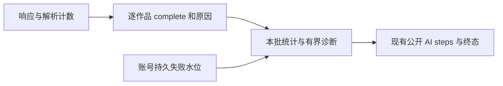

# T-1027 评论完成统计与公开诊断验证

## 已确认根因与改动

旧代码将 `batch.works.length` 当作完成数，文案只检查 `truncated`，但 runner 会因为逐作品 `complete=false` 标记失败，因此出现“failed / 全量完成”矛盾。修复后只认 `complete === true`，分别展示处理、确认完成、未完成数；缺少完成标志不推进成功水位。完整批次只声明“本批完成”。

另一个跨批缺陷已红测复现：前 20 个作品失败进入 sync backoff，后 9 个完整时旧代码整体 succeeded。现在经现有 `publicationSyncService.failures(ctx, ["comments"])` 读取当前账号尚未恢复的评论同步失败数，即使没有 due 作品也不覆盖前批失败。不改变失败 backoff、账号身份或浏览器资源管理。

## 公开诊断

沿既有 `CollectResult.message` 和 AI steps 文本输出 `评论抓取诊断：` 后的 JSON，无新增 contract 字段。

- `schemaVersion: 1`、`scope: "batch"`。
- 响应计数：`matchedResponses / validResponses / invalidResponses / parsedComments / pendingResponses / ignoredResponses`。ignoredResponses 表示响应作品归属不匹配或无法核实；历史错误计数不因成功重试清零。
- 入库计数：`receivedComments / writtenComments / skippedComments`。解析数可包含重复响应中的记录，收到数为去重后的抓取结果，写入数为真实新增。
- `reasons` 固定原因汇总；`works` 最多 20 个，每个 awemeId 最长 80 字符；`omittedWorks` 明确省略数。缺少诊断时计数为 null、原因为 unavailable。
- 原因：`stable_end / pagination_exhausted / more_pages_pending / response_identity_unverified / watermark_reached / no_matching_response / no_valid_response / invalid_response / unparseable_records / response_pending / page_limit`。
- `unresolvedSyncFailures: {count, scope: "account.comments", source: "publicationSyncService.failures"}`：当前账号持久失败水位，包含历史尚未恢复失败，**不是本任务独有 pending 总数**。旧注入端口缺少 failures 时 count 为 null。
- 不暴露原始响应、Cookie、评论正文或作者信息；不把协议错误/解析丢失/响应未结束误作完整空列表；已解析的可用数据仍保留。

## 红测证据

- 本会话先运行既有 comments 测试的新断言，复现 1005 个作品中 1 个未完成仍显示全量完成。
- 抓取层新增 8 个诊断用例先失败，随后实现转绿。上述早期红测仅保留于会话工具输出，不补造原始日志。
- 跨批及缺失 complete 红测原始日志：`/tmp/t1027-verification/cross-batch-red.log`，8 项中 2 项失败，均因错误调用 markSucceeded；随后转绿。

## 最终定向命令与日志

| 命令 | 结果 | 日志 |
| --- | --- | --- |
| `pnpm --dir backend exec vitest run src/application/collection/comments.test.ts src/application/collection/comments-public-diagnostics.test.ts src/modules/ai-runtime/scheduled-collection-runner.test.ts` | 28/28 | `/tmp/t1027-verification/backend-tests.log` |
| `pnpm --dir frontend exec vitest run src/server/ingestion/douyin-cdp.test.ts src/server/ingestion/comment-collection-plan.test.ts` | 140/140 | `/tmp/t1027-verification/frontend-tests.log` |
| `pnpm --dir frontend typecheck` | 通过 | `/tmp/t1027-verification/frontend-typecheck.log` |
| `node orchestrator/process/boundary-scan.mjs` | 无新增违规，既有基线 5 | `/tmp/t1027-verification/boundary.log` |
| `pnpm --dir backend exec tsc --noEmit --pretty false` | 全局未通过；本次评论修改文件无报错 | `/tmp/t1027-verification/backend-typecheck.log` |

后端全局类型错误包括 asset-business-execution.service.test、chat-assembly.test、signal-quality.test、transcribe-runner.test 等范围外文件，未声称全局全绿。

新增公共链路测试使用真实 collector → ingestComments → runner → 公开步骤生成逻辑，存储端口使用隔离替身，不连接用户数据库。覆盖 20/20/20/9 四批零新增、前批失败后批成功、无 due 但仍有失败、缺失 complete、有效空列表、去重零新增、额度截断、部分数据写入但未完成、有界脱敏。抓取层另覆盖无匹配响应、错误协议、JSON 失败、响应未结束、解析丢失和翻页上限。

## 安装实测限制

旧公开证据 `/tmp/t1026-cli-evidence/collection-comments-latest.json` 对应 run `run-d1d19487-3e48-453f-9eb0-f0bb602b1cf8`、AI task `ai-task-cf2fc682-137`。公开 task/steps/jobRun/execution 回读确认四批处理 20/20/20/9，均新增 0。这里是 69 次处理，不证明 69 个不同作品；旧日志缺响应/解析事实，不能判断究竟未收到匹配响应、协议变化、解析失败或去重。

未读取私有数据库或连接文件。当前代码测试不能替代安装后真实采集；主线第三候选安装后应通过授权采集及公开 AI steps 回读核验新诊断。原失败不因修正文案被宣告成功。

## T-1026 artifact busy 顺带交接

`WorkbenchArtifactPendingError` 明确区分另一 operation 占用与确定性输入冲突。host 对 B 返回 `artifact_revision_pending / nextAction=wait` 并引用 A 的 pendingOperationId；不会告诉 B 改参数重试。双 operation 修订及复制覆盖，A 完成后可继续正确修订。

- frontend host/atomic/register integration：20/20；`/tmp/t1027-verification/artifact-frontend-tests.log`。
- backend artifact/lineage：22/22；`/tmp/t1027-verification/artifact-backend-tests.log`。
- 生产改动仅 artifact service、execution export、frontend artifact host；公共 host 集成测试为 `frontend/src/server/workbench-artifact-register.integration.test.ts`。

## 独审第三轮：分页恢复与响应身份

先补四条边界红测，原始日志 `/tmp/t1027-verification/review3-red.log`：4 failed / 134 passed。复现历史 status=8 压过后来 has_more=0、has_more=1 空列表静默后被确认完整、A 的迟到响应补成 B、无请求作品 ID 的空列表被当成完成证据。

修复：

- 按真实请求 URL 中的 cursor/offset/page/page_index 保留页状态。同页较新成功响应恢复该页失败；历史 invalidResponses 仍保留，其他页失败不会被清除。异步 JSON 解码不允许较旧响应覆盖较新页状态。
- `has_more=0/false` 是明确分页结束；`has_more=1/true` 即使连续三轮静默仍未完成。缺少 has_more 时保留既有稳定结束退路，前提是已经验证响应归属及有效性，且没有未恢复的页失败或解析丢失。
- 请求 URL 的 item_id/aweme_id 必须与当前作品完全一致。明确指向 A 的响应不作为 B 的数据或完成证据。仅在请求归属明确时才允许给缺少作品字段的评论补该请求作品 ID。
- 请求无作品 ID 时仍保留记录自身明确属于当前作品的数据；混合、冲突、无归属数据不猜归属，整页不计为完成证据。旧 handler 的迟到 JSON 和新 handler 收到旧请求 response 均有异步回归。
- 旧 watermark 翻页测试的 fake 请求补入真实作品与 cursor 身份，原有数据/翻页断言不减弱。

最终日志：`review3-green.log`（前端 148/148）、`review3-backend.log`（后端 28/28）、`review3-typecheck.log`（frontend typecheck）、`review3-boundary.log`（边界），均位于 `/tmp/t1027-verification/`。这些是注入浏览器端口的确定性回归，不代表真实网站采集 E2E。

### 组合边界追加复核

独审追加发现“有效首屏 + 请求属于 B 但后页混合 A/B”会漏记后页未解决状态，并借首屏 stable_end 误报完成。新增未恢复/同页恢复两条用例，`mixed-page-red.log` 当场 1 failed / 143 passed。修复仅为当前作品请求页保留 `identityUnverified` 状态，同页较新有效响应可恢复；完全无关的 A 迟到请求仍只计忽略，不否决 B 合法成功。明确属于 B 的记录继续保留。

最终前端 **150/150**：`/tmp/t1027-verification/mixed-page-green.log`；最终 frontend typecheck **通过**：`/tmp/t1027-verification/mixed-page-typecheck.log`。`git diff --check` 通过。

## 公开 CLI 评论失败清单与重试

安装第三候选 `048fd032` 的 run `run-79306813-484c-48d0-8a2a-dc1189022c72` 在 0.6 秒内因 62 项历史失败、无 due 作品结束，works=[]。这不是网站响应证据。动态读取当前安装 CLI 的 operations list/describe 确认没有失败清单/解除作品 backoff 的公开入口，未读用户数据库或连接文件。

经用户授权与 Kuhn 方案评审，新增正式 `analytics.comments.failures.list` / `analytics.comments.retry`；具体 schema 见 SPEC。list 只返回真实可采集且 externalId 匹配的当前账号失败项，公开字段不含原异常；baseline 包含 retryAt 等完整失败状态和错误哈希。retry 1–100 唯一 ID，全批事务归属验证、行锁、baseline 比较及条件更新，只提前 retryAt，保留失败事实/成功水位/评论/原任务。CLI gateway 相同 key+输入先回原 receipt，旧 baseline 不破坏幂等；换输入冲突。

新增回归证据（均在 `/tmp/t1027-verification/`）：

| 日志 | 结果 |
| --- | --- |
| `cli-retry-contract-red.log` | 原始 contract 红测 4 failed / 9 passed |
| `cli-retry-service-red.log` | 原始服务/到期判据红测 4 failed / 1 passed |
| `cli-retry-contract-green.log` | 两文件 13/13 |
| `cli-retry-backend-final.log` | 六文件 36/36 |
| `cli-retry-frontend-final.log` | 三文件 152/152，含真实 HTTP POST dispatch + gateway + analytics transport + PGlite service |
| `cli-retry-typecheck.log` | frontend typecheck 通过 |
| `cli-retry-boundary.log` | 边界无新增违规，基线 5 |
| `cli-retry-backend-types.log` | backend 全量仍有范围外类型错误；本次 analytics 文件无报错 |

服务测试覆盖稳定分页/隐藏与 externalId 变化/跨账号拒绝/整批失败回滚/并发旧 baseline 只成功一次/并发新失败不被旧 retry 覆盖/只改 retryAt/成功水位新鲜但失败到期仍实际进入 collector.readCommentsForWorks。HTTP dispatch 测试在新失败改变 baseline 后使用原 key+输入，确实返回原 receipt；不同输入、新 key 携旧 baseline、缺 apply 均拒绝。真实 fetchDouyinCommentsForWorks 遇 gateway 冷却仍返回 truncated，未导航抓取并关闭浏览器资源。

早期全 contract 的 `cli-retry-contract-all.log` 为 252 passed / 1 failed：当时唯一失败是 registry 显式清单未加入新路由。主线已补登记；当前包含 comments 与 file reconcile 新路由的全 contract 为 254/254，见 `scoped-contract-all.log`。

## 少量作品运行范围与最终定向验证

经主线登记写域、用户授权与 Kuhn 方案独审，已实现 `scheduledJobs.runNow.body.publicationIds`（1–20 个唯一真实 ID，仅 comments）。任务保存排序后的固定选择，不修改持久 job.target 或 cron。collector 仅处理选中且 due 的作品；原 job 的单作品 awemeId 不覆盖显式选择。诊断分别提供选中范围与当前账号失败数，其他作品历史失败不否决本次选中范围的成功。

运行去重执行两层核对：result.deduped 返回时读取持久任务；ai.createTask 自身返回旧任务时，在 ensureRun/dispatch 前读取持久任务。只有 jobId 与选择完全一致才复用，范围不同或无法核实则冲突。回归覆盖全量/少量两个并发方向、同范围乱序、createTask 内部复用但外层未标 deduped、未知作品启动前拒绝，以及真实 controls → 持久 AI task/run → collector 链路。改变后续 job.target 不会扩大原任务范围。

新增红测日志（均为当场执行）：`scoped-run-contract-red.log`（1 failed / 6 passed）、`scoped-run-service-red.log`（3 failed / 4 passed）、`scoped-collector-red.log`（1 failed / 10 passed，复现显式选择被原单作品 awemeId 覆盖）。

| 命令 | 结果 | 日志（目录 `/tmp/t1027-verification/`） |
| --- | --- | --- |
| `pnpm --dir contract test` | 254/254 | `scoped-contract-all.log` |
| `pnpm --dir backend exec vitest run src/application/scheduling/controls.test.ts src/application/collection/comments.test.ts src/application/collection/comments-public-diagnostics.test.ts src/modules/ai-runtime/scheduled-collection-runner.test.ts src/modules/analytics/comment-retry.integration.test.ts src/modules/analytics/sync-state.service.test.ts src/modules/analytics/sync-policy.test.ts` | 47/47 | `scoped-backend-final.log` |
| `pnpm --dir frontend exec vitest run src/server/ingestion/douyin-cdp.test.ts src/server/ingestion/comment-collection-plan.test.ts src/server/ingestion/douyin-cdp-comment-retry.test.ts` | 152/152 | `scoped-frontend-final.log` |
| `node orchestrator/process/boundary-scan.mjs` | 无新增违规，基线 5 | `scoped-boundary.log` |
| `pnpm --dir backend exec tsc --noEmit --pretty false` | 范围外既有错误仍在，本次 comments/analytics/controls 文件无报错 | `scoped-backend-types.log` |
| `pnpm --dir frontend typecheck` | 未通过；仅并行任务的 workbench-file-recovery.test.ts 两处 NativeLeasePort 账号类型错误，已交负责人修复 | `scoped-typecheck-final.log` |

Kuhn 最终只读独审已明确通过、未发现 selected runNow 实现阻断缺陷。复核范围包括严格契约、两层持久范围去重、原任务固定选择、双向并发冲突、真实 task/run → collector 测试，以及上述 47/254/152 条原始绿测日志。独审未代替重跑类型检查；本项实现与测试冻结，全局前端类型检查尚欠并行文件测试修复。

冻结交接补充：Carver 随后报告已修复其测试 NativeLeasePort 非空账号校验，`pnpm --dir frontend exec tsc --noEmit --pretty false` exit 0，日志 `/tmp/t1026-file-recovery-typecheck.log`；此为负责人回报，不改写上表本次实际失败日志。最终全局类型检查由主线统一执行。本项不修改 Carver 文件，不继续改代码，任务验收状态留待主线安装实测后收口。

后续真实安装采集由主线在第四候选中经公开 CLI 选择少量失败 ID 执行。当前隔离测试不代替网站 E2E；作品 retry 不解除平台 cooldown，无 due/冷却返回也不证明网站根因或采集成功。未读取私有数据库或连接文件。

## 第六安装真实单项复验

`run-3fcc5bfb-af74-4fd3-a9a9-08125dadb0f4`处理1/1、确认0/1，27.99秒后failed，原失败并未修正文案就变成成功。公开诊断显示245响应、240个2xx与5个3xx，评论接口匹配0；选中范围1失败和账号62失败分开。同key retry回放一致。16桶/省略/溢出合计245，不能把未显示的路由推断为不存在。page路由正确、导航200、readycomplete不是登录或评论列表加载成功的证据。外层原来误识别navigationStatus为超时的问题本轮已消除。

因此第七候选只在同一个采集Page、同一次既有readyState evaluate内追加有限可见角色证据，不新增平台请求或私有访问。标题及角色短文本可能包含账号显示名，范围在SPEC明确；不声称绝无个人信息。登录/验证码仍null，零节点与truncated不能解释成页面无该状态。安装后只选一项再验，真实采集仍待通过。

第七候选被动UI实现冻结：前端真实Chromium与采集链4文件171/171，后端2文件35/35，frontend全量与backend定向类型检查通过。Wegener独审发现并亲自复现外层status读取子dialog正文，三项真实红后改为跳过子dialog正文、只独立采允许角色和heading；shadow隐藏lightDOM与ARIA输入排除也已覆盖。原生产evaluate次数不变，off后迟到响应不改变完成结果。原始红绿日志`/tmp/t1027-ui-*.log`；真实网站单项复验待新包。
