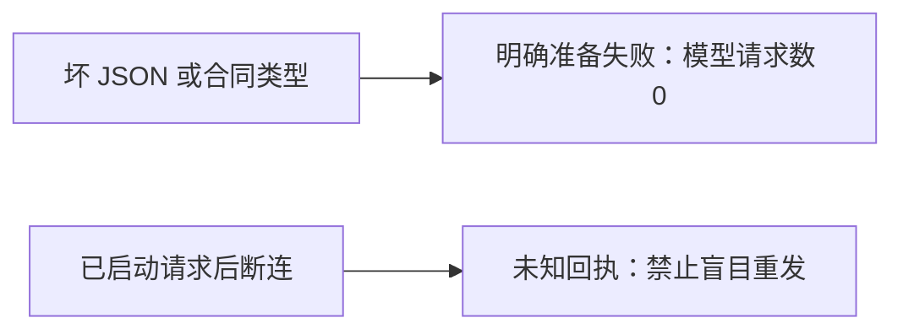

# T-1033 模型请求前坏输入状态实测

独立 SPEC 评审 PASS（REV:a971134781ac），仅校准 resolver 的同步输入类型与 JSON 错误。不扩大到节点执行、供应商、结算或保存。

- 当场公共文件红测：3 失败、36 通过，planning.thesis 缺失/坏数组应明确失败却是 unknown_result。
- 补准确错误码、坏 JSON 与其他冻结输入族后：12 失败、38 通过；普通代码异常和已启动断连两项通过。
- 修复为局部捕获 ZodError/SyntaxError → failed / STRUCTURED_INPUT_INVALID 后：公共 Worker、真实 Pi 三供应商 HTTP 错误/断连、脚本恢复流水线 3 文件 78 通过，关闭重试（--retry 0）。输入失败零端口、零 HTTP、零保存；已启动断连仍 unknown 且重投不联网。
- Worker tsc 首次因新 HTTP 捕获测试的 JsonSchema 类型报错；改用正式 workerSkillSnapshotSchema.parse 验证冻结快照，随后 tsc 退出 0。未用类型断言洗过。
- 全文件旧 fixture 按实际 Pi 流协议返回 SSE；复盘默认字段归一化的断言保留传入值并验证合法空默认字段。两者是测试对齐，不是放松业务检查。
- 本任务不新增 AI 事实审稿调用、不保证模型事实质量，不改用户数据库与安装包。T-1032 的真实反例继续保留。

本任务 Gate 的实际范围为上述 Worker 边界。本轮最终公共回归再次为 3 文件 78 通过（worker-final-78-green.log）。全局 reconcile 实测退出 1：32 errors / 1 warning，范围外问题已有 T-1015/T-1026/T-1027 与旧规格治理任务追踪；本任务 Worker 边界测试通过，不能写客户端全部通过。

2026-10-01 补充：从 `ae78054c` 的干净 git archive 副本重新运行 structured-worker-generation、durable-pi-http.integration、script-worker-pipeline 三文件，78 项通过，零重试；日志 evidence/t1033/clean-commit-78-green.log。先前尝试的 provider HTTP 小套件只覆盖 59/61 项，不把它们写成 78 项；最终以明确上述三个文件的完整命令为准。
