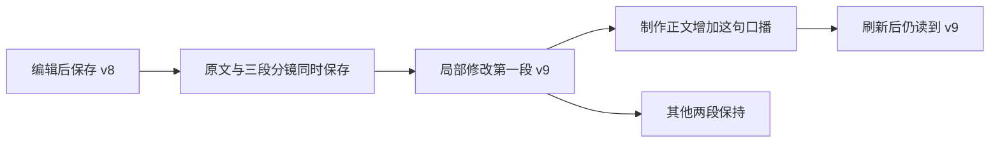

# T-1034 编辑分镜与制作正文实测

## 用户可见的结果

编辑过的分镜表保存后仍有各段口播、画面和字幕；后续局部修改会同步到制作正文。刷新后不会回到旧口播。原始表格文本仍保留，普通正文和损坏表格沿原保存路径，不因结构转换整单失败。

## 当场证据

| 项目 | 结果与边界 |
| --- | --- |
| 独立 SPEC 评审 | 第三轮 PASS，REV:d9cc821540d3；前两轮问题和后续新证据保留。实现最终只读复查未发现新阻断；评审者未独立运行测试。 |
| 保存结构红测 | 真实 PGlite 编辑采纳/手工保存 2 失败，随后修复；save-red.log。 |
| 连续修改红测 | transcript 陈旧 2 失败；patch-red.log 是第三轮评审绑定证据。 |
| 未改段丢字反例 | 口播本身含“画面：”“字幕：”被重复解析，2 失败；保存逐段原始口播，仅解码目标段后修复；untouched-narration-red.log。 |
| 最终后端定向回归 | 4 文件 55 通过，关闭重试；backend-55-green.log。 |
| 可独立提交的公共服务补充 | 在既有 artifacts.service.test.ts 新增同一服务→实际正文 reader→真实 extractVoiceoverText→修改/回滚/隔离回归；与协议测试共 2 文件 35 通过。补充用例为实现后的提交隔离验证，没有伪造红测。 |
| 图文、文章、媒体与发布 | 6 文件 48 通过；results-48-green.log。 |
| 前端旧稿面及新结果卡 | 7 文件 71 通过；frontend-71-green.log。 |
| 生产构建 | Worker 打包、Next 编译、TypeScript、页面生成均通过，退出 0；production-build.log。有动态文件追踪警告。 |
| 全局门禁 | reconcile 仍 32 errors/1 warning；边界、语义和既有合同回归失败保留，孤儿扫描 0 errors/100 warnings。不是整体全绿。 |

五秒测试总时限下曾有首个 PGlite 用例超时，失败日志已保留。最后用 15 秒单用例时限、单 Worker、零重试执行；没有时序测量，不能把初始化认定为已证明的根因。生产超时没有修改。

## 真实页面与公开服务连续链

环境是实际 Next 开发客户端与独立 PGlite 验收库，合成账号 `acct-t1029-local`，项目 `project-0d04195a-122`，视频作品 `output-88b7d78e-151`。使用用户当前配置的模型完成此前候选生成；此次保存与局部修改没有再调用模型。合成账号不代表平台扫码绑定，也不是安装版数据。

1. 视频作品页手工修改第一段，点击“保存脚本”，显示保存成功与 v8。
2. 公开 `artifacts.versions.list` 读回三段结构、纯口播正文、来源协议标记和各段原始口播映射。
3. 公开 `artifacts.scriptPatches.apply` 修改第一段，得到 v9。断言制作正文增加“先把作品清单写下来。”，其他两段逐字保持。证据 public-save-patch-read.json。
4. 点击旧项目级制作链接，实际稿面显示 v9、三个独立段落及各自口播/画面/字幕；刷新后 v9 和新增口播仍在。截图 video-v9-patch-saved.jpg。

局部修改通过公开业务接口执行，不能声称本轮也运行了 AI Copilot 改稿工具。实际生产 reader 和口播导出函数由上述公共服务集成用例验证；没有运行视频渲染或外部发布。

## 保留的验收缺口

- T-1034 新生产代码与公共服务回归可独立提交；依赖 T-1029 的候选采纳集成测试仍由父任务一起整合。
- 当前证据不是正式安装包启动。任务看板的正式前端旅程 Gate 仍未满足：现有数据为明确的验收账号，不能伪写 non-fixture 或补拍未执行的安装版旅程。
- 全局后端测试源码类型检查、合同注册和既有边界失败仍有欠债。
- 三次真实模型脚本仍有无来源经历、比例与效果陈述；T-1032 验证了消息传递机制，不能据此保证生成文案准确。
- 真实双账号绑定、雷达来源完整流程及新桌面安装包仍待父任务验收。T-1029、T-1031、T-1034 保持进行中，不声明客户端完全可用。

## 2026-10-01 干净提交复验

生产修复与独立测试已提交为 `ae78054c`，仅暂存 artifacts.service.ts 的三个本任务 hunk；T-1029 初始化接口、回执、repository 和 output-scripts 模块继续留在原工作区。使用 git archive 导出该提交到 `/tmp/creatoros-t1034-clean-ae78054c`，离线冻结 lockfile 安装依赖，源码三份逐字节对比一致。独立副本中协议测试与 artifacts 公共服务回归 2 文件 35 项通过，零重试；日志 clean-commit-35-green.log。这证明该修复不依赖原工作区未提交实现，未把副本包装成桌面真机验收。

提交 hook 输出“Can't find lefthook in PATH”；提交本身成功，但不能记为 hook PASS。原始日志保留了工具的 EOF 空行与进度回车，暂存 diff --check 对这些日志报告空白问题；没有改动第三轮评审绑定的 patch-red.log 哈希。生产源码的工作区 diff --check 通过。
