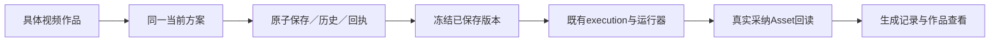

# T-1037 制作工程实现与真实证据

2026-10-01。任务进行中，不能作为完整公共服务、前端工作台或客户端验收 PASS。

## 已发生

- 独立评审 round1 CONCERNS `f447504eb2ca`，修订旧 assetId 删除与新版 itemId 删除的唯一兼容行为；round2 PASS `03cbb3aedc96`，taskctl 已启动。
- 实现内部结构编辑 helper：旧稿明确保存时稳定身份、默认值合并且未知字段保留、精确前值摘要、批次校验、目标类型/ID 守卫、单项删除、字幕失效重点清理、不可变输入。
- `plan-red.log` 是新模块未实现时的真实 import 失败，未运行断言，不能声称七项断言均先失败。
- `unchanged-legacy-boundary-red.log` 是实际行为红测：1 failed / 6 passed。新增时长检查误伤了只改字幕的旧合法素材；仅检查本次新增或改时间的项后，`plan-final-green.log` **7 passed**。
- `contract-regression.log`：旧视频 props 和 production 合同 **23 passed**。`contract-typecheck.log`：tsc exit0。
- backend 全量类型检查原始失败保留；第一轮含本次测试数组可空和联合类型收窄问题，第二轮这些错误已消除。最后一轮仍有其他模块14个旧测试类型错误，本次 production-editor 没有类型错误，不能报 backend 类型检查全绿。物理边界检查仍为 T-1026 已登记的 Copilot 两项新基线违规，本次未改相关文件，不宣称门卫通过。
- T-1036 真实选型和 ChatCut 当前工程实测已提交 `34e3b6a9` / `18884d1a`；用户桌面 ChatCut 未提交剪辑修改，validateOnly 移动候选后真实 item 全量回读一致。

## 接下来必须完成

1. 历史/保存回执与渲染请求 schema、迁移及公共事务/CAS/幂等服务。
2. contract operations、transport/client 注册与组合根 Asset/项目素材/执行任务 port。
3. direction 的卡片 ordinal / B-roll file 引用与稳定身份、明确移动/删除的协议适配；当前内部 helper 尚不足以宣称有 direction 的方案可正确预览与成片，禁止提前接成可用按钮。
4. 具体 output 入口和旧方案新旧共享真值兼容，保存不生成、冻结渲染与真实采用关联。
5. SPEC 全部归属、公开读回、重启、并发、断线、首屏外素材及完整旧调用链回归。

本文件的 helper 单测不是服务、预览或出片验收。T-1038—1041 与父 T-1035 均未完成。

## 2026-10-01 公共服务集成验证

本轮实际接通9个公共操作、不可变版本/请求表与正常迁移。保存、局部应用、恢复、旧confirm/remove/PUT共享当前方案；CAS、历史、保存回执同一事务。渲染预约冻结已保存方案/spec，沿现有execution→AI attempt幂等与运行器派发，不建立第二任务系统。具体视频入口和脚本按outputId定位，多视频明确选择；空项目旧备料路径继续可用。

### 当场测试

- `production-complete-regression-current.log`：9文件 **152 passed**，含公开服务、旧生产合同/仓库/验收、执行服务、旧编导候选和现有模板。随后追加未支持根字段报告，`unsupported-fields-red.log` **1 failed/9 passed** → `unsupported-fields-green.log` **10 passed**，真实行为红绿均留存。
- `executor-stable-reference-regression.log`：**26 passed**。旧file引用和新稳定item引用都穿过实际executor物化改名与同一HTML模板；引擎为fake，不冒充真实MP4。
- `production-public-frontend-final.log`：5文件 **50 passed**，包括原工作台、独立结果入口、具体output选择及实际组合根。`output-account-regression-current.log` **6 passed**；此前真实旧空项目路径回归已修复，未删原合法流程。
- `production-root-102-assets.log`：公开组合根 **1 passed**，实际建102条合法账号素材与项目链接，选择不在首100条中的素材，保存→冻结生成→保存B→重试A→真实AI任务回读。运行器仅隔离媒体执行，派发边界、services、AI幂等和PGlite均真实；经实际AI service写入可信execution_adopted审计验证Asset回读，未自动改primaryAssetId。该模拟采纳不代替真实媒体确认/查看验收。
- 真实磁盘PGlite正常迁移保存→关闭→重开→版本与回执读回测试已在上面的152项中通过；仅使用 `creatoros-editor-persistence-*` 新临时目录，没有打开或更改用户数据库。
- `legacy-atomic-retry-red-corrected.log` **2 failed/8 passed**，复现旧PUT非法状态却部分写入、旧remove丢响应无法恢复。配置/状态/方案一起提交，删除派生移入回执优先build后通过。`legacy-convert-retry-red.log` **1 failed/11 passed**，复现旧PUT成功后转换新版、重试被提前拒绝；校验移入事务后也通过。
- `production-root-integration-valid-input.log`曾真实超时，发现PGlite事务内Asset端口使用事务外连接而等待自身。修复为同一事务连接的公开Assets/MaterialLinks service后，`production-root-scoped-transaction.log` **1 passed**，102素材公共链也通过；没有删权限检查或打开第二数据库。
- 最新frontend与contract tsc **exit0**；backend tsc仍有其他模块14项旧测试类型错误，production/editor/本轮execution改动未报告类型错误。原始失败日志保留，不能报告全仓类型检查全绿。

### 已知全局失败与实际范围

`pmem sync` 已运行；`reconcile-current.log`仍为 **32 errors/1 warning**，与先前全局基线一致：历史review receipt漂移、既有LED检查失败、Copilot前端SDK边界等。T-916/T-1026/T-1027已登记其根因队列。`boundary-current.log`仍有原7项（超基线2项位于live-chat-session），`semantic-current.log`仍是原video.decisions未调用material.match；本轮不抬高基线、不写全绿。

合同registry已补本任务9路由和所覆盖的旧remove，仍因7条既有intelligence/onboarding/redfox/daily-report路由未列入旧allowlist失败；保留 `editor-contract-regression-final.log`，不放宽列表冒充成功。此问题记入T-916合同漂移根因，具体编辑服务注册、唯一ID、旧合同与CLI分类均已验证。

冻结的是已保存方案和执行spec里的真实Asset引用。现有Asset物化仍读取执行时currentFileId；尚不承诺替换同一个Asset文件后旧请求字节完全相同，T-1042集成时需明确媒体版本策略并复核协议。真实模型生成、实际MP4关键帧、客户端安装版、可视时间轴、助手逐项采纳、音效字体和画布合并分别仍按T-1038—1042继续，不能由本轮服务测试替代。
