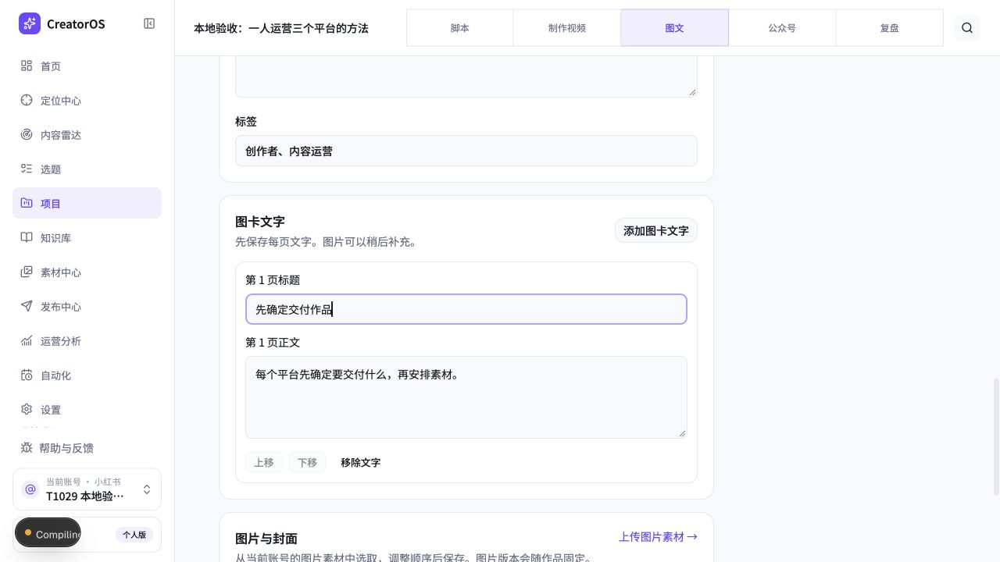
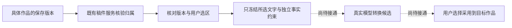
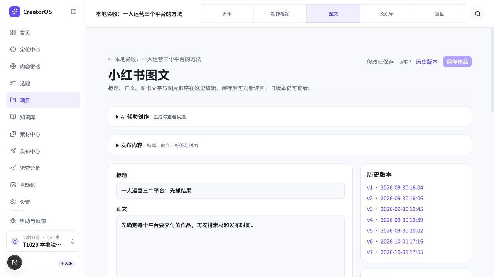

# T-1043 当场验证记录

本轮执行目录为隔离工作树 `codex/user-diagnostics`，主工作区只读。任务保持进行中；本文是验证事实，不替代批准 SPEC，也不表示整项完成。

## 用户可见结果

图文工作台可以添加、编辑、排序和移除图卡文字，保存保留稳定 cardId、来源和实际图片文件。真实本地验收作品 `output-0d04195a-133` 保存到 v6，刷新读回“先确定交付作品”及正文；原两张图片仍在。页面图片来自既有验收稿，本次没有生图或发布。

文章结构候选现在按实际触碰字段合并：先采用标题，再手改摘要，最后采用正文，不会覆盖摘要。新增段落连续采用仍按候选顺序插入；已修改的原段落、关联画面简报或已删除插入锚点明确拒绝冲突。同请求回放恢复原保存回执。

来源冻结服务读取具体文章、图文或视频 owner 的当前保存版本。局部转换只返回明确字段、保存段落或经过全文摘要校验的 UTF-16 文字片段；不携带未选正文。事实待确认项独立作为约束。结构视频稿可直接使用正式正文，旧纯文本仍可精确选择；空稿、空图卡或只有成片而无稿明确要求补文字。历史恢复另经三个 owner 的历史版本读取，重算并核对原来源锚点；原稿及其规则引用后来改变时，仍返回旧内容和旧规则引用。源锚点不能证明目标类型、平台、素材或完整请求幂等；调用方仍须从原账本核对完整请求摘要并保留原模型规则正文。服务仅导出，尚未装配互转操作。

## 当场证据

| 检查 | 结果 | 日志 |
| --- | --- | --- |
| 来源 + 文章结构采用 + 图文保存/历史 + 视频 owner 回归（历史恢复接口前） | 5 文件、40 PASS | `owners-and-source-current.log` |
| 三类来源历史恢复、选区摘要/锚点防改、旧规则引用、跨账号 | 1 FAIL / 5 PASS → 6 PASS；扩展历史不存在和三类账号用例后仍 6 PASS | `conversion-history-red.log`、`conversion-history-green.log`、`conversion-history-current.log` |
| 来源冻结补边界 | 真实 2 FAIL / 3 PASS → 5 PASS | `conversion-whole-availability-red.log`、`conversion-source-final.log` |
| 文章连续部分采用 | 真实 2 FAIL / 17 PASS → 19 PASS，后扩展用例纳入综合检查 | `article-structure-partial-red.log`、`article-structure-partial-green.log` |
| 图卡公共保存/读取 | 初始拒绝 cardBriefs → 8 PASS；历史/来源扩展后 9 PASS | `card-briefs-public-red.log`、`card-briefs-public-green.log`、`card-briefs-history-current.log` |
| 图卡工作台和旧单项结果交互 | 2 文件、10 PASS | `card-brief-editor-green.log` |
| 转换回执、字段采用状态、选区规范化 | 1 FAIL / 15 PASS → 16 PASS | `conversion-normalized-selection-red.log`、`conversion-normalized-selection-green.log` |
| LED-047 界面性能回归 | 8 文件、159 PASS | `led047-current.log` |
| 前端类型 / 契约类型 | PASS | `frontend-types-current.log`、`contract-types-source.log` |
| 后端类型 | FAIL，保留既有测试错误；当前新增来源/图卡/文章文件无类型报错 | `backend-types-source-final.log` |
| 全契约回归（选区规范化前） | 256 PASS、3 FAIL | `contract-current.log` |
| boundary | FAIL：既有 live-chat-session 的 ai 和 @ai-sdk/react 两项新增于基线的违规，沿 T-1026 | `boundary-current.log` |
| orphan | PASS，0 error / 100 warning | `orphan-current.log` |

日志均位于 `docs/research/evidence/t1043/`。来源 bootstrap 红测为缺少服务模块，尚未执行断言；其后测试夹具曾用事务外查询导致超时，并误用不存在的 listOutputs，原失败分别保留 `conversion-source-initial.log` 与 `conversion-source-fixture-correction.log`，不把它们当产品回归。两条 whole 行为失败是独立复核指出、当场补用例并实际重跑所得。没有补拍历史红测。

全契约失败分别为 cover.generate 旧注册断言、registry 的额外既有路由，以及 Asset 夹具缺 sourceUrl；后端类型失败在旧 runtime、Copilot 和 legacy patch 测试。沿既有 T-1015 核实，不删除断言或据此宣称这些行为已通过。全局 Gate 尚未全绿。

## 独立复核与仍缺验收

只读 conversion_audit 复核了文章触点合并、字段采用状态、图卡历史来源和来源冻结设计。来源实现首轮 FAIL 指出结构正文误拦、空图卡误放，两处修正并补实际红/绿后局部 PASS。历史恢复接口设计也局部 PASS，明确来源摘要不替代原完整请求账本校验。此回执不代表整个服务契约或互转 Gate。

还须贯通严格 output_version 引用到三个 owner 的候选、正式版本和分项回执；接通目标稳定创建、冻结请求/模型提交恢复、结构化图卡候选与按字段采用投影、实际转换公共操作和界面。六个方向的当前 PASS 仅是来源读取，不是生成或采用完成。真实模型文章→图文→视频脚本→文章旅程、素材复用和故障注入尚未验收。

本地验收页面当前提示模型凭据不可用；没有以夹具冒充真实模型。T-1044 的 code-mode host 变更仍等待 DEC-T1044-02 明确确认，保持关闭和研究暂停，不将“继续”视作该项确认。

## 2026-10-02 交互与布局实测

用户要求“用户交互上要符合用户体验，视觉上排版布局合理”，已记录到原任务与 DEC-T1043-02。本轮落实图文工作台，其他工作台及完整互转旅程仍待验收。

| 用户步骤 | 体验结果 | 当场证据 |
| --- | --- | --- |
| 打开作品，直接编辑标题和正文 | 已改善：辅助创作与发布区域默认折叠；宽窗口编辑与历史分栏，1024px 窄窗口改为单栏，顶部提供历史入口 | `ux-01-before.jpg`、`ux-02-editor-first.jpg`、`ux-03-narrow.jpg`；1024px 实测页面宽度与内容宽度一致，无横向溢出 |
| 查看辅助候选 | 已改善：原生折叠控件支持键盘 Enter 展开，并保留候选组件挂载；摘要提示正文生成状态 | `ux-04-keyboard-expanded.jpg`，真实浏览器键盘展开；模型不可用提示保留真实状态 |
| 编辑、保存并刷新读回 | 已改善：明确显示未保存、保存中、已保存；保存期间保护编辑控件，失败保留输入可重试；成功文案不展示内部 ID | `ux-05-saved.jpg` 与刷新后的 `ux-02-editor-first.jpg`；真实公共保存得到 v7，刷新读回正文、原图卡及图片 |

保存实测仅针对隔离验收数据库既有作品，在正文末尾增加一个换行，未改生产数据，未生图或发布。上述五张截图均为本轮真实页面捕获并检查；保存截图展示 v7 与“修改已保存”，成功提示“作品已保存。”另由当场页面可访问文本确认。未执行完整无障碍审计。保存保护不覆盖独立候选采用刷新，不能宣称所有异步回写问题已解决。

交互测试当场从 2 FAIL / 1 PASS 修复为两个文件 12 PASS（`ux-save-feedback-red.log`、`ux-save-feedback-green.log`），覆盖失败保留输入、保存期间禁用编辑、重试读回及候选保留挂载。键盘实际展开由浏览器实测补足。LED-047 回归 8 文件 159 PASS（`ux-led047.log`）。前端类型检查修正两处测试查询参数后 PASS（`ux-frontend-types.log`），`git diff --check` PASS。只读独立复核对该布局与保存保护设计局部 PASS，不替代整个任务 Gate。

## 2026-10-02 严格来源与原生成入口接线

当前已落实正式文章、图文、视频脚本 owner 的 output_version 引用校验；编辑后采用视频脚本仍保留历史来源。文章和图文 Worker 复用严格引用协议。视频再作为互转来源时保存稿的全局/段落来源不丢失，局部读取不夹带未选段落。文章单项标题/摘要采用同时比较文字和来源触点，防止旧候选覆盖手工改过的来源。

视频脚本与结构文章的原生成入口增加完整 conversion 请求及来源约束；原任务输入装配显式保留它们，同请求先恢复原任务，不重新采样当前背景、目标稿或规则。未注册公共转换操作，未完成图卡结构候选及转换分字段账本；不能据此声称六方向生成已完成。新生成入口测试中的模型提交是可观察 mock，来源/任务输入与请求恢复检查不等于真实模型输出验收。

| 当场检查 | 结果 | 证据 |
| --- | --- | --- |
| 严格引用合同与既有转换合同 | 2 文件 20 PASS；严格引用红测 2 FAIL / 2 PASS | `output-version-provenance-red.log`、`output-version-provenance-green.log` |
| 真实 owner 持久化及来源校验 | 3 文件 38 PASS | `output-version-owners-regression.log` |
| 视频来源连续性、文章来源触点 | 两个缺陷分别真实红测；修复后 2 文件 31 PASS | `video-source-continuity-red.log`、`article-source-touch-red.log`、`source-continuity-green.log` |
| 视频原任务装配与生成恢复 | 真红测后 2 文件 9 PASS | `conversion-script-input-red.log`、`conversion-video-generation-red.log`、`conversion-video-generation-green.log` |
| 文章结构生成与旧任务恢复 | 真红测后 24 PASS | `conversion-article-generation-red.log`、`conversion-article-generation-green.log` |
| 文章 Worker 冻结完整转换 facet | 首轮 schema 红测、再次发现 facet 丢字段；修复后 7 PASS | `conversion-article-worker-red.log`、`conversion-article-worker-green.log` |
| 前端及所引生产代码类型 | PASS | `conversion-article-types.log` |

后端全量类型检查仍有既有 runtime/Copilot/legacy 测试错误（见 T850 `main-track-backend-types.log`），并非全量通过。独立只读审查指出上述来源连续性、来源触点和原任务装配丢字段问题，均已实际复现后修复；全任务审查尚未完成。模型凭据仍不可用，未声称真实模型链或发布通过。

## 2026-10-02 原请求预约、结构候选与公共转换接口

转换现在先将原请求号、完整意图和实际来源锚点保存在已有 creative_result_bundles，再由原文章/图文/视频 owner 创建独立目标，以原 owner 创建回执核验并绑定。0117 与 Drizzle CHECK 同步禁止普通空目标预约。授权字段及固定 result ID 在提交模型前全部预约；恢复保留已替换的重试结果映射。同一结构文章任务投影多个独立结果行，不增加模型调用，采用回执分别保存。

原文章 owner 已支持候选 queued/running 的真实读回、人工标题/段落编辑以及结构失败重试。编辑锁住段落 ID、op、插入位置、顺序和来源，原候选保持不变；完整 sections 结果只允许完整投影采用。单个字段采用不会把其他字段标成 adopted。已知安全/归属/来源拒绝向外抛，不能写成提交未知；迟到提交只 CAS 写未绑定任务且未采用的预约，不能覆盖先完成的真实回执。

公共 `POST /output-conversions`、`GET /output-conversions/:clientRequestId` 已经接到原 transport 与运行装配；GET 只读，未绑定或未预约返回 CONVERSION_PENDING，POST 同原意图恢复。正常结果生成、单字段文章及媒体链保留原入口。模型执行仍由既有 Worker 完成，没有新队列、候选 owner 或 AI 直写领域稿件。

当场证据（均在隔离 worktree / PGlite 中发生，不代表真实模型）：

| 范围 | 证据 | 实测 |
|---|---|---|
| 原请求预约/并发 winner/绑定及旧结果回归 | conversion-reservation-red.log → conversion-reservation-owner-green.log | 红测缺模块，修复后 2 文件 4 PASS；运行装配随后单独验证 |
| 完整意图与提交丢回执恢复 | conversion-ledger-red.log → conversion-ledger-green.log | 2 文件 5 PASS |
| 所有授权字段先预约 | conversion-fields-reservation-red.log → conversion-fields-reservation-green.log | 2 文件 6 PASS |
| 独立采用回执 | conversion-receipt-red.log → conversion-receipt-green.log | 1 文件 6 PASS |
| 原文章结构编辑和状态轮询 | article-structure-edit-red.log / article-candidate-state-red.log → article-candidate-state-green.log | 1 文件 27 PASS |
| 结构适配及既有媒体回归 | article-structure-adapter-red.log → structure-ledger-regression.log | 4 文件 25 PASS |
| 实际文章/图文 owner + 原生成端口预约重入 | conversion-coordinator-red.log → conversion-coordinator-green.log | 1 PASS；3 个任务用测试端口预约，未调用真实模型 |
| 公共操作合同 | conversion-operations-red.log → conversion-operations-green.log | 17 PASS |
| 已知输入拒绝 | conversion-input-rejection-red.log → conversion-input-rejection-green.log | 2 文件 8 PASS |
| 迟到提交成功/失败不覆盖 adopted | conversion-late-submit-red.log → conversion-late-submit-green.log | 2 文件 10 PASS |
| 结构 owner 原冻结输入重试 | article-structure-retry-red.log → article-structure-retry-green.log | 1 文件 28 PASS；类型修正后的窄回归另记 |

全量 contract 本次仍 3 FAIL / 267 PASS；补齐本次两个注册路由后，registry 剩余额外路由属于既有欠债。旧 cover.generate 注册断言和 Asset 夹具缺 sourceUrl 沿 T1015 核实。boundary 的 SDK 新增基线违规沿 T1026，semantic 的 material.match 缺调用沿 T1027，不提高基线、不删除断言。

仍未完成：公共互转界面与六个方向完整旅程、选择图片在目标中的实际复用、结构候选事实待确认项的明确展示/采用、真实配置模型验证，以及 T850 完整可视剪辑和 T1045 组合/画布/审核串联。公共服务基础和局部测试通过不等于整项任务完成，BACKLOG 状态保持进行中。

## 2026-10-02 生命周期3 原两个真实红的修复

实际React公共调用链：采用前owner GET待回时卸载，迟到仍adopt；范围SHA待回时卸载，迟到仍convert新POST，两条当场RED保留。完整account/project/output/sourceType作用域、closed/unmount serial、每个await后实际账号复核已冻结独审，3文件SHA `8a077674a5b110037ad74594d523033771e56d6cb3f6c2ca7d49940ff7108b6a` 精确合入。原Panel6＋新增6，root12 PASS；独立附加关闭重开后fresh目标版本、来源保存新版本不重提任务，共14 PASS。只属该窄面；六向完整互转、真实模型、实际取消/继续及来源版本展示仍分别验收中。
