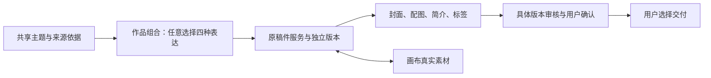

# T-1045 实施与当场验证

2026-10-02，仍在实施，未完成完整验收。用户已授权全面落地与自测；本记录不代替 BACKLOG 状态与阶段 Gate。

用户可以在同一个作品组合中任意选择视频、公众号、图文、朋友圈。选择表达与创建稿件是两件事；取消选择不删除已写内容。每份稿件仍由自己的原服务保存，组合记录真实身份和所选版本。

## 已落地的服务与证据

| 范围 | 当场证据 | 结论与限制 |
| --- | --- | --- |
| 严格组合、朋友圈、依据、物料、审核资源合同；36项公开操作与CLI副作用声明 | [合同评审](../research/evidence/t1045/contract-review.md)、[5项合同测试](../research/evidence/t1045/contract-shapes-final.log) | 静态设计和资源形状验证通过，不代表全部公开操作已接通 |
| 组合16种选择含空集、共享依据不可变历史、CAS与账号隔离 | [原服务测试](../research/evidence/t1045/composition-owner-green.log) | 3项通过；来源非空验证另验 |
| 朋友圈独立Artifact创建、保存、历史、原请求恢复 | [原服务测试](../research/evidence/t1045/moments-owner-green.log) | 3项通过；真实模型生成仍待接入 |
| 原成员预约、丢回复恢复、取消、手工A→B→A不被迟到创建覆盖 | [成员预约测试](../research/evidence/t1045/member-reservation-final.log) | 7项通过，原视频owner；其余owner集成另验 |
| 原项目删除清理新增五表及相关Artifact，其他账号数据保留 | [真实红测](../research/evidence/t1045/project-cascade-red.log)、[修复后8项](../research/evidence/t1045/project-cascade-green.log) | 已复现遗漏并修复；并发删除根锁另复审 |
| 模块公开transport保存、历史回执、空列表和分页、手工保存不伪造AI采用 | [16项服务测试](../research/evidence/t1045/public-members-final.log)、[分页红测](../research/evidence/t1045/pagination-red.log) | 3文件16项通过；应用根路由及HTTP/CLI旅程尚待接通 |
| 四类成员通过原Projects/Articles/GraphicPosts/Moments服务创建与只读创建回执恢复 | [真实owner集成](../research/evidence/t1045/all-member-owners.log) | 1项通过；刷新、账号隔离、同请求无重复创建；未调用模型 |
| 历史引用仅在原位置保留，新观点/事实位置重新验证 | [当场2项红测](../research/evidence/t1045/historical-refs-red.log) | 已实施修复；[3文件18项](../research/evidence/t1045/historical-refs-final.log)通过 |

| 原owner创建与删除的事务根锁、历史引用位置边界 | [独立复审](../research/evidence/t1045/member-owner-review.md)、[5文件60项](../research/evidence/t1045/original-owner-lock-final.log) | 窄实现通过；尚未进行真实PG并发竞争验收 |
| 非空配图由原Asset owner核验、外账号/错文件回滚、旧已删文件仍可编辑文字 | [7项测试](../research/evidence/t1045/real-file-owner.log) | 真实DB与原owner通过；图片字节下载/画布待验 |

## 待完成范围

- 应用根装配、公开HTTP/CLI、四类表达的完整界面与正常/最小窗口实测。
- 来源、规则、素材的非空真实归属和选区摘要验真；重复使用、错误归属、历史引用失效与回滚。
- 原画布上下文、真实文件物料关联、显式依赖与受影响触点提示。
- 朋友圈真实模型候选、重试及逐项采用；字段与组合审核的真实模型执行回执。
- 全部15种非空组合的完整生成、保存、刷新、编辑、物料、审核及交付旅程。
- LED-047、边界、孤儿、契约和全局reconcile；按实际结果记录，未做的Gate不写PASS。

模型实测仍需要验收账号具有可用模型配置。此前验收库的密钥无法解密，已请用户在应用设置中恢复可用配置；没有替换密钥、改动凭据或伪造模型结果。独立服务工作继续推进。

## 本轮非空来源、真实稿面物料

- [source-owner-integration.log](../research/evidence/t1045/source-owner-integration.log)：3项，真实Moments/Basis历史与UTF16选区摘要恢复；雷达/Asset完整来源集成另验。
- [material-multiple-green.log](../research/evidence/t1045/material-multiple-green.log)、[material-rules-frozen.log](../research/evidence/t1045/material-rules-frozen.log)：4项，真实朋友圈多图来源不丢、部分解除与手工改稿待复核；原规则版本随关联冻结。
- [card-anchor-owner-regression.log](../research/evidence/t1045/card-anchor-owner-regression.log)：3文件46项原文章/图文及物料回归通过。
- [owner-materials-final.log](../research/evidence/t1045/owner-materials-final.log)：3项，原文章封面/单段与原图文封面/单卡附加解除真实回执、共享同一文件槽位隔离、unknown触点零写、重排其他卡不使单卡依赖过期、删除已绑定卡需明确解除。
- 图文空稿与旧稿可缺cardBriefs；已修正可选字段读取，不补写历史字段。来源leaf和图卡协议有独立窄评审；根装配尚未经过完整公开HTTP/CLI旅程。

## 本轮公开根与审核服务

- [public-root-final.log](../research/evidence/t1045/public-root-final.log)：1项真实应用组合根DB回归，原四类成员创建、原请求重复恢复、16种选择不删除稿件、非空Moments配图与原保存回执、跨账号拒绝；不是浏览器/CLI验收。
- [source-pure-snapshot.log](../research/evidence/t1045/source-pure-snapshot.log)：1项真实DB，确切旧雷达快照保留、错item/快照/用户/账号/null正文拒绝，读前后转写表零写。
- 审核合同sourceRefs/confirmedReport窄评审通过；审核owner模型调用证明初审FAIL，修复后独立复审PASS，/tmp当场4项红测→19项绿测。正常123迁移集成后的[review-owner-integration.log](../research/evidence/t1045/review-owner-integration.log)2文件22项通过；成功fixture经过原生成reserve/start/settle/providerReceipt/save，未调用供应商。
- 原owner新增同事务可选锁读经独立窄源码PASS；[review-lock-owner-regression.log](../research/evidence/t1045/review-lock-owner-regression.log)4文件81项原文章/图文/制作与审核回归通过；没有真实PG竞争barrier证据。
- 根backend全量typecheck仍有原测试基线错误，新增类型错误已单独修复；不宣称全仓类型Gate通过。
- 作品组合与朋友圈稿面已实现，浏览器实际创建组合、保存主题与公众号+朋友圈选择；发现已保存basisDirty未归零并当场修复，需继续复验。截图、最小窗口、全部旅程仍待完成。

## 2026-10-02 本轮界面与原字段读取

- [界面恢复回归](../research/evidence/t1045/work-ui-regression.log)：10项通过；全部16种表达选择含空集、未知回复同完整请求恢复、项目素材引用失败保留编辑、精确文件不重复、明确版本冲突读新基线而保留编辑、账号切换迟到回复丢弃、共享依据保存后清除脏状态且保留尚未提交的表达选择、按明确保存版本复制正文。fixture仅验证界面控制，不是供应商模型证据。
- [字段读取器真实owner回归](../research/evidence/t1045/field-readers-root.log)：正常迁移10项通过；文章/图文/朋友圈原owner、单卡字段范围、真实文件校验、发布字段隔离。历史封面缺file不会阻断只审文字；封面/整稿仍诚实拒绝缺精确文件。独立窄review PASS，未覆盖真实PG竞争或视觉模型。
- [新界面ESLint](../research/evidence/t1045/work-ui-eslint.log)、[前端完整类型检查](../research/evidence/t1045/work-ui-types.log)：当场退出0。
- 浏览器实际新建组合和朋友圈稿面、共享主题保存、公众号+朋友圈及四项选择保存刷新、绑定明确原视频/公众号身份；朋友圈正文保存后刷新读回，真实图片先加入项目再写稿件，配图原文件预览和保存刷新均成功。
- [朋友圈1440×960](../research/evidence/t1045/moments-normal.png)、[朋友圈900×600完整页](../research/evidence/t1045/moments-minimum.png)留存：宽屏正文与配图并列，最小窗口改为纵排、保留原控件。实际复制/下载与剩余组合物料/审核完整旅程继续验证。
- 无行为提取原production/publishing/ai/positioning factory参数供同tx实例；发现审核AI提交不能捕获root Settings overlay，已要求同tx真实Settings resolver并取得独立窄PASS，尚未完成根接入。

## 2026-10-02 公开来源选择与事务回归

- 已按独立前置窄评审接通 `work.sources.select`：用户明确选择真实稿件保存版本与整稿/字段；服务端读取原 owner 后产生来源身份与摘要，客户端不自报正文或摘要。公开合同/CLI策略 [1项](../research/evidence/t1045/source-select-contract.log)、真实来源 transport [5项](../research/evidence/t1045/source-select-root.log)通过。
- [应用公共根完整回归](../research/evidence/t1045/source-select-public-root-green.log)1项通过：原四类成员、16种选择、非空图片、Moments字段来源→保存共享依据→再次读取Basis整份来源→原Article标题来源。初跑[40秒超时](../research/evidence/t1045/source-select-public-root-timeout.log)揭示同事务读取成员漏传连接，已修复为传递同一连接，未把fixture当原公共根证据。
- 浏览器实际通过公开来源选择、保存共享依据并刷新，仍显示1项来源与全部4个真实成员。朋友圈复制明确保存版本返回成功；下载显示成功但工具等待下载事件超时，落盘文件尚未核验，不计完整下载通过。
- [审核根工厂](../research/evidence/t1045/review-factory-root.log)2文件15项通过真实原owner/Settings overlay/原AI任务提交；未调用供应商，公开根尚待精确视频绑定端口接入。
- [LED-047回归](../research/evidence/t1045/led047-current.log)8文件159项通过。当前[物理边界检查](../research/evidence/t1045/boundary-current.log)失败：已有 Copilot `live-chat-session.ts` 新增2条 SDK越界已由 T-1026跟踪，本任务未新增越界，不计全局Gate通过。

- 来源列表显示真实稿件/使用范围/保存版本；移除保留手工主题、未保存前不写正式依据。[界面回归12项](../research/evidence/t1045/source-list-ui-final.log)、[完整前端类型](../research/evidence/t1045/source-list-types-final.log)、[新增界面ESLint](../research/evidence/t1045/source-list-eslint.log)退出0；[原规则同事务公共根回归](../research/evidence/t1045/source-rules-public-root-final.log)1项通过，先建立真实Profile与Statement，规则核验使用同tx实例。
- [1440×900共享来源](../research/evidence/t1045/work-sources-normal.png)、[900×600共享来源完整页](../research/evidence/t1045/work-sources-minimum.png)：实际保存1项朋友圈短文来源与4类真实绑定；最小窗口DOM `scrollWidth=clientWidth=900`，未出现横向溢出。
- Production精确历史文件proof owner实现经独立窄PASS，原stub [4失败/1通过](../research/evidence/t1045/production-bindings-red-owner-final.log)，真实原owner [6通过](../research/evidence/t1045/production-bindings-green-final.log)。已整合正常0124迁移并[重跑6通过](../research/evidence/t1045/production-bindings-normal-migration.log)，包含原版本/FK级联零孤儿；探针fixture明确不是真实ffprobe。当前历史账本不替代原叠加媒体current真值，旧alias不猜今日文件。根/UI完整接线仍在进行。初次迁移遗漏statement-breakpoint，正式迁移当场失败后补齐分隔并重跑，未以临时DDL绕过。

## 2026-10-02 精确原文件与审核根实装

- 精确文件历史绑定已接原Production保存/采纳/编辑/恢复成功后回执；额外绑定捕获失败保留原合法保存成功。正常迁移公共服务3项通过，不回填无法证明的旧媒体别名。
- 审核根接通原Settings同事务、原AI任务、真实字段与历史文件端口。实际浏览器完成人工核对朋友圈整稿并刷新仍为当前内容已确认；模型核验仍为未完成。
- 实际点击模型审核后产生原AI/执行任务，随后因验收账号MODEL_CREDENTIAL_UNAVAILABLE进入waiting_user。没有供应商成功调用证据；界面原先把等待配置投影成运行中，正按独立前置PASS修正并保留原任务恢复入口。
- 完整验收仍在进行，T1042/T1043/T1045/T850均未完成；真实模型、画布升级、精确词句时间码和剩余物料旅程不得以夹具通过替代。

## 2026-10-02 朋友圈候选与发布封面实际集成

- 原 Moments 模型候选及同事务正式稿/血缘端口已接入组合根、原模型 Worker 与可配置 moments.compose；原用户公开泛型 AI 不允许绕过候选预约。正式记录仍由用户采纳写入。
- 组件 8 项通过，覆盖丢生成回复、丢采纳回复、ACK 已到但刷新失败、卸载/稿件隔离、缓存满、已采纳回执读回、取消后明确新候选、原回执网络失败禁止新采纳。最后一族当场红 1 FAIL →修复→8 PASS；独立只读审与完整 frontend tsc 通过。证据目录 `docs/research/evidence/t1045/`。
- 0127 进入原连续 journal（125、126、127），发布封面实际 project/link/active image/exact file/LocalFs bytesSHA 同 tx 核验；原手工 createRevision/setCover/createImported 全根消费者使用原 owner 包装，不只公开 transport。
- 新原公共 transport＋真实 LocalFs 图片回归当场发现旧文字保存清空封面 1 FAIL；改为省略字段保留精确 pair、显式解除才清空后 1 PASS。坏文件零写、恢复原文件沿同 request 采纳、回执重读、原文字更新保留封面、解除封面保留文字/标签均闭合。原 Publishing 44＋contract 7＋新封面 18＝69 PASS；原根封面归属/四类组合 3 PASS；frontend 全量 tsc exit 0。
- 实际验收服务正常从旧 124 journal 升级启动，原四类组合、依据和朋友圈正文/真实配图仍在。真实新候选沿原保存版本提交，原 Worker execution `exec_02027e7a-77e1-43df-83d1-ffff903789d4` 等待 `MODEL_CREDENTIAL_UNAVAILABLE`；不把此状态当真实模型生成成功。刷新后保留原 candidate 身份，只读取原状态，没有重建任务。截图 `moments-real-candidate-before-refresh.png`。
- 全范围未验收：Canvas/Video 实际触点、精确 ASR、粗剪候选、更多真实模型旅程、全局 Gate 仍在继续，任务不完成。

### 实际等待状态与同稿件恢复

真实 Worker 等待状态经原 AI getTask.runtimeStatus/errorCode 投影到 MomCandidate，保留真实 executionTaskId，unknown_result 不重新提交；冻结成功/失败/取消候选仍保留原终态，GET 零写。2 族真实行为红→backend 17 PASS（之前缺 fixture import 的失败另存，不冒业务红）。组件在继续原执行时持久完整 command/idempotencyKey/ACK；读取失败恢复原同请求，ACK 已到只读。独立审又发现同账号错稿件缓存可继续别的任务，当场行为红→Moments/artifact 归属校验→17 PASS，覆盖不同稿件 resume、两个 ACK 采纳状态与已证错归属仅清本页缓存。实际浏览器已读回“生成等待处理模型设置或权限，原任务保留”及“继续原生成任务”，未实际继续坏凭据，截图 `moments-original-waiting-restored.png`。

### 2026-10-02 具体材料面板与恢复链实际回归

5文件材料面板独立root静态检查后合入，中文表达名称、空位置提示、默认折叠/按需读取；原请求body/CAS稳定，跨组合scope隔离。Moments retry原GET先核momentsId/artifactId并阻卸载后迟到提交，真实红1失败17通过后18通过；独立另增合法重试和卸载共20通过。

材料ACK刷新恢复当场独立红、root同例红：已ACK但owner读失败后remount重发。现持久ACK用于文案，并由原getWorkCompositionRequest的组合/操作/完整input/committed状态确认后纯读；旧无ACK缓存也从原committed回执恢复。独立又发现GET晚到复活缓存的红，已在原GET之后先核active再任何remember。3文件35项通过（Moments20、材料12、粗剪候选3），不把这些组件测试冒充公共owner/真实模型完成。
