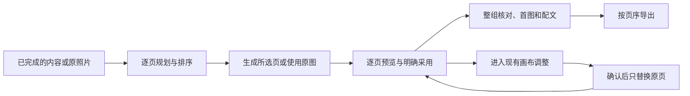

# T-1048 连续组图与画布衔接验收

2026-10-03，开发树 `codex/user-diagnostics`。已集成主工作台、后端候选与版本服务、Worker 和现有画布；代码回归与隔离桌面前端生产构建通过。**任务仍进行中，真实出图、真实界面和安装版尚未验收。** 不把组件图片 fixture 或构建产物当作供应商图片和用户操作证据。

用户先完成内容，再规划有序页面。可以使用原照片，也可以生成所选页；共享方向和参考是可选设置。选中页可进现有画布，确认图片后明确采用回原页。快图保留为单页细调。最后按真实页序核对图片、首图、配文与标签并导出。

## 已集成的行为

- 主面为页列表与选中页，主动作随状态显示“规划组图”或“生成所选页”。可编辑、排序、删除、重做单页、采用候选、选已有图片、进入画布与可选快图细调；草稿及成功页保留，超过单次 bundle 容量分组提交。
- 两个现有可配置 Skill 复用 MIT baoyu-xhs-images 的连续阅读、逐页大纲、共享视觉方向与局部重做方法，固定上游提交 `1567581c26ec29f4216c6e6835415bf30343b0e3`，保留选用源、许可、哈希和改造说明；没有另造编辑器或图片执行器。
- 指定页生成从真实作品不可变版本读取目标页、全部有序页和共享方向，冻结精确参考文件。候选首次绑定后不追随 currentFile；未知提交查询原任务，避免重复付费。采用只替换目标页，保留其他页与未绑定旧照片，同批其他页采用仍可继续。
- 画布入口先保存草稿，再绑定 account/project/output/cardId/baseVersion 与原槽精确文件。候选采用前重读公共确认材料和当前作品，以当前 CAS 保存；原槽并发换图、删除或内容依据变化时保留候选并说明冲突。返回普通左击先保存画布，失败留原页。
- 未知采用保存完整原请求，刷新/重挂后沿原版本、原 requestId 恢复；明确 409 才解除失败请求缓存。sessionStorage 禁用时只支持内存恢复，不承诺跨刷新恢复。未知画布创建仍需核对原画布，没有虚构创建接口幂等恢复。
- 导出保留真实页序和每页用途，只省去与页面同文件的重复封面用途；不同页使用同一源文件仍逐页保留。独立封面置首，旧照片继续交付。ZIP 的组件回归检查了文件、配文与图片顺序清单。

## 当场测试与构建

| 检查 | 结果 | 证据 |
| --- | --- | --- |
| 前端工作台、结果、页序及画布组件 | 8 文件，60 项通过 | [最终日志](../research/evidence/t1048/root-frontend-final.log) |
| Backend 公共生成、采用、版本、画布及封面 | 16 文件，91 项通过；串行、无自动 retry | [最终日志](../research/evidence/t1048/root-backend-final.log) |
| Contract 新旧稿与公开采用输入 | 3 文件，6 项通过 | [日志](../research/evidence/t1048/adopt-contract-green.log) |
| Worker 模板及原图片调用 | 5 文件，8 项通过 | [主回归](../research/evidence/t1048/root-worker.log)、[封面回归](../research/evidence/t1048/root-worker-cover-regression.log) |
| LED-047 交互性能防复发 | 8 文件，159 项通过 | [日志](../research/evidence/t1048/led047.log) |
| 受影响前端源文件 ESLint | 8 文件通过，没有禁用规则 | [日志](../research/evidence/t1048/root-frontend-lint-final.log) |
| Frontend / Contract / Worker 全类型检查 | 均 exit 0 | [前端](../research/evidence/t1048/root-frontend-types-final.log)、[合同](../research/evidence/t1048/root-contract-types-final.log)、[Worker](../research/evidence/t1048/root-worker-types.log) |
| Worker 构建 | exit 0；保留既有 CJS import.meta 警告 | [日志](../research/evidence/t1048/root-worker-build-final.log) |
| 隔离桌面前端默认生产构建 | `CREATOROS_DESKTOP=1 pnpm --dir frontend build`，exit 0，生成 standalone server；包含编译及类型检查 | [最终日志](../research/evidence/t1048/isolated-desktop-next-build-retry.log) |

生产构建位于 `/tmp/t1048-build-work`，源自当前开发树；使用默认 Turbopack，没有替换构建器或跳过类型检查。第一次因依赖 symlink 指向隔离目录外失败，保留 [原日志](../research/evidence/t1048/isolated-desktop-next-build.log)；将依赖物理克隆到隔离目录后成功。运行数据目录全部指向 `/tmp/t1048-build-runtime`，没有复制模型凭据或用户私有数据。此证据只证明桌面前端构建，不是完整安装包、干净 checkout 或真实界面验收。

## 独立复核与红测真实性

画布初审四项缺陷已按当场 RED 修复并复核：[初审](../research/evidence/t1048/canvas-audit.md)、[红测](../research/evidence/t1048/canvas-controls-red.log)、[复核](../research/evidence/t1048/canvas-recheck.md)。另补页序 RED→GREEN 与实际 CanvasEditor dirty 返回/失败保留用例，最终画布四文件 28 项计入上述 60 项，不重复累计。

完整集成复核发现三项问题：公开采用契约遗漏 cardId、导出去重删页及封面换序、未知采用刷新生成新请求。修复后 [增量复核 PASS](../research/evidence/t1048/integration-recheck.md)，仅认可三项源码/契约/组件/实际 PGlite owner 行为，不代表整体产品 PASS。

- 公开契约实际 body.parse RED→GREEN。普通 UI 没有统一 body.parse，不能声称旧 UI 必然返回 400。
- `public-adopt-red.log` / `public-adopt-green.log` 早期未导出名称造成 fixture 失败，不算行为红绿证据。修正为官方 ENDPOINTS 后的 [基线复现 RED](../research/evidence/t1048/public-adopt-baseline-red.log) 是当场还原接任务时契约，不是补写历史前置 TDD。[最终四项通过](../research/evidence/t1048/public-adopt-final.log) 经公开 body.parse 后进入真实 PGlite owner。
- owner 实际提交成功后 wrapper 丢 ACK 的用例为新增 GREEN-only，证明原请求恢复不重复建版本，没有虚构历史 RED。模型和 Assets 字节端口仍为明确 fixture。

## 尚未通过的全仓检查

- Backend 全类型检查 exit 2，52 条错误位于未触碰的既有文件，本轮文件无报错。没有独立干净 HEAD 对照，因此全类型 Gate 仍失败：[日志](../research/evidence/t1048/root-backend-types-final.log)。
- boundary 7 条，相对登记基线 5 新增两条既有 Copilot SDK import，T-1026 跟踪；未提高基线：[日志](../research/evidence/t1048/boundary.log)。
- semantic boundary：既有 video-decisions-runner 未调用 material.match，T-1027 跟踪：[日志](../research/evidence/t1048/semantic-boundary.log)。
- orphan：0 errors、100 warnings，保留既有 PLANNED 与未追踪提示：[日志](../research/evidence/t1048/orphan.log)。
- 已运行 pmem sync；最终全仓 reconcile 原始结果保存在 [日志](../research/evidence/t1048/root-reconcile-final.log)，全局欠债由 T-916 跟踪，不宣称全绿。

## 源码范围与未完成验收

[44 个选定源码/测试/许可文件的哈希](../research/evidence/t1048/implementation-file-hashes.json)固定当前受测内容。开发树包含接任务前的混合未提交实现，完整选定文件含继承部分；后端/前端交付的基线哈希与增量 patch 单独保存。画布继承部分见 [增量](../research/evidence/t1048/canvas-inherited-baseline-delta.patch)、[哈希](../research/evidence/t1048/canvas-delta-hashes.json)。共享 persistence-client 的两处接线仅保存 [范围内 patch](../research/evidence/t1048/persistence-assembly-delta.patch) 和哈希，不把整个巨大混合文件收进本任务提交。提交因此不是可独立重建的完整基线证明。

客户端公共配置已确认图像模型为 `gpt-image-2` 且已有凭据；CLI 只提供脱敏配置。真实图片验收仍需用户在客户端“设置 → 模型配置 → 配置备份”导出到本机并提供路径。此前文本模型粗剪证据不等于图像模型凭据。没有解密客户端私有存储绕过。

至少三张真实模型图片、单页重做、真实画布采用与返回、整组图片实际导出、900×600/1440×900 布局操作、真实整组核对、完整安装版与正式前端验收回执均待验。此前浏览器安全策略阻断保留，没有改用其他浏览器、CDP 或间接执行绕过。任务不标完成。
