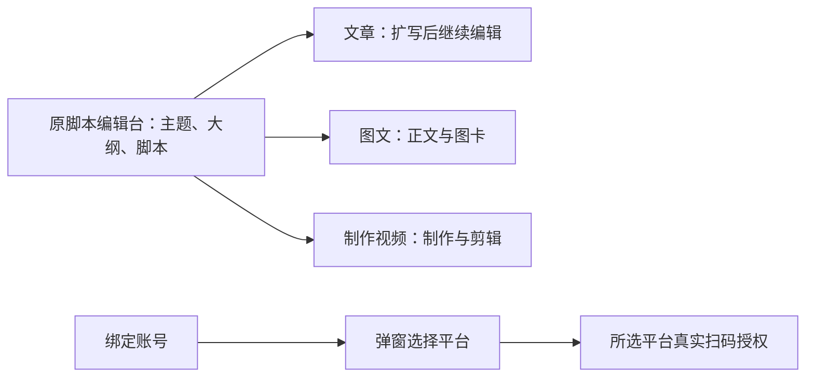

# T-1051 — 脚本优先工作台与先选平台绑定账号

日期：2026-10-03。工作树：`codex/user-diagnostics`。SPEC 独立评审回执：`PASS[REV:4cfe0db6c72c]`。本记录只描述当场发生的实施与检查，不代替用户网页签收。

## 用户能看到的变化

先在原完整脚本编辑台确定内容。文章、图文、制作视频随真实所选作品出现；脚本始终第一项，作品组合不再是创作 Tab。文章与图文读取当前保存的主脚本或大纲扩写成候选，采用后仍能手工修改。主稿后来修改不会自动覆盖扩写稿。

- 新建和直接创作多选后进入项目根脚本工作台；保留已成功创建项与同键恢复，移除自动提交首份扩写稿。显式选择的雷达来源正文进入项目简介供主稿创作使用，来源不可读时明确说明。
- 文章/图文正常生成冻结真实 `project_script` artifact/version 引用；同 attempt 恢复原输入。重试、采用和历史读取经属主端口验证版本，人工稿沿原 CAS 保护。
- 账号页一个“绑定账号”入口，打开和选平台不会调用授权 API。选择抖音、小红书或快手后只显示其真实授权组件；进行中不能重复提交、切平台或关闭，完成/失败释放。公众号绑定尚未接入，显示说明，没有假扫码按钮。
- 用户给的 NoteRelay 已在 `/private/tmp/douyin_dl/noterelay-main/`；已读其说明和同一 Markdown note 的平台适配流程。仅参考交互，没有复制 AGPL 实现、执行第三方脚本或引入依赖。

## 当场证据

以下不同命令包含重复用例，不合并为不重复的总数。

| 检查 | 当场结果 | 原始证据 |
| --- | --- | --- |
| 导航/创建/平台弹窗首轮 | 16 失败、20 通过；保存原始失败记录 | [frontend-red.log](t1051/frontend-red.log) |
| 新来源合同首轮 | 2 失败 | [contract-red.log](t1051/contract-red.log) |
| 新来源装配首轮 | 新文件缺失导致导入失败，未收集行为用例，不能声称逐项行为红测 | [backend-red.log](t1051/backend-red.log) |
| 真实服务冻结输入交给 Worker prompt builder | 首轮 1 失败、2 通过，发现严格 schema 不接受 generationIntent；修复后通过 | [worker-prompt-red.log](t1051/worker-prompt-red.log)、[backend-final.log](t1051/backend-final.log) |
| 文章重试的主稿来源守卫 | 1 失败、2 通过后修复；最终套件通过。独立复核确认 durable resume 和普通 submit 前均校验 | [article-retry-red.log](t1051/article-retry-red.log)、[implementation-review.md](t1051/implementation-review.md) |
| 前端聚焦回归 | 9 文件、94 项通过，retry=0 | [frontend-final.log](t1051/frontend-final.log) |
| 后端来源/文章/图文/历史来源 | 4 文件、49 项通过，单 worker、retry=0。初始并行运行的超时失败日志保留，不冒充成功 | [backend-final.log](t1051/backend-final.log)、[backend-regression.log](t1051/backend-regression.log) |
| Worker 严格 schema 与 prompt | 实际运行 2 文件、10 项通过；未发生真实模型调用 | [worker.log](t1051/worker.log) |
| 合同与既有转换 | 2 文件、19 项通过；另 4 文件、7 项通过，包含 2 项重复来源合同用例 | [contract-regression.log](t1051/contract-regression.log)、[contract-final.log](t1051/contract-final.log) |
| LED-047 | 8 文件、158 项通过，retry=0 | [led047.log](t1051/led047.log) |
| frontend tsc | 最终命令退出 0，无诊断 | [tsc-delivery.log](t1051/tsc-delivery.log) |
| 聚焦 lint | 新来源相关 UI/创建编排文件退出 0 | [lint-focused.log](t1051/lint-focused.log) |
| 较宽 lint | 11 errors / 9 warnings，位于文章工作台和持久装配原有未改逻辑等；没有声明整套 lint 全绿 | [lint.log](t1051/lint.log) |
| 公共 HTTP 创建、保存、读回 | 一个项目、三类真实 output；主脚本版本保存后精确读回；7 个页面 HTTP 200 | [t1051-http-smoke.json](t1051-http-smoke.json) |
| boundary | 7 对基线 5；两项仍是 Copilot SDK 既有违规，由 T-1026 跟踪，未提升基线 | [boundary.log](t1051/boundary.log) |
| orphan | 0 errors / 100 warnings | [orphan.log](t1051/orphan.log) |
| pmem sync 与全仓 reconcile | sync 完成；reconcile 退出 1，36 errors / 1 warning，未标全绿 | [reconcile.log](t1051/reconcile.log) |

雷达来源准备的新增用例首次执行就是绿测，没有补造历史红测；见 [source-creation.log](t1051/source-creation.log)。

### 全仓失败与本轮差异

相对 T-1050 的 35 errors / 1 warning，本轮新增一条 LED-045 命令失败，其余错误文本完全一致。预览异常编译和总回归当时并行运行；其失败根因不能仅凭推测标为已修复。随后按原命令单独复跑退出 0，实际仅命中存在的 `cover-runner.test.ts`，21 项通过；命令中的 `asset-generate-runner.test.ts` 不存在，没有声称它也通过。保留首次全仓失败，命令覆盖/超时差异由既有 T-1015 核对。见 [led045-recheck.log](t1051/led045-recheck.log)。历史规格回执沿 T-916、边界沿 T-1026、语义扫描沿 T-1027 跟踪。

## 开发预览和读回

本地服务：`http://127.0.0.1:4318/`；数据库仍为隔离的 `/tmp/t1049-user-acceptance/db`，未访问真实工作数据库、未复制模型密钥或平台授权。

旧开发编译缓存导致请求长时间无返回；保留缓存到 `/tmp/t1051-next-dev-cache-20261003-180228` 后重新编译，公共 API 返回 200。备用 webpack 曾因原有 node:crypto / ONNX 原生依赖编译失败，已停止，没有把该尝试写成通过。最终继续使用 Turbopack；应用源码和数据库没有因缓存恢复而删改。

- 用户当前项目原脚本入口：[打开脚本](http://127.0.0.1:4318/projects/project-ef4eab23-166)。本轮 HTTP 200。
- 新的独立验收项目：[脚本优先工作台](http://127.0.0.1:4318/projects/project-53f5ffc2-97)，含明确标注的保存读回脚本和三份空输出，未冒充模型生成结果。
- [账号页](http://127.0.0.1:4318/accounts)、[新建项目](http://127.0.0.1:4318/projects/new)均 HTTP 200。

HTTP 证据包含服务端传给 CurrentProjectProvider 的三类真实作品。壳顶栏首帧按既有 store 规则呈中性 Tab，客户端 effect 发布真实值后才展示完整 Tab；HTTP 未执行 effect，不能把首帧 HTML 或 HTTP 200 当作用户视觉 PASS。没有浏览器自动化。

## 仍待验收

用户手工核对原脚本编辑台、动态 Tab、平台选择弹窗、实际编辑/候选采用，以及窄屏/宽屏排版。真实扫码和真实模型扩写本轮未执行，也未写 PASS。

T-1051 保持进行中；`progress done T-1051:implementation` 已记录，实现证据已准备，acceptance 待进行。收尾预检曾要求登记组合根既有 Rust/keychain/daemon 标记；核对 HEAD 中已存在的原行后，按当前文件准确哈希在 COMPLEXITY_LEDGER 登记本任务复用，不改变门卫或赋予新工具链、凭据存储及宿主权限。没有运行 taskctl complete，没有把混合工作树改动批量提交、推送或发布。
