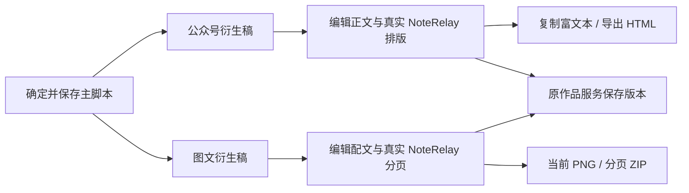

# T-1052 NoteRelay 实际集成与验证

## 当前结果

用户提供的 NoteRelay 0.1.8 原 core、平台 adapter、主题、分页器和样式已实际进入 CreatorOS 的公众号与图文工作台。正文和保存为主，生成/转换折叠为辅助。确定脚本沿原已保存主稿/大纲版本扩写；候选采用后，衍生稿可独立改稿。没有引入第二份作品或素材数据库。

实现和允许的代码/服务验证已完成，任务仍保持进行中、待用户网页验收。真实浏览器 PNG、系统剪贴板和公众号粘贴未验证；不能据此称完整验收通过。

## 直接入口

预览服务：`http://127.0.0.1:4318`，运行于现有工作树 `codex/user-diagnostics`；数据沿用隔离 PGlite/media 目录，没有改用户原数据库。

- [原用户项目](http://127.0.0.1:4318/projects/project-ef4eab23-166)
- [本轮可编辑验收项目](http://127.0.0.1:4318/projects/project-8d660be7-54)
- [公众号与 NoteRelay](http://127.0.0.1:4318/projects/project-8d660be7-54/article?outputId=output-8d660be7-79)
- [图文与 NoteRelay](http://127.0.0.1:4318/projects/project-8d660be7-54/outputs/output-8d660be7-95/image)

测试账号为已有的本地测试账号 `acct-ef4eab23-41`，不是平台登录或绑定成功证明。本轮测试稿和 1 像素 PNG 是明确夹具，没有写入原用户项目或冒充 AI 生成。若切到了别的账号，请选择“网页体验测试账号”。

## 真实复用和可交付源

原源码内容快照 `a91b976a2fe25453dafb22d9b407ee6a5508e889da5083fe2901b395f28f5667`，原路径 `/private/tmp/douyin_dl/noterelay-main/`，AGPL-3.0-or-later；原 LICENSE/第三方声明保留。没有 git commit 时未编造提交。

原模块仅做 Clipboard/下载交付宿主及去掉空署名演示口号的适配，精确差异在 `reference-editors/noterelay/WEB_PATCHES.diff`。新的 web host 提供 Obsidian DOM/sanitize shim、严格合同与消息桥；实际构建依赖图包含原 WechatAdapter、RednoteAdapter、Wechat 渲染器、原主题和分页器。网页不能读取账号凭据或签名素材 URL；宿主只经原端口读取精确文件，传 Blob。

静态包、对应源和许可随应用提供，预览底部有源码下载。源码 ZIP 在隔离目录解压，用固定版本的本机依赖链接运行归档自带的 web/build.mjs，四个网页文件与服务文件逐字节相同。不是重新执行附件原插件脚本，也不是干净安装包验收。见 [来源](t1052/source-provenance.json)、[隔离重建](t1052/source-rebuild.json)、[静态包核验](t1052/build-verify.log)、[当前 HTTP 字节核对](t1052/served-final.json)。

## 当场发生的验证

| 验证 | 实际结果及限制 | 证据 |
| --- | --- | --- |
| 规格独立评审 | 首轮指出图文投影不明确；补齐顺序/key/不回写边界后 PASS[REV:4abd3070b22a] | [规格回执](t1052/spec-round-2.json) |
| 实现只读复核 | 辅助折叠问题修复后 PASS；可重建源和代码示例保护复核 PASS | [实现复核](t1052/implementation-review.md) |
| 布局合同 | 13 项通过，拒绝越界/未知字段，保留旧 Doocs 分支 | [真实红测](t1052/contract-red.log)、[绿测](t1052/contract-green.log) |
| 前端与原包 DOM | 6 文件 36 项通过；正文改稿、来源/布局保留、会话隔离、取消旧导出、真实原渲染与主题、图片宽度/圆角、代码示例和素材投影 | [最终回归](t1052/frontend-final.log)、[正文边界真实红测](t1052/projection-content-red.log) |
| 文章与图文原后端服务 | 2 文件 45 项通过，保存/读回/历史/幂等/CAS；不另造保存服务 | [服务回归](t1052/service-tests.log) |
| 公共 HTTP 链路 | 真实建项目/主稿/两作品，精确 PNG 上传/下载核字节，版式与正文保存/当前/历史读回、同键重试成功，两次旧 CAS 均 409 | [公共接口结果](t1052/http-smoke.json) |
| 当前网页与静态产物 | 4 个页面 HTTP 200；8 个交付文件逐字节符合当前 manifest。HTTP 200 不证明浏览器操作/像素 | [最终 HTTP](t1052/served-final.json) |
| 原 HTML/PNG/ZIP 管线 | 实际静态 IIFE 在 JSDOM 调原渲染与富文本 HTML，正文/内联样式/精确图片写入正确；原 ZIP 页序/命名/PNG signature 验证使用明确 toPng 像素夹具 | [用例源码](../../frontend/src/features/reference-editors/noterelay/native-bundle.test.ts) |
| 前端类型与聚焦 lint | frontend tsc exit 0；新 NoteRelay 文件和构建脚本 ESLint 0 错误/0 警告 | [类型](t1052/tsc-final.log)、[lint](t1052/lint-final.log) |
| LED-047 | 8 文件 158 项通过，保留旧弹层/路由/刷新交互回归 | [LED-047](t1052/led047.log) |
| 任务范围治理 | 当前文件摘要与来源登记后 0 错误；既有签名/运行时文字未授权扩大机制 | [范围治理](t1052/governance-final.json) |
| diff / orphan | diff --check exit 0；orphan 0 error / 100 warning | [diff](t1052/diff-check.log)、[orphan](t1052/orphan.log) |
| boundary | 7 对基线 5；两项仍为 T-1026 已登记的 Copilot SDK 违规，未提升基线 | [boundary](t1052/boundary.log) |
| 收尾对账 | pmem sync 完成；reconcile exit 1，35 errors / 1 warning，无新增错误，不冒充全绿 | [sync](t1052/pmem-sync.log)、[reconcile](t1052/reconcile.log) |

初次公共 HTTP 用例曾带多余 sourceRef 字段，严格合同拒绝，修正用例后继续。随后发现开发服务仍持有旧文章版式合同，实际保存拒绝；沿原隔离数据目录重启服务，再走完整公共写读流程成功。两次失败日志分别保留为 http-smoke-first.log 和 http-stale-runtime.log，不把失败抹成从未发生。新增图片控件用例曾错误断言 inline borderRadius，原实现实际写 CSS 变量；对照原源码修正断言，不修改原控件行为，首个日志保留为 native-image-first.log。

## 用户网页验收路径

1. 打开验收项目，脚本在首项；文章/图文按真实稿件出现。
2. 公众号：修改段落标题/正文，在 NoteRelay 换主题和署名，点击原“保存修改”；刷新核对正文、来源和版式。
3. 公众号：点击“复制公众号文章”并粘贴到公众号编辑区，检查富文本样式/图片；不支持时有纯文本回退；“导出 HTML”核对同一稿。
4. 图文：修改配文、主题/字号，实际翻页，保存并刷新；下载当前 PNG、导出分页 ZIP，检查每页内容、文件顺序与尺寸；原照片 ZIP 和逐页画布入口保留。
5. 导出等待时改稿/切作品，旧结果应取消且不写入新稿。缺模型时手工编辑、保存和排版仍可进行。

## 未验项与状态

此前浏览器策略拒绝和用户亲自网页验收的约定见 DEC-T1049-01、DEC-T1051-01、DEC-T1052-01；本轮没有换 CUA、CDP 或 Playwright 绕过。JSDOM 没有真实布局/Canvas/system Clipboard：原 DOM 溢出分页、真实 PNG 像素、浏览器 sandbox/CSP 运行、真实文件下载、系统剪贴板与公众号粘贴待用户实测。真实模型、平台发布、安装包和全仓通过均未宣称发生。

T-1052 不提前标完成；保留用户视觉/交付验收。全仓既有历史回执/教训/物理和语义边界欠债由 T-916、T-1015、T-1026、T-1027 跟踪，不能用本轮局部通过替代这些门。

全仓对账与 T-1051 的 36 条错误相比，本次为 35 条、无新增错误，当前 LED-045 命令通过；这不证明原命令缺失文件的覆盖问题已解决。其余错误文本一致，见 [实际差异](t1052/reconcile-comparison.json)。没有放宽门卫或提高边界基线。
