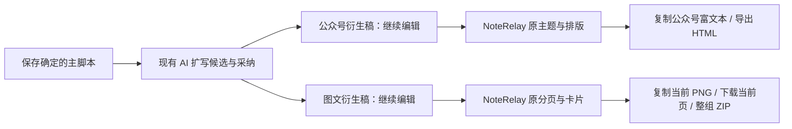

# T-1052 — 集成 NoteRelay 的脚本衍生稿工作面

## 用户确认与路由

2026-10-03 用户再次确认：图文和公众号是确定脚本后的衍生品，并明确要求把本机 NoteRelay 实际集成、实际验证（DEC-T1052-01）。这取代 T-1051 的“只参考、不复制”范围；不改变主脚本、账号、作品和素材的所有者。当前为维护期 BUILD：先冻结原插件依赖和集成合同、独立评审，再接代码；本轮没有发布、安装包或新增平台登录。

## 大白话

在原脚本编辑台确定内容；公众号和图文根据已保存主稿扩写，再各自改稿。正文仍由当前编辑区和保存按钮管理，NoteRelay 提供真实平台主题、排版预览、公众号富文本复制、小红书分页图片和整组导出。不是只做一个像它的界面。

## 原实现与复用边界

输入目录 `/private/tmp/douyin_dl/noterelay-main/` 已存在；package 0.1.8，AGPL-3.0-or-later，含其第三方声明。以有序路径与文件字节生成快照摘要：`a91b976a2fe25453dafb22d9b407ee6a5508e889da5083fe2901b395f28f5667`（src/**/*.ts、package/lock、styles、LICENSE、THIRD_PARTY_NOTICES）。没有 git commit 时不编造 commit。

原 WechatAdapter 调 renderWechatHtml 和 makeHtmlWeChatCompatible，已有主题及富文本复制；RednoteAdapter 已有 1242×1660 卡片、按标题及 DOM 溢出分页、当前 PNG 和全组 ZIP。Obsidian ItemView/插件设置不能直接当 Next 页面使用：复用原 core/theme/platform 渲染源和样式，通过小型网页 host 替换 Obsidian DOM、sanitize 和 requestUrl 接口。保留源、许可证、第三方声明及精确补丁记录。不要运行附件的脚本。

## 要求与合同

- FR-01：公众号和图文的主要预览使用实际 NoteRelay 源码。脚本为第一主工作面；两类 AI 扩写沿 T-1051 的已保存主稿/大纲冻结版本和候选采纳链，不新增脚本确认状态或禁用旧合法手工创作。
- FR-02：NoteRelay 静态独立网页在 sandbox opaque-origin iframe 运行，复用原两平台 adapter、内置主题、原分页、HTML 兼容和 PNG/ZIP 渲染能力。新 host 只负责 UI、协议和宿主接口适配；不创建账号/作品数据库、模型运行器、后台图像代理或 Obsidian 依赖。
- FR-03：新增共享 `noteRelayLayout` 严格合同，`schemaVersion=1`、`editor=noterelay`、`editorVersion=0.1.8`、themeId、可编辑署名/简介/变量、图文字号/分割标题级别/模板以及按原 key 的图片宽度/圆角设置，其中 themeId 1..128字符、署名0..120字符、简介0..500字符；变量最多32项、key 1..64字符、value最多2000字符、合计UTF-8不超16KiB；字号12..32整数、分割级别1或2、模板default或notes；图片宽度30..100、圆角0..32，映射最多256项且key最多512字符。文章 nativeLayout 兼容现有 doocs-md 并增加此分支；图文文档新增可选 nativeLayout。两者由原版本/CAS/幂等保存，刷新及历史读回恢复。同一稿不把临时 blob/data 图片当正式 asset ID。
- FR-04：文章主稿仍是现有 sections、图片精确引用、sourceRefs 和 metadata；图文主稿仍是 body、imageUses、cardBriefs 和 sourceRefs。NoteRelay 收到标题、纯 Markdown 和布局；文章的内部稳定段落标记仅在传给预览时去掉，不回写/重排段落。图片用 `creatoros-asset:<assetId>:<assetFileId>` 从稿件真实 imageUses 建立 allowlist，宿主经现有 asset download port 获取精确文件并传 blob；iframe 不拥有账号令牌或 URL 签名。未登记引用不请求下载，来源/读取错误明确显示。
- FR-05：双向桥只接收当前 iframe window、opaque origin、当前随机 sessionId 的消息；ready 仅初始化一次，版式变更通过严格 schema 解析后更新当前草稿，无自动正式保存。切作品/账号/版本建立新会话，迟到回复不回写。导出冻结当前正文、版式及素材，稿件/版式改变取消旧结果；导出期间禁重复操作，卸载清理 request 等待与 blob。公众号复制在宿主真实 ClipboardItem 写 text/html 和 text/plain，失败显示真实错误；不支持富文本时明确提供纯文本回退。
- FR-06：公众号预览有真实主题选择和可修改署名/变量，使用原排版；HTML 导出与复制使用同一当前稿。小红书预览有实际翻页、主题、字级/分割设置、当前 PNG 复制/下载与完整 ZIP；保留真实图片/画布逐页创作和既有整组图片交付。插件默认演示署名/口号不冒充真实账号：空署名保持空或可见待填，无示例内容灌入稿件。
- FR-07：主要内容编辑与 NoteRelay 预览放在生成/转换等辅助操作之前，辅助面可折叠；缺模型仍能编辑、保存、预览和导出。已有 Doocs 稿件的布局和历史不强制改写；旧编辑器保留可选真实入口。无假按钮，失败保留用户正文/版式/素材。
- FR-08：验证原渲染源、许可、快照和构建的实际复用；合同红→绿、原服务保存/历史/CAS、桥交互、真主题渲染/安全、公众号 HTML 与正文、分页及 ZIP/PNG 交付。用户此前浏览器自动化限制继续保留，先做真实 HTTP/DOM/构建和公开保存读回；真实浏览器像素与系统剪贴板证据缺失时如实记录，不能把 DOM fixture/HTTP 200 当作实测通过。真实模型生成与平台发布不因排版集成而冒充发生。

## 验收

- AC-01：实际页面加载自己的 NoteRelay 静态包；依赖图证明调用原 WechatAdapter/RednoteAdapter，主题切换改变原预览，空稿不显示示例正文或虚构账号。
- AC-02：编辑当前文章或图文，改 NoteRelay 主题/署名/版式，经原服务保存再读回完全一致；旧 doocs/无 nativeLayout 的历史仍能读取；CAS 冲突不覆盖新稿。
- AC-03：真实 article imageUses 精确文件可以预览与写入公众号 HTML；Graphic 的真实素材保持版本引用。伪造、跨会话和迟到消息不修改当前稿或导出；更改后旧导出作废。
- AC-04：公众号交付包含已编辑正文、原主题内联样式、纯文回退与可读 HTML；图文原分页内容全量保留，PNG/ZIP 字节和文件名/页序正确。浏览器限制未解除时，真实 PNG 像素/系统剪贴板不得标 PASS。
- AC-05：新预览/编辑为主，生成辅助折叠；原脚本首项和动态 Tab、文章候选采纳、图文逐页画布仍可用。缺模型不阻断手工保存/排版；失败信息准确并保留输入。

## 验证与边界

contract 只扩展已有文档布局，不新增公开 operation/表/迁移。backend 沿原文章/图文 service 存版本。frontend 负责展示、Clipboard/下载与现有 RPC；平台原渲染器在隔离静态包内，不放后端业务/AI SDK。范围：reference-editors/noterelay、静态包与构建脚本、共享布局合同与 tests、两工作台/桥与相关测试、原文档保存回归、任务证据和控制面。每个验证结果注明真实路径、mock 范围和未验项。执行类型检查、聚焦 lint、LED-047、boundary/orphan，最后 pmem sync/reconcile，旧欠债保留。
