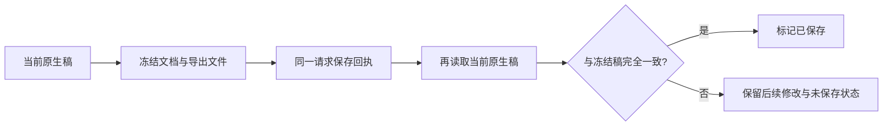

# T-1053 原生编辑器集成独立实现评审

结论：通过本次源码、宿主状态和 DOM 边界实现评审，当前无未关闭的可操作 finding。四类编辑器最终公开包的对应源码配对通过；OpenCut/Doocs 已直接从 public 目录在没有全局 `process` 的 DOM 环境完成实际模块复核。评审日期：2026-10-03 至 2026-10-04。

## 范围与边界

已读取任务 SPEC、T-1053 context、项目记忆、SYSTEM_ARCHITECTURE 及已安装流程技能，确认 BUILD 阶段。共享 checkout 只读；所有新增探针和评审工件仅在 `/tmp/t1053-implementation-review`。未使用浏览器、Playwright 或 CDP。

评审覆盖共享 native surface/loader/theme/account、素材映射、NoteRelay 宿主、视频/快图宿主、Doocs 文章宿主、production-editor-entry，以及 NoteRelay 原适配器、快图实际 controller/core、OpenCut actual embedded/core/storage/media/render、Doocs actual Vue/CodeMirror/PreviewPanel/core 源码。

真实原组件直接挂载及资源调用已从源码确认。DOM 夹具验证作用域、回执、状态和释放边界；它们不证明真实浏览器像素、真实解码、系统 Clipboard 或 MP4 成片。OpenCut `opencut-wasm` 无 GPU device/compositor 销毁 API，保留该已记录限制，不要求虚假的销毁证明。

## 已发现问题与修复状态

| 问题 | 原具体触发 | 当前状态 |
| --- | --- | --- |
| 快图未知 pattern 未声明 type 时绕过资源过滤 | Fabric 5 实际 `enlivenPatterns` 只检查 truthy source；外链 fill/stroke 未标 type 仍触发图片加载 | 源码修复已复核；实际 Fabric 探针仅见占位 data URI；最终包/源码配对通过 |
| 快图 JS 选框未读公共主题 token | 使用未下发的 `--primary`，回退固定色；公共入口只传 `--creatoros-*` | 已改读 `--creatoros-brand`，真实 Fabric 选框/控制点回归通过；最终包/源码配对通过 |
| Doocs 外部同段改稿被旧缓存覆盖 | 只比较 sectionId/order/images，父正文改动不 reload；保存旧 draftMarkdown 覆盖新正文 | 完整输入 fingerprint + external sync + native echo 分离已复核；独立 4 项 DOM 宿主回归通过 |
| Doocs 即时保存遗漏通知窗口内输入 | 原 CodeMirror 编辑后 300ms 才通知宿主，保存直接使用旧缓存 | 保存即时 snapshot；正式导出也核对即时正文/版式；独立回归通过，真实 ESM 探针验证通知窗口存在 |
| 快图慢图片卸载未取消真实 Image | revoke URL 后 Image src/handlers 和导入等待仍在 | abort/epoch ownedJob + decodeImage 清理已复核；探针卸载后 settled=true/src空/handlers空/URL释放，最终实际源码 29 项测试通过，最终包/源码配对通过 |
| 快图已知 409 后无恢复入口 | 保存 pending 对任何错误保留，native/返回/重读/放弃全部锁住；旧 expectedCurrentVersionId 持续冲突 | 根修复已独立复核：conflictAttempt 保本地，备份/当前版本读取入口可用；未知 ACK 仍冻结重试。原 actual-host 红测现通过 |
| 原生保存期间迟到合法导入误标已保存 | 先冻结 snapshot；旧导入稍后增加图层；busy 忽略 onChanged；回执无条件 dirty=false | 两宿主回执后重新核对实际 snapshot；无法核对保守 dirty。actual Kuaitu controller + actual graphic host 双证、原红测现通过 |
| Doocs 合法图片属性与响应式来源绕过精确图片过滤 | 原正则在 `alt="a > b"` 中断；未知 img src/srcset、picture/source srcset、SVG image href/xlink:href 可留存；合法已绑定图有时反而丢 src | 已改 inert template 解析和逐元素资源过滤。最终 public ESM 的 11 族断言通过；合法已绑定图、inline 图、SVG矢量层与规范正文保留；最终包/源码配对通过 |
| OpenCut 生产 ESM 依赖浏览器不存在的 process | 根静态扫描发现 14 处未替换 NODE_ENV；独立 DOM 夹具移除 process 后，actual production ESM 在 import 阶段抛 ReferenceError，尚未 mount | production define 修复；最终 public ESM 在没有 process 的环境中实际 import→mount→dispose 通过。原 red 日志 `opencut-browser-global-red.log`，当前 `opencut-public-final-probe.log` |
| Doocs 生产 Vue chunk 同样依赖 process | 同样移除 process 后 actual ESM 在 `vendor_vue-nO-Z3qFp.js:8` 未守卫读取 NODE_ENV，尚未 mount 即失败 | production define 修复；最终 public ESM 全程没有 process，14 DOM 行为及 11 族图片明确断言全部通过。当前 `doocs-public-final-probe.log` |

保存后的正确状态是把文件所对应的冻结稿与仍可继续变化的本地稿分开核对：

## 独立执行的证据

| 检查 | 结果 | 证据性质 |
| --- | --- | --- |
| 共享 8 个宿主测试文件，retry=0 | 修复后 43 tests PASS，最终再次执行日志保留 | 当前真实宿主 + 明确 native handle 夹具；NoteRelay native-bundle 为 actual ESM；`host-tests-final.log` |
| OpenCut 四个实际 source 测试文件 | 最终再次执行 16 tests / 80 assertions PASS | actual lifetime/controller/commands/storage/media resources；renderer/wasm 是明示夹具；日志 `opencut-source-tests-final.log` |
| Doocs actual dist-native ESM DOM 脚本 | 14 checks PASS | actual Vue/CodeMirror/PreviewPanel；Range/ResizeObserver 等是明示 DOM 夹具 |
| Doocs 图片来源/合法属性/局部降级 | actual ESM 11 族明确断言 PASS | 单双引号大于号、换行、真实素材、响应式 img/picture/source、SVG href/xlink、inline image；原正文逐字保持，原SVG vector层保持；`doocs-image-variants-{red,current}.log` |
| Doocs 独立修复回归 | 4 tests PASS | actual Article host + 明确 handle，覆盖外部同步、即时 snapshot、导出校验、echo 保 Undo |
| 独立 graphic 冲突与迟到导入回归 | 2 tests PASS | actual graphic host + 提供真实当前稿变化的明确 handle |
| 快图 actual source 测试 | 最终 2 files / 29 tests PASS | actual controller/core + 明确 Fabric canvas/DOM 夹具，pattern 与选框部分调用真实 Fabric；日志 `kuaitu-final-tests.log` |
| 未声明 type pattern | 修复后仅请求占位 data URI | actual Fabric `enlivenPatterns`，图片加载记录器禁止网络 |
| 慢 Image 卸载 | 修复前 raw import 不结束、src/handlers仍在；修复后清理全部 | actual NativeController + 明确 PendingImage 夹具 |
| 保存期间迟到导入 | disabled=true，冻结层数0、当前层数1 | actual NativeController + 明确 Image/engine 夹具，证明合法在途导入仍会完成 |
| 最终公开 ESM 无 Node process | OpenCut import/mount/dispose、Doocs 14 DOM + 11 图片族均 PASS | 直接加载 shared frontend/public 内实际 ESM；DOM/几何/Canvas fixture 已明确，不声称媒体/GPU行为 |

原 red probe 与测试文件均保留于本目录；报告没有把失败补写成历史 PASS。首次快图测试 CLI 因 cwd/root 解析错误而未执行测试，改正 cwd 后才真正执行，只有后者计入上述通过数。

快图最终交付已逐字核对 public 与 delivery 的 ESM/CSS/graph/meta/LICENSE，源码归档与 public 归档相同，已审关键源码与归档对应。归档 SHA-256 `caec8830b6d9b11dfc79b47c721aee882d8f58dc0e9ac64c1364ecb70323b994`；JS `47c8193cde75f04be063e4e0d999b56609721db27a71fa9112f01e059fed4a4d`；CSS `cd47761c252f0c78ca84955dd10a4fb088c86a592145ece94deb6162cbfb2662`。

NoteRelay 最终 public `source.zip` 内全部 48 个 src/web 文件与实际已审源码逐字相同，包含 `web/native.ts`、`web/native.css`、`web/build.mjs`。归档 SHA-256 `07f7376e868b26691340224ba46bd82d40df80752d5a837cc9e3898ff10faf5f`；public JS `e0cf56a0063b30645cef4092888d6a44a0fd92942eba495d67478211eebe4e58`；CSS `e379e8cc8d1d90e49a09fe2af5ef813d231411fd902cee32bf1be908675612bf`。实际 public ESM 的挂载/HTML/两实例/取消/主题行为由上述共享 native-bundle 测试直接执行；PNG 像素管线明确使用夹具。结果见 `noterelay-source-delivery-final.json`。

OpenCut 最终交付全 7 个 public native 文件（ESM/CSS/graph/许可/本地图片）与 delivery 逐字对应。归档 SHA-256 `0da70debcdf5a6656c65847606314f523c29e8f59e83e27e02077521130e9420`；JS `f61b0939ff9a185861dbc7addee2c40ef1b3a0d71cfac81c31c41d1f43a50354`；CSS `e8757103e0fd57d164826df1de27070222dc6b2ba23bcd4bb32a3cbbe64ee688`。

Doocs 最终交付全 395 个 public native 文件（ESM/所有 chunk/CSS/graph/许可/本地图片）与 delivery 逐字对应。归档 SHA-256 `60baa6f2656e5038e31bab6c2ff71ddfbaba54a6a7f703796364b78f4f96f3a7`；JS `5e31ddf1044faf3ac200a08d50fe51b7f40e55a885a592df9387f2891df43adb`；CSS `cf6a66b7e51c1b4251b663f7b03edbc1eebd74154993e263d80698e528407e57`。实际原 LICENSE 与 metadata 同为 WTFPL；没有改写原许可。

归档与实际 source 比对快图 255、OpenCut 688、Doocs 537 个 source/core 文件，均无字节不匹配；另外直接核对了 OpenCut `apps/web/scripts/build-native.mjs`、Doocs `apps/web/vite.native.config.ts` 等修复入口与归档相同。三个 public 源码归档都与 delivery 相同。全部 public native 文件无多余旧文件。完整结果见 `source-delivery-final.json`。

## 已关闭问题的当前代码定位

以下为复核修复的位置，不是待修 finding。共享宿主路径以 `/Users/zyongzhu/.codex/worktrees/user-diagnostics/Thirdspace-creator/` 为根，原组件路径以对应 temp source 为根。

| 修复 | 当前文件与行号 |
| --- | --- |
| Doocs 完整输入 fingerprint 与外部同步 | `frontend/src/features/article/doocs-article-editor.tsx:40`、`:69`、`:94` |
| Doocs 即时保存/正式导出 snapshot | `frontend/src/features/article/doocs-article-editor.tsx:153`、`:167` |
| Graphic 已知冲突与冻结稿备份/重读 | `frontend/src/features/reference-editors/graphic-design-workbench.tsx:34`、`:35` |
| Graphic 保存回执后核对当前稿 | `frontend/src/features/reference-editors/graphic-design-workbench.tsx:30` |
| Video 保存回执后核对当前稿 | `frontend/src/features/reference-editors/video-reference-workbench.tsx:70` |
| 快图 JS 主题选框 | `/tmp/t1053-native-canvas/source/src/native-controller.ts:60` |
| 快图图片 job 取消与真实 Image 清理 | `/tmp/t1053-native-canvas/source/src/native-controller.ts:116`、`:127` |
| 快图无 type pattern 资源过滤 | `/tmp/t1053-native-canvas/source/src/native-controller.ts:212` |
| Doocs 精确图片及响应式/SVG资源过滤 | `/tmp/t1053-native-doocs/packages/core/src/native-host.ts:71` |
| OpenCut production define | `/tmp/t1053-native-video/source/apps/web/scripts/build-native.mjs:52` |
| Doocs production define | `/tmp/t1053-native-doocs/apps/web/vite.native.config.ts:10` |

## 仍未验证的实际运行边界

本次实现评审不能代替真实浏览器像素、布局、焦点层级、真实音视频解码、MP4导出、系统 Clipboard、图片/资源 ZIP 人工质量，以及远程 MathJax/PlantUML 与复杂图表的实际运行验收。OpenCut 的 GPU device/compositor 销毁仍受其原 API 能力限制。这些边界保留待验/已记录限制，未写成 PASS。
