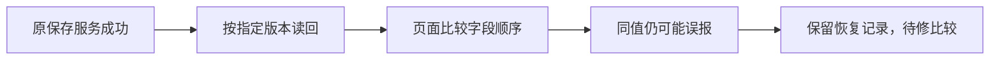

# T-1053 · 2026-10-05 网页恢复与公共接口复查

## 用户要求与范围

按用户已确认的原工作台继续接入与验收。本轮恢复 4318 预览，检查公众号、图文、视频具体作品页和原生编辑器资源，复查原保存服务。本轮没有修改产品代码、重新选择布局或执行 WorkBuddy AI；用户已取消 WorkBuddy 实际 AI 验证，其接入继续按 MCP 范围。

本轮已读取新版 oil-ui-pro 0.10.0 和账号组页面规范。T-1053 当前为 maintenance BUILD 的 acceptance，write_set 为任务证据；实际视觉与操作继续待验。浏览器策略拒绝后没有使用 CUA、CDP、Playwright 或其它自动化绕过。

## 预览启动

工作目录为 `/Users/zyongzhu/.codex/worktrees/user-diagnostics/Thirdspace-creator`。沿用既有 `/tmp/t1049-user-acceptance/db` 隔离预览库及同目录 media/workspaces 等，账号为 `acct-ef4eab23-41`（网页体验测试账号），没有读取或改写用户原库。

第一次启动在监听后仍返回 404。停止本轮自己的进程组，将旧 `frontend/.next/dev` 缓存保留为 `/tmp/t1053-next-dev-cache-20261005-1791130056` 后重新编译，三个具体作品入口恢复。进程以 `start_new_session=True` 分离启动，launcher PID 86460、Next PID 86483；日志 `/tmp/creatoros-user-preview-4318-20261005.log`，PID 文件 `/tmp/creatoros-user-preview-4318-20261005.pid`。以上 PID 只描述当场状态，不保证后续会话仍相同。

```text
pnpm --filter creatoros-frontend exec next dev --hostname 127.0.0.1 --port 4318
```

| 页面 | 当场结果 |
| --- | --- |
| [公众号文章](http://127.0.0.1:4318/projects/project-8d660be7-54/article?outputId=output-8d660be7-79) | HTTP 200，响应未含 not-found 标记 |
| [图文工作台](http://127.0.0.1:4318/projects/project-8d660be7-54/outputs/output-8d660be7-95/image) | HTTP 200，响应未含 not-found 标记 |
| [视频工作台](http://127.0.0.1:4318/projects/project-8d660be7-197/production?outputId=output-8d660be7-208) | HTTP 200，响应未含 not-found 标记 |

HTTP 带当前账号 Cookie，不能只用流式响应的 200 代替作品归属检查。时间、响应字节、摘要与脚本数见 [具体页面记录](existing-pages.json)。`open_in_codex` 对公众号地址返回 queued；这不等于已观察到网页视觉或操作。

收尾时重新请求三个具体作品入口，均为 200 且无 not-found，见 [最后可访问记录](final-pages.json)。

## 当场验证

| 检查 | 结果与界限 | 证据 |
| --- | --- | --- |
| 四个原生编辑器资源 | 413 个运行文件与 4 个源码归档的真实 HTTP 字节符合固定清单；Doocs 空 `.gitkeep` 占位被拒绝 400，不是运行资源 | [结果](native-http-resources.json)、[复用脚本](native-http-resources.py) |
| 原文章/图文公共服务 | 26 次公共 RPC，保存、当前读回、精确历史读回、同请求重放、旧 CAS 409 通过 | [结果](http-smoke.json)、[复用脚本](http-smoke.py) |
| 图片字节和布局引用 | 使用 OpenCut 固定源码自带 `effects/preview.jpg`，走原上传、归属、下载、文章和图层保存服务；下载字节一致，原精确文件身份与布局读回保留 | 同上；不是浏览器画布导出图 |
| 文章保存比较 | 同值对象经过合同解析或嵌套字段重排后，现有 JSON.stringify 比较误判不一致；已复现，尚未修复 | [只读合同探针](save-normalization-probe.mts)、[输出](save-normalization-probe.json) |

新建隔离验收工程 `project-f73ddd4a-50`；文章 `output-f73ddd4a-76`、图文 `output-f73ddd4a-92`；素材 `asset-f73ddd4a-68` / `afile-f73ddd4a-72`，图片 SHA256 `b318cede7bbe27bfbf1b8b94d41f65b6f52d5f2650ce3a153d03b76c2a1c0190`。不改动用户正在查看的三份作品，保留验收稿和回执供读回。脚本为原 T-1053 HTTP 验证的复用副本，改动仅为本次输出目录、工程名称及真实 JPEG 服务夹具。

## 保存缺陷与待验项

`frontend/src/features/article/article-workbench.tsx:372` 将指定版本的合同解析结果与未规范化的恢复请求直接 stringify 比较。添加标签会改变顶层字段顺序，JSONB 也允许嵌套 themeSettings 字段重排；同值请求可能已经由后端保存，但页面仍保留恢复记录并报“保存回执与指定版本读回不一致”。只读探针用原 articleDocument schema 复现两类误判，不把它写成真实浏览器点击证据。

这属于 T-1053 AC-03 / AC-05 的未闭合验收项。本轮没有删除读回守卫或恢复记录；接口检查通过不能证明页面保存提示通过。后续修复应复用既有画布/视频的确定性 JSON 比较并沿原合同处理默认值，保留正文、数组顺序、精确 ID 与版本差异的拒绝，以及保存期间新编辑和未知回执的恢复。不得通过放宽真实内容一致性来消除报错。



真实浏览器的主题、窄窗、焦点、快捷键、复制、PNG/ZIP/MP4、实际下载、刷新和画布往返继续待验。真实模型、WorkBuddy、平台发布和安装包均未验证。T-1053 继续待验，没有完成任务或补写缺失的视觉/真机证据。

## 收尾对账

`pmem sync` exit 0，见 [同步日志](pmem-sync.log)。全量 `reconcile` exit 1，仍为 35 error / 1 warning，见 [当场日志](reconcile.log) 与 [逐行比较](reconcile-comparison.json)。与原 T-1053 日志相比数量相同，失败内容存在差异：本轮 LED-045 再次报错，LED-046 本轮通过；其余 error/warning 行相同。LED-045 的全仓失败、单独通过和命令差异已经在 T-1015 / T-1051 记录，根因继续待核实；不以相同数量声称全仓状态完全相同，不放宽任何门。

本轮只提交此目录内的新增验收记录，未提交其它已有工作区修改。文章保存比较缺陷仍属于本任务待修验收项，因此没有完成 T-1053。只读探针对应原实现、合同与既有画布/视频比较代码的 SHA 见 [源码快照](source-hashes.json)。
