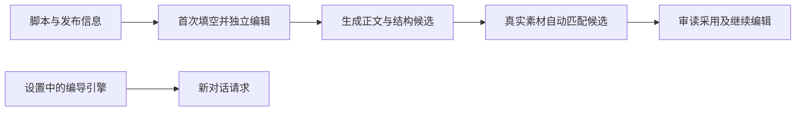

# T-1055：脚本衍生稿工作台检查记录

## 已实现

文章与图文沿用主脚本阶段的标题、简介和标签：首次只填空，标记未保存；人工已填值保留。稿件采用后可以二次编辑，主稿后续变化不自动覆盖已保存的衍生稿。

- 文章使用页面可用宽度，编辑与 NoteRelay 预览分栏，窄屏用堆叠样式。生成、保存使用明确主操作；段落管理收进菜单。
- 图文主生成只请求正文和图卡结构，标题、简介和标签再生成收进辅助选项。候选入口不藏在逐页设置里。
- NoteRelay 预览放在折叠排版设置之前；主复制/分页 ZIP 与更多导出有主次，保留原生实例、主题、署名、精确素材和交付能力。
- 图片由原模型在冻结的真实素材目录中提出 exact asset/file 建议；采用经原服务验证目标、账号、版本和物理文件。已有选图保留，失效单图跳过，合法正文继续采用。
- 编导引擎选择移入“设置 → 模型配置”，共享真实偏好与状态；新消息随新设置，在途回复和旧消息重试保留原引擎。
- 删除脚本“项目作品与创作”按钮及普通稿的空顶条，导入、转录与已发布的真实动作保留。

## 实际证据

| 检查 | 结果与记录 |
| --- | --- |
| 独立 SPEC 审查 | 前置通过；仅 Markdown 列表格式修正后复审通过：[第一轮](spec-round-1.json)、[第二轮](spec-round-2.json) |
| UI/原生宿主相关 | 最终 12 文件 86 tests 通过，retry 0：[记录](frontend-root-tests.log) |
| 设置/聊天/LED-047 | 12 文件 244 tests 通过，retry 0：[记录](ui/t1055-root-settings-led047.log) |
| Backend 主稿/文章/图文 | 3 文件 64 tests 通过，retry 0：[记录](backend-root-tests.log) |
| Contract 相关 | 4 文件 23 tests 通过：[记录](contract-root-corrected-tests.log)；隔离完整相关 32 tests 见 [Backend 索引](backend/README.md) |
| Worker 公共生成与落账 | 最终 4 文件 72 tests 通过；本地供应商桩验证完整调用链，真实模型未调用：[最终记录](worker-root-complete-tests.log)、[修复说明](backend/worker-review-fix-README.md) |
| Frontend 类型 | `tsc --noEmit` exit 0：[记录](frontend-final-typecheck.log) |
| Worker 类型 | [记录](worker-root-typecheck.log)；contract/Backend 生产类型与隔离诊断比对见 [Backend 索引](backend/README.md) |
| 公共 HTTP | 26 次 RPC 和 3 个页面通过；同一 metadata/script 来源、保存/历史读回、幂等、旧 CAS 拒绝、主稿变化不覆盖和历史出处保留：[结果](http-smoke.json)、[脚本](http-smoke.py) |
| 当前用户页面 | 脚本、文章、图文与设置页实际 HTTP 200；不含项目作品按钮：[记录](pages-prebackend.json) |
| lint | UI 9 个既有 error 未增加；设置 3 个既有 warning 保留；Backend/Worker 改动文件也与隔离原源码比较无新增。不是全绿：[UI 比对](frontend-lint-delta.json)、[Backend 索引](backend/README.md) |
| boundary/orphan | boundary 7 条，对登记基线 5 条；两条已有 Copilot SDK 违规属于 T-1026，未扩大 baseline。orphan 0 error / 100 warning：[边界](boundary.log)、[orphan](orphan.log) |
| diff / 项目同步 | diff exit 0；pmem sync exit 0：[diff](diff-check-final.log)、[同步](pmem-sync-final.log) |
| 最终 reconcile | 运行记录及与既有失败的对照见 [reconcile](reconcile-final.log)、[对照](reconcile-comparison.json)。不得推定全局通过。 |

实现独立复核已 PASS，findings 为空：[审查记录](implementation-review.json)。

## 红测及审查修复

实际红测与中途错误均保留，没有补拍历史 PASS：

- 首次透传/主入口/默认元数据保护红测；预览先于折叠设置及图文只生成正文/图卡红测：见 [UI 日志目录](ui/)。
- 独立审查发现逐字标签分隔符丢失，红→绿修复独立 tagsInput。
- 主保存、并发版本和旧请求恢复三个分支等待回执期间的新输入丢失，真实 deferred 红→绿；生成不拿旧冻结稿继续执行。
- 配图提示按真实 imageUses 更新，不再把已有图说成未选。
- 模型改 metadata 反杀合法正文、旧无目录 ID-only 建议被新 schema 拒绝，真实红测后安全降级；公共 Worker 采用归一化结果，经 native JSON/text 两路径落账。
- 部分测试 fixture 初稿的选择器歧义、contract 文件筛选路径、以及预览全局旧实例未重启导致 HTTP 缺新字段，均保留原失败日志并纠正；不计成产品 PASS。

本任务 44 个实际源码文件及 SPEC 的治理检查通过：[治理结果](governance-final.json)。过程命令曾误启动全仓治理扫描，其既有失败原样保留于 `governance-global-existing.log`，不冒充本任务通过。

## 待验及实际限制

本轮已通过 489 项相关回归及实际公共保存/读回检查；没有浏览器自动化、真实模型调用或系统剪贴板/公众号粘贴。组件/JSDOM 与 HTTP 不能证明页面像素、最小视口、原生 PNG 捕获或配图质量。原生 bundle 相关组件检查通过，实际网页视觉与真实模型效果保持待验；T-1055 仍在看板中；review/implementation 已由流程命令登记完成，acceptance 未标通过。

当前预览仍为隔离 PGlite 数据与本地媒体。源码位于 `codex/user-diagnostics` 开发工作树，沿此前明确限制保留真实浏览器验收，不声称安装包或正式发布完成。
