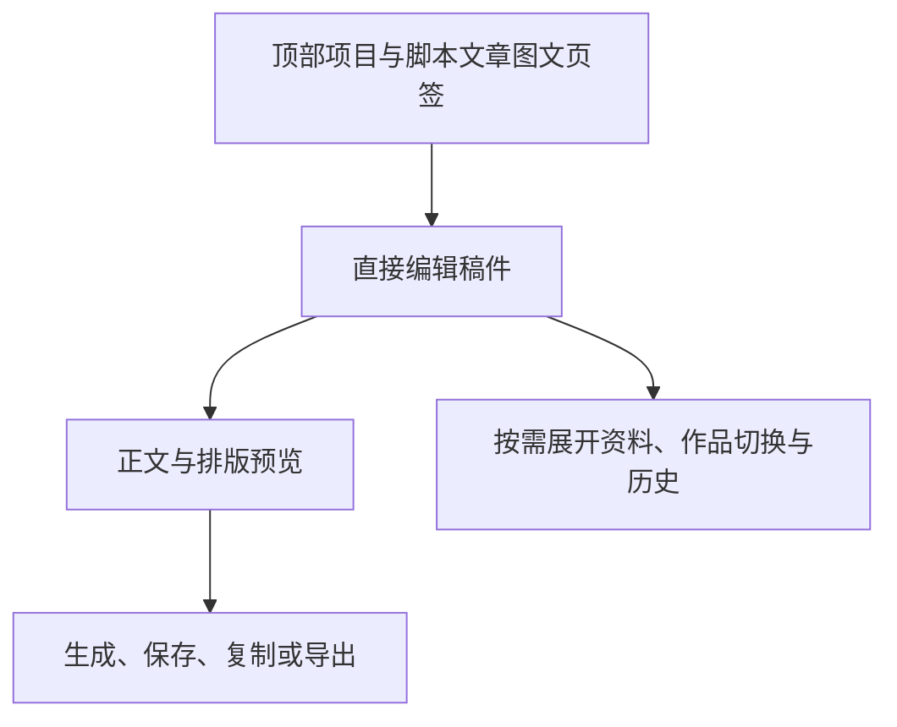

# T-1056 — 衍生稿字体与页头清理检查

## 改了什么
文章、图文稿面去掉重复的项目出处、页面大标题、说明段、返回文字和页头版本状态小字。单稿的作品选择、新建及写作资料收进原辅助区；多稿和空态仍有明确真实选择入口。历史折叠但保留真实读取。保存按钮的可用状态与提示反映真实修改和保存状态。

正文复用脚本的 `text-sm leading-relaxed`，段落标题 `13px`、区标题 `13.5px`；生成/保存按钮使用公共 `text-sm` 字体。NoteRelay 宿主删除重复说明，排版主题及原生交付不改。

## 实际检查
- 独立前置 SPEC 审查 PASS：`spec-round-1.json`，回执 `92e1237e8459`；独立实现只读审查 PASS：`implementation-review.json`，未推定浏览器视觉。
- 修改前新增组件检查实际 3 失败：页头文字仍在、字号未统一（`interaction-red.log`）。这是展示及折叠/保存状态检查，不冒充业务核心 TDD 或真机证据。
- 第一轮完整组件检查 54 项中 2 失败：误去 `projectTitle` 导致真实新建构造异常，图文 root class 替换未命中。恢复真实新建参数、修正 class 后最终 **5 文件 54 项通过**（`components-final.log`）。前次失败保留在 `components-first.log`。
- LED-047 与 NoteRelay 原引擎/投影回归 **10 文件 172 项通过**（`led047-native.log`）；共 **226 项通过**。这是组件和已有引擎夹具检查，不是浏览器/系统剪贴板验收。
- 最终 frontend `tsc --noEmit` exit 0（`frontend-typecheck-final.log`；实际工具完成状态见 `command-results.json`）。首轮类型错误保留，未隐藏。
- 四个源文件按本轮前快照运行 ESLint：原有 **6 errors / 1 warning**，修改后同数；未增加（`lint-before.json` / `lint-current.json` / `lint-summary.json`）。未宣称 lint 全绿。
- 当前用户实际文章/图文 URL 直接 HTTP 均 **200**，响应没有被删除的重复页头文案（`http-pages.json`）。不把 HTTP HTML当已看过客户端像素。
- 本轮 **7 文件**修改，前后 SHA 与仅本轮 diff 分别见 `source-change-manifest.json` 和 `task-only.patch`。范围 governance **8 文件 0 errors**（包含 SPEC），未修改业务或合同。
- boundary 仍有 T-1026 记录的原 Copilot SDK 违规；orphan exit 0，既有 warnings 保留。`pmem sync` exit 0。

## 待验与全仓情况
本轮没有浏览器像素/最小视口证据，沿之前禁止浏览器自动化的决定保留待验；不生成假的 frontend-validation 回执。任务实现步骤完成，acceptance 保持待验。全仓 reconcile 已完成：**35 error(s), 1 warning(s).**，对比 T-1055 最后实测，新增 0 / 消失 0；旧错误留在原根因任务（T-1026、T-1015、T-916 等），未改门卫或放宽基线。详见 `reconcile.log` 和 `reconcile-comparison.json`。本轮验收仍因缺真实视觉证据保持待验，未记完成或提交混合历史 WIP。
