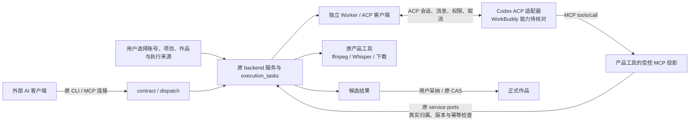

# T-1058：ACP / MCP 双向接入与项目绑定调研

调研日期：2026-10-04。性质：只读研究与方案候选；没有生产修改、安装、模型调用、浏览器自动化、运行时探针或测试。没有读取/复制 Agent 原始凭据，没有操作示例 ChatCut 项目。WorkBuddy 的真实支持由另一研究者核对，本报告不将 CodeBuddy 当作 WorkBuddy。

## 1. 建议的连接方向

大白话：CreatorOS 用 ACP 把任务交给 Codex；Codex 用 MCP 调用 CreatorOS 提供的工具。ffmpeg、Whisper、下载、资产导入、候选保存及采纳仍由产品原服务完成。两个协议可以一起使用，接入协议不会取得账号、项目和数据库的所有权。

该图是项目方案推论，不是已经接通的拓扑。Agent SDK 仍只能放 Worker，业务写入经 backend service ports；原任务账本继续是执行权真相。遵守 [SYSTEM_ARCHITECTURE](/Users/zyongzhu/.codex/worktrees/user-diagnostics/Thirdspace-creator/orchestrator/SYSTEM_ARCHITECTURE.md)。

| 比较项 | ACP | MCP | 对本项目的建议 |
|---|---|---|---|
| 核心连接 | 客户端驱动 Agent 会话 | Host 中的客户端连接工具/资源服务 | ACP 放在 Worker；MCP 投影原产品工具 |
| 主要交互 | initialize、session/new、prompt、update、cancel | initialize、tools/list、tools/call；可选 resources、prompts 等 | 都按真实协商能力开放 |
| 配置模型 | 取决于 Agent 的具体配置能力 | sampling 仅为可选请求，模型提示并非强制选择 | 不把任一协议当成通用模型凭据管理器 |
| 项目绑定 | cwd 是文件系统上下文 | roots 是可选文件根上下文 | 两者均不能替代账号/项目/作品归属检查 |
| 数据写入 | 协议不赋予业务数据库权 | tool 注解不替代权限 | 原候选采用与 CAS 保持唯一正式写入路径 |
| 断开与恢复 | session/load 等需能力协商；cancel 有完成语义 | HTTP 断开不等于取消；恢复消息不等于业务对账 | 原 unknown、lease/fence 与幂等处理仍必要 |

协议事实依据：[ACP 初始化](https://agentclientprotocol.com/protocol/v1/initialization)、[ACP 会话设置](https://agentclientprotocol.com/protocol/v1/session-setup)、[MCP 架构](https://modelcontextprotocol.io/specification/2025-11-25/architecture)、[MCP tools](https://modelcontextprotocol.io/specification/2025-11-25/server/tools)。研究基线采用 ACP v1 与 MCP 2025-11-25，实际适配器须固定 SDK/版本并协商，不能混用其它主版本字段。

ACP v1 可以在 session/new 中传入 MCP 服务。stdio 为协议基线，HTTP/SSE 要检查 Agent 的 mcpCapabilities；选择本机短寿命 HTTP 桥时，不能凭 Agent 名称假定 HTTP 可用。[ACP 会话设置](https://agentclientprotocol.com/protocol/v1/session-setup)

MCP sampling 是服务端请求客户端生成的可选能力；客户端决定实际模型，modelPreferences 只提供建议。不能用它保证用户指定模型或免图片配置。[MCP sampling](https://modelcontextprotocol.io/specification/2025-11-25/client/sampling)

## 2. Codex：维护中的桥与现代码的差异

### 来源固定

- **OpenAI 官方**：本地 Codex 可作为 MCP 客户端连接 stdio 或 Streamable HTTP 服务；这是 Agent 调产品工具的方向。[官方 MCP 文档](https://learn.chatgpt.com/docs/extend/mcp?surface=cli)
- **旧 Zed 源码参考**：`zed-industries/codex-acp` 的提交 `296069e841634cd4bb9bc4515602d836e49231ec`。README 明示项目已归档，开发迁到新仓库，不宜作为新安装的维护基线。[固定旧 README](https://github.com/zed-industries/codex-acp/blob/296069e841634cd4bb9bc4515602d836e49231ec/README.md)
- **维护方开源桥，非 OpenAI 原生 ACP 保证**：`agentclientprotocol/codex-acp` 发布 **v2.1.1**，2026-10-01，提交 `68d7d2d5ddfc0ed5746f9f6130892dda685e65dd`。它以 stdio 提供 ACP，启动 Codex App Server 后转换协议，包声明 Apache-2.0。[发布](https://github.com/agentclientprotocol/codex-acp/releases/tag/v2.1.1)、[固定 README](https://github.com/agentclientprotocol/codex-acp/blob/68d7d2d5ddfc0ed5746f9f6130892dda685e65dd/README.md)、[package.json](https://github.com/agentclientprotocol/codex-acp/blob/68d7d2d5ddfc0ed5746f9f6130892dda685e65dd/package.json)

### 源码可验证，尚无本项目连接证据

新桥的 initialize 广告 `loadSession=true`、图片输入与 embeddedContext、MCP HTTP；SSE=false。图片输入能力不等于文生图能力。ChatGPT/API key 以及自定义 gateway 是其具体认证机制；gateway 需客户端显式声明对应扩展能力，不是任意 ACP Agent 都支持。[CodexAcpServer](https://github.com/agentclientprotocol/codex-acp/blob/68d7d2d5ddfc0ed5746f9f6130892dda685e65dd/src/CodexAcpServer.ts)、[CodexAuthMethod](https://github.com/agentclientprotocol/codex-acp/blob/68d7d2d5ddfc0ed5746f9f6130892dda685e65dd/src/CodexAuthMethod.ts)

`CODEX_CONFIG` 被解析成会话配置；传入 MCP 服务映射为 Codex mcp_servers。仍会读取已有配置层并处理重名服务，因此传一份短名单不自动等于隔离了全局 MCP/插件。默认 AgentMode 为 Agent（自动审查、工作区写权限）；CreatorOS 必须显式选择受控模式并验证有效工具配置。ACP 客户端不声明 fs/terminal，只限制 Agent 调用客户端这些能力，不能证明 Agent 自有原生工具已封闭。[index](https://github.com/agentclientprotocol/codex-acp/blob/68d7d2d5ddfc0ed5746f9f6130892dda685e65dd/src/index.ts)、[CodexAcpClient](https://github.com/agentclientprotocol/codex-acp/blob/68d7d2d5ddfc0ed5746f9f6130892dda685e65dd/src/CodexAcpClient.ts)、[AgentMode](https://github.com/agentclientprotocol/codex-acp/blob/68d7d2d5ddfc0ed5746f9f6130892dda685e65dd/src/AgentMode.ts)

本项目现有 [codex-app-server.ts](/Users/zyongzhu/.codex/worktrees/user-diagnostics/Thirdspace-creator/ai-worker/src/execution/codex-app-server.ts) 固定 Codex 0.159.3，并关闭 image_generation/code_mode 等；[codex-native-turn.ts](/Users/zyongzhu/.codex/worktrees/user-diagnostics/Thirdspace-creator/ai-worker/src/execution/codex-native-turn.ts) 没有 imageGeneration 结果消费链。当前接入不能据此声称已经支持原生图片生成。

新桥确有 `CodexEventHandler` 的 imageGeneration started/completed 映射及历史回放。`ImageGenerationReporter` 将 result 编码数据作为 ACP image/png 返回，保留 revisedPrompt 与 savedPath；**普通非 AIR 客户端会过滤 resource_link，若只有文件路径没有图片数据，只能从 rawOutput.savedPath 取得路径**。只拼接 agent_message_chunk 会丢失生成图。[事件映射](https://github.com/agentclientprotocol/codex-acp/blob/68d7d2d5ddfc0ed5746f9f6130892dda685e65dd/src/CodexEventHandler.ts)、[图片 reporter](https://github.com/agentclientprotocol/codex-acp/blob/68d7d2d5ddfc0ed5746f9f6130892dda685e65dd/src/tool-calls/reporters/ImageGenerationReporter.ts)

因此，免独立图片配置应按实际 provider/登录/有效工具能力显示。未来图片接入必须把真实数据或受控文件导入产品资产，再保存候选、审查采用；不能把任意路径直接写成正式作品图片。图片返回、provider 准入、额度、取消后迟到图片、旧图保留和公共资产导入链仍需实际验证。此处不否认 Codex 原生生图能力，也不将“桥能报告图片”写成本项目已可生图。

## 3. 现有 external-agent-bridge 与 CLI 的最小复用

### 当前代码事实

1. [mcp-server/src/server.ts](/Users/zyongzhu/.codex/worktrees/user-diagnostics/Thirdspace-creator/mcp-server/src/server.ts)、[tools.ts](/Users/zyongzhu/.codex/worktrees/user-diagnostics/Thirdspace-creator/mcp-server/src/tools.ts) 已实现 tools/list、tools/call；工具来自 contract ENDPOINTS，调用经 [dispatch.ts](/Users/zyongzhu/.codex/worktrees/user-diagnostics/Thirdspace-creator/mcp-server/src/dispatch.ts) 到 `/api/v1/dispatch`。这不是超链接或空壳。
2. 现有 CLI discovery 检查运行进程、过期时间、product/package 和 launchNonce，使用本机连接描述符；MCP 主入口采用 stdio。应复用连接校验，不能向模型提供原始连接凭据。
3. 原 dispatch 写操作要求 apply、幂等键；高影响操作还有 confirmImpact。backend 继续验证账号归属并使用原 cli-invocations 状态。MCP 的 readOnlyHint 等只辅助展示，不能当作业务授权。
4. [context.ts](/Users/zyongzhu/.codex/worktrees/user-diagnostics/Thirdspace-creator/mcp-server/src/context.ts) 仅保存默认 accountId，没有 active project。CLI 只有显式 `--use-default-account` 才取默认号；MCP `_creatoros.accountId` 支持逐次显式传号。
5. [external-task-tool.service.ts](/Users/zyongzhu/.codex/worktrees/user-diagnostics/Thirdspace-creator/backend/src/modules/ai/external-task-tool.service.ts) 已有原任务绑定的冻结工具清单、租约、turn/toolCall 幂等和 settled/unknown 处理；只向外部聊天开放批准的 host 读取/候选工具。当前 engine 含 codex/codebuddy，不能把 codebuddy 改名当成 WorkBuddy 支持。

### 固定旧分支，只取可复用部分

只读核对 `codex/external-agent-bridge`=`7d2087a8a81ebf522f15a2119f55fc3118f56b22` 中 `ai-worker/src/execution/acp-local-agent.ts` 与 `external-task-mcp-bridge.ts`。后者已有本轮临时 MCP 工具投影：list/execute 经 WorkerPort，随机本轮凭证、本机回环、取消关闭、unknown 不自动重试。前者有 ACP 初始化、事件、版本、loadSession 检查与取消收尾。

**建议复用**这些协议装配、原 service ports、冻结权限与调用标识处理，并适配当前 0.159.3/维护中的桥；不整包恢复旧实现。旧适配器曾复制用户 `.codex/auth.json` 到任务目录，这条认证方式与本轮不读/复制原始凭据边界冲突，不复用。旧文件内“已实机验证”注释及测试文件存在，不能成为新版本、新配置、新工作流的验收证据。

内部 ACP 任务与用户主动连接的外部 CLI/MCP 有不同授权范围：现有 MCP 从全部 contract operation 生成工具，不能直接把整份 full CLI 权限塞给内部 Agent。内部路径复用原任务的 none/proposal 窄工具面；普通上传/保存/ffmpeg 等继续由原 owner 执行。后续若要支持非聊天创作任务，需要明确原业务 owner 与输入绑定，不伪造 chat conversation/sourceMessage 来套取任务权限。

HTTP 桥若采用 Streamable HTTP，应按协商启用，并验证 Origin、仅绑定回环及实际认证；连接断开不得当成成功取消。若未来是 OAuth 保护的远程 MCP，要验证 token 的资源 audience，不能透传 Agent 的模型令牌。[MCP transports](https://modelcontextprotocol.io/specification/2025-11-25/basic/transports)、[MCP authorization](https://modelcontextprotocol.io/specification/2025-11-25/basic/authorization)

## 4. get_active_project 示例应如何绑定真实项目

**事实**：该名字是应用自定义工具，既非 ACP 标准会话方法，也非 MCP 标准方法；本次只读源码搜索没有找到 CreatorOS 的同名工具。示例 prompt 不能证明 ChatCut 已提供什么授权、项目版本或前台语义。

**候选合同**：内部 ACP 优先直接沿用原会话/任务 input 的真实绑定；外部 MCP 每次使用明确 app/账号/项目/作品 ID，并经原 RequestContext/service port 校验。若增加便捷的 get_active_project，它只返回用户在目标应用内明确选定的上下文，不自动产生写授权，也不需要第二套任务/项目绑定账本。

| 需要区分的对象 | 正确语义与最低处理 |
|---|---|
| 应用与运行实例 | 明确 CreatorOS 或 ChatCut，以及真实连接实例。不能把两个应用的同名 ID、端口或 cwd 混用；原 product/package/launchNonce 可复用 |
| 前台窗口 | 只可作“当前查看什么”的线索；系统前台切换不能重定向已有任务。多个窗口选择不唯一时返回 none/ambiguous，要求显式选择 |
| 用户和账号 | 服务端验证当前身份及所选账号归属；模型/本机 context.json 提供的 accountId 只是请求，不是授权 |
| 项目与作品 | 验证 project 属于账号、output 属于 project；无作品选择时不能自动拿第一篇/第一条输出 |
| 版本与选区 | 当前编辑操作重新读取服务端当前真值，做原 CAS；只有契约明确不可变的历史 sourceVersion 可按原引用读。生成冻结来源，采用仍检查当前版本 |
| 改绑与迟到结果 | 用户显式切项目只影响新的任务绑定；旧结果仍属于原 task/account/project/output，冲突不能借当前前台位置自动改投 |

返回结构可以包含 `status`、`productId`、运行实例标识、`accountId`、`projectId`、可选 `outputId/sourceVersionId`、上下文修订号和供人确认的名称；这些是候选字段，不是已批准的新 API。不可把模型自造 ID、模糊前台描述或外部工具刚读到的快照当执行真值。MCP roots 仅描述文件目录，并未替产品提供上述账号/作品合同。[MCP roots](https://modelcontextprotocol.io/specification/2025-11-25/client/roots)

## 5. 取消、恢复和实施前未验证项

ACP cancel 是通知，但原 prompt 要在中止及待发更新结束后以 cancelled 返回；收到 cancel 后仍可能有中止前的工具更新。适配器 session/load 回放历史不证明一次未知业务操作没有发生。接入层应保留原执行账本，明确取消确认、租约丢失、超时 unknown、迟到结果与 CAS 采用的区别。[ACP prompt turn / cancellation](https://agentclientprotocol.com/protocol/v1/prompt-turn)

研究已足以支持上述双向连接方案候选；没有足够证据宣称生产集成成功。实施合同还需要闭合：

- WorkBuddy 的真实协议/版本/安装/认证/许可；不套用 CodeBuddy 参数。
- Codex 精确 adapter/runtime/SDK 组合、有效工具配置、登录与 provider、返回实际模型身份；自配 gateway 不能据名称假定原生图片可用。
- 图片数据及 path-only 导入、原资产归属、候选采用、取消/恢复/迟到和旧图保留的完整调用链。
- 全量 CLI 与任务窄 MCP 的授权投影、跨应用/多实例/多账号显式绑定及来源版本；保留原合法上传、编辑、保存与旧冻结任务。
- 桥启动调用 logger.log 时传入 config/auth request 相关对象；如果采用 gateway 或默认认证配置，日志是否启用、路径与脱敏必须核对，模型上下文和普通诊断不能包含原始凭据。[固定 index 源码](https://github.com/agentclientprotocol/codex-acp/blob/68d7d2d5ddfc0ed5746f9f6130892dda685e65dd/src/index.ts)

本报告中的实现建议均为推论/待评审合同，源码能力均标为源码可验证；没有把协议广告、README、旧测试或 mock 测试当成新版本真机证据。
