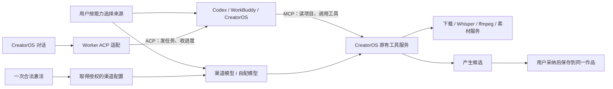

# T-1058 — 可组合模型来源与 Codex、WorkBuddy 集成调研

核对日期：2026-10-04。依据 [研究 SPEC](../../features/t1058-composable-agent-model-research.md) 和 [DEC-T1058-01](../../../orchestrator/DECISION_LOG.md#dec-t1058-01--激活模型来源与-agent-组合方向纠正2026-10-04)。本报告给出设计建议，没有修改产品运行时、激活服务或模型配置，也没有运行 Agent、真实模型、浏览器或连接探针。官方支持、源码可验证、方案推论与未验证项分开记述。

## 一、建议给用户的设置方式

用户只需完成一次合法激活。设置里保留三种可用来源：**渠道提供、自己配置、外部 Agent**；每项能力可以选择实际支持的来源，保存的配置可随时切回。激活和渠道分发身份不会决定必须用哪个 Agent。

| 设置 | 建议显示与行为 |
| --- | --- |
| 产品激活 | 一个激活入口。所有仍合法的产品激活，包括旧码，应能取得授权的渠道配置。期限、撤权和真实性沿原校验。 |
| 编导引擎 | CreatorOS / 本地 Codex / WorkBuddy；只显示适配器实际可用的入口和连接状态。WorkBuddy 云端会话与桌面 MCP 连接分别说明。 |
| 文本创作 | CreatorOS 时选择渠道或自配文本模型；Codex 时默认由已登录的 Codex 管理，无须再填文本 API Key。 |
| 图片生成 | 可选择 Agent 内置生图、渠道图片模型、自配图片模型。接通 Codex 的真实内置生图后，不要求另填图片 Key。仍允许用户改用渠道或自配。 |
| 视频、语音、转写等 | 分别选择真实支持的渠道、自配或既有本地能力；没有能力时说明这一项缺什么。没有任务需要时不把所有媒体配置做成开工门槛。 |
| 已保存配置 | 切换来源不删除配置，不把自配卡隐藏在“渠道已接管”状态下。凭据仍由原保管方管理。 |

**组合示例：Codex 写稿和生图 + 自配视频 + 渠道配音；或 CreatorOS 渠道文本 + 自配图片 + 本地 Whisper。** 这些是候选产品行为，不是当前已通过的组合实测。

“自由组合”落实在任务能力来源上。外部 Agent 的内部文本模型由其适配器、登录和套餐管理；ACP/MCP 并不保证能把任意渠道文本模型塞进任何 Agent。支持选择内部模型的适配器才提供该项配置，避免一个看似可选但实际无效的按钮。



## 二、ACP 与 MCP 同时采用

| 目的 | 协议与方向 | 产品职责 |
| --- | --- | --- |
| 在 CreatorOS 对话里调用 Codex/WorkBuddy | CreatorOS 是 ACP client，Agent 是 ACP server | 登录发现、会话、提示词、进度、权限请求、取消与恢复。 |
| 用户在 Codex/WorkBuddy 对话里操作 CreatorOS | CreatorOS 是 MCP server，外部 Agent 是 MCP client | 项目读取、候选生成、工具调用、任务状态与产物读取；复用原 owner 服务。 |
| Agent 使用转写、下载、渲染等能力 | 调 CreatorOS 工具，经原任务服务执行 | 产品继续安装、接入和维护这些底层工具；不要求 Codex 自带 ffmpeg/Whisper。 |

ACP 使用 JSON-RPC，定义初始化、会话、prompt、update、权限请求及取消；会话恢复等按协商能力决定。MCP 定义资源和工具交互，支持 stdio、Streamable HTTP；它不自动提供完整编导对话生命周期。上述职责组合是本项目建议，不是两种协议互斥的产品限制。[ACP 官方概览](https://agentclientprotocol.com/protocol/v1/overview)、[MCP 官方架构](https://modelcontextprotocol.io/docs/learn/architecture)、[MCP 传输规范](https://modelcontextprotocol.io/specification/2025-11-25/basic/transports)

### 用户给的 ChatCut 示例说明什么

`get_active_project` 是应用提供的工具名，不是 ACP 或 MCP 标准方法。示例让 Agent 先绑定具体项目、读取当前内容，再等待用户；这段 prompt 本身不是安装 MCP 的操作，也不能凭项目标题授权跨项目读取。

本轮仅读取本会话可发现的 ChatCut 工具元数据，未调用任何 ChatCut 工具或操作示例项目。元数据明确其 server 面向桌面应用，并要求先核实 active project；可借鉴这个使用顺序，不复制其运行时或声称它是开源实现。

CreatorOS 已有 `mcp-server` 和 contract → `/api/v1/dispatch` 服务通道，但没有实现同名 `get_active_project` 工具。应在既有实现上补齐桌面当前项目连接语义、具体作品和版本绑定。现有 MCP 从全 contract 生成工具，内部 ACP 任务应投影原任务冻结的 none/proposal 窄工具，不直接授予整份 CLI 工具面；不伪造聊天来源去套取非聊天任务权限。具体接点见 [协议和源码核对](protocol-research.md)。

建议的连接体验：在项目内点击“连接外部 Agent”，选择 Codex 或 WorkBuddy，完成对应 MCP 配置，再复制只读项目 prompt。连接卡只在真实连接能力可用时显示“已连接”；复制一段文字不代表连接成功。该交互是候选，尚未实现。

项目工具至少有以下边界：

- 绑定实例、用户/账号、真实 projectId/outputId 与 revision；缺少活动上下文时返回真实空态，不凭标题查找并授权。
- 只读连接提供项目/作品读取；改稿先形成候选，用户采纳由原 backend 服务校验归属和 CAS 保存。已有被明确授权的产品操作沿原权限处理。
- 工具生成、转写、渲染等调用复用唯一 `execution_tasks` 及实际产物回执。MCP adapter 不直连数据库、不提供绕开 owner 的任意 shell 或 SQL。
- 本机 MCP 优先复用 stdio shim；若提供 loopback HTTP，仍校验连接 token、目标实例与 Origin。云端 Agent 访问不了用户电脑的 `127.0.0.1`，远程工具需另有用户授权的可达连接；本轮不承诺隧道已实现。

## 三、Codex：可免文本和生图配置，但当前代码还没接完

### 已核实事实

Codex 官方内置图片生成使用其登录与可用额度，CLI 可通过 `$imagegen` 调用；当前官方说明为 `gpt-image-2`，计入 Codex 用量。这支持用户“选择 Codex 后不再要求配置文本和文生图模型”的方向。它并不等于所有版本、所有登录方式和所有第三方桥都自动可用。[官方图片生成说明](https://learn.chatgpt.com/docs/image-generation)

当前产品锁定 Codex `0.159.3`。对应官方源码固定为 `01fc69f4026735edfdf6789820549727a4867b11`：独立 image-generation 扩展按 provider 判断可用性，使用活动 provider 的认证；app-server 有图片 item、结果和保存路径。官方源码测试使用 mock 与认证 fixture，不能当作本项目真实生图成功。[扩展源码](https://github.com/openai/codex/blob/01fc69f4026735edfdf6789820549727a4867b11/codex-rs/ext/image-generation/src/extension.rs)、[app-server 图片合同测试源码](https://github.com/openai/codex/blob/01fc69f4026735edfdf6789820549727a4867b11/codex-rs/app-server/tests/suite/v2/imagegen_extension.rs)

### 与当前项目的差距

- `ai-worker/src/execution/codex-app-server.ts:10` 仍禁用 `image_generation`、code mode 及多项工具；当前 `codex-native-turn.ts` 只收文本 agentMessage，工具输出也只投影文本。
- 因而“Codex 官方能生图”与“当前 CreatorOS 已接通生图”是不同证据。本轮没有更改这些配置，也没有生成成功回执。
- 当前只在聊天任务路由 Codex，结构化生成、视觉审读、图文、后台与嵌套工具有多条 API 路径。未来需要冻结到任务的能力路由，不能只改设置页后声称全局生效。

### 开源接法建议

旧 `zed-industries/codex-acp` 已归档；维护中的 `agentclientprotocol/codex-acp` 以 Codex App Server 为底层。核对版本 `v2.1.1` / commit `68d7d2d5ddfc0ed5746f9f6130892dda685e65dd` 已处理 imageGeneration 事件，将图片和保存路径投影到 ACP。建议复用其协议与事件适配，不复活旧 bridge 整包，更不能复制用户认证文件。[维护中桥接](https://github.com/agentclientprotocol/codex-acp/tree/68d7d2d5ddfc0ed5746f9f6130892dda685e65dd)、[旧仓归档说明](https://github.com/zed-industries/codex-acp)

需要额外处理：只有保存路径、没有 base64 的图片结果；历史回放与终态；实际模型、登录、版本和原生图片能力。图片仍须经资产 owner 导入候选并绑定具体作品，验证可读文件范围，采用后保存精确引用。

桥默认模式可能启用自身文件/命令能力。ACP client 声明 `fs/terminal=false` 只是不提供宿主代理，不代表 Agent 自有工具被禁用。未来必须核验工具配置和权限 profile，而不是为免模型配置开放整个产品数据库或全部用户目录。锁定桥和 Codex 的兼容版本组合，不把上游最新桥源码当作当前随包版本的兼容实测。

结论：**文本默认由 Codex 承担；图片可默认用 Codex 内置生图；用户保留渠道/自配选项。** 视频、语音等按实际能力配置，不再用“固定必须配两个模型”描述产品。

## 四、WorkBuddy：官方接法要区分云端、桌面与 CodeBuddy

| 入口 | 官方或源码证据 | 推荐用法及限制 |
| --- | --- | --- |
| WorkBuddy 云端会话 | 官方 Open API：第三方 OAuth → tasks → ACP link/token，HTTP SSE + JSON-RPC | 适合在 CreatorOS 内显示 WorkBuddy 对话。需应用注册、用户授权、可信服务端换票；不是本机桌面的 stdio ACP。 |
| WorkBuddy 桌面 | 官方 MCP/Skill 连接器；另有 localassistant HTTP 消息/历史 API | MCP 适合桌面 WorkBuddy 使用 CreatorOS 工具。localassistant 尚缺足够的项目会话隔离、取消和恢复证据。 |
| CodeBuddy Code | 官方 `codebuddy --acp` | 可作为另一个本地 ACP 引擎，以 CodeBuddy 名称呈现；不能冒称 WorkBuddy 桌面。 |
| 社区 workbuddy-acp-bridge | Windows 私有 Remote Gateway，作者说明非官方且接口不稳定，未找到明确许可证 | 仅研究参考，不作为默认产品依赖。 |

主要来源：[WorkBuddy Open API](https://open.workbuddy.cn/docs/openapi)、[WorkBuddy 连接器](https://open.workbuddy.cn/docs/connector)、[CodeBuddy ACP](https://cloud.tencent.com/document/product/1831/137021)、[社区固定 README](https://github.com/jie023/workbuddy-acp-bridge/blob/e2327499273efa093ebdcbffde9a4c8833e26e76/README.md)。

官方云端 ACP 文档流程为 `initialize → session/load → session/prompt`，有权限请求和 prompt 终态。文档未明确完整取消接口，出现 `cancelled` 状态不能证明已支持 `session/cancel`。云端模型选择、生图、任意 MCP 注入、重连与幂等都需单独核验。不要将标准协议所定义的方法直接宣称为该产品已支持的方法。

WorkBuddy 应用 OAuth 与 MCP 连接器 OAuth 是两个方向：前者授权我们调用 WorkBuddy，后者授权 WorkBuddy 调我们的工具。官方要求应用 secret 不暴露到客户端。产品应经可信服务端换票，不能在桌面包内塞共享 secret，不能把 CreatorOS 激活码当作腾讯登录凭证。[应用注册与授权](https://open.workbuddy.cn/docs/third-party-app)

建议呈现：编导引擎可接官方 **WorkBuddy 云端**；“连接外部 Agent”可接 **WorkBuddy 桌面 MCP**。如要求直接驱动本机 WorkBuddy 桌面，先核对官方 localassistant 是否满足完整会话合同；当前不得用私有 Gateway 假装已支持本地 ACP。

版本、认证、平台、套餐与再分发限制详见 [WorkBuddy 调研附件](workbuddy-research.md)。当前产品不承诺腾讯运行时可随包再分发，不把 MIT 安装 tap/文档仓许可当作运行时许可。

## 五、现有激活和模型来源为什么还不能自由组合

以下来自本地源码审阅；没有核验上游线上服务。

| 现状 | 实施时的具体变化 |
| --- | --- |
| 既有桌面宿主验证激活签名、设备、期限；数据库仅有展示镜像 | 保留真实激活验证。所有仍合法的码获取渠道配置由签发端/配置服务补齐权益与映射，不由客户端伪造 `channelRef`。 |
| 标准包也有渠道配置拉取能力；品牌/分发身份与模型凭据不是同一件事 | 合并用户激活入口，渠道包身份仍处理品牌、更新等分发职责。“两类码”具体发行事实不能仅凭本地 `licenseMode` 推断。 |
| 完整渠道模型优先，托管额度存在时缺失能力显示 pending，自配配置虽保留却不生效 | 用明确、可持久化的来源选择替代自动接管；渠道、自配同时保留。 |
| 渠道目录、持久凭据、按次转写凭据、额度账户分别有状态 | 目录可得不等于所有能力可调用，更不自动等于赠送额度。界面显示真实可用性和错误。 |
| 渠道模型选择存于凭据表的 `__model_selection__:<capability>`，键只有 userId/scopeId/serviceId | 不能宣称已账号隔离。后端策略须明确用户默认与账号覆盖，不继续把选择藏入凭据表。 |
| 编导偏好仍是浏览器 localStorage 的 pi/codex；多条生成链各自解析模型 | 后端统一任务策略和按能力来源裁决，补 WorkBuddy 适配器；专配模型、默认池、后台与嵌套工具均需覆盖。 |
| 旧模型 authority 冻结整份渠道 bundle 摘要，配置更新可让旧任务拒绝解析 | 设计区分偏好切换与真实撤权/配置失效；经合同变更后细化，不直接删除原校验。 |

建议后端保存的是选择与引用，形如下面的候选结构；不是已落地的数据表或合同：

```json
{
  "engine": {"adapterId": "codex", "connectionRef": "agent-connection-id"},
  "capabilities": {
    "text": {"source": "agent"},
    "image": {"source": "agent"},
    "video": {"source": "custom", "profileId": "model-profile-id"},
    "tts": {"source": "channel", "optionId": "signed-option-id"}
  },
  "policyRevision": 1
}
```

每个新任务冻结用户/账号、实际引擎和版本、能力/来源、真实 option/config/connection 引用及 revision、渠道 scope、会话/turn 与任务关系；不存明文凭据。后续切换只改变新任务，在途、历史重试与未知结果继续核对原身份。真正过期或撤权仍阻止对应调用。结果未知不能静默换 Agent 重发，防止重复产物或外部写入。

合法旧码缺渠道 scope 时，既有授权发行/配置服务签名补发或迁移映射，产品继续验签和归属校验。所有合法码覆盖已由用户确定；如何补发、配置是否附带额度以及上游兼容版本仍是具体合同问题，无须再询问用户是否允许已确认方向。

代码接点及当前真实差异详见 [设置与权限源码审阅](settings-research.md)。未来实施同时触及 contract/backend/worker/前端设置及上游授权配置服务，仅挪一个引擎下拉框达不到本要求。

## 六、实施合同需闭合的证据

本轮完成调研，不把以下未发生验证填成 PASS：

1. 锁版 Codex ACP 与随包 runtime 兼容；真实登录、文本/结构化/视觉、内置图片导入、MCP 工具、取消与恢复、未知回执对账。
2. WorkBuddy 官方应用获批、授权与云端 ACP 实测；桌面 MCP 工具访问；本地助理的项目会话、取消及恢复合同。云端会话能访问哪些工具不能由空 `mcpServers` 示例推断。
3. 所有仍合法旧码取得渠道配置，渠道、自配、Agent 多种组合可切回；凭据缺失、额度不足、撤权和不同账号的真实状态。
4. 新旧冻结任务、嵌套/后台任务、切换中在途任务与重试保真；旧上传、保存、无图写稿、Whisper 降级和渲染路径不被新引擎门反杀。
5. 第三方协议版本、用户自行安装与再分发许可。文档说明与用户机器实测不能互相替代。

ACP+MCP、配置来源解耦、合法激活取得渠道配置及底层工具由产品承担是推荐方向；本报告不会将未知的 WorkBuddy 本机 ACP、生图免费、任意模型注入或当前全链迁移写成既成事实。

## 证据导航

- [协议与开源桥源码](protocol-research.md)：版本、许可、生命周期和现有 MCP 接点。
- [WorkBuddy 官方能力](workbuddy-research.md)：官方/社区区别、认证、平台、未知项。
- [本地设置与渠道权限](settings-research.md)：源码行锚，未进行上游线上调用。
- [来源快照清单](source-manifest.json)：只读抓取路径、固定提交和摘要；不含用户凭据。
- [交付与治理检查](verification.md)：仅记录当场发生的检查，不冒充产品验收。
