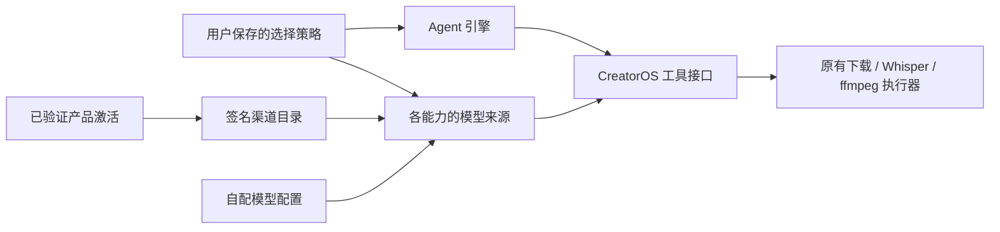

# T-1058 激活、渠道、模型来源和 Agent 引擎只读核对

日期：2026-10-04。核对工作树：`/Users/zyongzhu/.codex/worktrees/user-diagnostics/Thirdspace-creator`。

本报告来自已有源码与 SPEC 读取。没有修改仓库，没有运行测试、浏览器、模型、线上授权请求或凭据探针。本次仅将已有结论归档到 `/tmp`；未补充新调研。

## 结论

现有签名和凭据链路可复用。自由组合主要需要解除**渠道配置自动接管模型**，并把选择保存到后端、冻结到任务。底层 ffmpeg、Whisper、下载工具继续由 CreatorOS 执行。

用户已确认方向是：**所有仍合法的激活码，包括旧码，都应获得渠道配置；同时允许自配模型、Codex/WorkBuddy，并随时切回。** 覆盖合法旧码不是待再次确认的产品范围。缺少签名作用域的旧权益如何由发行服务补齐，是待评审的技术合同。

## 现状表

| 维度 | 当前事实 | 迁移要求 |
|---|---|---|
| 激活码类型 | 设置显示“时间型/永久激活”；`licenseMode` 实际为开放字符串，兼容代码还出现 `COUNT/TRIAL`。仓库不能证明发行端仅有两种码。 | 码的期限、次数、产品权益分别描述；不能把永久码等同于模型额度。所有仍合法旧码属于已确认覆盖范围。 |
| 标准版/渠道版 | 都是 `productRef/projectKey=creatoros`。包身份控制品牌、应用标识、密钥库、更新来源；`expectedChannelRef` 不是实际模型调用凭据。 | 分发身份与模型来源解耦。标准包也已支持渠道配置拉取。 |
| 产品授权 | 既有桌面宿主验签后写 `.license`；数据库激活状态为展示镜像。 | 保留签名、设备、期限、撤权等既有校验，不能任意字符串码放行。 |
| 渠道配置 | Activity 签发短效 ticket；Growth 按签名 `projectKey/channelRef/clientId` 返回签名 bundle。缺 `channelRef` 即 `activation_scope_missing`。 | 全部合法码的配置授予须由服务端补齐签名权益和注册映射，客户端不能猜 `official`。 |
| 凭据 | 新版 graph 为服务/模型目录。托管持久凭据另外拉取、加密保存；按次 ASR 凭据只在当前调用内使用。历史 inline payload 仍有兼容处理，不能把它作为新合同的凭据分发方式。 | 配置授予与凭据就绪分别展示。不能因已有目录而显示“全部可调用”。 |
| 额度 | 存在 `AI_CREDIT_ACCOUNT_PENDING`、需要连接账户、余额不足等真实状态。 | 合法激活 ≠ 已有额度账户 ≠ 有余额。是否赠送额度是尚待确定的服务合同，不能从“提供配置”推断。 |
| 模型选择 | 完整渠道能力优先；本地配置保留但不生效。设置页还有“托管额度存在时，缺失能力显示 pending”的规则。 | 增加明确来源选择，渠道和自配同时保留，可编辑或查看、随时切回。 |
| Agent | 当前偏好只有浏览器 `localStorage` 中的 `pi/codex`；Codex 为已有聊天执行路径，WorkBuddy 尚不能据此宣称集成可用。 | 保存后端 engine policy，按真实适配能力提供选项。 |
| 已冻结任务 | 模型 authority 使用整个渠道 payload 与 scope 的摘要；摘要变化时，worker 凭据解析拒绝旧任务。 | 将“用户切换偏好”与“真正撤权/配置失效”分开处理。 |
| 底层工具 | 转录、提取音频等仍使用现有 worker/宿主工具路径。ASR 有独立的本地 Whisper 降级合同。 | 保留执行归属和既有 ASR 降级；不增加通用的隐式换模型/换引擎。 |

## 需要特别纠正的实际差异

### 渠道模型选择当前没有账号隔离

路由读取 `accountId`，但把选择写成 `__model_selection__:<capability>`。最终表的键只有 `userId + scopeId + serviceId`；同一用户、同一渠道 scope 的不同账号共享该选择。不能把既有 SPEC 中的按账号选择描述为现有实现事实。

代码锚点：

- [选择写入路由](/Users/zyongzhu/.codex/worktrees/user-diagnostics/Thirdspace-creator/frontend/src/app/api/v1/local/channel-model-selection/route.ts:58)。
- [凭据/选择存储读取边界](/Users/zyongzhu/.codex/worktrees/user-diagnostics/Thirdspace-creator/backend/src/modules/settings/settings.repository.ts:483)。
- [resolver 选择读取装配](/Users/zyongzhu/.codex/worktrees/user-diagnostics/Thirdspace-creator/frontend/src/server/persistence-client.ts:1127)。

### 设置页仍有强制接管规则

渠道完整能力显示 `ChannelManagedModelCard`；如果 `usesManagedCredits=true`，未出现的渠道能力显示 `ManagedCapabilityPendingCard`，而不是既有自配卡。后端 resolver 同样先解析渠道；完整渠道路由缺凭据时抛错，不会继续自配链。

代码锚点：

- [设置页按渠道状态替换配置卡](/Users/zyongzhu/.codex/worktrees/user-diagnostics/Thirdspace-creator/frontend/src/features/settings/settings-model-region.tsx:40)。
- [文本来源裁决](/Users/zyongzhu/.codex/worktrees/user-diagnostics/Thirdspace-creator/backend/src/modules/ai-runtime/llm/resolve.ts)，`resolveLlmConfig`、`resolveDedicatedLlmConfig`、`channelConfigFor`。
- [渠道缺凭据的真实错误](/Users/zyongzhu/.codex/worktrees/user-diagnostics/Thirdspace-creator/backend/src/modules/ai-runtime/channel-model-config.ts:337)。
- [渠道逐能力 parser](/Users/zyongzhu/.codex/worktrees/user-diagnostics/Thirdspace-creator/backend/src/modules/ai-runtime/channel-model-config.ts:425)。

### 发布构建残留标志不能等同于运行时政策

发布构建仍要求 `CREATOROS_MODEL_CONFIGURATION_AUTHORITY=managed_locked`；已有读取查到它由既有桌面宿主注入，但未发现 JS 运行时读取者。不能作为“现在自配一定被封禁”的证据。后续应清理或重新定义这个残留标志，避免与新选择合同相矛盾。

代码锚点：[发布构建限制](/Users/zyongzhu/.codex/worktrees/user-diagnostics/Thirdspace-creator/frontend/src-tauri/build.rs:123)、[宿主环境注入](/Users/zyongzhu/.codex/worktrees/user-diagnostics/Thirdspace-creator/frontend/src-tauri/src/lib.rs:2291)。

## 建议的装配关系

用大白话说：激活决定产品权益和可取得的渠道目录；用户选择谁来协作、各项能力用哪套模型；底层工具继续通过 CreatorOS 的真实执行接口工作。

## 具体迁移建议

### 1. 激活权益与渠道注册

已授权产品方向：所有仍合法激活码，包括旧码，提供渠道配置，同时允许自配及 Agent 切换。

待服务合同评审的是实现方式：

- 缺 `channelRef` 的旧权益由 Activity 如何补发签名作用域，以及 Growth 如何注册默认可用目录。
- 已验签 `CONFIG_TICKET_REQUEST_INVALID` 当前表示不适用 ticket；覆盖对应合法码必须改上游权益注册，而不是放宽客户端异常处理。
- “配置授予”是否包含赠送额度、托管凭据，额度账户如何绑定。
- 正式与渠道包的新安装默认模型来源，以及旧安装选择如何迁移。

继续保持 Activity 管授权、Growth 管目录及托管服务。渠道包品牌不能自行授予模型权限。所有合法旧码覆盖无需再次作为产品问题提问；如何安全签名补发属于技术候选。

核心代码锚点：

- [激活类型宽容投影](/Users/zyongzhu/.codex/worktrees/user-diagnostics/Thirdspace-creator/frontend/src/server/activation/license-client.ts:34)。
- [时间型/永久型展示映射](/Users/zyongzhu/.codex/worktrees/user-diagnostics/Thirdspace-creator/frontend/src/features/settings/settings-interactive-region.tsx:884)。
- [CreatorOS 统一产品身份及包身份装配](/Users/zyongzhu/.codex/worktrees/user-diagnostics/Thirdspace-creator/frontend/src-tauri/build.rs:216)。
- [签名新事实缺 channelRef 时清空旧作用域](/Users/zyongzhu/.codex/worktrees/user-diagnostics/Thirdspace-creator/frontend/src-tauri/src/license.rs:1341)。
- [渠道 activeVerdict 校验](/Users/zyongzhu/.codex/worktrees/user-diagnostics/Thirdspace-creator/frontend/src/server/activation/client-config.server.ts:470)。
- [请求 Activity ticket](/Users/zyongzhu/.codex/worktrees/user-diagnostics/Thirdspace-creator/frontend/src/server/activation/client-config.server.ts:1431)。
- [取得 fresh access](/Users/zyongzhu/.codex/worktrees/user-diagnostics/Thirdspace-creator/frontend/src/server/activation/client-config.server.ts:1483)。
- [拉取及验证 Growth bundle](/Users/zyongzhu/.codex/worktrees/user-diagnostics/Thirdspace-creator/frontend/src/server/activation/client-config.server.ts:1536)。
- [返回真实模型 authority](/Users/zyongzhu/.codex/worktrees/user-diagnostics/Thirdspace-creator/frontend/src/server/activation/client-config.server.ts:1858)。

### 2. 持久化来源和引擎选择

建议新增后端选择策略：

- `engine`：CreatorOS、Codex、WorkBuddy 等真实可用适配器。
- 每项模型能力的来源：渠道、自配配置档、适配器自身管理。
- 渠道模型保存真实 `optionId`；自配模型保存配置档 ID；密钥仍使用各自现有凭据存储。
- 明确用户默认策略与账号覆盖关系；不要继续借凭据表保存选择。
- 已选择渠道但缺凭据/额度时返回真实原因；用户可为新任务主动切换来源。
- 渠道签名目录本身不可编辑；“不强制使用渠道”不等于允许用户改写渠道签名参数。

不能承诺所有引擎与模型任意笛卡尔组合。**Codex/WorkBuddy 等外部 Agent 的内部文本模型来源不能由 CreatorOS 任意注入**；是否支持注入、选择或只允许 Agent 自身管理，须由实际协议能力决定。外部 Agent 调用 CreatorOS 的图片/视频工具，与其内部文本模型的来源，是不同能力。

### 3. 新任务冻结，旧任务保真

创建执行任务时冻结：

`engine + modelSource + capability + model/optionId + 配置身份 + 渠道 scope/revision + user/account + policyRevision`

仅保存引用和身份，不保存明文凭据。

- 偏好切换只影响新任务；旧消息重试、在途任务继续使用原执行身份。
- 旧任务缺少新字段时按原版本解释，不能重新读取当前偏好后换引擎。
- 真正撤权、过期、服务移除仍须阻止对应渠道调用。
- 当前“整个 bundle 摘要变化即取消旧任务”的 T-645 规则，需要合同变更后细化，不能直接删除。
- 自配任务不应因无关渠道目录更新被改变；渠道任务仍校验它使用的真实权益。
- 切回渠道需确认当前签名目录与 scope；旧缓存和旧密钥不能提升权限。
- 已开始但结果未知的外部调用先恢复/核对原执行记录，不能换引擎重发。

代码锚点：[任务 authority 摘要和作用域](/Users/zyongzhu/.codex/worktrees/user-diagnostics/Thirdspace-creator/frontend/src/server/task-model-authority.ts)、[worker 调用前的 authority 匹配](/Users/zyongzhu/.codex/worktrees/user-diagnostics/Thirdspace-creator/frontend/src/server/persistence-client.ts:5793)、[ASR 原冻结配置校验](/Users/zyongzhu/.codex/worktrees/user-diagnostics/Thirdspace-creator/frontend/src/server/persistence-client.ts:5808)、[封面调用前匹配](/Users/zyongzhu/.codex/worktrees/user-diagnostics/Thirdspace-creator/frontend/src/server/persistence-client.ts:5839)。

### 4. 最小实施落点

- 后端策略与存储：[settings.service.ts](/Users/zyongzhu/.codex/worktrees/user-diagnostics/Thirdspace-creator/backend/src/modules/settings/settings.service.ts)、[settings.repository.ts](/Users/zyongzhu/.codex/worktrees/user-diagnostics/Thirdspace-creator/backend/src/modules/settings/settings.repository.ts:483)、[settings.db-schema.ts](/Users/zyongzhu/.codex/worktrees/user-diagnostics/Thirdspace-creator/backend/src/modules/settings/settings.db-schema.ts)，配套 contract 与迁移。
- 真实来源裁决：[LLM resolver](/Users/zyongzhu/.codex/worktrees/user-diagnostics/Thirdspace-creator/backend/src/modules/ai-runtime/llm/resolve.ts)、[multimodal resolver](/Users/zyongzhu/.codex/worktrees/user-diagnostics/Thirdspace-creator/backend/src/modules/ai-runtime/multimodal/resolve.ts)，覆盖专配模型与默认文本池。
- 任务装配、凭据恢复、ASR 配置校验：[persistence-client.ts](/Users/zyongzhu/.codex/worktrees/user-diagnostics/Thirdspace-creator/frontend/src/server/persistence-client.ts:5793)、[task-model-authority.ts](/Users/zyongzhu/.codex/worktrees/user-diagnostics/Thirdspace-creator/frontend/src/server/task-model-authority.ts)。
- 设置页解除自动接管：[settings-model-region.tsx](/Users/zyongzhu/.codex/worktrees/user-diagnostics/Thirdspace-creator/frontend/src/features/settings/settings-model-region.tsx:40)、[channel-model-selection 路由](/Users/zyongzhu/.codex/worktrees/user-diagnostics/Thirdspace-creator/frontend/src/app/api/v1/local/channel-model-selection/route.ts:58)、共享 engine 偏好入口。
- 保持授权验签：[license.rs](/Users/zyongzhu/.codex/worktrees/user-diagnostics/Thirdspace-creator/frontend/src-tauri/src/license.rs:1341)、[client-config.server.ts](/Users/zyongzhu/.codex/worktrees/user-diagnostics/Thirdspace-creator/frontend/src/server/activation/client-config.server.ts:1483)。
- 保持托管凭据/额度与本地降级边界：[managed-credential-lease.server.ts](/Users/zyongzhu/.codex/worktrees/user-diagnostics/Thirdspace-creator/frontend/src/server/activation/managed-credential-lease.server.ts)、[ai-credit-link.server.ts](/Users/zyongzhu/.codex/worktrees/user-diagnostics/Thirdspace-creator/frontend/src/server/activation/ai-credit-link.server.ts)、[transcribe-local-fallback.ts](/Users/zyongzhu/.codex/worktrees/user-diagnostics/Thirdspace-creator/ai-worker/src/runtime/transcribe-local-fallback.ts)。

这里不需要将底层命令迁往 Codex。Agent 通过真实工具接口使用现有能力，模型来源由服务端明确裁决即可。ASR 的既有一次云端失败转本地 Whisper 规则保留；不得把该特例推广成所有文本、图片、视频调用失败后静默换来源。

## 已读合同依据及局限

- [T-1058 调研 SPEC](/Users/zyongzhu/.codex/worktrees/user-diagnostics/Thirdspace-creator/docs/features/t1058-composable-agent-model-research.md)。
- [T-1058 packet](/Users/zyongzhu/.codex/worktrees/user-diagnostics/Thirdspace-creator/orchestrator/context/T-1058.md)。
- [T-606 渠道签名 authority 合同](/Users/zyongzhu/.codex/worktrees/user-diagnostics/Thirdspace-creator/docs/superpowers/specs/2026-07-29-creatoros-channel-model-authority.contract.md)。
- [T-645 逐能力 authority 及 T-679/T-701/T-733/T-768 增量](/Users/zyongzhu/.codex/worktrees/user-diagnostics/Thirdspace-creator/docs/superpowers/specs/2026-08-02-capability-scoped-channel-model-authority.md)。

本报告未验证发行端当前激活码枚举、Growth 当前模型名单、真实额度余额、线上凭据同步和 WorkBuddy 适配可用性；没有将历史 SPEC 中的模型型号当成当前线上事实。
