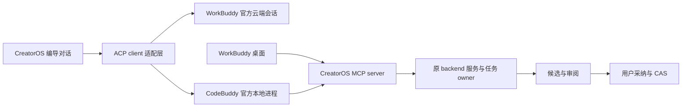

# T-1058：WorkBuddy / CodeBuddy 接入能力只读调研

核对日期：2026-10-04。只读官方文档、公开仓库与包元数据；没有安装、执行 Agent/模型、连接用户账号、浏览器自动化、运行探针或修改项目文件。以下“官方公开”表示有文档证据，不表示 CreatorOS 已接通或已验收。

## 结论

WorkBuddy 已有官方第三方应用 Open API，其中云端任务提供 ACP 会话通道；它不只是 MCP client。WorkBuddy 桌面还可通过官方 HTTP 本地助理 API 接受消息。CodeBuddy Code 是另一产品，其本地 `codebuddy --acp` 明确公开。不能把 CodeBuddy CLI 的接口、安装包或认证默认当成 WorkBuddy 桌面接口。[WorkBuddy Open API](https://open.workbuddy.cn/docs/openapi)、[CodeBuddy ACP](https://cloud.tencent.com/document/product/1831/137021)

| 连接方向 | 有证据的公开方式 | 本轮判断 |
| --- | --- | --- |
| CreatorOS → WorkBuddy 云端会话 | 注册第三方应用、用户 OAuth 授权；tasks 返回 link/token；ACP over HTTP SSE + JSON-RPC | 官方方案候选，可在应用内显示会话；需服务端换票和单独验收 |
| CreatorOS → WorkBuddy 本地助理 | Open API localassistant 在线状态、发送消息、历史查询 | 官方方案候选；文档没有完整的项目专属会话/取消合同 |
| CreatorOS → CodeBuddy Code 本地进程 | `codebuddy --acp` | 官方 ACP Agent Server；应以 CodeBuddy 名称呈现 |
| WorkBuddy → CreatorOS 项目工具 | WorkBuddy 连接器：MCP + Skill；远程 HTTPS SSE/streamableHttp，或本地 stdio | 适合让 WorkBuddy 调用 CreatorOS 真实工具和候选服务 |
| CreatorOS → 本机 WorkBuddy 私有 Gateway | 社区 workbuddy-acp-bridge | 非官方稳定接口；不建议作为默认产品依赖 |

MCP 连接器与 Open API 是相反的授权方向，不能共用一个模糊的“已登录”状态。[连接器](https://open.workbuddy.cn/docs/connector)、[第三方应用](https://open.workbuddy.cn/docs/third-party-app)

## 官方 ACP 与认证事实

WorkBuddy 云端任务创建需要 `user.task.invokable`，读取需要 `user.task.readable`。任务返回的 link/token 通过 GET SSE 接收、POST JSON-RPC 发送，并用 `Acp-Connection-Id` 关联。公开流程是 `initialize → session/load(task_id) → session/prompt`；示例 protocolVersion=1。`session/request_permission` 处理确认；prompt 的最终 response 是本轮结束信号。ACP token 遇 401 后可通过任务详情刷新。[Open API](https://open.workbuddy.cn/docs/openapi)

其 OAuth 应用需审核启用、配置回调及 scopes。官方要求 `client_secret`、refresh token 存在服务端，不暴露到前端/客户端。因此纯桌面安装包内不能塞入共享应用 secret。概览写 access token 24h，而接口示例 `expires_in=3600`；实现应按实际返回过期时间处理，不能硬编码。[应用注册和授权](https://open.workbuddy.cn/docs/third-party-app)、[token 接口](https://open.workbuddy.cn/docs/openapi)

本地助理公开了 `user.localassistant.readable/invokable`、消息及 permission_response；消息历史支持增量轮询。文档没有明确项目独立 session 创建、精确取消、fork/resume、模型选择或调度幂等规则。云端文档出现 `cancelled` 终态，却未找到 `session/cancel` 接口说明；不能据枚举宣称取消已支持。[Open API](https://open.workbuddy.cn/docs/openapi)

CodeBuddy Code ACP 可代理客户端声明的文件/终端能力。标准 `initialize/session/new/session/prompt` 无需私有身份 `_meta`；官方明确第三方不要自行生产 WorkBuddy 内部准入、owner、credential 扩展。不能通过社区发现的内部方法伪装成官方 WorkBuddy 进程。[ACP 集成](https://cloud.tencent.com/document/product/1831/137021)、[公共/私有扩展边界](https://cloud.tencent.com/document/product/1831/137025)

## WorkBuddy MCP/CLI 连接器

官方推荐有 API 的服务使用 MCP + Skill。WorkBuddy 是 MCP client，接入方提供 server；一个连接器只选 MCP 或 CLI 一种方案。CLI + Skill 表示 WorkBuddy 调用接入方 CLI，不是 WorkBuddy 自己公开了 `workbuddy --acp`。[连接器](https://open.workbuddy.cn/docs/connector)

远程 MCP OAuth 使用 WorkBuddy 的 public client + OAuth 2.1/PKCE，要求 discovery、dynamic registration 和精确回调匹配；也有用户自填 token 模式。所需最低客户端版本必须在 connector metadata 声明，取实际使用字段中的最高值。[MCP 认证](https://open.workbuddy.cn/en/docs/connector)

| 配置能力 | 官方最低 WorkBuddy 版本 |
| --- | --- |
| min/maxWorkbuddyVersion | 4.22.12 |
| stdio cwd、disabledTools | 4.22.15 |
| token 模式 / token-schema.json | 4.23.0 |
| versionCheck、statusMatchJson、多步 CLI auth | 4.24.0 |
| Python CLI runtime、Device Flow；MCP runtime/preAuth/staticEnv/staticHeaders | 5.0.0 |
| name_map / description_map | 5.2.0 |

版本来源：[官方兼容性表](https://open.workbuddy.cn/docs/connector)。市场分发需提交审核；自定义 MCP 直接配置在产品更新日志中有支持说明，但本轮没有用户机器实测。[更新日志](https://www.workbuddy.cn/docs/workbuddy/Changelog)

## 安装、模型与平台限制

- WorkBuddy 桌面：Mac 安装指南要求 macOS 12+，分别提供 ARM64/X64；Windows 指南要求 Windows 10+、x64。登录在官网浏览器完成，支持微信、手机号、邮箱、SSO。下载页称 Windows x64 兼容 ARM64，并列 UOS/麒麟商店；FAQ 却写 Win11 ARM64 暂不支持。ARM64、国产 Linux、具体构建的连接器能力应记待验证。[Mac](https://www.workbuddy.cn/docs/workbuddy/From-Beginner-to-Expert-Guide/Installation-Mac-Guide)、[Windows](https://www.workbuddy.cn/docs/workbuddy/From-Beginner-to-Expert-Guide/Installation-Win-Guide)、[下载页](https://www.workbuddy.cn/work/)、[FAQ](https://www.workbuddy.cn/docs/workbuddy/From-Beginner-to-Expert-Guide/FAQ)
- CodeBuddy Code：官方 npm 包为 `@tencent-ai/codebuddy-code`，Node 安装要求 18.20+；原生二进制仍标 Beta，列 macOS ARM64/X64、Linux ARM64/X64、Windows X64。官方 Homebrew tap 支持 Mac/Linux。配置目录可隔离，避免与 WorkBuddy 共存冲突。[安装](https://www.workbuddy.cn/docs/cli/installation)、[官方 tap](https://github.com/Tencent-CodeBuddy/homebrew-tap)
- CodeBuddy 登录区分中国站、国际站、企业域名、iOA；平台 API Key 也必须配对应网络环境，不能复用 CreatorOS 激活码充当腾讯登录凭证。[登录](https://www.workbuddy.cn/docs/cli/quickstart)、[认证](https://www.workbuddy.cn/docs/cli/iam)
- WorkBuddy 支持自己的自配模型/Ollama，费用与模型能力由外部提供方决定；此事实不证明其云端 Open API 能选择或继承桌面模型配置，也不证明 CreatorOS 可读取其原始模型凭据。[模型配置](https://www.workbuddy.cn/docs/workbuddy/From-Beginner-to-Expert-Guide/Function-Description/Model)
- WorkBuddy 有独立积分/订阅，高级功能可能受套餐限制；CreatorOS entitlement 不能替代腾讯套餐。ACP 支持本身不证明图片/视频生成功能可以免费或免配置。[套餐与用量](https://www.workbuddy.cn/docs/workbuddy/Usage)

## 版本与许可锚

| 来源 | 核对到的版本/日期 | 说明 |
| --- | --- | --- |
| WorkBuddy 官网 Changelog | 首条 5.6.2，2026-09-21 | 公告，不代表用户已安装版本 |
| CodeBuddy npm latest | 2.161.1，读取于 2026-10-04 | license 字段 `SEE LICENSE IN README.md`；未安装 |
| 腾讯官方 CNB 文档仓 | commit `694ae23f44308ca901d620d2e48c2c3d35c75fc9` | 2026-10-02 00:36:52 同步 v2.161.1；标注内部 release commit `5efcb9ac1be72`，不是已获取的公开运行时源码 |
| CodeBuddy 网站发布页 | v2.153.0 / JS SDK 0.3.261 / Python SDK 0.3.260 | 导航落后于 npm/CNB，不作为最新版本声明 |
| 腾讯云 ACP 页面 | 更新于 2026-08-26 | 未标 ACP 首次支持的最低 CLI 版本 |
| ACP Registry | artifact codebuddy-code 2.159.0；2026-09-29 protocol matrix | 第三方协议项目证据，不是腾讯对最新版本的担保 |

原始来源：[WorkBuddy Changelog](https://www.workbuddy.cn/docs/workbuddy/Changelog)、[官方 npm 元数据](https://registry.npmjs.org/@tencent-ai/codebuddy-code/latest)、[官方 CNB 固定提交](https://cnb.cool/codebuddy/codebuddy-code/-/commit/694ae23f44308ca901d620d2e48c2c3d35c75fc9)、[v2.153.0](https://www.workbuddy.cn/docs/cli/release-notes/v2.153.0)、[ACP 页面](https://cloud.tencent.com/document/product/1831/137021)、[ACP Registry artifact](https://raw.githubusercontent.com/agentclientprotocol/registry/main/codebuddy-code/agent.json)、[协议项目的 matrix](https://github.com/agentclientprotocol/registry/blob/main/.protocol-matrix/latest.md)。

不能把公开文档仓、MIT Homebrew tap 或 MIT 编辑器扩展当作 Agent 运行时再分发授权。ACP Registry 把 CodeBuddy 标为 Proprietary，并指向官方软件服务协议；该协议页面生效日期 2025-09-26，终端定义仍以编辑器插件为主。将 CLI 打包进 CreatorOS 或改造 WorkBuddy 内部运行时的具体授权未核验，应优先用户自行安装的官方包与公开协议。[Registry](https://raw.githubusercontent.com/agentclientprotocol/registry/main/codebuddy-code/agent.json)、[官方协议](https://www.codebuddy.cn/agreement/)

## 社区桥接：只作为研究参考

`jie023/workbuddy-acp-bridge` 固定 commit `e2327499273efa093ebdcbffde9a4c8833e26e76`，提交时间 2026-07-14T00:52:02Z。README 明确：Windows 11、Python 3.11+、已启动 WorkBuddy；MCP stdio → 本机 ACP HTTP/SSE Gateway。全局会话串行复用、每轮 `/clear`、默认拒绝权限，提供 run/continue/cancel。作者声明无官方隶属/授权，且 Gateway 不保证第三方稳定；升级可能需要重新核对 app.asar。GitHub license 元数据为 null，未找到明确许可证文件。[固定 README](https://github.com/jie023/workbuddy-acp-bridge/blob/e2327499273efa093ebdcbffde9a4c8833e26e76/README.md)、[仓库元数据](https://api.github.com/repos/jie023/workbuddy-acp-bridge)

它证明有人做过桥接代码，不证明当前 Mac、最新 WorkBuddy、项目隔离、许可、取消或恢复已可靠。不能采用“扫描用户 WorkBuddy 会话文件/内部凭据 + 私有准入方法”作为官方接入合同。更可信的实现参考是标准 ACP SDK 与官方 CodeBuddy ACP 文档；腾讯公开仓库当前主要提供安装 tap 和文档，不是 WorkBuddy 桌面公开 ACP runtime 实现。

## 建议落入 CreatorOS 的连接模型（推论，未实现）

1. 引擎项分清“WorkBuddy 云端”“CodeBuddy 本地”；WorkBuddy 桌面当前先作为调用 CreatorOS MCP 工具的外部客户端。若产品必须直接控制桌面 WorkBuddy，先定义并验证官方 localassistant API 的会话/取消合同，不冒用 CodeBuddy 名称。
2. 共用 CreatorOS MCP tools，但每次调用携带由 CreatorOS 签发的用户/项目/作品/任务授权。只暴露已有 owner ports；生成返回候选，用户采纳落库，继续沿 CAS。MCP 提供能力，不自行成为新的数据库 owner。
3. 需要完整对话生命周期时用 ACP；外部 Agent 需要读取项目、生成候选、调用产品已接入的 ffmpeg/Whisper/媒体服务时用 MCP。底层工具继续由 CreatorOS 原 owner 执行。
4. 云端 WorkBuddy 能否访问指定的 CreatorOS MCP、支持哪些 mcpServers/内容块/模型选择，必须按 initialize 实际能力和官方接入确认；文档里的 `mcpServers: []` 示例不是已支持任意本机 MCP 的证据。
5. 冻结实际引擎、版本、协议、会话 ID、模型能力及来源；切换只影响新任务。认证失败、工具不可达、取消不确定时显示真实状态，不自动改用另一个账号/模型重放外部写入。

## 未知与下一轮验证清单

- Open API 应用类型及获批 scopes 是否适合 CreatorOS，开发者协议、计费/限流和 SaaS/国际/企业部署覆盖范围。
- WorkBuddy 云端模型选择、自定义模型继承、图片/视频能力、结构化输出、会话资源上下文上限。
- 云端取消、重连回放、提示幂等、本地助理项目会话隔离、权限响应的完整输入族。
- 所选 CodeBuddy 锁版实际 initialize/authMethods/load/cancel/config/工具限制；不能把第三方 matrix 当本项目实测。
- 指定 OS/架构的真实安装、host 状态和 MCP 授权；WorkBuddy Windows ARM64 说明存在冲突。
- 官方运行时打包/再分发许可；社区桥接许可证与非公开接口兼容性。

本轮没有记录任何连接成功或运行时 PASS。
