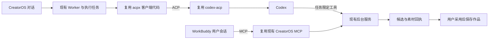

# T-1059：已有 Agent 接入代码的复用选择

## 给用户看的结论

CodeBuddy 已排除。Codex 接入选择维护中的 `codex-acp` 适配器，客户端代码选择已经接入它的 `openclaw/acpx`。WorkBuddy 选择已有开源项目的 MCP 连接器代码，连接 CreatorOS 已有工具服务。协议、业务工具、任务账本和内容保存继续复用已有实现。

本轮完成固定源码、许可和文件级调用链核对；未安装这些依赖、复制生产代码或接通产品。不能把“有代码可用”写成“已经运行成功”。

MCP 箭头表示 WorkBuddy 调用 CreatorOS。它不能让 CreatorOS 在自己的对话框里驱动 WorkBuddy；该方向的本地会话控制来源仍有缺口。

## 选择与固定版本

| 用途 | 选定来源、固定提交 | 许可 | 实际接入证据及复用方式 |
| --- | --- | --- | --- |
| Codex ACP 适配器 | [agentclientprotocol/codex-acp v2.1.1](https://github.com/agentclientprotocol/codex-acp/tree/68d7d2d5ddfc0ed5746f9f6130892dda685e65dd)；`68d7d2d5ddfc0ed5746f9f6130892dda685e65dd` | Apache-2.0 | `CodexAcpServer` 调用 `CodexAcpClient` 启动原生 app-server；优先固定包依赖，整段复用协议桥。 |
| 已消费 Codex ACP 的客户端 | [openclaw/acpx 0.19.4](https://github.com/openclaw/acpx/tree/27efb1b57b9de22105a91e9154b1d29b51ede8cb)；`27efb1b57b9de22105a91e9154b1d29b51ede8cb` | MIT | 注册表已有 Codex→维护适配器；`AcpClient` 用 ACP SDK 建连接、发 prompt、收通知、取消和恢复。复用客户端源码及必要依赖闭包。 |
| WorkBuddy 已接入的应用 | [dream-num/workbuddy-univer-office](https://github.com/dream-num/workbuddy-univer-office/tree/856eae4fe416b28adffb96092d67ff26c7797ff4)；`856eae4fe416b28adffb96092d67ff26c7797ff4` | Apache-2.0 | 实际 stdio/HTTP MCP 与连接器包装；作者记录 WorkBuddy 5.5.4 手工 HTTP 成功，正式 stdio 完整安装仍未验收。复用包装、生命周期与结果封装片段。 |
| WorkBuddy 配置兼容 | [PowerContext](https://github.com/oceanbase/powercontext/tree/ba7dc8dddea2c37168dbaf801e6399a40aae49f1)、[EverMe](https://github.com/EverMind-AI/EverMe/tree/6739467509892c69a8d08073c250000120378029) | Apache-2.0 | 已有 WorkBuddy 专用配置合并、备份/回滚、canonical 路径和首次信任处理。只取配置接线范围。 |
| WorkBuddy 云端 ACP，保留来源 | [JaguarJack/workbuddy-openapi](https://github.com/JaguarJack/workbuddy-openapi/tree/738f794a73bc327d730ffbcb29b220e4e39863d2)；`738f794a73bc327d730ffbcb29b220e4e39863d2` | MIT | 真实官方任务 link/token→SSE/POST ACP 代码；PHP SDK，仅见 mock 测试，远端取消缺失。未选为本地执行引擎基础，不为它增加另一套运行器。 |

各源码的 URL、抓取时间和原始字节摘要见 [来源清单](source-manifest.json)。[Codex 附件](codex-reuse.md) 和 [WorkBuddy 附件](workbuddy-reuse.md) 区分源码事实、上游作者验证与本项目未验证项。

## 具体复用清单

### Codex：复用适配器和客户端

| 已有文件 / 方法 | 复用内容 | CreatorOS 接点与限制 |
| --- | --- | --- |
| codex-acp `src/CodexAcpServer.ts`：`initialize()`、`tryCreateSession()`、`loadSession()`、`prompt()`、`cancel()` | ACP 能力、会话、MCP 注入、执行和中断映射 | 放在 Worker；从既有任务冻结上下文传入工作目录、明确权限与任务工具。不要另写 JSON-RPC 解析器。 |
| codex-acp `src/CodexAcpClient.ts` | ACP 到 Codex app-server 请求、会话恢复 | 固定依赖和实际 Codex 二进制版本；包内 `@openai/codex ^0.159.1` 不证明与本项目固定 0.159.3 已兼容。 |
| codex-acp `src/CodexEventHandler.ts`、`src/tool-calls/reporters/ImageGenerationReporter.ts`、`src/tool-calls/AcpToolCallRenderer.ts` | 原生图片、MCP、命令及文件回执 | 图片来自工具事件；必须保留 `content.image` 和 `rawOutput.savedPath`。标准非 AIR 客户端在仅有路径时不收到 resource_link，不能只读文本回复。 |
| acpx `src/agent-registry.ts` Codex 项、`src/acp/client.ts` 的 `AcpClient` | 已有 agent 启动、SDK 连接、create/load/resume/prompt/cancel/close、异步通知 | 选中 Codex 的代码接入现有执行服务；默认浮动 `npx @...@^1.1.5` 改用固定随包入口。不得把整个注册表变成产品支持列表。 |
| acpx `src/acp/client-process.ts`、`client-protocol.ts` 及客户端导入的必要助手 | 进程退出、标准流、能力及认证/错误处理 | 保留许可、文件来源、依赖闭包和修改记录；用现有宿主端口接任务状态和通知，禁用无关兼容行为。具体依赖闭包按 Codex 附件落实。 |

**不搬 acpx 的 `runtime/engine/manager.ts`、flows、文件会话存储、历史和队列。** 它们维护另一份会话/任务权威；本项目已有 `execution_tasks`、lease、回执及冻结任务上下文。复用 `AcpClient` 本身不要求复制这些持久化服务。

上游默认 Agent 模式是自动审查和工作目录写权限，不能直接当成本项目权限。关闭客户端 fs/terminal 回调也不限制 Codex 自身的命令/文件工具。所选工具、权限审批、工作目录和 Agent 自身配置必须在具体实施合同中绑定；不复制凭据、不隐式扩大当前工具范围。

### WorkBuddy：复用连接器，沿现有 MCP

| 已有文件 / 方法 | 复用内容 | 明确边界 |
| --- | --- | --- |
| Univer `scripts/package-workbuddy-connector.py::document()`、包装主体 | connector-meta/mcp/token-schema/Skill 包装、固定版本、检查个人路径和令牌泄漏 | 替换为已有 CreatorOS MCP 运行入口；不搬 Office registry、SDK 或工作目录权限。 |
| Univer `src/mcp/main.ts::close()`、`src/mcp/http.ts::startHttpMcpServer()` | SDK transport、stderr、EOF/信号清理；HTTP 请求级协议对象和释放资源 | 优先已有 stdio。需要 HTTP 时复用已有 SDK/生命周期代码，不能另写传输协议或引入 Office runtime。 |
| PowerContext `workbuddy.py::_merge_workbuddy_mcp()` / 安装回滚；EverMe `workbuddy.go::workBuddyConfigPathInDir()` / `workBuddyWriter.Commit()` | 最小配置合并、备份回滚、用户 `~/.workbuddy/mcp.json` 与宿主首次信任 | 配置写入成功和 MCP 可调用分开记录；不搬记忆服务、提示 Hook 或第三方存储。 |
| 本项目 `mcp-server/src/index.ts::main()`、`connection.ts::discoverConnection()`、`tools.ts::buildTools()`、`server.ts::createCreatorOsMcpServer()`、`dispatch.ts::DispatchClient.dispatch()` | 现有 stdio、安装连接握手、契约生成工具、权限和真实 dispatch | 继续使用原服务；不创建第二份工具表/数据库。外部操作带账号/项目归属；候选走原采用服务。 |

Univer 的 MCP App 预览使用 iframe，不符合用户的原生风格要求；这部分 UI 不纳入 CreatorOS。脚本、文章、图文和制作视频沿现有组件与样式。其付费 Office 依赖许可不由应用的 Apache 许可覆盖。

## 禁止从零重写的落实方式

1. 每个未来新增接入文件都标明固定来源、源文件、许可、复制/修改范围，或者注明仅是连接现有服务的产品适配代码。
2. ACP/MCP 协议、标准流、会话请求、取消和回执复用上述实现/SDK。禁止另写一套协议桥、任务管理、内容存储或下载/转写/渲染底层工具。
3. 用户先前确认的激活、渠道、自配模型及 Agent 按能力组合继续有效；这次来源选择没有把渠道配置和 Agent 绑定，也没有要求切换时清空配置。
4. AI 结果仍是候选，经用户采用后 backend service 保存；内部 Agent 只给冻结任务允许的工具，不因外部 MCP 全契约入口存在而默认向内部会话开放全部写操作。
5. 不选实际启动 `codebuddy` 的包装项目，不复制没有明确许可的私有网关桥或提取的专有应用文件。AionUi 当前源码已走原生 app-server，不能用旧 Wiki 证明它正在消费 codex-acp。

## 仍需真实实施与验收

固定适配器与随包 Codex 版本、客户端依赖闭包的构建、权限有效配置、路径型图片导入、停止/恢复、WorkBuddy 插件安装/信任/调用、跨账号隔离、模型来源切换，以及云端 ACP 取消与网络可达性均未完成产品验收。当前原生 Codex 宿主仍关闭图片和命令等能力，报告不表示这些能力已经开放。

未找到可直接嵌入当前 Node/TS 产品、已独立接入 WorkBuddy 本地会话控制且许可明确的 ACP 客户端。这个来源缺口不会以自造桥接器填补；MCP 路径可以确认复用，但不能冒充应用内 WorkBuddy 执行引擎。
