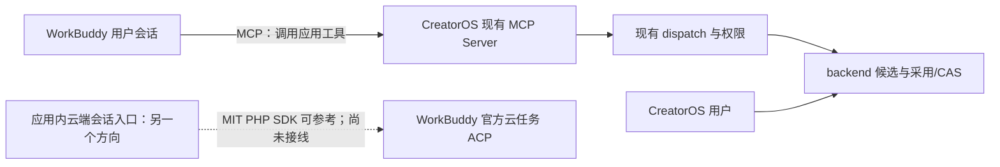

# T-1059：已有 WorkBuddy 集成的复用核对

核对时间：2026-10-04。仅下载固定版本的公开源码并阅读；没有安装、运行第三方脚本、测试、模型、Agent 或浏览器，没有读取用户认证，没有修改仓库。主工作树仅只读。下文“源码有实现”“作者记录真机结果”“本项目验证”是三种不同证据；本轮没有第三种。

## 结论

1. **MCP 接线有可合法复用的真实实现。** 首选 `dream-num/workbuddy-univer-office` 的连接器包装和启动边界，结合 PowerContext 的配置合并/回滚、EverMe 的首次信任提示。CreatorOS 自己已有完整 contract → MCP → dispatch，适合沿用这个入口。无需再造业务工具注册表、数据库或 Agent 运行器。
2. **这些 MCP 项目都是 WorkBuddy 调用应用，不能证明应用内已经能驱动 WorkBuddy。** Univer 的 5.5.4 HTTP 面板成功是作者明确限定的真机记录，正式 stdio 连接器完整安装/发现仍待验证。
3. **找到合法的云端 ACP SDK，而非只有无许可 bridge。** `JaguarJack/workbuddy-openapi` 有 MIT、官方任务 link/token → SSE/JSON-RPC 的实际代码，未调用 CodeBuddy。它是 PHP 库，只有可见 mock 回归，未见云端真机凭据；不能当成当前 Node/TS 应用已经可直接使用的本地 WorkBuddy 适配器。本轮不为使用它新增 PHP 运行器。用户已授权调研两方向；后续具体运行时合同需处理宿主差异和取消/恢复缺口，不重复索取已确认的方向授权。

## 固定版本与许可

| 项目 | 固定 commit / 提交时间 UTC | 实际许可 | 连接方向与证据边界 |
| --- | --- | --- | --- |
| [workbuddy-univer-office](https://github.com/dream-num/workbuddy-univer-office/tree/856eae4fe416b28adffb96092d67ff26c7797ff4) | `856eae4fe416b28adffb96092d67ff26c7797ff4` / 2026-09-11 11:41:51 | [Apache-2.0 LICENSE](https://github.com/dream-num/workbuddy-univer-office/blob/856eae4fe416b28adffb96092d67ff26c7797ff4/LICENSE) | WorkBuddy → 本地 MCP。作者记录 5.5.4 手工 HTTP；正式连接器开发预览。 |
| [oceanbase/powercontext](https://github.com/oceanbase/powercontext/tree/ba7dc8dddea2c37168dbaf801e6399a40aae49f1) | `ba7dc8dddea2c37168dbaf801e6399a40aae49f1` / 2026-10-03 11:49:36 | [Apache-2.0 LICENSE](https://github.com/oceanbase/powercontext/blob/ba7dc8dddea2c37168dbaf801e6399a40aae49f1/LICENSE) | WorkBuddy → 运行中的 MCP/HTTP 服务；专门安装实现，集成被作者标为 community。 |
| [EverMind-AI/EverMe](https://github.com/EverMind-AI/EverMe/tree/6739467509892c69a8d08073c250000120378029) | `6739467509892c69a8d08073c250000120378029` / 2026-09-22 11:25:48 | [Apache-2.0 LICENSE](https://github.com/EverMind-AI/EverMe/blob/6739467509892c69a8d08073c250000120378029/LICENSE) | WorkBuddy → 记忆 MCP；有专门 detector/writer 与测试源码，首次信任由 WorkBuddy 完成。 |
| [JaguarJack/workbuddy-openapi](https://github.com/JaguarJack/workbuddy-openapi/tree/738f794a73bc327d730ffbcb29b220e4e39863d2) | `738f794a73bc327d730ffbcb29b220e4e39863d2` / 2026-09-03 01:07:27 | [MIT LICENSE](https://github.com/JaguarJack/workbuddy-openapi/blob/738f794a73bc327d730ffbcb29b220e4e39863d2/LICENSE) | 应用 → 官方云任务 ACP；第三方 PHP SDK，mock 测试不等于真机。 |

复制/改编 Apache 源文件需保留许可与适用版权/NOTICE、注明修改；MIT 源文件保留版权和许可。应用源码许可不授予 Univer Pro SDK 或商标权。未把资源目录徽标当成实际 LICENSE。

## 首选 Univer：文件与可复用边界

固定源码根：[856eae4f](https://github.com/dream-num/workbuddy-univer-office/tree/856eae4fe416b28adffb96092d67ff26c7797ff4)。

| 精确文件 / 函数 | 源码事实 | CreatorOS 可复用部分与限制 |
| --- | --- | --- |
| [scripts/package-workbuddy-connector.py](https://github.com/dream-num/workbuddy-univer-office/blob/856eae4fe416b28adffb96092d67ff26c7797ff4/scripts/package-workbuddy-connector.py) `document()` 及包装主体 | 产出 `connector-meta.json`、`mcp.json`、`token-schema.json`、一个 Skill；`minWorkbuddyVersion:5.5.4`；stdio `npx` 启动固定 0.1.0 tarball；审计包中绝对路径/令牌泄漏。 | 复用包装模板、固定版本和无个人路径原则，改为已有 CreatorOS MCP 运行时。不得复制 Office registry、工作目录授权冒充 CreatorOS 账号授权，或宣称市场审核已通过。 |
| [bin/univer-office.mjs](https://github.com/dream-num/workbuddy-univer-office/blob/856eae4fe416b28adffb96092d67ff26c7797ff4/bin/univer-office.mjs) CLI 主体 | 拒绝缺失、未展开变量、相对目录；只启动自己的 MCP main。 | 启动参数/配置校验模式。实际 CreatorOS 连接应沿 `discoverConnection()`，不把新目录当作数据库权限。 |
| [src/mcp/main.ts](https://github.com/dream-num/workbuddy-univer-office/blob/856eae4fe416b28adffb96092d67ff26c7797ff4/src/mcp/main.ts) `close()` / 顶层连接 | SDK `StdioServerTransport`；日志 stderr；stdin EOF/SIGINT/SIGTERM 关闭；没拉起另一个 Agent。 | 沿现有 stdio MCP 生命周期。源码不是“WorkBuddy CLI/ACP client”。 |
| [src/mcp/http.ts](https://github.com/dream-num/workbuddy-univer-office/blob/856eae4fe416b28adffb96092d67ff26c7797ff4/src/mcp/http.ts) `startHttpMcpServer()` | 共享一个 Office runtime；请求独立 MCP server；随机 Bearer；4MB JSON；POST-only Streamable HTTP；幂等关闭；凭证文件 mode0600 原子写入。 | 如果明确需要 HTTP，可改编 transport/lifecycle 片段接现有 dispatch。优先已有 stdio，不能连带引入 Office 服务或第二套凭证模型。 |
| [src/server/main.ts](https://github.com/dream-num/workbuddy-univer-office/blob/856eae4fe416b28adffb96092d67ff26c7797ff4/src/server/main.ts) `startServer()` / `startOwnedServer()` | realpath 后拿单 workspace lease；bind `127.0.0.1`；严格 Host/存在的 Origin 校验；另有 agent/viewer/review 身份边界。 | 是可读的 loopback 防护/释放资源参考，不搬 Office 的 SQLite、lease 或 viewer 审阅模型。 |
| [src/mcp/server.ts](https://github.com/dream-num/workbuddy-univer-office/blob/856eae4fe416b28adffb96092d67ff26c7797ff4/src/mcp/server.ts) `createOfficeMcpServer()`、内层 `register()` / `api()` | 15 个真实 Office 工具经自己 REST 执行；文本摘要去除 image bytes，图片用 MCP image block，另有 structuredContent；错误返回 isError。 | 结果封装片段可改编。工具和权限仍从本项目 contract/CLI policy 生成，不能复制其工具表或 generic JS execute 来绕过 backend。 |
| 同文件 `registerAppTool('univer_preview')` / `registerAppResource()` | ext-apps 资源 URI 有内容哈希；`_meta.ui.resourceUri`、`workbuddy.ui.launchSurface:'panel'`；状态和实际截图时间明确；只读预览。 | 若未来明确需要 WorkBuddy 内工具卡，可借鉴公开 metadata、真实状态与资源缓存处理；当前无需为此重写 MCP 高层 API。 |
| [skills/univer-office/SKILL.md](https://github.com/dream-num/workbuddy-univer-office/blob/856eae4fe416b28adffb96092d67ff26c7797ff4/skills/univer-office/SKILL.md) | 一个 Skill，按需读七份 references；读取权威状态、草稿写入、未知结果先查再重试、人工审阅。 | 复用使用约定结构，改用 CreatorOS 真实 operation、候选采用和任务查询。不要复制 Office 领域执行指令。 |

### 不能直接搬的宿主依赖/UI

`package.json`：Node ≥22.12、pnpm10.33.4、MCP SDK1.29.0、ext-apps1.7.4、Express5.1.0、Zod3.25.76，大量固定 Univer insiders SDK、React19.2、libsql。Pro 相关依赖需额外许可。CreatorOS MCP 已有 SDK ^1.29.0 和 Zod ^4.4.3，契约是低层 JSON Schema API；因此不能把整个 `McpServer.registerTool(zod3)` 表搬进来。

[src/mcp-app/main.ts](https://github.com/dream-num/workbuddy-univer-office/blob/856eae4fe416b28adffb96092d67ff26c7797ff4/src/mcp-app/main.ts) `render()` 确实把 `previewUrl` 赋给 iframe；人工完整编辑/审阅也另开浏览器。用户已经要求原生风格一致，这个 UI 不适合直接嵌入 CreatorOS。保留本项目文章/图文/脚本工作台的组件和样式，只复用底层接线。

### 作者证据与仍未知

[docs/release-readiness.md](https://github.com/dream-num/workbuddy-univer-office/blob/856eae4fe416b28adffb96092d67ff26c7797ff4/docs/release-readiness.md) 明确：5.5.4 成功路径是手工 HTTP，stdio 插件不是同一已验证路径；干净安装、更新/卸载、自动启动、任务隔离、取消/空闲退出、跨平台及完整工作台流程未完成验收。

[docs/marketplace-submission.md](https://github.com/dream-num/workbuddy-univer-office/blob/856eae4fe416b28adffb96092d67ff26c7797ff4/docs/marketplace-submission.md) 写明尚未提交审核；候选 ZIP 到信息确认不等于上架。开发 manifest 的 `CODEBUDDY_PLUGIN_ROOT` / `CODEBUDDY_PROJECT_DIR` 是变量名，不能据此认定拉起 CodeBuddy，也不能假定正式连接器支持这些替换。作者记录的真实结果不自动转为 CreatorOS PASS。

## 同类已有接线：选可用片段

### PowerContext

[src/powercontext/cli/workbuddy.py](https://github.com/oceanbase/powercontext/blob/ba7dc8dddea2c37168dbaf801e6399a40aae49f1/src/powercontext/cli/workbuddy.py)：

- `install_workbuddy_plugin()`：备份 settings/mcp 和自己 hooks/Skill，安装异常回滚。
- `_merge_workbuddy_mcp()` / `_workbuddy_mcp_entry()`：只合并自己的 `mcpServers.powercontext`，保留其他 server 和用户已有非旧默认 URL/headers，原子写 JSON。
- `_merge_workbuddy_settings()`：只 upsert 自己的 UserPromptSubmit Hook，不删除其他 Hook。
- `run_workbuddy_diagnostics()`：独立 hooks/settings/mcp/Skill 检查。

[WorkBuddy README](https://github.com/oceanbase/powercontext/blob/ba7dc8dddea2c37168dbaf801e6399a40aae49f1/integrations/workbuddy/README.md) 与实际 `.mcp.json` 使用 Streamable HTTP。Hook Python3.11 标准库访问运行中 PowerContext 服务；不嵌入存储、不启动服务。可复用合并、归属/备份回滚和诊断模式；不引入记忆服务、Hook 抓取用户提示或其 scope 算法。CreatorOS 当前 stdio 仍可复用安装管理思路，HTTP shape 不能原样填入 stdio。

### EverMe

[cli/internal/plugin/workbuddy.go](https://github.com/EverMind-AI/EverMe/blob/6739467509892c69a8d08073c250000120378029/cli/internal/plugin/workbuddy.go)：

- `workBuddyConfigPathInDir()` 固定用户 `~/.workbuddy/mcp.json`；注释明确不要写 `.mcp.json`（生成聚合）或 `connectors/default/mcp.json`（应用所有）。
- `workBuddyDetector.Detect()` / `workBuddyInstalled()` 是配置/安装可用性探测；PATH 查找并不执行 Agent。
- `workBuddyWriter.Commit()` 复用共享 mcpWriter，成功后仍提示用户在 WorkBuddy MCP 管理里首次信任。**配置成功不代表能调用。**

有 [workbuddy_test.go](https://github.com/EverMind-AI/EverMe/blob/6739467509892c69a8d08073c250000120378029/cli/internal/plugin/workbuddy_test.go) 源码，本轮未运行。依赖 Go CLI/已有 MCP 服务，EverMe 登录/记忆服务不应移植；只抽取 canonical path、预览/备份、最小合并和宿主信任状态处理。不要把 npm 中另一代 WorkBuddy Hook 包与本次固定 Go 实现混称同一版本。

## 云端 ACP：合法现成代码与限制

[JaguarJack/workbuddy-openapi/src/Support/AcpTransport.php](https://github.com/JaguarJack/workbuddy-openapi/blob/738f794a73bc327d730ffbcb29b220e4e39863d2/src/Support/AcpTransport.php)：

- `open(Task)` 用任务 link/token GET SSE，核验 HTTP 成功、text/event-stream、`Acp-Connection-Id`。
- `initialize()`、`load()`、`prompt()` 真实发送 initialize/session/load/session/prompt；`post()` 回传同连接标识；SSE 解析终止响应与 permission request。
- 单连接一次活跃 prompt；请求号、连接所有者校验；中断后结果未知明确标记，不盲重放；`respondToPermission()` 只回复本连接仍 pending 的权限请求。
- `close()` 是本地断开响应流，源码未实现 `session/cancel`。缺少恢复/重新获取 token 的自动端到端生命周期。
- [Actions/Task/CreateTask.php](https://github.com/JaguarJack/workbuddy-openapi/blob/738f794a73bc327d730ffbcb29b220e4e39863d2/src/Actions/Task/CreateTask.php) `execute()` 调 `/tasks`，scope=`user.task.invokable`；[WorkBuddyClient.php](https://github.com/JaguarJack/workbuddy-openapi/blob/738f794a73bc327d730ffbcb29b220e4e39863d2/src/WorkBuddyClient.php) `withTokens()` 按用户隔离客户端，`openAcpConnection()` 先读任务。

[composer.json](https://github.com/JaguarJack/workbuddy-openapi/blob/738f794a73bc327d730ffbcb29b220e4e39863d2/composer.json)：PHP ^8.1、Symfony http-client ^6.4。README Composer 使用名与 composer.json 的 package name 不一致，不能假定已发布可安装包。公开 [AcpTest.php](https://github.com/JaguarJack/workbuddy-openapi/blob/738f794a73bc327d730ffbcb29b220e4e39863d2/tests/AcpTest.php) 使用 MockHttpClient/MockResponse，只证明有契约测试输入，未见真实云端验收；本轮也未运行。

与[官方 WorkBuddy OpenAPI](https://open.workbuddy.cn/docs/openapi) 的双通道说明一致。必须是用户授权的开放平台应用和云端任务凭证；不需要读取本地桌面登录态。云沙箱无法直接连用户机器的 `127.0.0.1` MCP，是否配置可达服务是另一个网络/授权设计点。官方扩展里的 `_codebuddy.ai/*` 是 WorkBuddy 云协议名称，不等于启动用户排除的 CodeBuddy 产品。不要为绕过开放平台注册而抄私有网关认证。

## CreatorOS 最小复用路径（建议；尚未实施）

只读核对位置：`/Users/zyongzhu/.codex/worktrees/user-diagnostics/Thirdspace-creator`。

| 当前文件 / 函数 | 已有事实 | 应沿用的边界 |
| --- | --- | --- |
| `mcp-server/src/index.ts::main()` | `discoverConnection()` + DispatchClient + stdio transport | 提供给 WorkBuddy 已有进程入口；不用起新的服务/Agent。 |
| `mcp-server/src/connection.ts::discoverConnection()` | 安装连接描述与启动级握手、CLI access、product/package/launch 身份 | 不从 WorkBuddy credential/session/db 反向取秘密，也不发固定开发 token。 |
| `mcp-server/src/tools.ts::buildTools()` | contract ENDPOINTS、CLI policy 生成工具/JSON Schema | 保持真实 operation，拒绝另造 API 执行表。 |
| `mcp-server/src/server.ts::createCreatorOsMcpServer()` | tools/list、tools/call，经 `DispatchClient.dispatch()` | 写操作要求 apply、idempotencyKey；影响型操作要 confirmImpact；AI 候选仍走原 backend 用户采用/CAS。 |
| `mcp-server/src/dispatch.ts::DispatchClient.dispatch()` | 真实 `/api/v1/dispatch`，带安装握手/CLI 客户端权限 | 接线不能绕过认证、账号/project ownership 或直接写库。 |
| `mcp-server/src/cli.ts::runCliCommand()` | 已有 `creatoros mcp serve` 路由 | 可利用已有交付 CLI，实际安装命令/路径由本项目包装事实决定。 |

**最小候选改动**：沿已有交付脚本生成 WorkBuddy 连接配置/Skill；借鉴已许可的目录选择、用户配置最小合并/备份回滚/首次信任提示。协议、业务调用、后台任务、候选采用均继续用本项目实现。MCP server 当前只返回 text JSON；需要图像工具结果时再在现有工具响应边界实现真实 image block，不能把 Univer iframe 或截图冒充本项目可编辑工作台。

如果产品目标仍是“在 CreatorOS 对话里选 WorkBuddy 并启动/恢复/取消它的会话”，MCP 配置不满足这条方向。合法 cloud ACP SDK 可作为后续复用来源，但当前 Node/TS 客户端、真实官方授权、取消/恢复与本项目任务映射仍是缺口，不能登记成已经实现。

## 排除来源

- 父任务前序核对已排除 `freemodel-workbuddy-proxy`；父任务另核对 VOKO 的该 provider、相关 Obsidian 插件通过 `codebuddy` / `@tencent-ai/codebuddy-code` 拉起执行。本轮未重新固定这些仓库，不给它们补造 commit/许可证据，不能包装成 WorkBuddy 独立路线。
- [jie023/workbuddy-acp-bridge 固定 README](https://github.com/jie023/workbuddy-acp-bridge/blob/e2327499273efa093ebdcbffde9a4c8833e26e76/README.md)：前次固定 commit `e2327499273efa093ebdcbffde9a4c8833e26e76`，[仓库 license 元数据](https://api.github.com/repos/jie023/workbuddy-acp-bridge) 为 null、无实际 LICENSE，且依赖本地私有会话/网关发现；仅登记缺口，不复制。
- 提取的 WorkBuddy app.asar/专有文件不因公开 GitHub 而有复用权。没有许可证证据的实现不选用。
- 教程、资源目录或“支持 WorkBuddy”标签只是发现入口；最终依据上面原作者固定源码。

## 本地源码证据

全部为公开 GET 原始字节，保存 URL/时间/文件 SHA256；没有任何 auth/token 内容。

| 本地目录 | source-records.json SHA256 | UTC 抓取时间 |
| --- | --- | --- |
| `/tmp/t1059-source/workbuddy-univer-office/` | `693127eac8699658425f7ed33449e4c7c99b81a0e0aa43951f073803b654006d` | 07:39:41–07:44:56 |
| `/tmp/t1059-source/powercontext/` | `955bf8670cfebf0d1e1fda7045ef02442e159c163eb305613d65a921803a945f` | 07:45:14–07:46:09 |
| `/tmp/t1059-source/everme/` | `dfee62773776b00f7696e1dd722a0abc36a5d4608d7fbaf481250525f09c4b74` | 07:45:21–07:46:11 |
| `/tmp/t1059-source/workbuddy-openapi/` | `0279721463f757ea96053b1d0a0a855819486e96ae55219a04c0a15b8310e6ac` | 07:47:23–07:48:08 |

日期均为 2026-10-04。Univer 原记录在 `sources`，追加两文件在 `records`；其他源统一 `records`。目录含 repo/commit/tree、LICENSE、上表关键源码和有限 README/测试源码。

官方正文复用前次归档 `/tmp/t1058-workbuddy-evidence/openapi.text.txt`：SHA256 `4b22c1ef77151c6dbab8e31b730ac1cea0d7bfd26a06464e97e668f47742235e`，2026-10-04 07:05 UTC 抓取；本轮未重复腾讯版本/套餐调研。
