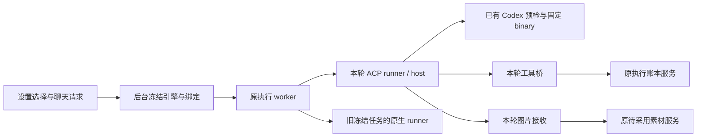

# T-1060 提交依赖只读核对

核对目录：`/Users/zyongzhu/.codex/worktrees/user-diagnostics/Thirdspace-creator`。
核对基准：`HEAD=04ad621237f80884e554b5a6bca69ec645b4f3a3`。只读工作树与 Git 差异；未暂存、提交、测试、调用浏览器或真实 Agent，未读取认证文件或凭据值。

## 结论

只提交新的 ACP host、runner、图片模块和 vendor 会缺源码。它们直接复用了此前尚未提交的 Codex 预检、旧任务兼容、后端回执服务与状态契约。可把这些必要基础源码关联到本轮提交，或先形成单独的基础提交；不能把未提交依赖描述为干净 HEAD 已具备。

同一文件中的 ASR、文章、图文、画布、激活及其他旧需求改动应留在工作树。混合文件须按具体行构造提交内容，不能整文件 `git add`。

## 1. HEAD 缺少、运行必需的前置源码

以下九个文件目前均为未跟踪文件；部分也出现在本轮 `write-files.json`，但它们在 HEAD 中不是已有基础。建议明确记录“关联前置 Codex 基础源码”，不要伪造其原任务历史验证。

| 文件 | 直接依赖与必要原因 |
| --- | --- |
| [codex-app-server.ts](/Users/zyongzhu/.codex/worktrees/user-diagnostics/Thirdspace-creator/ai-worker/src/execution/codex-app-server.ts:6) | ACP host 第 6 行及状态入口第 5 行直接复用 `createControlledCodexSession`、固定版本 binary 定位、启动参数与环境过滤。自身只增加 `codex-app-server-protocol` 和 Node 标准库依赖。 |
| [codex-app-server-protocol.ts](/Users/zyongzhu/.codex/worktrees/user-diagnostics/Thirdspace-creator/ai-worker/src/execution/codex-app-server-protocol.ts:5) | 上一行基础源码依赖 `CodexHostError`、`CodexRpcSession`；预检真实通信不能缺。 |
| [external-chat-worker-run.ts](/Users/zyongzhu/.codex/worktrees/user-diagnostics/Thirdspace-creator/ai-worker/src/execution/external-chat-worker-run.ts:7) | ACP runner 第 7 行复用私有工作目录、文本上下文函数；该文件同时保留无 ACP 绑定的旧任务执行路径。本轮新增 ACP 路由也在这里。 |
| [codex-native-turn.ts](/Users/zyongzhu/.codex/worktrees/user-diagnostics/Thirdspace-creator/ai-worker/src/execution/codex-native-turn.ts:2) | `external-chat-worker-run.ts:8` 静态导入。虽新 ACP 路径不直接执行它，构建与旧冻结任务兼容仍必须保留。 |
| [external-chat-turn.service.ts](/Users/zyongzhu/.codex/worktrees/user-diagnostics/Thirdspace-creator/backend/src/modules/ai/external-chat-turn.service.ts:18) | dispatcher 的外部回合预约、入场、真实 provider turn、图片回执、结算、原消息提交均依赖。复用原 `execution_calls` 等表，无需新增独立任务账本。 |
| [external-task-tool.service.ts](/Users/zyongzhu/.codex/worktrees/user-diagnostics/Thirdspace-creator/backend/src/modules/ai/external-task-tool.service.ts:22) | 工具桥通过 dispatcher 使用此原工具执行/幂等账本服务；不能只交桥而缺 backend 实际端口。 |
| [local-codex-worker-env.ts](/Users/zyongzhu/.codex/worktrees/user-diagnostics/Thirdspace-creator/backend/src/modules/execution/local-codex-worker-env.ts:2) | dispatcher 与状态服务都调用的受控子进程环境装配；本核对只读源码声明。 |
| [local-codex-status.service.ts](/Users/zyongzhu/.codex/worktrees/user-diagnostics/Thirdspace-creator/backend/src/modules/ai-runtime/local-codex-status.service.ts:6) | 原请求 IO 包装真实状态 worker；前端状态路由调用其 `read`。 |
| [local-codex-status.ts](/Users/zyongzhu/.codex/worktrees/user-diagnostics/Thirdspace-creator/contract/src/internal/local-codex-status.ts:2) | 状态 worker、backend 状态服务、前端共享 hook 的同一状态协议；须同时保留 `execution-worker.ts` 的 reexport。 |

本轮新增的五个运行文件也不在 HEAD：`codex-acp-host.ts`、`codex-acp-worker-run.ts`、`external-chat-images.ts`、`codex-status-entry.ts`、`external-task-mcp-bridge.ts`。应与上述闭包及原 vendor 固定源码、许可、来源/补丁记录一起提交。vendor 使用本轮权威清单，不从未跟踪目录整包捎带其他源码。

### 额外漏项：图片精确回执 helper

[external-chat-turn.service.ts:9](/Users/zyongzhu/.codex/worktrees/user-diagnostics/Thirdspace-creator/backend/src/modules/ai/external-chat-turn.service.ts:9) 直接导入且第 150 行调用 `readCommittedGeneratedAssetFile`，HEAD 没有这个导出。必须关联 [generated-asset-candidate.service.ts:47](/Users/zyongzhu/.codex/worktrees/user-diagnostics/Thirdspace-creator/backend/src/modules/assets/generated-asset-candidate.service.ts:47) 当前追加的 11 行只读核验函数。其已有 imports、表、`readGeneratedAssetReceipt`、素材字段均在 HEAD；不需要扩入文章或画布实现。

`assets/index.ts:86` 新增此函数 reexport 对当前直接文件 import 不必要，可留上游 WIP。原 `createPendingGeneratedAssetService`、`ObjectStorageForCtx` 及 `pending-generated-asset.service.ts` 已在 HEAD，没有差异；不需要为本轮带入其余素材改动。

## 2. 混合 tracked 文件：只取这些具体改动

| 文件 | 必要提交内容 | 明确排除 |
| --- | --- | --- |
| `ai-worker/src/execution/worker-entry.ts` | `runExternalChatInWorker` import、`runExternalChat` 注入两处。 | `runAssetAsrInWorker` import/注入。 |
| `ai-worker/src/execution/worker-runtime.ts` | 外部 runner type import、`WorkerDependencies.runExternalChat`；当前 140 行起 Codex 分支、progress、原提交回执/真实 messageId 校验。 | ASR type、capability、分支；`graphic.card-brief` 路由。 |
| `ai-worker/scripts/build.mjs` | `@openclaw/fs-safe` external；真实 `codex-status-worker.cjs` 与 `codex-acp.cjs` 构建及许可 banner。 | 本文件当前差异未发现其他旧需求。 |
| `ai-worker/package.json` | `@openai/codex@0.159.3`；`@agentclientprotocol/sdk@1.5.1`；`@openclaw/fs-safe@0.21.3`；`@modelcontextprotocol/sdk@1.29.0`；`diff@9.0.0`、`open@11.0.1`、`vscode-jsonrpc@9.0.1`。 | `./platform/*`、小红书/文章/图文/发布 exports；无关依赖排序。 |
| `pnpm-lock.yaml` | 上述 worker importer 依赖、准确版本 package/snapshot 递归闭包，包括 Codex/fs-safe 平台依赖。 | 无关旧包。此核对未逐节点认证 lock 闭包，不应把工作树全 lock 差异自动当成本轮。 |
| `contract/src/internal/chat-worker.ts` | 引擎值、固定 `codexAcpBinding`、绑定 schema/字段/校验。 | 不把历史 `codebuddy` schema 值描述为本轮已接通引擎；用户已排除它。 |
| `contract/src/internal/execution-worker.ts` | 绑定 reexport；10 个外部聊天/工具端口枚举；外部回执、真实 turn、图片身份/回执和工具 schema；对应端口输入；状态协议 reexport。 | `asset-asr` imports/exports/端口 spread/input union/capability；`readAssetReference` 端口及输入。 |
| `backend/src/modules/ai/chat-turn-submission.service.ts` | 当前引擎校验、后端冻结 ACP 绑定、原消息重放与事务竞争时引擎一致性校验；对应聚焦 tests。 | 当前差异均与引擎有关，无需附带 `chat-assembly.ts` 的文章/画布修改。 |
| `backend/src/modules/ai-runtime/chat-production-runtime.ts` | `submit` 输入增加 `executionEngine?:"pi"|"codex"`，当前仅一行差异。 | — |
| `backend/src/modules/ai-runtime/chat-production-composition.ts` | `ChatProductionCompositionDeps.externalImageStorage` 字段及 `createChatProductionRuntime` 调用中的透传。 | Canvas import、`canvas` 字段/变量、`resolveTools` 的 canvas 合并；它们紧邻图片透传，不能整 hunk 照收。 |
| `backend/src/modules/execution/model-worker-dispatcher.ts` | 三个外部服务/env import；`ChatWorkerDispatcherDeps.externalImageStorage`；创建外部回合/工具服务；`ToolScope.externalToolMap` 与原工具实例绑定；chat supervisor `extraEnv`；当前 221 行起外部端口装配及 pending/signal 沿原生命周期。 | ASR import/deps/端口；`readAssetReference`；Moments/review imports/实例/结果提交。 |
| `backend/src/modules/execution/worker-supervisor.ts` | `extraEnv` 可选字段、`fork` 的 `buildChildEnv(options.extraEnv)`。 | `settleAssetAsrRequest` 新值。 |
| `backend/src/modules/ai-runtime/request-io.service.ts` | `extraEnv` 字段与子进程环境透传两行。 | — |
| `backend/src/modules/ai-runtime/index.ts` | 状态服务 export 一行。 | `transcribeConfiguration`、`StructuredBusinessAdapter` 新 export。 |

`child-env.ts`、`ai.repository.ts`、`execution.errors.ts`、`execution-lease.service.ts`、`execution-chat-tool-ports.service.ts` 本次精确检查没有 HEAD 差异，相关原能力可以沿 HEAD 复用。

桌面运行闭包还需保留本轮 `frontend/scripts/desktop/execution-worker-runtime.mjs`、`build-sidecar.mjs` 与相应 tests：新增两个 entry、Codex 固定 npm alias 平台身份/版本核验及 fs-safe external。Windows 交付若属于本次交付内容，按权威 write-files 保留 `tools/windows-closure-rat/stage-layered-workers.mjs` 的实际平台依赖闭包与对应 tests；不是引用测试通过即可声称 Windows 真机运行已验证。

## 3. 前端旧 WIP 装配：自包含交付与保留依赖要分清

新 `native.image` 展示本身可只取 `ai-copilot-content.tsx` 当前 2672 行起五行，复用 HEAD 已有的 `ChatScreenshotCard`。当前整文件还包含文章选择透传、Canvas 展示、深链预填等旧改动，须排除。

`chat-screenshot-card.tsx` 本轮的 `kind="generated"`、原素材预览读取/失效、无 sourceUrl 时隐藏来源、统一图片文字及其聚焦 tests 应关联；`asset-preview-url.ts` 所需两个函数已在 HEAD。

若本提交要在干净 HEAD 实际通过设置选 Codex 并发送，新图片展示之外还必须关联以下 T1055/T1057 前置装配；若留作单独上游提交，交付应明确注明所依赖的提交/尚未提交 WIP。

| 前置文件/改动 | 用途 |
| --- | --- |
| `frontend/src/features/copilot/assistant-engine.ts`（HEAD 缺） | 同一偏好读写/订阅、状态重查事件。 |
| `frontend/src/features/copilot/use-assistant-engine.ts`（HEAD 缺） | 共享真实状态 hook；依赖状态契约及 `/api/chat/engines`。 |
| `frontend/src/features/copilot/live-chat-session.ts`（tracked 三处差异） | 偏好 import、`executionEngine`/`sourceEngines`、实例初值；保留旧消息冻结执行器。 |
| `frontend/src/features/copilot/ai-copilot-content.tsx` 的引擎专属 hunks | hook import/实例、liveSession engine、transport `prepareSendMessagesRequest`、不可用/附件提示、发送可用性、状态提示。不要混入 Canvas/文章/深链。 |
| `frontend/src/app/api/chat/route.ts`（tracked 三处差异） | 请求 engine 字段、值校验、传入真实 `durable.submit`。HEAD 默认只生成 Pi 输入；漏此处 UI 选择不会送入后台。 |
| `frontend/src/app/api/chat/engines/route.ts`（HEAD 缺） | 真实状态 GET 路由，沿原认证与 account 归属路径读取。 |
| `frontend/src/server/execution-worker-path.ts:32`（tracked 一行） | 固定状态 worker 路径 resolver。 |
| `frontend/src/server/persistence-client.ts` 的状态专属 hunks | 状态 service/path imports、`localCodexStatus` 类型、实例创建、stop、read；不要整文件 stage。 |
| `frontend/src/features/settings/assistant-engine-card.tsx`、对应 test（HEAD 缺）；`settings-model-region.tsx` 两行及 `settings-interactive-region.tsx` 一行 | 用户可在既有设置中真实切换/重查，当前聊天不显示选择器。这是已确认的前置 UI 工作，应单独注明来源。 |

`persistence-client.ts` 当前 6818 行 `externalImageStorage:objectStorageForCtx` 是本轮图片保存的必要装配；紧接的 `canvas:{...}` 属于旧 WIP，要排除。HEAD 已有 `objectStorageForCtx`；不必捎带该文件事务对象存储、文章、画布、ASR、运营等成百行旧修改。

## 4. 提交选择建议

1. 新增纯 Codex 运行源码、固定 vendor 闭包/许可/来源、本轮聚焦 tests 可以按明确清单提交。九个 HEAD 缺的前置运行文件须关联，保留旧冻结任务路径。
2. 混合 tracked 文件以 HEAD 内容为基础加上本报告列明的必要行。组合根需特别拆图片透传与 Canvas，相邻 hunk 不代表同一任务。
3. 网页设置、状态/submit 路由如未与此次一起交付，明确保留为上游未提交依赖。不可在 commit 说明中宣称独立检出即可切换和接通。
4. WorkBuddy 包装、CLI/native MCP 接入按本轮权威 `docs/verification/t1060/write-files.json` 独立保留；不从相关设置或打包文件扩大纳入激活、发布等旧改动。本报告不重新认证该独立闭包。
5. 关联必要基础后，父代理应在拟提交内容的隔离检出上核对 imports、type/build 与授权 Gate。当前混合工作树的通过证据不自动证明精简后的提交可构建；本报告没有执行该验证。

不要纳入：`chat-assembly.ts` 的文章配图/画布、`chat-tools.ts` 的 Canvas 业务、新文章图文 runtime/exports、ASR runner/owner/端口、激活代码、NoteRelay、生产画布与发布重构。它们与本轮复用原工具 host 不构成必须关联的新源码；原工具实例仍从 HEAD 原组合根提供。

辅助只读工件：`/tmp/t1060-commit-import-frontier.json`。它记录入口的相对 import 前沿及 HEAD 缺源，未将 package alias 和所有 type-only 引用解析为完整编译闭包，不能据此声称构建通过。
