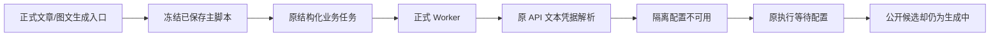

# 文章与图文正式 AI 入口继续验证

日期：2026-10-04。只读工作树源码；全部新数据在 `/tmp/t1060-ai-business/continue-derived/isolated-Ly3hYh`，未读取原用户数据库、模型密钥或 Agent 认证文件，未改用户设置，未采用或发布。

## 当场结果

| 入口 | 实际执行 | 结果 |
| --- | --- | --- |
| `articles.candidates.generate` | 原 transport、Articles service、AI service、已保存真实主脚本、原 Writing adapter、结构化准备、正式 Worker 子进程、原 LLM resolver、原执行账本 | 凭据解析阻断；模型调用 0、候选 0 |
| `graphicPosts.candidates.generate`（body） | 原 transport、GraphicPosts service、AI service、同一真实主脚本、原 Graphic adapter、结构化准备、正式 Worker、原 LLM resolver、原执行账本 | 凭据解析阻断；模型调用 0、候选 0 |

两项冻结的 `kind=model.structured`、`capability=copy.generate`，没有 `externalAgentBinding`。这说明当前正式衍生入口仍需要原 API/Pi 文本配置，不能拿 Codex 编导对话的成功冒充它们已经迁移。

隔离环境只检查显式允许的 8 个 API 环境变量；存在性全部 false。临时用户模型行为空。原 `resolveLlmConfig` 实际报 `LlmCredentialError`；原宿主包装为 `MODEL_CREDENTIAL_UNAVAILABLE`，正式 Worker 将原执行置为 `waiting_user`。没有网络模型请求、没有 mock HTTP 供应商、没有合成候选。原用户是否已经配置模型未读取，不能据此认定原用户缺配置。



## 发现的真实状态问题

两项 execution 均为 `waiting_user`，错误 `MODEL_CREDENTIAL_UNAVAILABLE`。但 `ai.getTask` 的公共状态被投影为 `running`：

- 文章 `readCandidateState` 返回 `status=running`、`candidate=null`、`errorCode=null`；公开 `getArticleCandidate` 返回 `ConflictError` / “文章候选尚未生成完成”。
- 图文公开 `getGraphicPostTextCandidate` 返回 `status=running`、`value=null`；其 creative adapter 将错误码置为 null。
- 文章页轮询仅检查 `status=failed/cancelled/awaiting_confirmation/succeeded`，继续每 2.5 秒读任务，清除错误，不读取 `runtimeStatus/errorCode`。这是可重现的数据状态与页面源码不一致，未做浏览器真界面验证。

根因路径：

1. `backend/src/modules/ai/execution-task-projection.ts:15`：waiting_user 落入默认 running 分支；实际公共任务保留 `runtimeStatus` 和 `errorCode`，但衍生读模型未透传。
2. `backend/src/modules/articles/articles.service.ts:337`：文章结构候选只消费公共 `status`。
3. `backend/src/modules/graphic-posts/graphic-posts.service.ts:438`：图文候选只消费公共 `status`。
4. `frontend/src/features/article/article-workbench.tsx:266`：当前轮询不处理 waiting_user。
5. `backend/src/modules/graphic-posts/graphic-posts.creative-adapter.ts:40`：仅 failed 映射 GENERATION_FAILED。

完整生成路由归既有 T-1057（当前暂停且 SPEC 仍为合同候选）。状态缺陷归既有 T-915 的错误分类与公共投影 AC-05，以及 T-957 的真实 AI 验收/失败表达范围：T-915 明确配置阻断必须是 waiting_user，T-957 明确错误 UI 按实际运行状态提供动作、未知结果不得建议新建重试。应由主会话登记具体发现并判断修复范围，不能让子代理直接扩大产品 write_set。未修改生产实现、控制文件或原任务状态。

## 重试安全核对

对上面两项**当场生成的真实隔离 waiting_user 任务**，重新打开同一临时数据库，经原 `createFrozenModelRetryPort` 调用原 `persistentTask.command('retry')`。两项都真实返回 `ConflictError` / `任务状态不允许执行 retry: status=waiting_user, attempt=1/3`；整行执行状态前后完全相同、calls 仍为 0、wake 调用 0。见 `retry-guard.json` / `retry-guard.log` / `verify-retry-guard.mts`。

所以只把公开 waiting_user 改映 failed，当前新任务不会因此绕过持久状态门重发；却会诱导用户点击一个被原恢复门拒绝的“重试”。应展示原等待配置及原恢复动作，不能松开原 retry 门。`persistent-task.service.ts:260` 仅允许 failed/blocked retry，`unknown_result` 也不允许 retry（代码证据；本轮未伪造未知供应商回执测试）。waiting_user 的合法控制是原 `resume`（同文件 250）；started/unknown 回合仍须依原调用账本、相同 operationKey 对账。领域 retryFrozen 在已有 executionTaskId 时恢复原任务，不复制输入/预算；旧无执行记录才允许原终态复制分支。未知、已启动和配置阻断不能被统一成一个可重试失败。

## 可复现与证据

执行命令（在工作树 backend 中）：

```bash
node_modules/.bin/tsx /tmp/t1060-ai-business/continue-derived/verify-derived.mts > /tmp/t1060-ai-business/continue-derived/run.log 2>&1
```

当场 exit 0，原 Worker drain 2。`evidence.json` 保存真实 task/execution/script/version 身份、原 resolver 错误、领域/公共读回与源码 Worker 摘要。`run.log` 保留原输出。`verify-derived.mts` 是隔离装配 harness；未被调用的无关端口明确抛错，调用计数 0。它不替代整个桌面组合根、浏览器验收或真实 API 成功。

文章与图文当前版本前后相同，未写入 AI 正文。`inputs.outputId=null` 是原 ai_tasks 的 `contentOutputId` 空值；领域真实 outputId 在 `readback` 的公共/domain 返回中，未补造该字段。
