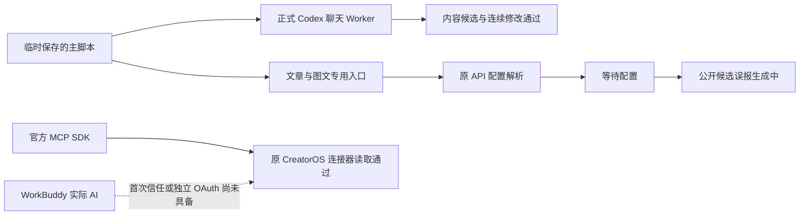

# T1060：继续验证 AI

日期：2026-10-04。用户要求“那你继续验证”。沿用 T1060 隔离验收范围，生产实现没有变化。实际运行使用当前开发工作树、既有正式 Worker/后台领域服务及固定 ACP；不是完整桌面安装包验收。原任务和全局欠债继续保留。

## 结果

| 检查 | 当场结果 |
| --- | --- |
| Codex 读取已保存脚本并产生文章/图文聊天内容 | 真实只读工具与模型执行，结果保存为聊天回复内容（conversation_reply）。明确 JSON 类型后，标题、简介、标签逐字沿用，文章段落和 3 页图文非空。主稿版本未变。 |
| Codex 连续修改 | 同一产品对话的原历史读回参与下轮；再次读取主稿，改为 2 段文章与 2 页图文，元数据保留、聊天结果读回通过。两轮是不同原生 session，未宣称原生会话续跑。 |
| Codex 取消与结果未知回放 | 在收到真实 provider turn 后中止 Worker 信号。原调用为 unknown，保留 session/turn；再进入同任务仅查原账本，明确拒绝恢复，没有第二次模型请求。远端取消是否已确认仍为未知。 |
| 文章专用生成入口 | 原 transport → 主脚本冻结 → 原业务准备 → 正式 Worker 实跑；原 API/Pi 配置解析报 MODEL_CREDENTIAL_UNAVAILABLE，执行 waiting_user。模型请求 0、候选 0。 |
| 图文专用生成入口 | 同上，实际等待 API/Pi 配置，模型请求 0、候选 0。不是 Codex 原生调用。 |
| CreatorOS 的 WorkBuddy 连接器侧 | 原 CJS CLI 与官方 MCP SDK 的真实 stdio/HTTP/临时 PGLite 读取链路，以及归属/缺 apply/撤销/EOF，共 13 项检查通过。 |
| WorkBuddy 自身 AI 与跨应用调用 | 未通过真实验证。调用 0；没有安装连接器或首次信任，没有改 Agent 设置或取桌面认证。 |

**完整 AI 功能验收仍未通过。** Codex 聊天内容成功不能证明文章/图文工作台的按钮已切到 Codex；原全业务路由仍归暂停的 T1057。当前隔离环境没有显式安全 API/OAuth 配置，没有读取原用户配置，因此不能断言用户原账号缺配置。

## 发现与限制

1. **等待配置却持续显示生成中。** 两项真实执行均 waiting_user / MODEL_CREDENTIAL_UNAVAILABLE，但 ai.getTask 的公共状态和领域候选仍 running。文章候选 errorCode 为 null，图文候选无值；文章页轮询未处理实际 runtimeStatus。登记 [T1061](../../../features/t1061-ai-waiting-state-projection.md)，承接 T915/T957 的现有状态与错误表达合同；本轮未修改实现。
2. **不能把所有阻断改成可重试失败。** 当场等待配置任务经原 retry 门均被拒绝，没有改状态、唤醒或发模型请求。应保留原 waiting_user/unknown_result 的区别与恢复入口，不能松开原幂等和未知回执保护。
3. **首轮内容格式检查失败。** 模型返回了标签拼接字符串，探针期望数组，但首轮提示未明确类型；正常模型回合与聊天结算已完成，探针失败如实保留。后续新临时任务明确 tags:string[] 后才通过；没有修改返回值、重发未知任务或把首轮改成 PASS。这不是专用结构化业务 JSON schema 的真实通过。
4. 取消验证通过原 Worker AbortSignal；没有操作 UI，也没有证明公开取消按钮到 Worker 信号的完整链路。原调用仍 unknown，不能宣称远端没有执行或取消已确认。

## 实际身份与原始记录

- 明确格式的初轮：session `01a106f9-21d9-7a22-a15b-872824301658`；turn `01a106f9-3010-7ca2-8037-98d623c4a381`，end_turn。
- 连续修改：session `01a106f9-b08f-7300-942a-3da56ef76257`；turn `01a106f9-b160-79f0-9eb6-43a882218974`，end_turn。
- 取消：session `01a106fa-328e-7db3-b7dc-5f56f73a8cf3`；turn `01a106fa-3342-7f62-b2b8-341363426563`，原账本 unknown。

全部临时账号/项目/数据库/存储；未采用、未发布、原稿版本未变。模型名称未在持久回执精确提供，按默认模型记录，不编造名字。原生 Code Mode host 关闭警告保留。

- [Codex 原回执](codex/evidence.json)、[首轮格式失败](codex/initial-format-failure.json)、[原始运行日志](codex/run-3.log)。run-1 是探针语法错误，未发模型请求；run-2 是首轮格式失败；均保留。
- [文章/图文正式入口和失败](derived/report.md)、[实际回执](derived/evidence.json)、[真实重试门](derived/retry-guard.json)。
- [连接器实跑报告](workbuddy/report.md)、[stdio 回执](workbuddy/stdio-evidence.json)。MCP 消费方是官方 SDK，WorkBuddy 实际调用 0；原完整 Next/Tauri 根没有启动。
- [工件与源码摘要](evidence-index.json)。4 次真实 Codex 提示，含首轮格式失败、两项成功与一次取消；没有新增产品执行器/协议/模型路由。

## 收尾

新状态缺陷登记待审，不把本任务记为完成；完整 AI、WorkBuddy、发行等仍待验。27 个实际验证路径的范围检查通过；orphan 为 0 错误/100 警告，pmem sync 已执行。

完整 reconcile 实际失败：35 错误/0 警告。其中 34 项与上轮基线相同，新增的是两行登记使已有庞大看板跨过 60KB 失控线。随后仅压缩本轮摘要，信息完整保留在本 SPEC/报告；针对 backlog-health 从 exit 2 降至原 exit 1，原 30KB 硬限膨胀仍存在。最后摘要调整后没有重跑全仓，不能把 34 项既有失败或该针对检查记成全局 PASS。见 [收尾回执](checks/receipt.json) 与原始日志。本轮仅提交验证记录和新缺陷登记，未改生产实现，未推送。
