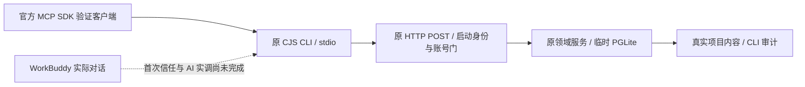

# T-1060 继续验证：CreatorOS 的 WorkBuddy 连接器侧

## 当场结论

**CreatorOS 连接器侧实跑通过。WorkBuddy 的 AI 及真实客户端调用仍待验。**

本轮用现有官方 MCP SDK 启动原生产 CJS CLI，通过真实 stdio 与 HTTP 调用，读取本轮新建的临时 PGLite 账号、项目和作品列表。没有使用假返回、没有重新实现 MCP 协议；原 HTTP `POST`、loopback/启动身份门、CLI 凭据门、账号属主、域 transport/service/repository、CLI 审计全部参与。仅把原 `persistence-client` 的宿主实例换成真实隔离服务实例，并在纯 Node 验证宿主中去掉 `server-only` 的构建标记；没有启动完整 Next/Tauri/WorkBuddy UI。因此不计作 WorkBuddy 跨应用或完整桌面验收。

## 实际执行

| 检查 | 结果 |
| --- | --- |
| 原包装脚本重新生成 ZIP | SHA256 `5249047f7a40ec544385dbac94033059882e9829554e74eb76d9f5437a0893f9`，与既有工件一致；无个人路径与凭据。 |
| 原 `build-runtime.mjs` 构建 CLI | 成功，原脚本自带 operations describe 冒烟成功；输出路径含中文，独立 argv，无 shell。 |
| stdio initialize | `creatoros@0.1.0`，实际启动子进程。 |
| tools/list | 368 个工具，161 个 readOnlyHint；按实际列表核对 Skill 中 8 个读取工具名。 |
| accounts_list | HTTP 200，仅本临时用户的 1 个账号，没有返回外来用户账号。 |
| projects_list → projects_get | HTTP 200，真实临时项目 `隔离 MCP 验证 · 松林晨光 f3e81f3f`，真实 ID/title 一致。 |
| projects_outputs_list | HTTP 200，真实空列表 0。 |
| 未选择账号 | HTTP 428，原 `AccountRequiredError`。 |
| 外来账号/项目 | HTTP 404，原属主门拒绝。 |
| 无 apply 写入 | MCP 工具错误，未发 HTTP，请求前后原项目标题一致。 |
| 临时凭据撤销后复用原连接 | 下一次调用 HTTP 403，立即拒绝。 |
| MCP 关闭 | EOF，子进程 exit 0 / signal null，close 120ms；未强杀。 |
| 原 CLI 审计 | 4 条真实 succeeded、2 条实际 failed。前置身份拒绝没有伪造业务审计行。 |

共 13 项隔离集成检查通过；9 次 tools/call、8 次真实 HTTP dispatch，范围见 `stdio-evidence.json`。这不是 13 次 WorkBuddy AI 调用。

## WorkBuddy 与未验证项

当场只读安装信息确认 `/Applications/WorkBuddy.app` 为 5.2.5，`com.workbuddy.workbuddy`；PATH 没有独立 `workbuddy`/`WorkBuddy`。不调用已排除的 CodeBuddy，不读取/复制 `auth.json`，不读原用户数据库或模型密钥，不操作 Agent 配置、安装或首次信任。

约定的 5 个 `WORKBUDDY_*` 官方 OAuth 环境变量存在性仍均为 false；只检查布尔值，没有输出值。此结论不等于用户未登录，也不等于 WorkBuddy 不能用。原 WorkBuddy 信任状态未读取，未知。

WorkBuddy 本轮实际 AI 提示 **0**、实际 WorkBuddy 客户端工具调用 **0**。尚需其原客户端安装连接器并由用户确认首次信任，再对临时项目实调；或明确提供已有已审批第三方应用的独立 OAuth 授权，沿原官方 OpenAPI 验证。本轮不新增 SDK/运行器来替代这些必要前提。

没有验证完整桌面打包、Windows/Linux、发布、写操作采纳，也没有把 SDK 连接成功冒充 WorkBuddy 成功。产品源码和主控制文件未修改。

## 证据

- `stdio-real-project.mts`：仅 /tmp 的集成 harness。
- `build-route.mjs` / `persistence-shim.ts` / `route-metafile.json`：原 HTTP 路由源码及唯一宿主装配替换。
- `stdio-real-project.log` / `stdio-stderr.log`：当场原始执行日志。
- `stdio-evidence.json`：检查、真实返回、原审计、真实退出信息。
- `environment-presence.json`：安装身份与安全环境存在性。
- `source-and-evidence-sha256.json`：原生产源码与验证工件摘要。
- 原包装脚本实际产物在 `/tmp/t1060-ai-business/continue-workbuddy/package/`，未安装；本归档只保留运行回执和摘要，没有复制此目录。

凭据文件已经删除。原 `/tmp/t1060-ai-business/continue-workbuddy/isolated-mcp-OgqE9P/resolved-mcp.json` 只含本轮临时连接文件路径，无 token，本归档没有复制此文件。原始日志不改成后补的成功记录。
