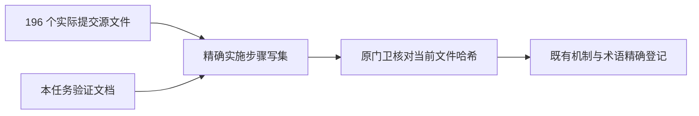

# T1060 提交后治理登记修复独立复核

## 结论

`findings: []`。本次控制面修复忠实于已授权范围：实施步骤收窄到真实提交文件，按精确哈希登记原有机制/验证术语，没有放宽门卫、历史基线或产品授权。该结论不授予工作树其他旧 WIP 的交付权限，也不改变真实工具、图片、WorkBuddy、干净检出或跨平台待验状态。

## 实际核对

1. 已读取提交 `c9c59617f7f74259985719e3f8927b9288eda11a` 及其父提交的差异。除控制面、SPEC 与本任务证据目录外，实际源文件恰为 196 个；与 `docs/verification/t1060/write-files.json` 完全一致，无漏项、额外源文件或重复目录豁免。当前实施步骤恰为这 196 个精确路径加 `docs/verification/t1060/**`，合计 197 项。总体 `write_set` 和其余四个步骤均与源码提交中的配置相同。
2. 五个源码接点的本次提交差异是：外部聊天 runner 注入、原 Worker Codex 分支与原回执提交、原请求 IO/监督器的受控环境透传、组合根的真实状态/图片存储接线。原 IPC 已存在于父提交；组合根的 Rust/keychain/keyring/daemon 词项也已存在于父提交的旧注释及接口。没有新增另一套通信、凭据存储或进程/任务权威。
3. 当前八个新增条目均为 `T-1060`、单精确文件、`in-budget`，绑定 `DEC-T1060-01` 与本 SPEC；读取时八个哈希均与当前文件字节匹配。四个源码文件含旧 WIP，与实际提交 blob 不同，条目明确说明旧 WIP 不属于本轮提交。`request-io.service.ts` 当前字节与源码提交相同。只登记当前扫描所遇到的既有机制，不把整文件旧改动变为本任务新增授权。
4. 三份验证文档只记录沿原 Rust 模块的隔离编译/测试：`verification.md`、`workbuddy-native-review.md`、`workbuddy-native-test.json`。其范围明确是 macOS 的隔离 crate、1 项测试通过而 9 项过滤，不是完整桌面构建或跨平台启动。没有声明安装新的语言工具链、凭据机制或运行时。
5. `governance-guard.mjs`、`progress.mjs`、`SCOPE_AUTHORIZATIONS.json` 与源码提交父版本完全相同；复杂度账本 `historical_baselines` 与源码提交相同。门卫仍要求同 task/file/category/sha256 精确匹配，旧哈希失效后继续拒绝。五条原 T1060 条目只有 `pnpm-lock.yaml` 的文件哈希被重绑到当前混合工作树字节，处置/类别/范围理由未放宽。
6. DEC 补记和验证报告保留原失败、196 文件源提交边界、混合文件取舍，以及真实工具和宿主待验事实。现有 reconcile 配置的工作树差异是其他旧任务增加检查；本轮没有删除或降低这些检查，也没有改违规基线来消除失败。

## 分离工作树与提交内容

后续暂存的混合源码和 lock 条目须绑定实际暂存 blob；工作树继续使用当前 WIP 的精确哈希。这是两套不同字节的真实登记，不能复制工作树哈希冒充提交哈希，也不能借重绑承诺省略实际核对。父会话已明确采用此方式；本复核评价当前修复和这个登记原则，不冒称尚未读取的后续暂存内容已经通过。

本独立复核仅执行只读 Git/文件核对；未运行浏览器、模型、产品测试或控制面命令，未写共享文件，仅将本报告写入 `/tmp`。
