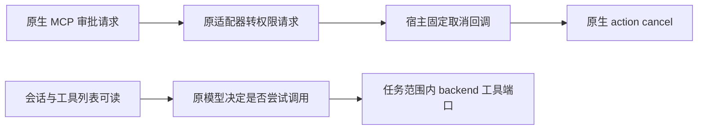

# T-1060 工具权限与模型目录只读核对

共享树未写；本轮未发送 prompt、调用模型、执行工具、读取或复制认证文件、修改 Agent 全局配置。唯一运行探针在临时空项目中创建会话并读取原 native `model/list`；只输出模型 ID、选中模型、字段名及能力字段。

## 当前结论

父代理的新真实探针已得到 Code Mode host 被禁用的原警告，工具调用和工具事件均为 0。现有证据支持记录当前工具能力未就绪；不能据字段缺失关闭已验证成功的合法纯文本会话。没有新增 guard 或模式启用补丁。

实际目录证据：`/tmp/t1060-model-compat/evidence/native-model-catalog.log`。

- 原线程选择模型 `gpt-6.1-sol`；这是目录事实，不作为代码分支。
- 原 native 返回八个模型，字段与固定 adapter 2.1.1 的 `Model.ts` 一致。
- 无 `toolMode`、`tool_mode`、`toolCallMode`、`tool_call_mode`、`supportedToolModes`、`supported_tool_modes` 或 `capabilities` 字段。
- 固定 `ModelProviderCapabilitiesReadResponse.ts` 仅公开 `namespaceTools`、`imageGeneration`、`webSearch` 三个布尔，不能推出 Code Mode 能否执行。
- `created=true`、`promptSent=false`；只证明会话和目录可读。目录不提供工具模式的结构化证明。

原 `ModelInfo` 内部信息没有通过当前固定 `model/list` 公共响应暴露；不能发明响应字段、枚举，或按模型名称作兼容判断，也不能读取另一个缓存文件冒充当场 native 目录。

## 固定 adapter 的真实审批路径

下列六份权限/报告源码 SHA 与已归档的固定上游运行源码完全一致，见 `evidence/permission-source-sha256.json`。

| 实际路径 | 源码事实 |
| --- | --- |
| native elicitation | `CodexAppServerClient.ts:266` 接收原 `mcpServer/elicitation/request`，按真实 threadId 找 elicitation handler；过期或缺 handler 时原样 cancel。 |
| MCP 工具审批识别 | `permissions/mcp.ts:34` 仅识别原 `_meta.codex_approval_kind="mcp_tool_call"`；`CodexElicitationHandler.ts:335` 同时要求 message-only form。 |
| 转 ACP 权限请求 | `CodexElicitationHandler.ts:220` 经原 `buildMcpPermissionRequest` 发 `session/request_permission`；`permissions/mcp.ts:115` 记录 `_meta.is_mcp_tool_approval=true`。 |
| 原宿主决策优先 | `acpx/src/acp/client.ts:2201` 先调用宿主 callback，只有 undefined 才落到 permissionMode。`codex-acp-host.ts:35` 固定返回 `{outcome:"cancel"}`。 |
| 回传原许可结果 | `acpx/src/permissions.ts:461` 转 ACP cancelled；`codex-acp/src/permissions/mcp.ts:136` 转 native `action:"cancel"`。`deny-all` 是后备拒绝门，单独改它不会越过当前固定 callback。 |
| 权限种类区分 | `permissions/CodexApprovalHandler.ts` 处理命令、文件、网络/权限 profile；MCP 工具审批走 `CodexElicitationHandler`，不能将两者混为同一个审批类型。 |
| 工具事件 | `McpToolReporter.ts:13` 所有 MCP 调用展示为 `kind:"execute"`；`ToolStatus.ts` 把 failed/declined/interrupted 都映射成 ACP failed，单看 kind/status 不能确定取消原因。原结果/错误保留在 `rawOutput`。 |

当前桥 `external-task-mcp-bridge.ts:28` 返回 name/description/inputSchema，没有 MCP annotations。固定 adapter 本身不按 `readOnlyHint` 判断首信任审批；是否提出审批由原生 Codex 决定。缺 hint 不是当前失败因果的证据，父代理当场的 Code Mode 警告已说明另一条模式限制。

任务执行仍有后台门：`external-task-tool.service.ts:36` 只开放原任务冻结且 effect 为 none/proposal 的合法宿主工具；第 88 行调用原 `tool.approve`，结果必须为 not-applicable，其他结果保存 blocked 原回执。MCP native 审批和该后台审批属于不同边界，不能互相替代。

## 最窄交付建议

1. 现有 `available` 保持会话连通语义，前端状态措辞收窄为“本地 Codex 会话已连接；工具和图片生成能力未核验”。状态 worker 当前只创建零工具会话，不冒称完整工具链 PASS。
2. 原 Code Mode host 警告继续透传正文；启用工具模式属于 T1057 未授权的安全方向，本轮不启用、不新建 runner、不新增公共能力字段。
3. 如后续需处理真实 MCP 审批，先留存原请求类型、真实 session/turn/tool identity、原 callback 取消结果。任何 allow_once、会话授权或永久授权都改变当前 SPEC 第 53 行的 cancelled 合同，应先完成范围评审与更新，不能在此自动批准。
4. 仅在任务目录和原工具元数据能如实证明时考虑传递标准 annotations；不能把所有 proposal 标只读，也不能把 hint 当授权或真实执行证明。

若父代理继续观察已有探针：原 `AcpClient.prompt` 第五参数支持只记录后仍返回 cancel 的 permission callback。观察 `_meta.is_mcp_tool_approval` 布尔、真实工具调用 ID、状态与安全错误分类即可；不 dump 原 rawInput、描述、URL 或 headers。权限请求计数 0、工具事件 0 仅表示本回合未发生可见工具尝试，不能据此编造模型的通用能力结论。

完整路径根：`/Users/zyongzhu/.codex/worktrees/user-diagnostics/Thirdspace-creator/ai-worker/vendor/`。目录类型固定源码在 `/tmp/t1060-source/codex-acp/src/app-server/v2/`。目录探针及源码 SHA 见 `/tmp/t1060-model-compat/evidence/catalog-source-sha256.json`。没有本轮测试或工具链 PASS 主张。
