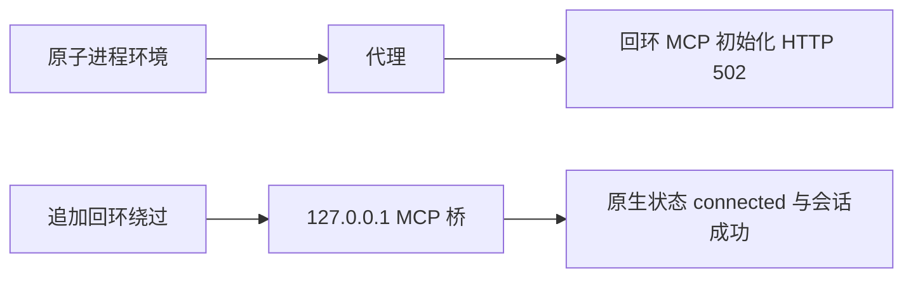

# T-1060 回环 MCP 初始化修复交付

本轮只在 `/tmp/t1060-mcp-compat` 改源和执行隔离验证；共享树未写。只创建临时空项目中的 ACP 会话，没有发送模型 prompt、执行工具、读取/复制认证文件或修改 Agent 全局配置。

## 根因与修复

原生产 host 继承远程代理，却没有固定回环绕过。真实 MCP 初始化请求返回 HTTP 502，原生状态页中请求的 MCP 为 `failed`，工具列表没有读取。随后原策略校验拒绝，ACP 外层把原因包成 `-32603 / Internal error`；外层消息没有 `CODEX_CAPABILITY_UNVERIFIED` 不能证明策略没有拒绝。

仅 host 环境增加 `codexAcpRuntimeEnvironment`，复用原环境白名单，保留原代理与大小写绕过项，再为子进程追加 `127.0.0.1`、`localhost`、`::1` 的 `NO_PROXY/no_proxy`。不扩大成全网绕过，不改变全局配置、权限、协议、工具桥或执行器。

## 可应用补丁

先应用测试补丁再应用实现补丁：

- `/tmp/t1060-mcp-proxy-tests.patch`：只新增 `ai-worker/src/execution/codex-acp-host.test.ts`，三个聚焦环境合同。
- `/tmp/t1060-mcp-proxy-implementation.patch`：只修改 `ai-worker/src/execution/codex-acp-host.ts`。
- 基准文件 SHA：`/tmp/t1060-mcp-compat/source-before.json`。
- 补丁 SHA：`/tmp/t1060-mcp-compat/evidence/patch-sha256.json`。

## 当场证据

| 证据 | 结果 |
| --- | --- |
| `evidence/session-red.log` | 原生产 host 与 adapter：会话失败、listCalls=0、toolCalls=0、promptSent=false。 |
| `evidence/session-status-diagnostic.log` | 隔离原 adapter 临时安全阶段诊断：threadStart 成功，原生 MCP 初始化 HTTP 502，随后真实策略拒绝；全局 MCP 均 disabled。只输出键名、枚举、工具数量及删去密钥的必要短文。 |
| `evidence/session-proxy-green-attempt.log` | 隔离 host 初始回环绕过修复：请求 MCP connected，准确唯一 fixture 工具，全局 MCP disabled；会话成功。 |
| `evidence/unit-red-baseline.log` | 原 host 基准、Vitest retry=0：三个合同真实失败，缺新增环境函数。 |
| `evidence/unit-green.log` | 最终 host、Vitest retry=0：三个合同通过。 |
| `evidence/session-final-green.log` | 最终 host +未经诊断修改的原生产 adapter：created=true、真实 sessionId 存在、listCalls=2、toolCalls=0、promptSent=false。 |

路径均相对于 `/tmp/t1060-mcp-compat`。探针源码为 `session-probe.ts`；最终探针用原生产 `codex-acp.cjs`，没有携带隔离诊断修改。`vendor/codex-acp` 中临时诊断源仅用于定位，不能提交或打包进产品。

测试环境为本机 Node 25.9.0。未运行项目全量 type/lint/Gate，没有真实模型输出、后台数据库工具执行、图片生成、Windows 真机或终端端到端 PASS 主张。父代理应整合后运行本轮授权验证。

## 准备阶段调整记录

首次把完整探针打成 CJS 时误把 fs-safe 也打入，运行前出现 `createRequire(undefined)`；改为与项目构建一致的 fs-safe external 后才取得真实会话 RED。首次隔离阶段诊断插入的函数边界错误，esbuild 报语法错，修正后才运行诊断；该次命令仍用旧 adapter 得到相同失败，没有被记为策略定位 PASS。首次测试基准复制用了错误相对路径，未复制成功；保留 `unit-red.log`，随后绝对路径重置原生产基准并重跑的正式 RED 为 `unit-red-baseline.log`。上述准备失败不冒充真实接入验证。
