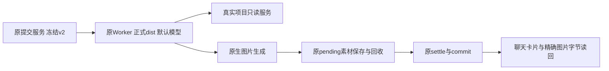

# T1060 正式 v2 默认模型真实业务验证

验证于 2026-10-04 完成，两次原默认模型请求均成功，retry 0。全程仅使用临时数据库、临时账号、临时项目和临时对象存储；未采用、未发布，未改共享源码、全局 Agent 配置或原账号项目。

## 当场结果

|链路|结果|真实证明|
|---|---|---|
|默认模型 MCP 读项目|PASS|原 context.project.detail 执行与 external_tool settled 回执，返回真实 Project ID 和未在prompt泄露的随机标题；task/business succeeded、聊天消息读回|
|默认模型同任务原生图片|PASS|同任务先读项目再实际 image_gen；原 saveImage/recover/重复保存幂等，原 Worker settle→commit；图片仍 pending，精确 file 字节与 SHA 一致，跨账号读取被拒|
|聊天图片卡片与执行身份|PASS|PGlite 实际 native.image 卡片 asset/file 与回执一致；聊天 metadata session/turn、aiTaskResult executionCallId 对齐|

## 身份与字节

- 读取 session：`01a106d5-4602-7170-840b-f7ae821ec9b2`；provider turn：`01a106d5-53ed-7ca2-81fa-aac09c7b28f3`；真实工具 call：`2`。
- 图片 session：`01a106d5-a09c-7b63-b62a-ff1b50466d64`；provider turn：`01a106d5-a15e-72b3-af1e-a6ee0ad6c251`；真实生图 tool call：`call_3q4XA4iQh75vPlCsJAe9n3Be`。
- 图片父后台 call：`call_8b848b49-2bb8-4801-b81d-f0a9706f339f`；执行任务：`execution-task-25be0798-3c55-4b27-aedf-92298c770bcb`。
- PNG：1674537 字节，1254×1254；SHA256：`db68d271ab7922c41722e12b0fc25ba73c6f1740446e00e67e935e65cbfc077a`。
- 原图：`/tmp/t1060-ai-business/default-codex-v2-image-VKo9rx/db68d271ab7922c41722e12b0fc25ba73c6f1740446e00e67e935e65cbfc077a.png`。
- 正式 host dist SHA256：`b742742f14649dee5a358d9ff20747c4b39c75ea4de92d69c94b52589fa9cd10`。

## 可复现工件

- `/tmp/t1060-ai-business/default-codex-v2-business.mts`：原提交、租约领取、冻结 hostContext/官方 Skill、原 createChatReadTaskToolHost + 真实 Projects/Artifacts/Publishing、externalTaskToolService、runCodexAcpInWorker、原 pending服务、settle/commit。
- `/tmp/t1060-ai-business/default-codex-v2-card-readback.mts`：重新打开隔离 PGlite，核对真实消息卡片与模型回合身份。
- 原始 JSON：`default-codex-v2-read-evidence.json`、`default-codex-v2-image-evidence.json`、`default-codex-v2-card-readback.json`。
- 逐文件 SHA 与源码快照：`default-codex-v2-evidence-index.json`。
- 运行命令（工作目录原 backend；只写/tmp）：`./node_modules/.bin/tsx /tmp/t1060-ai-business/default-codex-v2-business.mts read`、同脚本 `image`；卡片读回同样用 tsx。

## 范围与诚实限制

模型选择沿原默认，未设置 sessionModel；持久回执未包含精确 model 名称，不虚构该字段。两条使用正式 v2 源码与正式 dist，未使用 prototype host。只冻结 context.project.detail 的 effect=none；原 host 短读取权限、后端 approve、ownership、lease 保留。其它不调用的辅助端口明确未装配，不制造内容或指标。项目无产物、无发布、无指标，回执如实空/0。

原模型文字仍包含 CodeMode host disabled warning，但本轮 MCP 与图片都有真实执行回执，不能再据这段 warning 推断 0 工具/0 图片。本轮没有额外捕获内部 ACP rawInput/approval metadata，因此不伪称存在这份 trace；成功调用、工具账本、模型 session/turn 与图片 tool ID 均已留下。

这份证据不代表 API/Pi 脚本→文章/图文生成、视频生成、浏览器 UI、真实 WorkBuddy 客户端或 Windows 打包已验证。没有可用安全 API/Pi 配置入口，不读取原用户数据库或原始认证去补验证。
