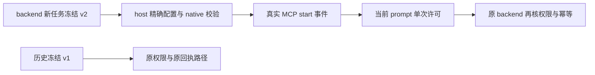

# T1060：正式 ACP v2 增量独立实施复核

## 结论

**本轮源码复核通过，findings=[]。** 这是实际生产增量的只读审查结论，不是模型、图片、UI、Windows 或整体产品真机验收通过。

本 Agent 未改共享仓库，未运行模型、测试、探针、安装、浏览器或读取凭据。报告写入 `/tmp/t1060-v2-implementation-review/`。审查基于当前 `HEAD` 差异与实际调用链；源码哈希见 `snapshot.json`，后续变更须按新哈希复核。

## 实际核对事实

### 1. 正式配置与真实回显

- `CreatorOsPolicy.ts:43-72` 用固定上游规则编码随机任务命名空间；仅 v2 接纳 `code_mode` 联合表。对象必须 `enabled=false`，直接列表只能包含 `image_gen` 与当前短任务命名空间，重复名称、未知字段和额外 namespace 拒绝；`non_prefixed_mcp_tool_names` 必须 false。
- `CreatorOsPolicy.ts:125-131` 对 native `config/read` 返回的列表与原 policy 声明列表进行集合精确比较，修复临时实验只核形状的证据缺口。原只读、审批、网络、无可写根及全局 MCP 禁用集合校验继续存在。
- `CreatorOsPolicy.ts:154-167` 再将声明列表与唯一请求任务 MCP 精确匹配；无 MCP 请求时必须恰为 `image_gen`。不开放 `functions`，不按模型名决定权限，不新增协议字段。
- 原 `CodexAcpClient.ts:716-739,876-886` 在 session 创建链中读取实际 native 配置，提交同一受控 thread config，再核实际 thread sandbox、原 MCP 启动与完整工具清单。请求值没有代替服务发现结果。直接 namespace 与 native `mcpServerStatus/list` 的原始工具名字段分开处理，没有读取不存在的 `tool_namespace`。

### 2. v1 冻结与 v2 新提交

- `contract/src/internal/chat-worker.ts:5-6` 将新提交绑定常量改为 v2，同时 schema 继续接纳明确冻结的 v1/v2；缺字段没有补默认绑定。
- 原 `chat-turn-submission.service.ts:76` 只在新 Codex 提交时用该绑定常量组装并冻结 modelInput；原已有任务 winner 不重写载荷。原输入摘要与 backend 归属校验继续解析冻结值。
- `codex-acp-worker-run.ts:44-47` 从冻结 binding 取 policy，既有 v1 仍用 v1；不把历史任务静默升级。旧无 binding 继续由原 dispatcher/native 分支接手。
- v2 先读取 backend 窄工具清单，列表为空时不启动 MCP bridge；host 只声明图片命名空间。v1 保留原建桥策略。未知/已启动回合的原拒重发逻辑未改变。

### 3. 真实工具事件与一次许可

- `codex-acp-host.ts:25-51` 仅接受原 `tool_call` start、`execute`、`in_progress`，从实际 `rawInput.server/tool` 建立 session/toolCallId 关联。服务器必须本轮 bridge 名，工具必须 backend 已冻结清单成员。标题、模糊文本、进度或许可更新不能创造关联。
- 原 `McpToolReporter.ts:13-23,42-44` 的 start 输入来自原 native MCP item 的 server/tool/arguments；原 renderer 将这些事实放入 `rawInput`。原 `permissions/lifecycle.ts` 与 `CodexElicitationHandler.ts:335-343` 从 native started item 按 thread/server 取真实 toolCallId，关联后的 permission request 不必重新携带 server/tool。这解释了 guard 使用已收到 start 事实，而不是猜测 permission 标题的必要性。
- 请求需要同一 raw/request session、原 MCP 审批标记、同一关联 toolCallId 与真实 `allow_once` 选项；成功后立即删除 pending 并记 consumed。重复许可、start 重放、终态、外来工具/服务器和无关联请求不能再次授权。v1 全部取消。始终不返回永久许可。
- 最新 `codex-acp-host.ts:75-77` 的构造器 fallback 始终取消，guard 只作为返回回调交给 `codex-acp-worker-run.ts:54` 当前 prompt。已核对这次最新修复，避免原 acpx 无 pending prompt 时使用 constructor fallback 批准。
- 原 acpx `client.ts:1316-1363,1425-1446,2173-2222,2311-2389` 保留 prompt owner、取消信号、替换/关闭核验与许可返回前再次检查；prompt 清理会移除 owner 并中止其 request controller。当前 Worker 创建新会话并只执行一次 prompt，guard 不成为跨任务许可服务。

### 4. backend 权限仍是执行权威

- host 一次许可只通过 Codex 工具调用审批，不授予产品业务执行权限。
- 原 `external-task-tool.service.ts:33-41,43-71,79-108` 每次按真实任务、账户/project、lease、冻结输入摘要、工具定义/版本/none 或 proposal 效应、started Agent 回合与输入校验重新绑定。原 `tool.approve` 只有 `not-applicable` 才继续执行，操作键和未知回执逻辑保持。提交、发布、文件与命令等工具不会通过这次 host 许可进入新清单。
- 原 MCP bridge 只监听回环，保持随机 Bearer、任务回合身份及 backend `executeExternalTaskTool` 端口。v2 改动没有替换该服务或原任务账本。

### 5. 补丁记录与相关断言

- `LOCAL_PATCHES.json` 的 CreatorOsPolicy 当前 SHA-256 与实际文件相等：`2b8b41c5eca3f89b56108cef94ce9c422cd05dd7a0ff693f961ed17698c2ec00`。原许可及固定来源记录未移除；官方直接 namespace 来源引用已登记。
- 只读查看的相关测试差异包含：native 回显少项/错项/重复/额外 namespace 拒绝，v1 联合表拒绝，v2 原唯一任务匹配及错误 argv 拒绝；工具关联、单次消耗、终态、重放、取消和 v1 拒绝；冻结 policy 传递、v2 空工具不建 MCP、Worker 使用返回的 prompt 回调；binding 新默认/历史值/缺字段兼容。
- 本 Agent 没有执行这些测试，也没有将源代码中的断言或主会话口头报告补记为本 Agent 的测试成功。最新构造器 fallback 修复按源码实际核对；整体客户端 owner/取消行为由原维护客户端承担。

## 留待真实验收的边界

正式默认模型是否成功调用窄 MCP、生成并经 backend 存入 pending 素材、真实字节读回及正式任务的 session/turn/tool 身份，需要本轮正式 host/Worker 的实际记录。此前 `/tmp` 适配器成功或生产 v1 的历史失败都不能替代这些验收。图片采用/发布、真界面与 Windows 启动没有本报告的通过结论。
