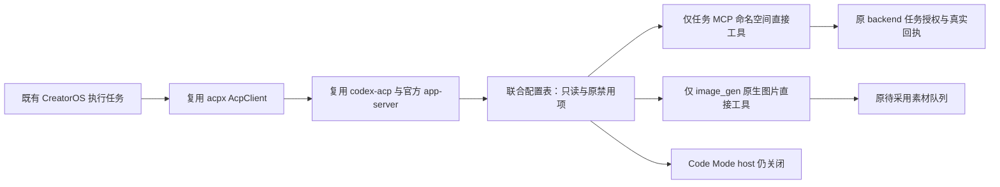

# T1060：默认 Codex 工具能力的只读复用研究

## 结论与证据边界

最窄的已有方案是使用 Codex 官方 `features.code_mode.direct_only_tool_namespaces`，仅将本次任务 MCP 命名空间和原生图片命名空间 `image_gen` 暴露为直接工具。可继续关闭 Code Mode host、shell、统一命令执行与 ACP 文件/终端回调，继续使用只读 sandbox 和原审批策略。无需编造工具模式字段，无需按模型名分支，也无需重写 ACP 或工具协议。

这是**固定版本源码支持的隔离验证候选**。本报告没有真实模型、工具调用、图片生成或 Windows 启动验收结论。主会话另行执行的真实调用须用实际事件与产物独立归档；现行生产 `creatoros-acp-readonly-v1` 仍只接纳 `code_mode=false`，不能将这个新联合表悄悄当成已通过原权限合同。

大白话：目前工具已经连上，但默认模型看到的主要入口是关闭了运行器的 Code Mode。官方有一个细粒度例外，能把选定工具直接交给模型，不必先开放命令或文件能力。



## 1. 当前失败原因

固定 `openai/codex` 提交 `01fc69f4026735edfdf6789820549727a4867b11` 的 workspace 版本为 `0.159.3`，许可 Apache-2.0。`requested_tool_mode` 优先使用真实 `model_info.tool_mode`；配置特性只在模型未给模式时参与选择。`effective_tool_mode` 仅给普通 `CodeMode` 在 host 不可用时提供有条件的 Direct 回退，`CodeModeOnly` 不走这一分支。因此关闭 `features.code_mode` 不能把模型元数据的 `CodeModeOnly` 改为 Direct。[固定模式选择源码](https://github.com/openai/codex/blob/01fc69f4026735edfdf6789820549727a4867b11/codex-rs/core/src/tools/mod.rs#L75-L97)

项目现状 `ai-worker/src/execution/codex-acp-host.ts:28-35` 与 `vendor/codex-acp/src/CreatorOsPolicy.ts:5-10,42-48,84-106` 同时禁用 `code_mode` 和 `code_mode_host`。项目真实诊断日志显示模型结束回合、MCP 服务发现发生，但工具调用为 0，并包含 host 被禁用的警告。本轮只读核对该既有日志，未自己调用模型。不能从发现成功推断模型已经成功调用工具。

## 2. 官方精确直接工具方案

`CodeModeConfigToml` 同时定义 `enabled` 与 `direct_only_tool_namespaces`；`FeaturesToml.code_mode` 是未加标记的 bool 或配置对象两种形式。`resolve_code_mode_config` 在配置对象中读取该列表，**不要求 `enabled=true` 才读取**。配置须替换原来的布尔值，不能同时把一个键当作 bool 和表。[字段定义](https://github.com/openai/codex/blob/01fc69f4026735edfdf6789820549727a4867b11/codex-rs/features/src/feature_configs.rs#L24-L46)、[联合类型](https://github.com/openai/codex/blob/01fc69f4026735edfdf6789820549727a4867b11/codex-rs/features/src/lib.rs#L900-L914)、[解析路径](https://github.com/openai/codex/blob/01fc69f4026735edfdf6789820549727a4867b11/codex-rs/core/src/config/mod.rs#L2717-L2747)

配置片段（名称必须换成该回合实际任务服务器的规范化命名空间）：

```toml
[features.code_mode]
enabled = false
direct_only_tool_namespaces = ["mcp__creatoros_task_<本回合12字符>", "image_gen"]
```

等价 JSON 字段：

```json
{
  "features": {
    "code_mode": {
      "enabled": false,
      "direct_only_tool_namespaces": ["mcp__creatoros_task_<本回合12字符>", "image_gen"]
    }
  }
}
```

等价单个 app-server 配置覆盖参数的内容是 `features.code_mode={enabled=false,direct_only_tool_namespaces=["实际任务命名空间","image_gen"]}`。它替代原 `features.code_mode=false` 参数；不要再追加与 bool 冲突的子键。以上均是片段，不包含 endpoint、令牌或任何凭据。

工具注册之后，`apply_direct_model_only_namespace_overrides` 对精确命名空间设置 `DirectModelOnly`；这一暴露类型会保留顶层工具，并从嵌套 Code Mode 工具集合中移除。该操作发生在 Code Mode 注册和模型可见工具构建前。MCP 自身暴露计划也识别同一精确列表，移除延迟与嵌套暴露。[注册与覆盖](https://github.com/openai/codex/blob/01fc69f4026735edfdf6789820549727a4867b11/codex-rs/core/src/tools/spec_plan.rs#L347-L369)、[精确覆盖](https://github.com/openai/codex/blob/01fc69f4026735edfdf6789820549727a4867b11/codex-rs/core/src/tools/spec_plan.rs#L520-L550)、[CodeModeOnly 隐藏条件](https://github.com/openai/codex/blob/01fc69f4026735edfdf6789820549727a4867b11/codex-rs/core/src/tools/spec_plan.rs#L794-L806)

上游现成 `code_mode_only_exposes_configured_dynamic_namespace_directly` 测试源码断言：即使 CodeModeOnly 与工具延迟开启，指定命名空间仍直接可见，延迟标记消失，exec 描述中不再含该工具。邻近测试展示 `functions` 会直接暴露公共工具，因此**不能用 `functions` 当作本任务命名空间**。本轮未执行这些 Rust 测试，未将源码断言记成当场测试成功。[现成测试](https://github.com/openai/codex/blob/01fc69f4026735edfdf6789820549727a4867b11/codex-rs/core/src/tools/spec_plan_tests.rs#L2609-L2677)

官方当前配置参考也列出同名公开配置项；固定版本兼容结论以以上源码为依据。[官方配置参考](https://learn.chatgpt.com/docs/config-file/config-reference)

### 2.1 MCP 命名空间不能用原始服务器名代替

当前随机服务器为 `creatoros-task-<12 ASCII 字符>`：

1. codex-acp 的 `McpServerName.ts` 只替换空白，横线在传给 Codex 时仍存在。
2. Codex 常规 MCP `ToolInfo` 起始命名空间是原始服务器名。
3. Codex 实际 sanitizer 只保留 ASCII 字母、数字、下划线，其余字符变为下划线。虽然邻近注释提到横线，实际代码仍将横线替换。
4. 默认再加 `mcp__` 前缀。因此当前单一短服务器对应 **`mcp__creatoros_task_<12字符>`**，工具名仍为 `t1060_read_verification_project`。
5. 多服务器命名碰撞、清洗碰撞或超长名称会追加摘要或截断。上述简单结果只适用于当前唯一、短、无冲突的临时 fixture，不是通用命名算法替代品。

[常规 MCP 起始身份](https://github.com/openai/codex/blob/01fc69f4026735edfdf6789820549727a4867b11/codex-rs/codex-mcp/src/rmcp_client.rs#L839-L856)、[实际清洗](https://github.com/openai/codex/blob/01fc69f4026735edfdf6789820549727a4867b11/codex-rs/codex-mcp/src/mcp/mod.rs#L572-L590)、[前缀与碰撞处理](https://github.com/openai/codex/blob/01fc69f4026735edfdf6789820549727a4867b11/codex-rs/codex-mcp/src/tools.rs#L108-L214)

`NonPrefixedMcpToolNames` 默认 false，但用户配置可能覆盖。隔离 probe 应核对其有效配置；若无法证明，应使用已有官方 `features.non_prefixed_mcp_tool_names=false` 的局部覆盖再校验，保持默认前缀规则。这只是关闭另一种命名方式，不授予工具执行权限。当前生产 v1 不接受该新增 feature 键，仍需限制在 `/tmp` probe。[默认值](https://github.com/openai/codex/blob/01fc69f4026735edfdf6789820549727a4867b11/codex-rs/features/src/lib.rs#L1428-L1433)、[前缀决策](https://github.com/openai/codex/blob/01fc69f4026735edfdf6789820549727a4867b11/codex-rs/core/src/config/mod.rs#L1875-L1879)

公开 `mcpServerStatus/list` 的 `tools` 返回原始 MCP `Tool`，不是内部 `ToolInfo`；没有可以直接读取的 `tool_namespace`。不要在协议响应中造这个字段。状态清单证明发现和允许工具集合，实际 `item/mcpToolCall` 的原始 server/tool 与完成回执才证明工具执行。[公开状态类型](https://github.com/openai/codex/blob/01fc69f4026735edfdf6789820549727a4867b11/codex-rs/app-server-protocol/schema/typescript/v2/McpServerStatus.ts)

### 2.2 原生图片命名空间

精确命名空间为 `image_gen`，函数为 `imagegen`，不是 feature 名 `image_generation`。扩展工具声明 `Direct` 暴露，可以参与上述直接命名空间覆盖。工具实际是否注册仍受 feature、账户资格、provider 的图片与命名空间能力、模型图片模态与真实认证通路限制。配置例外不能制造本来不存在或未获授权的图工具。[图片常量](https://github.com/openai/codex/blob/01fc69f4026735edfdf6789820549727a4867b11/codex-rs/ext/image-generation/src/lib.rs#L8-L9)、[工具身份与暴露](https://github.com/openai/codex/blob/01fc69f4026735edfdf6789820549727a4867b11/codex-rs/ext/image-generation/src/tool.rs#L119-L132)、[注册门槛](https://github.com/openai/codex/blob/01fc69f4026735edfdf6789820549727a4867b11/codex-rs/core/src/tools/spec_plan.rs#L727-L764)

## 3. 可复用的已有适配，不另建协议

| 来源 | 固定版本 / 许可 | 已有接点与效应 |
| --- | --- | --- |
| 官方 Codex | 0.159.3 / `01fc69f…` / Apache-2.0 | 上述配置、原 MCP 工具注册、原生图片及 Code Mode host 均已实现。 |
| agentclientprotocol/codex-acp | 2.1.1 / `68d7d2d5ddfc0ed5746f9f6130892dda685e65dd` / Apache-2.0 | `AgentMode.ts` 原 ReadOnly 模式、`CodexAcpClient.ts` 的会话级 MCP/config 接线、`CodexAppServerClient.ts` 原请求/回执与图片报告器。 |
| openclaw/acpx | 0.19.4 / `27efb1b57b9de22105a91e9154b1d29b51ede8cb` / MIT | `src/acp/client.ts`、`client-protocol.ts` 原进程/ACP 会话与排空接口，沿原调用链复用。 |

[codex-acp 原 ReadOnly 模式](https://github.com/agentclientprotocol/codex-acp/blob/68d7d2d5ddfc0ed5746f9f6130892dda685e65dd/src/AgentMode.ts#L39-L50)、[codex-acp 会话配置](https://github.com/agentclientprotocol/codex-acp/blob/68d7d2d5ddfc0ed5746f9f6130892dda685e65dd/src/CodexAcpClient.ts#L867-L896)、[acpx 原客户端](https://github.com/openclaw/acpx/blob/27efb1b57b9de22105a91e9154b1d29b51ede8cb/src/acp/client.ts)

上游 codex-acp 的普通分支会信任工作目录、合并附加目录等；不能通过回退到普通分支规避 CreatorOS 的控制校验。隔离 probe 可复制已固定源码，只扩展联合表与精确名称校验，其他原控制项继续核对；不复制历史凭据，不另建任务权威，不改变全局 config。

## 4. 官方 Code Mode host 是已有备选

若精确直接工具路径在真实模型中不可用，固定源码已有进程 host 与工具调度链；可研究启用 `features.code_mode_host` 并复用原 `ProcessOwnedCodeModeSessionProvider`。它由 `InstallContext` 找到原打包资源或平台二进制目录中的官方 host，不能随意硬编码新路径，也不需要新建远程服务或从零实现 JS 协议。[现成进程 provider](https://github.com/openai/codex/blob/01fc69f4026735edfdf6789820549727a4867b11/codex-rs/code-mode/src/remote_session.rs#L32-L90)、[原安装定位](https://github.com/openai/codex/blob/01fc69f4026735edfdf6789820549727a4867b11/codex-rs/install-context/src/lib.rs#L176-L206)

官方 host 使用 V8，工具对象来自本会话 enabled tools；全局构建没有暴露 Node fs/process，模块解析拒绝导入。嵌套工具仍走既有 Codex 工具调度，而 `ShellTool=false` 会阻止 shell 工具注册。这些源码事实不能代替完整 OS 隔离或安全验收，启用 host 也属于需要合同评审的执行能力变化。[全局工具对象](https://github.com/openai/codex/blob/01fc69f4026735edfdf6789820549727a4867b11/codex-rs/code-mode-runtime/src/runtime/globals.rs#L15-L56)、[拒绝模块导入](https://github.com/openai/codex/blob/01fc69f4026735edfdf6789820549727a4867b11/codex-rs/code-mode-runtime/src/runtime/module_loader.rs#L225-L236)、[shell 注册入口](https://github.com/openai/codex/blob/01fc69f4026735edfdf6789820549727a4867b11/codex-rs/core/src/tools/spec_plan.rs#L1079-L1115)

相比这条备选，直接工具例外保留 host 关闭，改动更窄，适合先做本次隔离验证。

## 5. 最窄临时验证建议

仅 `/tmp` 复制固定适配器源码，在原 `CreatorOsPolicy` 中允许：`code_mode` 对象只有 `enabled=false` 和 `direct_only_tool_namespaces`，名称集合严格等于本回合任务命名空间加 `image_gen`，无通配符、无 `functions`，启动参数与 `config/read` 回显采用同一联合表。实际 JSON/TOML 回显需核实，不能用 Node 对象构造成功代替 native 配置生效。

保留原有全局 MCP 禁用列表、仅本次任务服务、工具清单验证、ReadOnly/no-network sandbox、原审批、shell/unified_exec 禁用、ACP fs=false、terminal=false、未知权限拒绝及原图片候选归属与排空。MCP 工具执行授权由原 backend 任务端口决定，sandbox 的只读或 `readOnlyHint` 不等于服务端权限授权。[官方 MCP 工具范围配置](https://learn.chatgpt.com/docs/extend/mcp?surface=cli)

临时许可只能精确匹配唯一只读 fixture、真实调用身份及一次请求；其它命令、文件、网络或未知授权请求继续拒绝。不得通过宽泛 allow-all、关闭整个审批、扩大 sandbox 或恢复用户全局 MCP 配置获得表面成功。

分别观察：有效配置、thread 只读响应、确切 MCP 发现清单、实际工具调用事件及 server/tool、fixture 回执、图片事件及真实非空文件、排空后终态。CodeModeOnly 仍可能保留 host 不可用的 warning/exec 声明，直接工具注册存在不保证模型一定选择调用。只发现/只输出“已调用”文字/仅产生终态均不算工具成功。

若真实调用成功，只能结论为该固定组合在隔离 probe 中可用；下一步再独立审查完整合同、旧冻结任务兼容、权限覆盖、生产接线与回归。不得将 `/tmp` 成功写成生产 v1 已修复或 UI/Windows 真机全通过。

## 6. 归档

- 本报告只写 `/tmp`，共享仓库没有改动。
- `source-manifest.json` 含 44 份固定 Codex 源文件的 SHA-256、原维护桥/客户端快照核对与项目只读现状摘要。
- 9 次错误路径读取的 404 已保留为失败记录，未成为证据。首批部分文件未登记精确获取时间，清单如实置空，不补造。
- 本 Agent 没有运行模型、探针、测试、浏览器自动化或安装。上游测试只按源码阅读，其他主会话实跑证据须单独说明。
