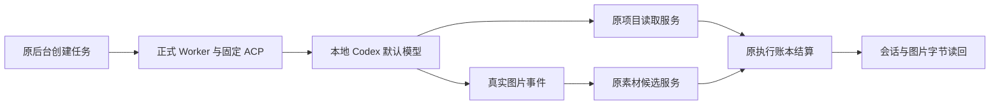

# T1060：AI 功能真实验证

日期：2026-10-04。用户要求自行验证 AI。工作树：`codex/user-diagnostics`。源码修复提交：`e2b1cd0862c8be1219d63794601c9b1a0accec97`，实际 Git 文件摘要匹配见 [提交回执](delivery.json)。

## 结论

本地 Codex 的文字回复、真实项目读取和原生生图已通过正式 Worker 与原后台服务的隔离实测。生成的图片已存为素材候选，原对象存储读回的字节与供应商实际输出相同。本轮隔离验证未获得可用的 API/Pi 模型配置，文章、图文等原生成入口尚不能证明可用；没有读取原用户数据库来补配置，这也不表示原用户未配置模型。这些入口的统一路由仍属 T1057。WorkBuddy 尚未完成首次连接信任和真实跨应用调用。

| 功能 | 当场结果 | 证据 |
| --- | --- | --- |
| Codex 默认模型文字回复 | 原提交、租约、Worker、结算、commit、会话读回通过 | [实际回执](v2-default-text-evidence.json) |
| Codex 读取当前项目 | 实际调用 `context.project.detail`，通过原读工具 host、Projects service、权限与账本，返回临时项目的真实信息 | [实际回执](default-codex-v2-read-evidence.json) |
| Codex 原生图片 | 同一任务先读项目再出图，原保存/恢复/重复保存幂等、结算和候选读回通过；其它账号读取拒绝 | [实际回执](default-codex-v2-image-evidence.json)、[实际 PNG](generated-lighthouse.png) |
| 聊天图片卡片 | 临时数据库重新打开后，原 `native.image` 卡片与同一素材、文件、session/turn/task 对齐 | [读回](default-codex-v2-card-readback.json) |
| API/Pi 脚本及衍生生成 | 未验证成功，未提供可用安全配置；没有用 Codex 对话成功冒充这些入口成功 | [配置存在性](api-env-presence.json) |
| WorkBuddy | 本机已安装，真实提示与工具调用均为 0；未安装连接器或确认首次信任 | [核查报告](workbuddy-report.md) |

所有业务验证都使用临时账户、项目、数据库与存储；候选未采用，未发布。没有浏览器、真界面、Windows/Linux 或正式安装包通过结论。

## 修复了什么

v1 的真实文字回复成功，但默认模型的 MCP 和生图为 0。固定 Codex 支持精确直接工具命名空间；本轮复用该上游配置，继续关闭 Code Mode host，只开放 `image_gen` 与当前任务 MCP。另一个实际阻断是宿主取消了 MCP 的原单次许可；v2 仅对真实调用事件、当前 prompt、相同 session/toolCallId/server 和后台冻结工具关联成功的请求返回 `allow_once`。原后台仍重核权限、租约、归属、输入和幂等。

新提交冻结 `creatoros-acp-readonly-v2`，旧 v1 不升级；无工具时只声明图片命名空间。native `config/read` 必须与声明的名称集合精确相等；额外工具、命名空间、永久许可和不相关审批拒绝。SPEC 独立复审 `PASS[REV:453827cbe2c1]`，实现独立复核 [findings=[]](implementation-review.md)。没有新建协议、执行器、任务表或按模型名分支。

原生警告仍如实保留在文字记录中：Code Mode host 被关闭。它说明该入口受限；此次授权的直接 MCP 和图片工具已实际执行，不能把这段警告当作整轮没有工具调用。没有通过隐藏警告制造成功。

## 真实身份与图片

- 项目读取：session `01a106d5-4602-7170-840b-f7ae821ec9b2`，provider turn `01a106d5-53ed-7ca2-81fa-aac09c7b28f3`；原 MCP 请求 ID 为 `2`，这是桥协议请求 ID，没有冒充原生模型 tool ID。
- 图片：session `01a106d5-a09c-7b63-b62a-ff1b50466d64`，provider turn `01a106d5-a15e-72b3-af1e-a6ee0ad6c251`，原生 image tool ID `call_3q4XA4iQh75vPlCsJAe9n3Be`。
- PNG：1,674,537 字节、实际 1254×1254 像素，SHA-256 `db68d271ab7922c41722e12b0fc25ba73c6f1740446e00e67e935e65cbfc077a`。已视读为真实灯塔插画；素材仍为 pending。隔离 TypeScript ESM 环境的 ffprobe 读取缺 require 时，数据库尺寸元数据留空，不补造尺寸。

## 可重现的检查与诚实边界

| 检查 | 结果 | 记录 |
| --- | --- | --- |
| 新增断言实施前红测 | 4 项失败、11 项通过，随后修复；另保留继承默认重试的首个日志 | [无重试红测](v2-red-no-retry.log)、[初次记录](v2-red.log) |
| Worker 协议、权限、冻结、图片、通知 | 7 文件 34 项通过，retry=0 | [最终测试](v2-worker-suite-final.log) |
| 原后台工具与图片服务 | 2 文件 11 项通过，retry=0 | [测试](v2-backend-suite.log) |
| 新提交 v2 绑定 | 1 项通过、23 项未运行，retry=0 | [测试](v2-submission-final.log) |
| 工作树 Worker build / tsc | 当场通过；CJS import.meta 构建警告保留 | [构建](v2-build-delivery.log)、[类型](v2-typecheck-delivery.log) |
| 本轮权限及来源预算 | 精确文件检查通过 | [检查](v2-scoped-governance.log) |
| orphan | 0 error、100 warning，链路通过 | [检查](v2-orphan.log) |
| pmem / reconcile | sync 已运行；全局仍 34 error、1 warning，与 v1 相比新增 0；LED-047 当场通过 | [全局检查](v2-reconcile.log)、[差异](v2-reconcile-delta.json) |

全局遗留失败仍由原 T1026/T1027/T1015/T916 等任务承接，未改门卫或历史基线。纯提交检出的既有 Worker 依赖缺口继续沿 [原记录](../commit-dependencies.md) 保留；工作树构建成功没有变成发行通过。T1060 保留进行中、待验，WorkBuddy、真界面与发行检查尚未完成。

v1 失败和临时试验日志均保留：默认 [图片失败](codex-native-image.log)、旧模型 [图片](codex-legacy-native-image.log) 与 [MCP 取消](codex-legacy-mcp.log)、临时 [直接 MCP](codex-direct-namespace-mcp.log) 和 [图片](codex-direct-namespace-image.log)。单独旧图片存储验证见 [独立收据](legacy-image-storage-only-evidence.json)，没有将分开的模型与存储回合冒充同任务通过。正式 v2 结果以上表为准。

上游固定来源见 [研究](upstream-direct-namespace-research.md) 和 [摘要](upstream-direct-namespace-sources.json)。本轮源文件见 [v2 源码摘要](v2-source-sha256.json)。未复制 WorkBuddy 闭源源码或原始认证资料。
