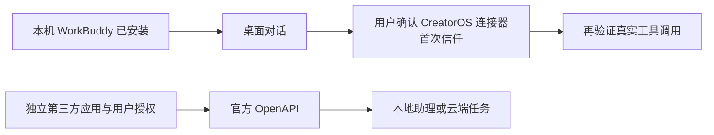

# WorkBuddy 本机 AI 调用核查

## 结论

本机安装了 WorkBuddy 5.2.5。此次核查没有找到满足“独立 WorkBuddy、临时项目与配置、不取桌面认证、不改全局配置”的已确认官方单次调用入口，因此没有发送 AI 提示，也没有验证 WorkBuddy 的 AI 或 CreatorOS 工具调用成功。

WorkBuddy 的官方 OpenAPI 确实支持非 GUI 调用；不能因此把当前桌面登录当作可直接调用的票据。它需要开放平台第三方应用和用户 OAuth 授权，当前未提供这种显式调用凭据。不是“WorkBuddy 只有 GUI”。

## 当场事实

| 核查项 | 事实与边界 |
| --- | --- |
| 应用 | `/Applications/WorkBuddy.app`，`com.workbuddy.workbuddy`，版本 5.2.5。PATH 中没有 `workbuddy` 或 `WorkBuddy` 命令。 |
| 内置 CLI | `Contents/Resources/app.asar.unpacked/cli/bin/codebuddy`；发布身份 `@tencent-ai/codebuddy-code` 2.106.4，入口常量 `CodeBuddy Code`。用户已排除 CodeBuddy，本轮没有运行它。 |
| 真实桌面后端 | `createWorkbuddyAppServerCodeBackend` 确实选择上述内置 CLI，同时注入 WorkBuddy 产品配置、登录网关环境和连接器能力。因此“应用内部使用 CLI”不等于“已有可直接授权的 WorkBuddy 独立调用”。 |
| 临时目录 | 原代码支持 `WORKBUDDY_CONFIG_DIR` 与 `WORKBUDDY_USER_DATA_DIR`。这些只能证明目录可配置，不能证明临时目录可继续使用原桌面登录。没有复制认证补齐它。 |
| 托管 app-server | 原入口注明 Electron 母端持有桌面能力和生命周期；启动后需要父端认证解密桥，并执行启动迁移、插件与后台服务。不将其改造成新的单次执行器，也没有启动它。 |
| 官方 OpenAPI | 本地助理 `POST /openapi/v2/localassistant/message` 需要 `user.localassistant.invokable`；云任务 `POST /openapi/v2/tasks` 需要 `user.task.invokable`。都需独立第三方应用及用户授权。PC助理接口不承诺指定临时工作目录或 profile。 |
| 当前显式票据 | 仅检查约定的五个 `WORKBUDDY_*` OAuth 环境变量是否存在，均为 false；没有搜索用户票据或输出值。这不表示桌面用户未登录。 |
| 既有集成 | 当前项目提供外部 CreatorOS MCP 连接器，不提供 WorkBuddy 内置执行引擎。README要求用户客户端首次信任；此次没有执行安装、信任或真实跨应用调用。 |

公开接口依据：[官方 OpenAPI](https://open.workbuddy.cn/docs/openapi)、[第三方应用](https://open.workbuddy.cn/docs/third-party-app)。搜索到的 [headless 文档](https://www.workbuddy.cn/docs/cli/headless) 正文为 CodeBuddy Code，不能当作独立 WorkBuddy 入口。官方 [连接器文档](https://open.workbuddy.cn/docs/connector) 的 CLI + Skill 是让 WorkBuddy 调度外部工具。

## 核心源锚

以下为当场从应用发布包只读提取的副本，完整摘要见 `source-records.json`；没有提取任何用户认证或配置。

- `app.asar!main/seed-builtin-plugins.js:2807`：`buildAgentCliRuntimeEnv`，配置目录、`CODEBUDDY_HOST=workbuddy-desktop`、`gatewaySecretEnv` 与 WorkBuddy 产品来源。
- `app.asar!main/seed-builtin-plugins.js:2987`：`resolveAgentCliRuntimeDirs`；`:2997` 配置目录、`:3000` 数据目录。
- `app.asar!main/seed-builtin-plugins.js:73005`：`createWorkbuddyAppServerCodeBackend`；`:73034` 原认证状态检查；`:73038` 内置 CLI路径解析；`:73049` 真实环境装配。
- `app.asar!main/seed-builtin-plugins.js:196163`：原 `buildAgentCliRuntimeArgs`；不要从默认权限模式或桌面信任设置推导本轮可自动授权。
- `app.asar!main/daemon-app-server-entry.js:4`：原托管 stdio入口说明；`main/daemon-app-server-main.js:257` 桌面母端桥，`:266` 原认证解密桥，`:449` 启动迁移。
- `cli/bin/codebuddy:16`：CodeBuddy身份常量；`:138`起静态 headless/help分流。没有执行 `--help`，因为不存在已确认独立 WorkBuddy帮助入口。
- 项目 `scripts/workbuddy/README.md:3` 外部工具集成定位；`:9` 用户配置路径；`:10` 首次信任；`:15` 不把配置复制成功当作工具可用。
- 项目 `docs/features/t1060-agent-source-integration.md:59`–`:63`：原 WorkBuddy范围和禁止自动覆盖/信任；本报告不扩大合同。

## 验证记录与后续

- 实际运行仅为读取应用安装信息、发布代码、官方文档与环境变量存在性。一个广泛应用代码扫描因耗时被终止，随后用固定字符串与指定模块完成只读核对，没有执行应用模块。
- 真实 WorkBuddy AI 提示 **0**，真实工具调用 **0**；结论是 **待验证**。
- 可继续的合法路径：用户在原 WorkBuddy 客户端安装既有连接器并确认首次信任后，验证临时项目的真实读取；或者提供已审批第三方应用的独立 OAuth 授权，通过原官方 OpenAPI验证。此次不新增 API SDK、协议、运行器，也不把 CodeBuddy替代入口计为通过。
- 本报告不判断模型效果或 WorkBuddy整体故障；仅说明当前允许边界下无法完成其非 GUI 真机验证。

## 工件

- `installation.json`：安装身份与入口现状。
- `openapi-auth-presence.json`：仅显式变量是否存在，无值。
- `verification-status.json`：执行与禁止项的当场记录。
- `source-records.json`：安装发布代码摘要。
- `official-sources.json`：官方来源。
- `application-source/`：当场读取的指定应用发布源码副本，仅供核查，不是产品迁入候选。
